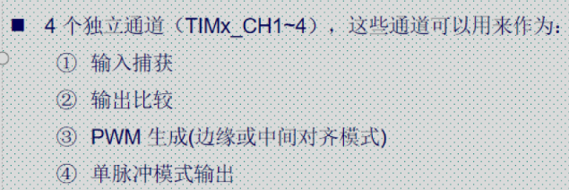
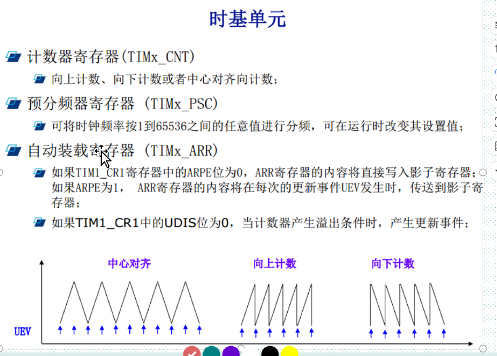

# 10.30

### 1基本定时器

1 基本定时器 只有定时功能

2 通用定时器 IC/OC/PWM 输入捕获 输出比较 PWM

3 高级定时器 IC/OC/PWM 

### 2定时器的时钟

虽然定时2324567是挂载在APB1上的,但是由于时钟树的要求,他是需要进行X2的,所以后续时钟计算时要以72Mhz作为时钟源进行计算的

### 3定时器通道

注意:每个通道都可以使用这四种功能,但是配置的话只能配置一种,每个通道的定时器是独立的,不会互相影响也不会共享资源.

### 4寄存器的作用

计数器寄存器:存放的是计数值,如果向上计数,那么里面存放的就是从零到重装载值之间的值

预分频寄存器 对定时器挂载的时钟线进行分频的,234567,挂载在APB1上

自动装载寄存器