# 01day   单片机模板创建

## 一、笔记的设置

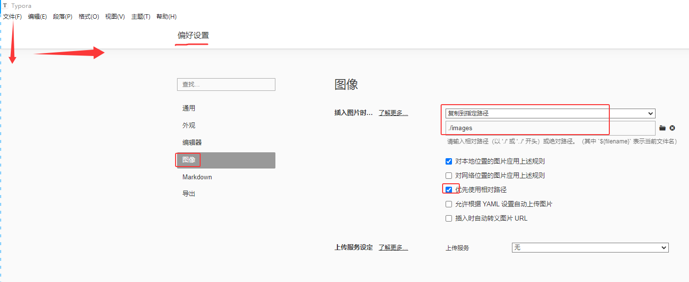

## 二、51单片机软件的使用


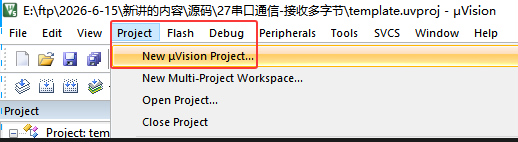

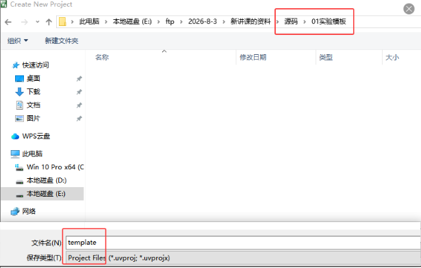

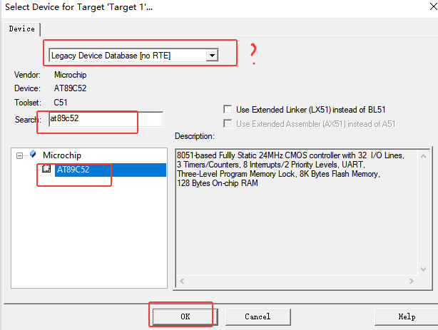

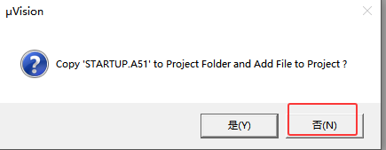

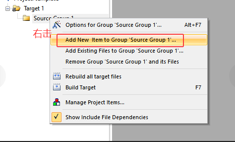

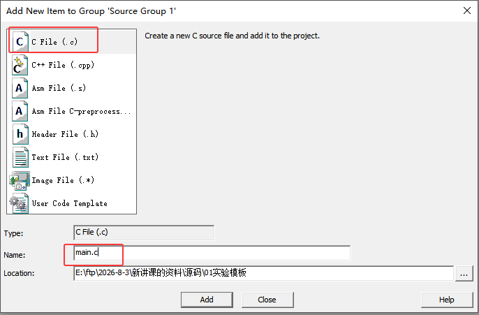

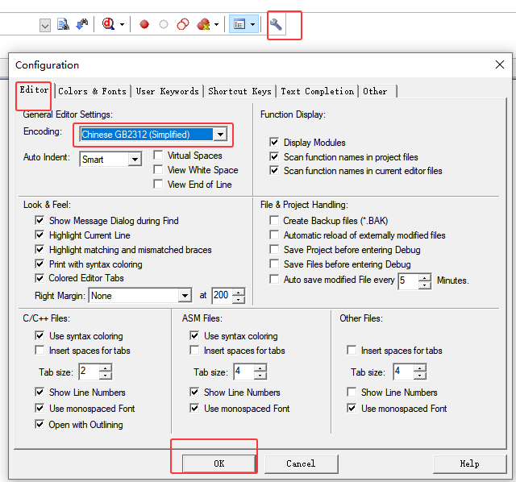

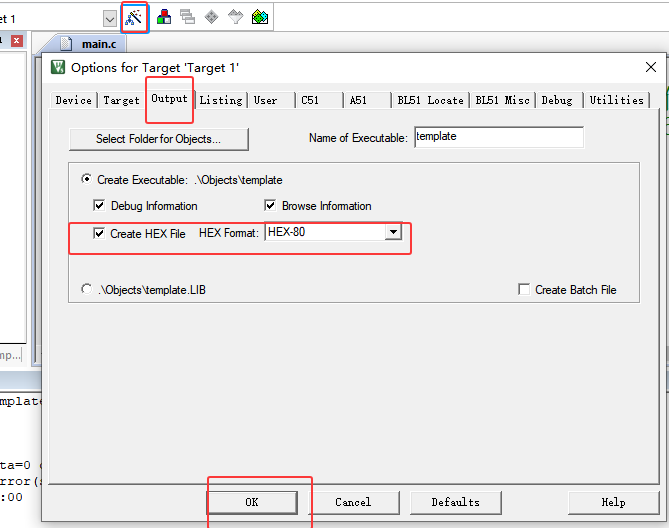


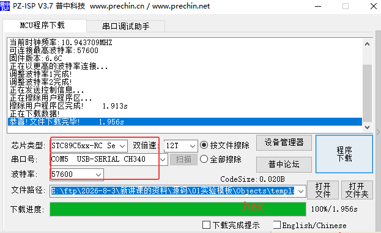

## 三、模板的程序

```c
#include <reg52.h>
typedef unsigned char  u8;// 1字节  8位          最大赋值 0~ 255         1111 1111
typedef unsigned int   u16;//2字节  16位         最大赋值 0~ 65535        1111 11111111 1111  

//延迟函数   等时间   us 微秒   ten_us   = 1      代表10us
void delay_us(u16 ten_us){
   while(ten_us--);   
}

//延迟函数    等时间   ms毫秒   ms=1       代表1ms
void delay_ms(u16 ms){
	u16 i,j;
   for(i=ms;i>0;i--)
	   for(j=110;j>0;j--);
}
              	
void main(){
  while(1){
			P2=0x00;//全亮    0000 0000
		 //delay_us(50000);//500ms
		  delay_ms(500);
		 P2=0xFF;//全灭    1111 1111
		 //delay_us(50000);//500ms
		 delay_ms(500);
	}


}

```

## 四、开发板的组成

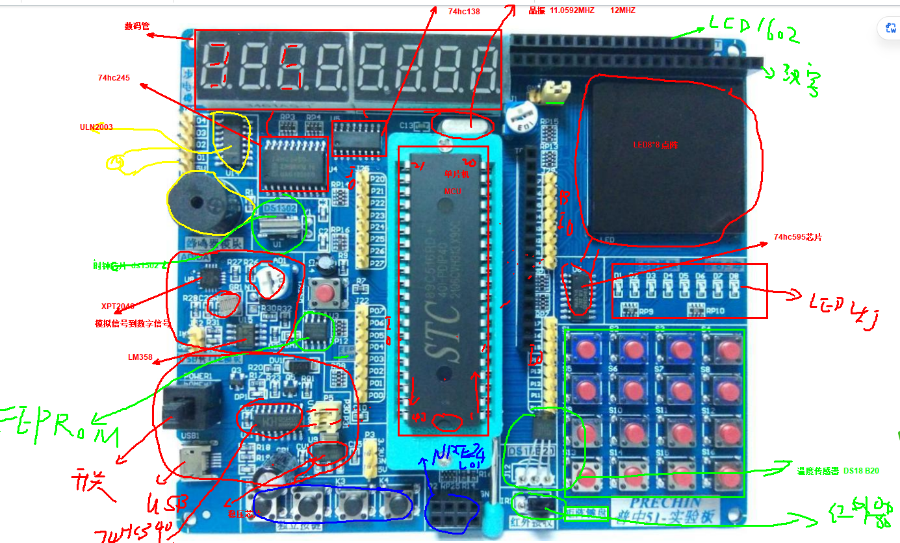

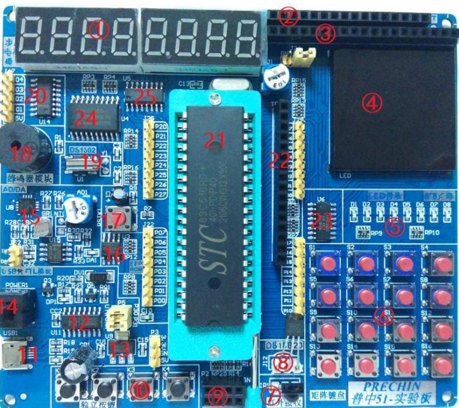

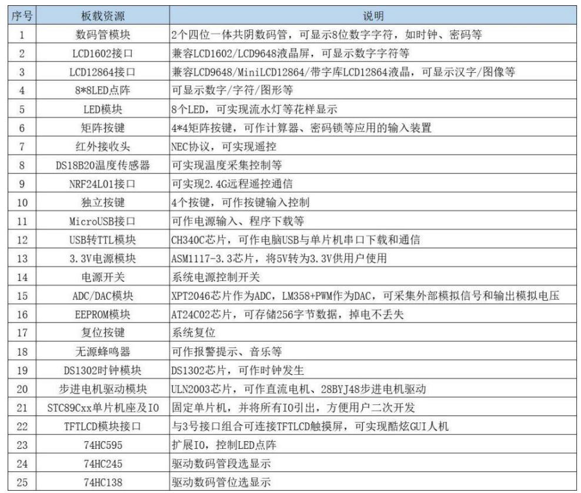

# 02day 单片机介绍

## 一、单片机的简介

 计算机  不叫单片机，它的组成及功能和单片相似

   计算机：   cpu  (计算和控制)      RAM(内存条)      ROM(硬盘)         输入和输出  （串口 并口 ）---键盘和显示屏

   单片机   --上机这些部件全部被做到一块集成电路芯片中，称为单片机  （MCU 微控制器）   比如A\D   D\A    引脚    我们用的 40脚          stm32 ZET6   144脚


51 单片机是对所有兼容 Intel 8031 指令系统的单片机的统称。

Intel(英特尔)：i80C31、i80C51、i87C51，i80C32、i80C52、i87C52

ATMEL(艾德梅尔)的：AT89C51、AT89C52、AT89C2051，AT89S51（RC），AT89S52（RC）等

STC(国产宏晶)单片机：STC89C51、STC89C52、STC89C516、STC90C516 等众多品牌。

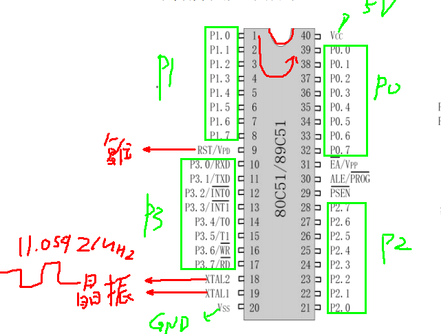

8位单片机   8 位 CPU

程序存储器  ROM        51单片机 4KB            52      ---8KB                                bit 位 -----Byte   字节 ----KB           1KB=1024B            1B=8bit        (不用扩容)

数据存储器RAM          51单片机 128B         52      ---256B        52RC    512B

32 条 I/O 口线         P0   P1   P2    P3    每一 组有 8个

2个定时/计数器       Timer0   T0      Timer1  T1

5 个中断源，2 个优先级（52 有 6 个）      ----外部中断0   ( INT0  )          外部中断1     (INT1  )      定时器0 Timer0   T0      定时器1Timer1  T1         串口中断

​                                                                               高优先级      低优先级

一个全双工串行通信口           RXD 接收   TXD发送

双列直插    40Pin     DIP 封装

·单一+5V 电源供电                                    5v   高电平  1        GND  低电平  0

CPU：由运算和控制逻辑组成，同时还包括中断系统和部分外部特殊功能寄存器；


## 二、内部结构图

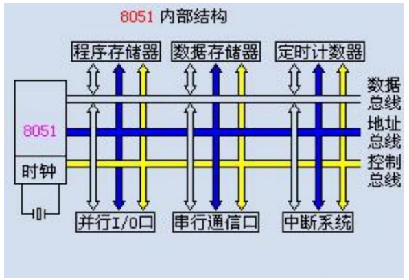

## 三、STC89C52

支持 ISP（在系统可编程）/IAP（在应用可编程）

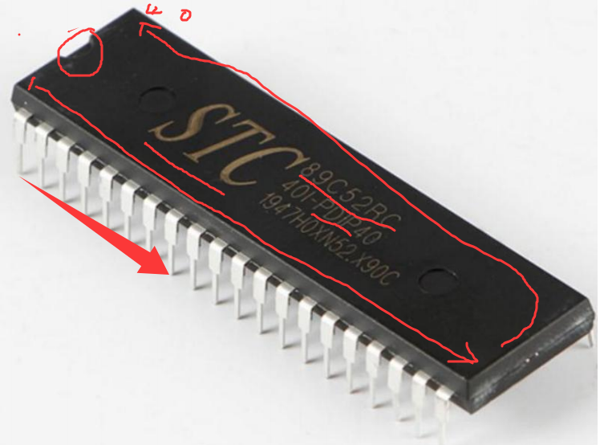

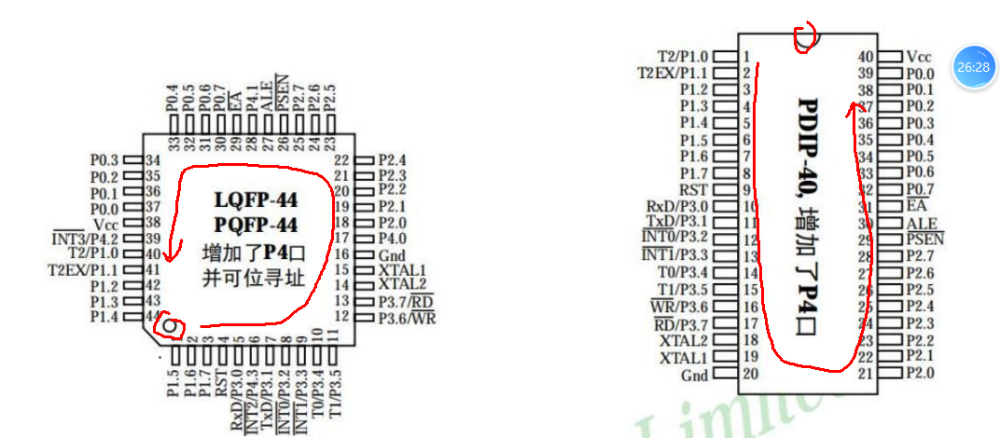

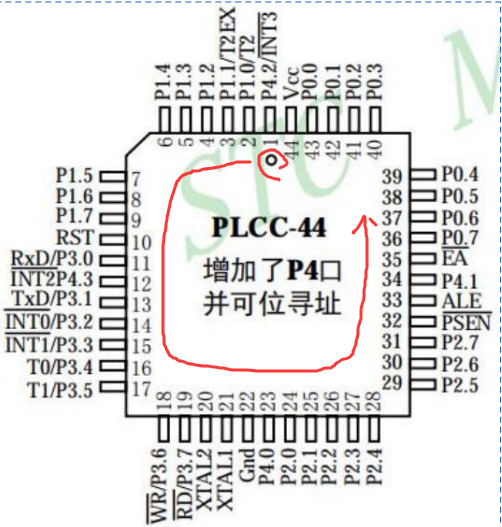

> P0口   (P0.0   ~P0.7)               双向8位三态I/O口，每个口可独立控制                       低电平 （默认输出）         高阻态          高电平   (外接上拉电阻)
>
> P1口  （P1.0 ~P1.7）             准双向8位I/O口，每个口可独立控制，内部自带上拉电阻       没有高阻态              低电平    高电平 (默认输出1)
>
> ​                          之所以称它为“准双向”是因为该口在作为输入使用前，要先向该口进行写1操作，然后单片机内部才可正确读出外部信号，也就是要使其先有个“准”备的过程，所以才称为准双向口
>
> // P1=0XFF;    //  1111  1111
>
> P2口  （P2.0 ~P2.7）             准双向8位I/O口，每个口可独立控制，内部自带上拉电阻       没有高阻态              低电平    高电平 (默认输出1)
>
> P3口  （P3.0 ~P3.7）             准双向8位I/O口，每个口可独立控制，内部自带上拉电阻       没有高阻态              低电平    高电平 (默认输出1)
>
> ​                               P3口除了基本输入输出外 ，还有第二功能     外部中断  定时器 中断   串口中断

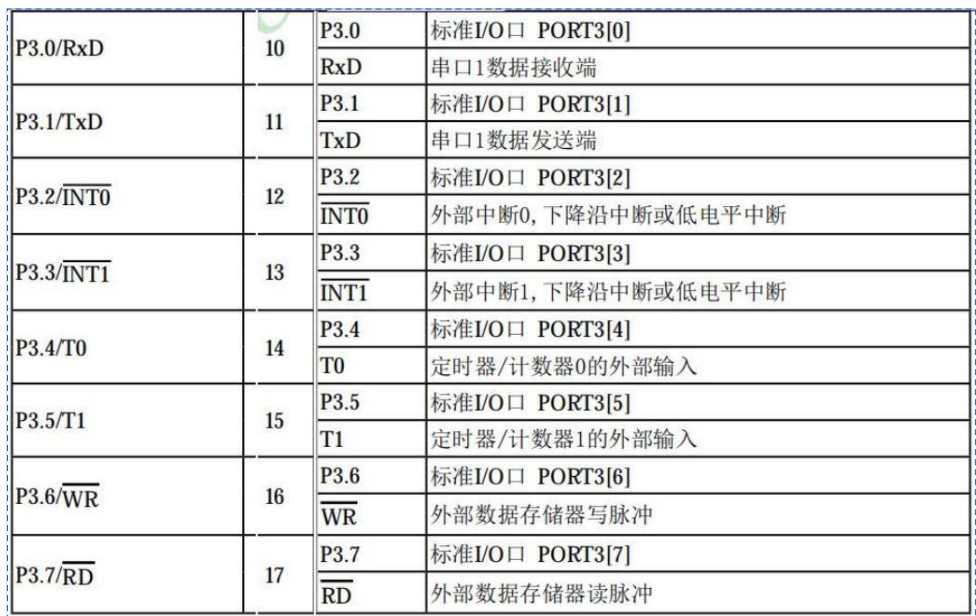


## 四、单片能做什么？

​     智能手环，微型四轴飞行器，平衡车、扫地机、移动POST机，智能电饭锅，3D打印机、机器人等。

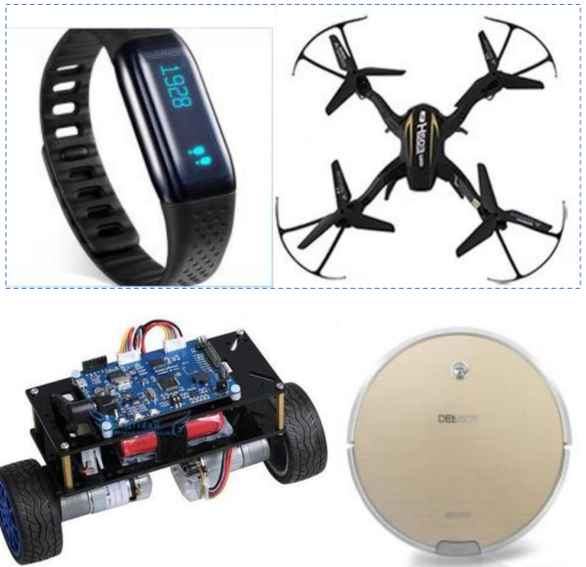

# 03 day 数字电路与c语言

## 一、电平特性  （电压）

 单片机数字集成芯片   ，数字电路 有两种电平标准     ：  高电平  5v    VCC  VDD       (逻辑电平  1)         低电平  0v  GND   VSS (逻辑电平  0)    

​          单片机是 TTL电平         高电平  5v      相当于地的       低电平  0v  

​          RS232串口电平    -12v  (-15v~-3v)       高电平                           12v  (15v~3v)    低电平                    MAX232 电平转换芯片

​          USB电平转TTL电平                          电平转换芯片     74HC340芯片

CMOS          TTL     ---5V


TTL 电平  临界值

输出   2.4v 以上是高             0.4v  以下是低

输入   2V以上是高                   0.8 v以下是低


CMOS电平  临界值

输出  4.99v 以上是高             0.01v  以下是低

输入   3.5V以上是高                   1.5 v以下是低


CMOS可以驱动  TTL                    但是TTL 驱动不了CMOS  ， 真想驱动  加上拉电阻

器件坏了， 更换注意同一标准 ，同一型号         实在不行找替代品


## 二、进制转换

### 1.十进制转为其它进制

十进制  ----------------》二进制         0b                 0           1                            逢n进一

​               ---------------》 八进制        0

​              ---------------》十六进制      0x   0X


  对n进制进行取余，倒叙排列     （为单片机准备               一律用无符号数操作）

```c
unsigned   int   
    
#include <stdint.h>
    
    uint8_t                    uint16_t               uint32_t 
    
 uint8_t  num= 40;
    0b00101000          050      0x28
```


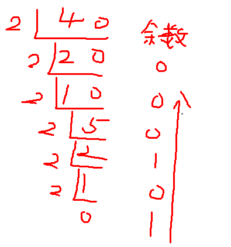

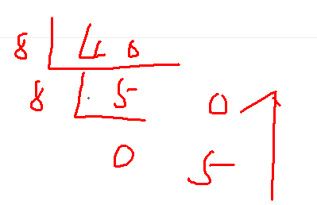

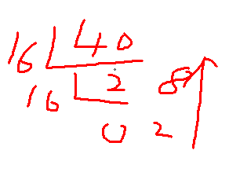

### 2.把其它进制转为十进制

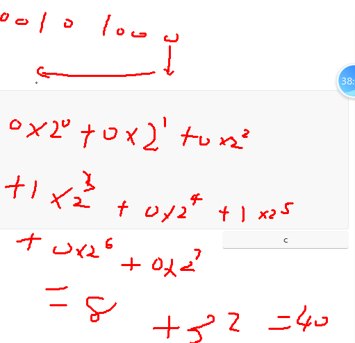

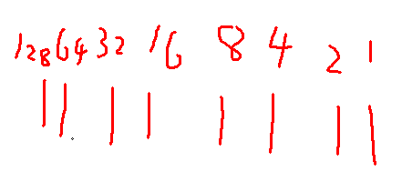

### 3.二进制-----》八进制                  二进制---》十六进制

​          三位一体                                                                    四位一体

 十进制0~9          二进制0~1               八进制0~7            十六进制0~9  ABCDEF

​                            4 2 1          4 2 1

​               0b 00    1 0 1          0 0 0   ------- 050

  

​              0b   00 1 0    1 0 0 0  ---------0x28     (重点)

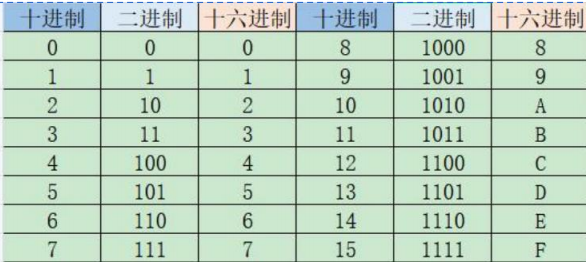

## 三、运算符  或电路符号

###  1.与门        &         - 位运符                按位与       1个是0即为0

  0 & 1 =0                 1 & 0 =0          0&0=0                                        1&1=1

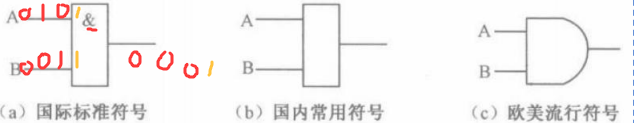

###   2.或门     |   ----按位或            1个为1即  1

  1 | 0=1            0 | 1=1                1 | 1=1                                    0| 0=0

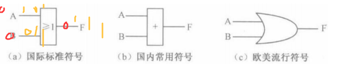

### 3.非门         ~       按位取反

~  1  =0                 ~0 =1

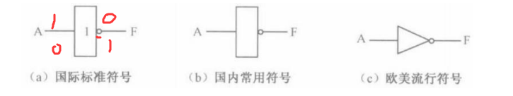

### 4.同或运算            相同为1   不同0   ( c语言中没有此运算符)

​        0⊙0=1，0⊙1=0（1⊙0=0），1⊙1=1

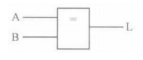

### 5异或运算       不同为1    相同为0

  0^0=0，0^1=1（1^0=1），1^1=0

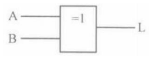

## 四、C 语言基础

>     1.  基础语法（数据类型   进制转换        输出输出       数据类型转换    运算符）
>     1.  分支结构   
>     1.  循环结构
>     1.  函数
>     1.  数组
>     1.  指针--------------------重点理解
>     1.  结构体------自定义的数据类型  复合的数据类型
>     1.  内存分析
>     1.  文件操作 （linux） ----不作为重点


### 1.数据类型

​     基本数据类型   ------  字符型  char                     1字节                    -128~127                 0~255                                   1111 1111

​                                         整型    int     4字节                       short int   （短整） 2字节              long int  （长整）   4字节       long long int（长长整）  8字节

​                                         实型（浮点型）     float (单精度)        3.14f               double（双精义）  3.14

​    构造类型（复合类型） ----- 数组    Array        结构体 struct               共用体 union               枚举 enum

   指针类型     ----   数据类型  *                           char *                int *

   空类型  ---void                                     void  fn(void){ 代码块;}                  无返回值             无参


>    整型    int                      在32编译平台 占   4字节               在51编译平台 占   2字节                       值域   -32768~32767          0~65535      
>
> ​                                                                                                     1111 1111 1111 1111

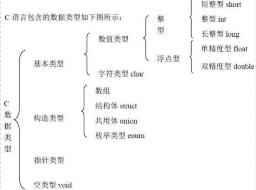

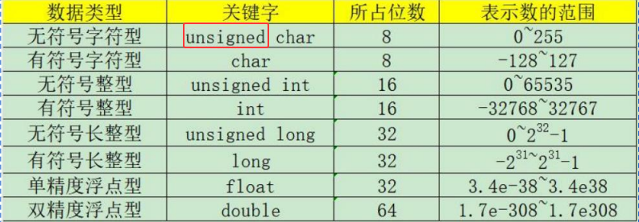

```c
#include <stdio.h>
int main() {
	printf("hello world\n");
	printf("nice\n");

	//数据类型   signed 有符号可以省略
	int   num = -30;
	unsigned int   num1 = -30;  //无符号
	double  b = 12353.14455;  //12345.12333378999
	float  c = 12353.14455f; //12345.123455
	char ch = 'A';
	char ch1 = 65;
	unsigned  char ch2 = 255;

	printf("num=%d\n", num);
	printf("num1=%u\n", num1);

	/*
	num=-30
     num1=4294967266                         //不报错  不代表对          单片机异常
	*/

	printf("%lf  %f  %c  %d  %u", b, c, ch, ch1, ch2);
	//12353.144550  12353.144531  A  65  255
	return 0;
}

```

单片机多个几个数据类型

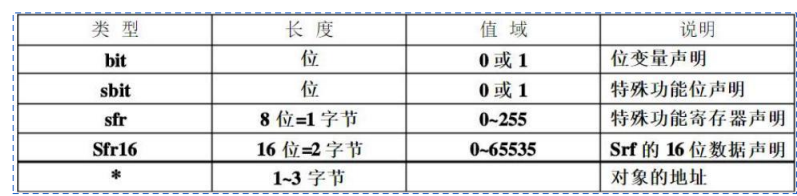

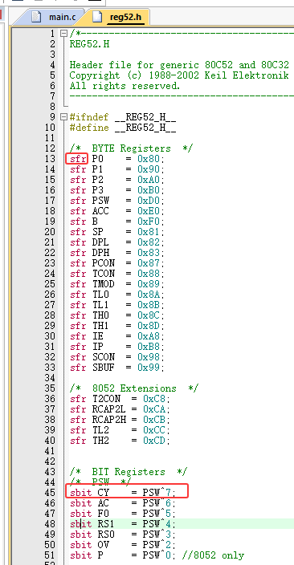

```c
#include  <reg52.h>
sbit  LED1=P2^0; //寄存器位的定义
bit  num=1;//位的定义
bit num1=0;//位的定义
void main(){
    
    while(1){
        
        P2=0x00;
        
    }
    
}
```

### 2.数据类型转换

####    隐式转换 （低字节  ---向高字节转）

​    bit→char→int→long→float→signed→unsigned

```c
    printf("%.2lf",3.14+2+'a');
```

####    强制转换

```c
   printf("%lf",(double)3/2);
```

# 04day  C语言的基础

## 一、运算量

### 1.常量  ---字面量  直接量        

 直接可以使用量

```c
3.14        3.14f          2        'A'       "hello"
    
 printf("%lf",2+3.14+'a')
```


###   2.变量   ---可以变化的量

 ```c
  int  a;   //定义一个整型变量  ，变量名叫a
    a=10;  //把整数10 赋值给变量a
    a=200;
 int b=100;  //变量初始化            定义一个整型变量b,同时把整数100赋值给变量b
 ```

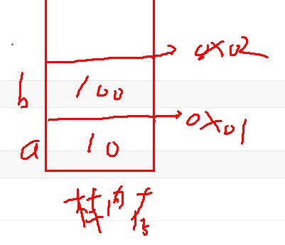

###  3.变量名的命名规范

​       （1）可以是字母a~z    A~Z   数字    下划线  _ 组成     不能以数字开头

​               _age                 a_01             stuName_01

​        (2) 用驼峰命名法或下划线命名法

​             stu_Name          stuName             init_01

​       (3) 见名知意     score       grade       Name      password    

​       (4) 区分大小写            age         Age                 

​       (5)不能使用关键字           if           else           int    static   extern  break;


### 4.常用的关键字

   typedef   重命名                      typedef    unsigned   char     u8 ;               typedef    unsigned   int     u16 ;

   extern    声明                            extern int a;             int a=10;

   static  静态                              static     int a=10;

## 二、运算符

###    1.算术运算符

```c
       +          -         *      /           %取余 （取模）
       ++  自增         --自减
```

```c
#include <stdio.h>
int main() {
	int a = 10;
	int b = 3;
	int res = a + b;
	printf("res=%d\n", res);

	printf("%d   %d   %d   %d\n", a - b, a * b, a / b, a % b);
	printf("%d   %d   %.2lf   %d\n", a - b, a * b, (double)a / b, a % b);
	/*
	7   30   3   1
   7   30   3.33   1
	*/
	//注意： 两个整数相除， 只能得到整数 ，舍小数留整数，  如果想得到小数 ，必须一个是小数
	//两个都是整数才能取余数   5%10  =5          100%150=100          150%100=50

	int i = 10;
	i++; //  i=i+1;
	printf("i=%d\n", i); // 11
	++i;//  i=i+1;
	printf("i=%d\n", i);//12

	i--;//  i=i-1;
	--i;//  i=i-1;
	printf("i=%d\n", i);//10
//------------------------------------------------   上面      前置和后置没有区别         下面的有区别
	int j = i++;   //    后置             先赋值， 再自增
	printf("i=%d  j=%d", i, j);  // 11     10

	j = ++i;  //前置          先自增     再赋值
	printf("i=%d  j=%d", i, j);//12   12


	printf("%d", i++); // 12              int m=i++;           printf("%d",m);
	printf("%d", i);//13

	//while (ten_us--);
	return 0;
}

/*
    +          -         *      /           %取余 （取模）
	   ++  自增         --自减


*/
```


###    2.关系运算符（比较运算符）

```c
>       >=            <              <=        ==       ！=                        结果是真 （1）          假（0）   常用于条件语句
```


###    3.赋值运算符  -----优先级很低

  ```c
  =    +=    -=    *=            /=   %=                 >>=         <<=        ~=      
  ```

```
#include   <stdio.h>
int main() {
	int a = 10;
	int b = 5;
	int res = a >= b;
	//res = a <= b;
	printf("res=%d\n", res);//res=1

	if (a <= b) {
		printf("是真的，很开心\n");
	}
	else {
		printf("是假的，不开心\n");
	}

	printf("%d  %d   %d   %d    %d   %d\n", 8 == 8, 8 >= 8, 8 <= 8, 8 > 5, 8 < 5, 8 != 5);//1  1   1   1    0   1

	//------------------------------------赋值

	int  m = 10;
	m += 5;   //    m=m+5
	printf("m=%d\n", m);  //15
	m -= 5;// m=m-5
	printf("m=%d\n", m);//10
	m *= 5;// m=m*5
	printf("m=%d\n", m);//50
	//......
	return 0;
}

/*
比较（关系）运算符
>       >=            <              <=        ==       ！=                        结果是真 （1）          假（0）   常用于条件语句
赋值运算符
=    +=    -=    *=            /=   %=                 (>>=         <<=        ~=           &=    |=   ^=)
*/
```

### 4.逻辑运算符

```c
&&  逻辑与        || 逻辑或         !逻辑非            结果是真 （1）          假（0）   常用于条件语句
```

```c
#include  <stdio.h>
int main() {
	int a = 10;
	int b = 5;

	int res = a >= b && 8 <= 5;   //   && 两侧有一个为假  ，即为假   0                    两个同时为真才能为真
	printf("res=%d\n", res);//0

	if (res) {
		printf("开心，是真的\n");
	}
	else {
		printf("不开心，是假的\n");
	}

	//请输入一个年份，判断是平年还是闰年    year%4==0&&year%100!=0||year%400==0

	res = a >= b || b++;   //  ||两侧有一个为真即为真 1                     两个同时为假   才能为假
	printf("res=%d\n", res);//res=1

	int year;
	scanf_s(" %d", &year);
	if (year % 4 == 0 && year % 100 != 0 || year % 400 == 0) {
		printf("%d年是闰年", year);
	}
	else {
		printf("%d年是平年", year);
	}


	res = !(a >= b);
	printf("res=%d", res);//res=0  假的

	return 0;
}

/*
逻辑运算符
&&  逻辑与        || 逻辑或         !逻辑非            结果是真 （1）          假（0）   常用于条件语句

 短路逻辑        表达式1&&表达式2                     表达式1是假的，表达式2不再执行，结果为假
                                                                          表达式1是真的，表达式2决定结果

		  //8<=5&&b++

短路逻辑        表达式1||表达式2                          表达式1是真的，表达式2不再执行，结果为真
																		  表达式1是假的，表达式2决定结果

*/
```

### 5.位运算符   （单片机使用）

```c
&  按位与      |按位或            ~ 按位取反            ^ 按位异或     >>  右移            << 左移
```

### 6.条件运算符（三元运算符）---if ...else

```c
?:                      逻辑表达式？表达式1：表达式
```

```c
#include <stdio.h>
#include <stdint.h>
int main() {
	// 原码         反码           补码               计算机底层一律按补码运算
	// 通过把10十进制 转为二 进制  ---原码               正数和无符号数   原码  反码 补码是同一个          单片机大部分操作都是无符号

	uint8_t  num = 40;   //二进制  0b  0010  1000
	uint8_t  num1 = 80;//              0b  0101  0000

	uint8_t res = num & num1;
	printf("%d  %x\n", res, res);//0  0


	res = num | num1;
	printf("%d  %#x\n", res, res);//120  0x78

	res = num ^ num1;
	printf("%d  %#x\n", res, res);//120  0x78

	res = ~num ; //~ 0b  0010  1000
	printf("%d  %#x\n", res, res);//   1101 0111     215  0xd7

	res = num>>3; // 0b  0010  1000
	printf("%d  %#x\n", res, res);//   000 00101        5  0x5

	res = num << 3; // 0b  0010  1000
	printf("%d  %#x\n", res, res);//  0 100  0000         64  0x40

	8 >= 5 ? printf("是真的") : printf("是假的");

	//求两个数的最大值
	int a = 30;
	int b = 20;
int max=	a >= b ? a : b;
printf("max=%d", max);

	return 0;
}

//&按位与              对应位 其中1个为0  位就是0
//| 按位或               对应位 其中1个为1  位就是1
//^ 按位异或           不同为1 相同为0
// ~按位取反 
//>> 右移            无符号         移出位丢掉，空的补0
//<< 左移             无符号         移出位丢掉，空的补0


//三元       条件运算符    ?:
```


### 7.指针运算符

```c
* 取值          &  取址                 int a=10;      int * ptr=&a;
```

# 05day  分支结构和循环结构

流程控制--控制程序的执行顺序，有三种结构： 顺序结构、分支结构、循环结构

## 一、分支结构

### 1.单分支 

if(判断条件){

​    如果判断条件是真，执行此代码;

}

​      判断条件不成立，按顺序执行下面的代码

### 2.双分支

if(判断条件){

  如果判断条件是真，执行此代码块1;

}else{

   判断条件不成立，执行此代码块2

}

按顺序执行下面的代码


判断条件？表达式1：表达式2


### 3.多分支

if(判断条件1){

​     条件1成立，执行代码块1;

}else if(判断条件2){

  条件1不成立，条件2成立，执行代码块2;

}else if(判断条件3){

  条件1   2都不成立，条件3成立，执行代码块3;

}

...

else{

 以上条件都不成立，才此代码;

}


### 4.switch分支

   相等比较             整型         char型         枚举型         注意 实型（浮点型） 不能用

  有限的数据集

switch(表达式或变量名){

​      case  常量值1：

​           代码块1：

​            break;

​      case  常量值2：

​           代码块2：

​            break;

​       ...

​     defalut:

​         以上条件都不成立，执行此代码块;

​        break;

}

注意： break 是结束条件   不能省略                     相等比较


## 二、分支结构演示代码

```c
#define _CRT_SECURE_NO_WARNINGS
#include  <stdio.h>
int main() {
	//1.单分支
	//您的测试成绩大于等于80分，成绩合格

	//double  score;
	//printf("请输入一个成绩：");
	//scanf(" %lf", &score);

	//if (score >= 80) {
	//	printf("成绩合格\n");
	//}

	//printf("running~~");

	//2.双分支
	//您的测试成绩大于等于80分，成绩合格，否则不合格

	//double  score;
	//printf("请输入一个成绩：");
	//scanf(" %lf", &score);
	///*if (score >= 80) {
	//	printf("成绩合格\n");
	//}
	//else {
	//	printf("成绩不合格\n");
	//}*/
	//score>=80? printf("成绩合格\n"): printf("成绩不合格\n");
	//printf("running~~\n");

	//作业-请输入两个整数，输出数中的最大值

	//3.多分支
	// 测试成绩  大于等于90   ，等级A    ;大于等于80   ，等级B   ;  大于等于70   ，等级C ;大于等于60   ，等级D;小于60   ，等级E     

	double  score;
	printf("请输入一个成绩：");
	scanf(" %lf", &score);
	if (score >= 90) {
		printf("A\n");
	}
	else if (score >= 80 && score < 90) {
	
		printf("B\n");
	}
	else if (score >= 70 && score < 80) {

		printf("C\n");
	}
	else if (score >= 60 && score < 70) {

		printf("D\n");
	}
	else {
		printf("E\n");
	}

	 printf("running~~\n");

	 //score >= 60 && score < 70去掉后半边                score>=90     score>=80  ....
	 //  score<60            score<70

	 //4.switch分支
	 /*
	 一年有12个月，一年分四季
	  12   1   2   冬季
	  3    4    5  春季
	  6    7    8  夏季
	  9   10    11 秋
	 
	 */

	 int month;
	 printf("请输入一个月份：1~12:  ");
	 scanf(" %d", &month);
	 switch (month) {
		 case  12: case  1: case  2:
			 printf("%d月是冬季\n", month);
			 break;
		 case  3: case  4: case  5:
			 printf("%d月是春季\n", month);
			break;
		 case  6: case  7: case  8:
			 printf("%d月是夏季\n", month);
			 break;
		 case  9: case  10: case  11:
			 printf("%d月是秋季\n", month);
			 break;
		 default:
			 printf("没有此月份，重新输入\n");
			 break;
	 }

	return 0;
}

```

## 三、循环结构

 3种循环    for 循环            while()              do...while

### 1.for

for(循环初始化;循环判断条件;循环迭代){

   循环体;

}


```c
for(int i=0;i<5;i++){
     printf("hello");
}


int i;
for(i=0;i<5;i++){
     printf("hello");
}
```

> 第一步：  循环初始化   i=0;                      整个循环就执行一次
>
> 第二步：     循环判断条件  i<5           如果条件成立，执行第三步                    直到条件不成立，结束循环
>
> 第三步： 执行循环体   ,执行第四步 
>
> 第四步     循环迭代   i++              回到第二步


### 2.while

while(循环判断条件){

   循环体;

}

```c
int i=0;
while(i<5){
    printf("hello");
    i++;
}
```

>  先循环条件判断，条件成立，执行循环体  ，反复判断执行，直到条件不成立，结束循环


### 3.do ...   while

do{

  循环体;

}(循环判断条件);

```c
int i=0;
do{
   printf("hello");
    i++;
}while(i<5);
```


## 四、三种循环使用场景的区别

   1. 三种循环 意义一样，都可以使用

   2. 如果  循环有区别       循环次数很明朗， 建议用 for

      如果循环次数不明朗，就是让求次数，建议用while   或 do...while

      

## 五、break和continue的区别

​    break 结束当前的循环                        ，还可以switch语句 结束条件

​    continue  结束（跳过）当次循环，继续下次循环

## 六、循环嵌套

```c
	int i, j;
	for (i = 0; i < 5; i++) {
		for (j = 0; j < 5; j++) {
			printf("好好学习~~      ");
		}
		printf("\n");
	}
```

## 七、循环作业

```c
#include <stdio.h>
int main() {
	//int sum = 0;
	//for (int i = 1; i <= 1000; i++) {
	//	if (i % 2 == 0) {
	//		sum += i;  // sum=sum+i;
	//	   }
	//}
	//printf("sum=%d", sum); //sum=250500

	//int i = 1;
	//int sum = 0;
	//while (i <= 1000) {
	//	if (i % 2 == 0) {
	//		sum += i;
	//	  }
	//	i++;
	//}
	//printf("sum=%d", sum);

	/*int i = 1;
	int sum = 0;
	do {
		if (i % 2 == 0) {
			sum += i;
		}
		i++;
	} while (i <= 1000);
	printf("sum=%d", sum);*/

	//-----------
	for (int i = 100; i <= 999; i++) {
		 //i=123             分解    个位  3    十位2   百位1
		int ge =i%10 ;
		int shi =i/10%10 ;
		int bai =i/100 ;
		if (ge * ge * ge + shi * shi * shi + bai * bai * bai == i) {
			printf("%d 是水仙花的数\n",i);
		}

		/*153 是水仙花的数
		370 是水仙花的数
			371 是水仙花的数
			407 是水仙花的数
           */
	}
	return 0;
}

// 5.使用三种循环结构
//​  实现1 + 2 + 3 + 4 + ...... + 1000中所有偶数的累加和，所有数字的累加和

// 6.输出100 - 999之间所有的水仙花数。
//​    水仙花数指的是：各位数字立方和等于该数本身例如：153 = 1 * 1 * 1 + 5 * 5 * 5 + 3 * 3 * 3


```

```c
int midi = 50;
int num;
while (1) {
	printf("请输入一个您猜的数字：");
	scanf(" %d", &num);
	if (num > midi) {
		printf("猜大了");
	}
	else if (num < midi) {
		printf("猜小了");
	}
	else if (num == midi) {
		printf("猜中了");
		break;
	}
}
// 7.猜数字游戏，

​      甲方输入一个数字确切的数字，，让乙方户去猜，猜对了，输出成功，猜错了，输出“大了”或 “小了”  继续猜，最多猜5次。5次都猜不对，游戏失败
```

# 06 day 函数知识及数组知识

## 一、自定义函数

### 1. 无返值无参的函数

```c
void  函数名( void ){
    函数体;
    
    
}

void  函数名( ){
    函数体;
      
}


//调用           函数不调用不执行

 函数名( );
```

注意： 函数之间是无法嵌套定义，   函数名也不能重名

```c
#include  <stdio.h>
#define PI 3.14
//1. 无返回值   无参
void  getCircleArea() {
	double r = 10;
	double area = PI * r * r;
	printf("圆的面积是%.2lf\n", area);
}
int main() {
	//1. 计算圆的面积
	getCircleArea();
	getCircleArea();
	return 0;
}

```


### 2.无返回无参的函数 

```c
void 函数名(形参1，形参2，...){
     函数体;
    
}

//调用
函数名(实参1，实参2，...);


```

注意：  实参赋值组形参的                   实参和形参的个数及类型 呼应起来                   不多也不能少

```c
#include <stdio.h>
#define PI 3.14
//1. 求圆的面积          无返回值  有参
                              //形参  局部变量
void  getCircleArea(double r) {
	double area = PI * r * r;
	printf("圆的面积是%.2lf\n", area);
}

//2. 求长方形的面积
void getRecArea(double w, double h) {
	double area = w * h;
	printf("长方形的面积是%.2lf\n", area);
}
int main() {
	getCircleArea(10);
	getCircleArea(20);

	double r1;
	printf("请输入一个半径值: ");
	scanf_s(" %lf", &r1);

	                  //实参
	getCircleArea(r1);


	getRecArea(10, 20);
	getRecArea(30, 40);

	double w, h;
	printf("请输入宽和高：");
	scanf_s(" %lf  %lf", &w, &h);
	getRecArea(w,h);
	return 0;
}
//1. 求圆的面积
//2. 求长方形的面积


// 无返回值      有参          参数个数没有限制         类型没有限制                         不同人来调函数，需的数据不一样，可提为参数
```


### 3.有返回值     无参（有参）的函数

```c
返回值数据类型 函数名（）{
    函数体;
    
    return  结果;
}

//调用函数
返回值数据类型   res=函数名（）;
//输出 结果     res 存的是  return 后的结果的值


返回值数据类型 函数名（形参1，形参2，...）{
    函数体;
    
    return  结果;
}

//调用函数
返回值数据类型   res=函数名（实参1，实参2，...）;
//输出 结果     res 存的是  return 后的结果的值
```

注意： return有两个作用，  1.  结束函数      return;         2. 结束函数并返回结束    return 结果

​           好处： 函数的结果可以应用在第三个函数中

```c
#include <stdio.h>
#define PI  3.14
// 有返回值      有参
//1. 圆的面积
double  getCircleArea(double r) {
	/*double area = PI * r * r;
	return area;*/
	return PI * r * r;

}
//2.长方形的面积
double getRecArea(double w, double h) {
	double area = w * h;
	return area;

	// return  w*h;
}

//求和
double getSum(double a, double b) {
	return a + b;
}
int main() {

double area=	getCircleArea(10);
printf("圆的面积是%.2lf\n", area);

double  area1= getRecArea(10, 20);
printf("长方形的面积是%.2lf\n", area1);


double sum = getSum(area, area1);
printf("sum=%.2lf", sum);
	return 0;
}

//求圆的面积及长方形的面积的和
```

## 二、函数作业

```c
#include <stdio.h>
int getMax(int a, int b, int c, int d) {
	int max = a; //假设其中一个最大
	if (max < b) {
		max = b;
	}
   if (max < c) {
		max = c;
	}
   if (max < d) {
	   max = d;
   }
   return max;
}
int getMin(int a, int b, int c, int d) {
	int min = a; //假设其中一个最大
	if (min >b) {
		min = b;
	}

	if (min > c) {
		min = c;
	}

	if (min > d) {
		min = d;
	}

	return min;
}
int main() {

	int  max=getMax(90, 90, 40, 80);
	printf("max=%d\n", max);

	int min = getMin(90, 90, 40, 80);
	printf("min=%d\n", min);
	return 0;
}


// 2.输出四个整数中的最大值和最小值
// 题目：封装带返回值函数  ，有四个整数形参， 输出这个四个形参中的最大值  或最小值，
```

## 三、数组的基础

 数组 存的是一组同类型的数据，把数据按序号存放，序号就是索引号，用一个变量来管理。

​    数据类型   数组名[常量数]={值1，值2，....}

​    数组名            下标 （索引）            数组长度   ---元素的个数

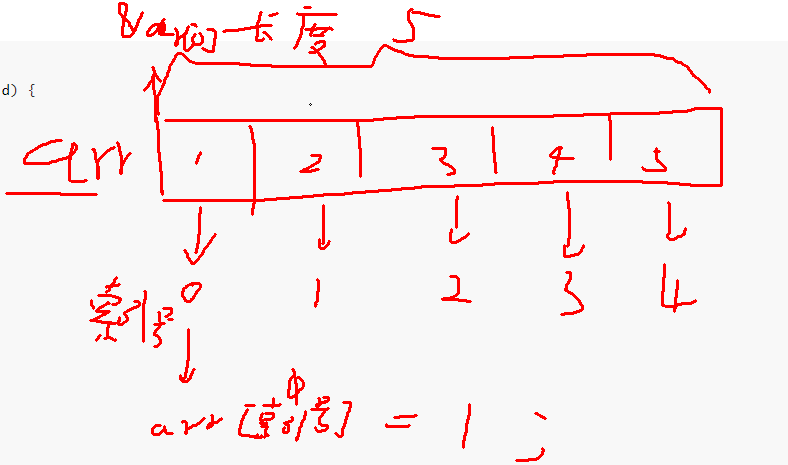

### 1、定义数组

​     方法一：先定义，再赋值

```c
int arr[10];

  arr[0]=10;

  arr[1]=20;

       ...

  arr[9]=100;
```

 方法二：定义的同时，即赋值            （数组初始化）

        ```c
        int  arr[5]={1,2,3,4,5};
        int arr[]={0,1,2,3,4,5};
        ```


注意：不能越界访问

### 2.操作数组  （增   修       取      删除         遍历）

​    （1）增              添元素

​           数组名[索引号]=值;

   （2）修改          修对应索引的值          以最后一次结果为准

​                     数组名[索引号]=新值;

  （3）删除   后面的覆盖前面的元素的方法

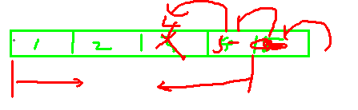

   （4）取  （访问）

​          int num= 数组名[索引号];

  （5）遍历         循环

    ```c
     int len=sizeof(arr)/sizeof(arr[0]);// 数组长度的计算          元素的个数
    
    for(int i=0;i<len;i++){
         
     }
    ```


     ```c
     #include  <stdio.h>
     int main() {
     	//1.定义数组       先定义 再赋值
     	int  arr[5];
     
     	//(1)增     ---索引号 从0开始   ~4结束
     	arr[0] = 10;
     	arr[1] = 20;
     	arr[3] = 40;
     	arr[2] = 30;
     
     	//(2) 取
     	printf(" %d  %d  %d  %d  %d\n", arr[0], arr[1], arr[2], arr[3], arr[4]);// 10  20  30  40  -858993460
     	arr[4] = 50;
     	printf(" %d  %d  %d  %d  %d\n", arr[0], arr[1], arr[2], arr[3], arr[4]);// 10  20  30  40  50
     	//arr[5] = 100;  //越界访问 报错了
     
     	//(3) 修
     	arr[0] = 1000;
     	arr[0] = 1;
     	printf(" %d\n", arr[0]);


​     
​     	//(4)删除   30            索引号 2的位置 --------------------------------了解
​     	/*for (int i = 2; i < sizeof(arr) / sizeof(arr[0])-1; i++) {
​     		arr[i] = arr[i + 1];
​     	 }
​     	 
​     	for (int i = 0; i < sizeof(arr) / sizeof(arr[0])-1; i++) {
​     		printf(" %d\n", arr[i]);
​     	}*/


​     
​     	//(5)遍历                注意 不能写与 i<=           越界
​     	for (int i = 0; i < sizeof(arr) / sizeof(arr[0]); i++) {
​     		printf(" %d\n", arr[i]);
​     	}
​     	return 0;
​     }
​     ```

   


```c
#include <stdio.h>
int main() {
	//数组定义同时，即赋值，  数组初始化
	int  arr[5] = { 10,20,30,40,50 };   //最多只能赋5个值， 可以少于5个，不足自动补0
	int arr1[] = { 10,20,30,40,50,80 };

	//计算数组的长度           查有几个数
	int len = sizeof(arr)/sizeof(arr[0]);
	printf("%d\n", len);//5                                20/4
	int len1 = sizeof(arr1) / sizeof(arr1[0]);
	printf("%d\n", len1);//6                         24/4


	printf("%zu   %zu\n", sizeof(arr), sizeof(arr1));//20   24

	//操作数组    增    删  改       查（取）    遍历
	// 修改

	arr[0] = 100;
	arr1[0] = 1000;
	printf("%d  %d\n", arr[0], arr1[0]);

	//取
	int num = arr[2];
	printf("%d   %d\n", num, arr[2]);//30   30


	//遍历
	for (int i = 0; i < len; i++) {
		printf("%d ", arr[i]);
	}

	return 0;
}
```

##   四、字符数组和字符串

​               C语言中没有直接字符串的定义方法，我们用的是字符数组来表示字符串

​               区别时              对‘\0’结尾是字符串                           字符串一定是字符数组，但是字符数组不一定是字符串

###    1.字符串的定义

                 ```c
                 char   str[6]={'h','e','l','l','o','\0'} ;// 可以少于6个，不足以'\0'补充 
                 char   str[6]="hello";//   最多只能有5个字符      最后一个默认是 '\0'
                 char   str[]="hello";
                 char * str="hello";
                 
                 //输出
                 printf("%s",str);
                 ```


### 2.演示

```c
#include  <stdio.h>
#include  <string.h>
int main() {
	//char   str[6] = { 'h','e','l','l','o','\0' };// 可以少于6个，不足以'\0'补充 
	//char   str[6] = "hello";//   最多只能有5个字符      最后一个默认是 '\0'
	//char   str[] = "hello";
    char* str = "hello world";

	//输出
	printf("%s\n", str);

	//计数字符串的长度呢   用内置方法   strlen(字符数组名)                string.h
    
	size_t     len = strlen(str);  //不包含 '\0'
	printf("%zu\n", len);

	//遍历

	//for (int i = 0; i < len; i++) {
	//	printf("%c ", str[i]);

	//}
	int i = 0;
	while (str[i] != '\0') {
		printf("%c ", str[i]);
		i++;
	}


	//比较两个字符串的大小    if("hello"=="hell")  错误的

	if (strcmp("hello", "hello") == 0) {
		printf("两个字符串相等");
	}
	else {
		printf("两个字符串不相等");
	}

	return 0;
}


```

## 五、数组的作业

```c
#include <stdio.h>
#include <stdlib.h>
//生成一个数组

//void createArr(int * arr, int len) {
//
//}
void createArr(int arr[], int len) {
	for (int i = 0; i < len; i++) {
		//arr[i] = 10;
		//scanf_s(" %d", &arr[i]);
		arr[i] = rand() % 100;
	 }
}

//打印数组
void printArr(int arr[], int len) {
	for (int i = 0; i < len; i++) {
		printf("%d ", arr[i]);
	}
}

//最大值

void getMax(int arr[], int len) {
	int  max = arr[0];
	for (int i = 0; i < len; i++) {
		if (max < arr[i]) {
			max = arr[i];
		 }
	}
	printf("max=%d\n", max);
}

//最小值

//求和     
int  getSum(int arr[], int len) {
	int sum = 0;
	for (int i = 0; i < len; i++) {
		sum += arr[i];
	}
	return sum;
}


int main() {
	//int arr[10] = { 10,20,50,80,40,90,50,100,50,60 };

	int arr[10];
	int len = sizeof(arr) / sizeof(arr[0]);
	createArr(arr, len);
	printArr(arr, len);
	getMax(arr, len);

	int sum = getSum(arr, len);

	double avg = (double)sum / len;

	printf("sum=%d  avg=%.2lf", sum, avg);

	/*
	41 67 34 0 69 24 78 58 62 64 max=78
sum=497  avg=49.70
	
	*/
	return 0;
}

// 4.求数组中最大值、最小值、 和、  平均值
// 定义一个int型的一维数组，包含10个元素，然后求出数组中的最大值，最小值，总和，平均值，并输出来。
```

# 07 day  最小系统及LED灯实验

## 一、最小系统构成（四部分）

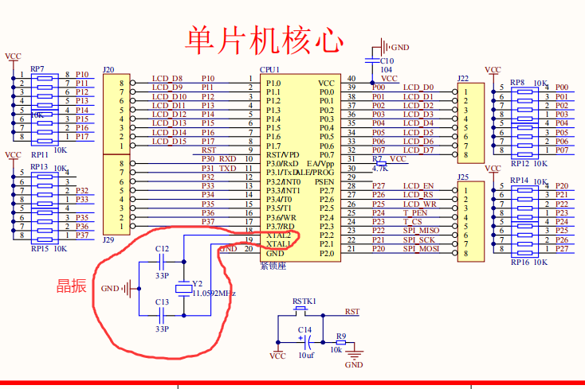

### 1.晶振电路   （ 相当人的心脏）

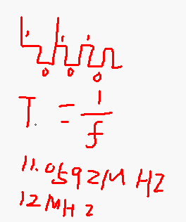

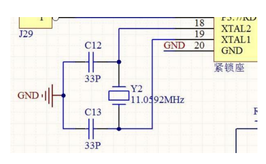

### 2.复位电路   （生病 看医生急救）       热启动  

​      高电平 复位             有两种方式

​     （1） 复位按钮       RST         不关机，重启    热启动 

​     （2）用电源开关        关机再开机  相当于复柆      冷启动  

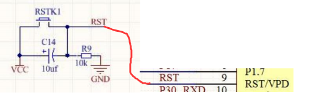

### 3.电源电路

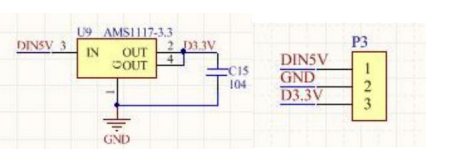

### 4.下载电路

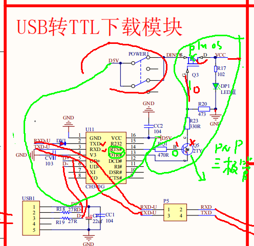

## 二、三极管和MOS管

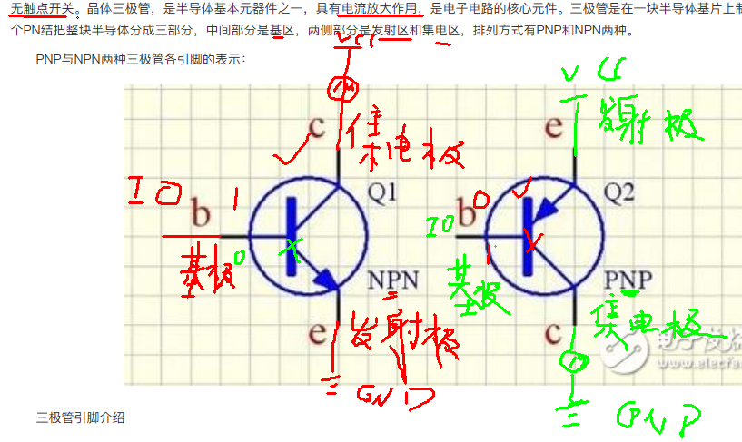

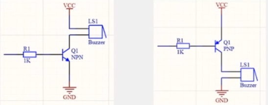


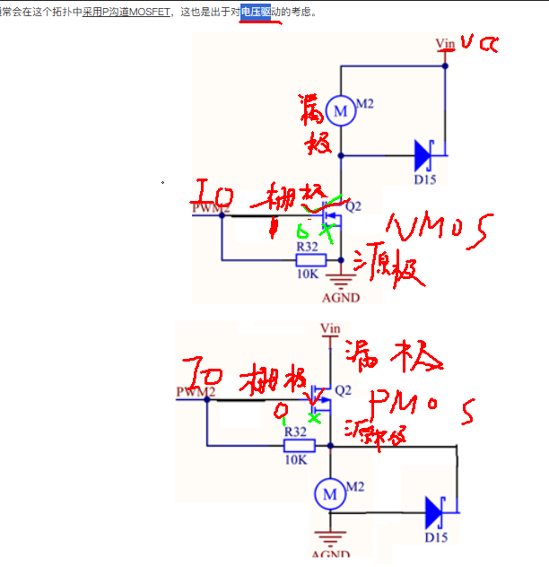

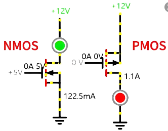


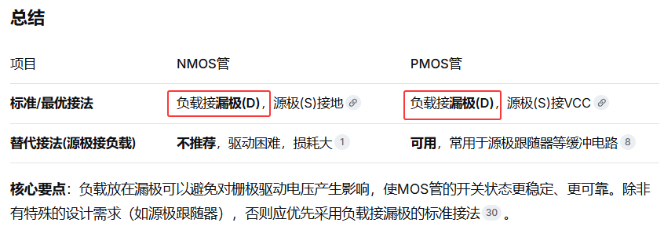

## 三、GPIO

GPIO（ general purpose intput output）是通用输入输出端口的简称，可以通过软件来控制其输入和输出。

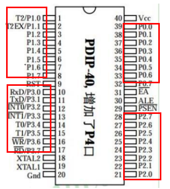

### 1.**P0** 端口    （一组有8个）   双向口          因为有高阻态  不用准备

P0.0~P0.7                   低位~ 高位                        写代码   左边为高位         右边为低位               1010 1100


锁存器      多路开关       v1 v2 场效应管（NMOS管）       非门     与门          三态缓冲器（高电平  低电平  高阻态）


####    （1）输出   （默认是 低电平 ）     和高阻态

​            如果想输出高电平，在IO外面 接上拉电阻

​       

####     （2）输入      （读引脚   读锁存器）


###  2.p1  p2  p3口     （内部有上拉电阻   默认输出是 高电平）  ，可以设置低电平

​     准双向             在输入前有 准备过程  先对   P1 P2 P3口先写入1      0xFF

​       


​                                                           当处于第一功能时，第二输出功能线为 1

### 3.总结：

> ①P0 口是漏极开路，默认输出低电平      有三态功能 （低电平   高电平   高阻态）           如果 对P0口赋值1  也是高阻态         
>
> ​                 要使其输出高电平，必须外接上拉电阻，通常选择4.7K~10K 阻值。
>
> ​                     双向口
>
> ②P0、P1、P2 几乎都用作普通 I/O 口使用，既可作为输入，又可作为输出。
>
> ​       p1 p2  p3 默认输出是高电平        因为内部设计有上拉电阻，    但是设置低电平                  准双向口          
>
> ③P3 口既可用作普通 I/O 口，又可作为第二功能使用，比如串口、外部中断、计数器等。

## 四、LED灯

发光二极管            单向导电                      大约 5mA 发光                   最大20mA


## 五、硬件电路


## 六、软件编程

###    1.点亮  D1     D3   D5灯

###    2. D1     D3   D5灯   闪着亮

###    3.流水灯     依次点亮  8盏灯          ，再反向流动

```c
#include <reg52.h>
//数据类型的重命名
typedef  unsigned char  u8;//   0~255
typedef  unsigned int   u16;//    0~65535

//封装函数  延迟    ten_us  =1        代表10us 
void delay_us(u16 ten_us){
	  while(ten_us--);
}
//  ms=1  1 代表1ms
void delay_ms(u16 ms){
	u16 i,j;
   for(i=ms;i>0;i--)
	      for(j=110;j>0;j--);
	
}
//寄存器位的定义
sbit  LED1=P2^0; //默认是 高电平  1
sbit  LED3=P2^2;//默认是 高电平  1
sbit  LED5=P2^4;//默认是 高电平  1
//void main(){
//	
//		while(1){
////			LED1=0;//亮
////			LED3=0;//亮
////			LED5=0;//亮
////			delay_us(50000);//500ms
////			
////			LED1=1;//灭
////			LED3=1;//灭
////			LED5=1;//灭
////			delay_us(50000);//500ms
//			//11101010   ----转为十六
//			  P2=0xEA;
//			  delay_us(50000);//500ms
//			//00010101   ----转为十六           1111 1111
//			 // P2=0x15;
//			  P2=0xFF;
//			  delay_us(50000);//500ms

//			}
//}


/*
1.点亮  D1     D3   D5灯
2. D1     D3   D5灯   闪着亮
3.  流水灯     依次点亮  8盏灯          ，再反向流动
*/


void main(){
	u8 i;
  while(1){
	  
	 for(i=0;i<8;i++){
	   P2=~(0X01<<i);
	   delay_ms(200);
	 }
	 
	  
	 for(i=7;i>0;i--){
	   P2=~(0X01<<i);
	   delay_ms(200);
	 }
	
	}

}
/*
1111 1110          ------  0x01       0x80                  ~(0x01<<0)
1111 1101                                                  ~(0x01<1)
1111 1011                                                  ~(0x01<2)
1111 0111
1110 1111
1101 1111
1011 1111
0111 1111
*/


```

### 循环流水

```c
#include <reg52.h>
#include <intrins.h>
//数据类型的重命名
typedef  unsigned char  u8;//   0~255
typedef  unsigned int   u16;//    0~65535

//封装函数  延迟    ten_us  =1        代表10us 
void delay_us(u16 ten_us){
	  while(ten_us--);
}
//  ms=1  1 代表1ms
void delay_ms(u16 ms){
	u16 i,j;
   for(i=ms;i>0;i--)
	      for(j=110;j>0;j--);
	
}
void main(){
	 u8 i;
		while(1){
			P2=~0X01;
			for(i=0;i<7;i++){
			  //P2=_crol_(~OX01, i);
				delay_ms(300);
				P2=_crol_(P2, 1);
			
			 }
			
			 for(i=0;i<7;i++){
			  //P2=_crol_(~OX01, i);
				delay_ms(300);
				P2=_cror_(P2, 1);
			
			 }

		}
}

//流水灯   循环流水
/*
1111 1110
1111 1101
1111 1011
.....
_crol_    (unsigned char, unsigned char);
_cror_    (unsigned char, unsigned char);
*/

```

# 08 day  蜂鸣器

## 一、理论

蜂鸣器  是一种电子讯响设备         计算机         打印机      玩具       闹钟           报警等

无源蜂鸣 器  （压电式蜂鸣器）   -----提供一定频率（可变）     发声               多谐振荡器起振,输出 1.5～5kHZ 的音频信号，阻抗匹配器推动压电

蜂鸣片发声。            1.5HZ  ~4KHZ   

有源蜂鸣 器  （电磁式蜂鸣器） ----  只要通电即可发声             频率固定


它的名字来源，有跟有无电源无头，         自带振荡器有关    有源蜂鸣 器 (自带)               无源蜂鸣 器 （不带）


计算：

周期是频率的倒数  T   =1/    f                             频率  1次/秒  = 1HZ


500HZ


频率越大 ---音调越高             频率越小 ----音调越低

占空比越大    音亮越高

## 二、硬件电路

IO口  提供电流  5mA                     蜂鸣器 需要 30mA                         需要放大电流   （三极管）              芯片ULN2003 可以放大电流 驱动蜂鸣器


到 51 单片机是用来做控制的，而不是驱动。

## 三、软件编程

1.  1kHZ的频率 进行发声   ，再试一下改变频率      音调的高低

2. 以500HZ的频率 响2秒   ，不再响

3. 封装一个函数   有响多久，以频率进行发声         （两个形参         响的时间        频率）       

     查一下资料     救呼车的声音

   - 高音频率**：**622Hz** (±15Hz)             1000hz      
   - **低音频率**：**466Hz** (±15Hz)              500hz
   - **持续时间**：高低音各持续 0.5秒

```c
sbit  beep=P2^5;
void beep_delay(u16 time,u16 fre){
    u16 i;
    for(i=0;i<2*time;i++){
        beep=~beep;
        delay_us(fre);
    }
}


beep_delay(500,50);
beep_delay(250,100);
```

```c
#include <reg52.h>
typedef unsigned char u8;
typedef unsigned int u16;
void delay_10us(u16 ten_us){
  while(ten_us--);
}
void delay_ms(u16 ms){
	u16 i,j;
  for(i=ms;i>0;i--)
	  for(j=110;j>0;j--);

}
//蜂鸣器引脚
sbit  beep=P2^5;   //默认 1
//void main(){
//  while(1){
//	  beep=1; //发声  打开
//		delay_10us(50);
//		beep=0;//不发声  关闭
//		delay_10us(50);
//	}

//}


//void main(){
//	u16   time=1000;
//  while(1){
//		
//		while(time--){
//			 beep=1; //发声  打开
//			 delay_10us(10);
//			 beep=0;//不发声  关闭
//			 delay_10us(190);
//		}
//		beep=0;//关闭
//		time=0;//让 里面循环 一直结束
//	 
//	}
//	
//	

//}


//void main(){
//	u16   time=2000;
//  while(1){
//		
//		while(time--){
//			 beep=~beep; //发声  打开
//			 delay_10us(100);
//			
//		}
//		beep=0;//关闭
//		time=0;//让 里面循环 一直结束
//	 
//	}
//	
//}


//封装一个函数     time  * fre_time
 void beep_delay(u16 time,u16 fre_time){
	  u16 i;
	 for(i=0;i<2*time;i++){
	    beep=~beep; //发声  打开
		 delay_10us(fre_time);
	 }
	 
	 
 }
 
 void main(){
	  u16 time=10;
 
   while(1){
	      while(time--){
				beep_delay(312,80);
	      beep_delay(250,100);
				}
				time=0;
	      
	 }
 
 }


/*
1.  1kHZ的频率 进行发声   ，再试一下改变频率      音调的高低            1个周期1ms

2. 以500HZ的频率 响2秒   ，不再响                                      1个周期 2ms      

3. 封装一个函数   有响多久，以频率进行发声         （两个形参         响的时间        频率）       

     查一下资料     救呼车的声音

   - 高音频率**：**622Hz** (±15Hz)             1000hz      
   - **低音频率**：**466Hz** (±15Hz)              500hz
   - **持续时间**：高低音各持续 0.5秒

*/
```


# 09 day静态和动态数码管

## 一、静态数码管理论

内部放的发光二极管 ，LED数码管

段数： 七段  abcdefg       八段（ 加了   小数点 DP）

位数：  1位         2位   3位    4位    .... 7位 ...

单元连接方式：  共阳极                    共阴极  （板子上使用是）


## 二、数码管显示原理


```c
//共阴数码管          公共端 GND             另一端给  高电平1  点亮       低电平0  熄灭
//0 ~9,  A~F       无显示
                 //0    1    2   3      4  5
u8 gsmg_code[17]={0x3f,0x06,0x5b,0x4f,0x66,0x6d,....};

//共阳             公共端 vcc      另一端给  低电平0 点亮       高电平1  熄灭

u8 gsmg_code[17]={0xc0,0xf9,0xa4,0xb0,0x99,0x92,....};

```


设计电路 是动态数码管的电路，   来完成静态数码管的功能               左边第一个8字会点亮 （默认），

动态显示    （在不同时刻点亮所有的数码管，并且 所有位点亮的时间不能超出24ms   ,循环）

利用发光管的余辉和人眼视觉暂留作用，使人的感觉好像各位数码管同时都在显示

## 三、硬件电路


## 四、软件编程

1. 让最左边1位数码上显法  字形码   6
2. 在第一个管上 循环显示0~F

```c
#include <reg52.h>
//数据类型的重命名
typedef  unsigned char  u8;//   0~255
typedef  unsigned int   u16;//    0~65535

//封装函数  延迟    ten_us  =1        代表10us 
void delay_us(u16 ten_us){
	  while(ten_us--);
}
//  ms=1  1 代表1ms
void delay_ms(u16 ms){
	u16 i,j;
   for(i=ms;i>0;i--)
	      for(j=110;j>0;j--);
}
//#define  SMG_A_DP_PORT   P0
//数码管 字形码的定义  0~9  A~F           共阴数码管
//                   0  1     2   3    4    5    6    7    8   9    A     B    C    D    E    F 无显示
u8 gsmg_code[17]={0x3f,0x06,0x5b,0x4f,0x66,0x6d,0x7d,0x07,0x7f,0x6f,0x77,0x7c,0x39,0x5e,0x79,0x71,0x00};
//void main(){
//		while(1){
//			  //P0=0x7d; 
//			P0=gsmg_code[6];
//			//SMG_A_DP_PORT=gsmg_code[6];
//			}
//}
/*
1. 让最左边1位数码上显法  字形码   6
2. 在第一个管上 循环显示0~F
*/


void main(){
	 u8 i;
		while(1){
			for(i=0;i<17;i++){
				P0=gsmg_code[i];
				delay_ms(200);
			}
		
			
			}
}
```

## 五、动态数码管

 多位数码管显示 字形码，      段选线   --- 管理     字形码   （所有管上段选码一样）        位选线 独立       哪一位数码管亮

动态数码管的显示原理，是在不同时刻 点亮不同位的数码      间隔时间不能超出24ms


## 六、74HC245 和74HC138

### 1.  74HC245


双向三态输出  八路信号收发                    屏的驱动


### 2.   74HC138

  三 八译码器            三通道输入   A0  A1  A2                                                       八通道输出  Y0           ~    Y7            位选线

​       000    --0         001 ---1         010   ----2             011--3         100-4

​        101---5          110----6         111--7


**这里给大家总结一个方法：A0、A1、A2输入就相当于3位2进制数，A0是**低位，A1是次高位，A2是高位。而Y0-Y7具体哪一个输出有效电平，就看输入

**二进制对应的十进制数值。比如输入是101（A2，A1，A0），其对应的十进制数**是5，所以Y5输出有效电平（低电平）

## 七、硬件电路


## 八、软件编程

1. 让八位数码上依次显示  0~7的数字
2. 让你自己的电话前8位依次显示在数码管
3. 让你的电话码 显示在数码管 向左滚动显示

注意： 封装38译器对应的位选的函数

 ```c
 void smg_display(){
     
     
     
 }
  // pos   0~7         num  自己想显示的数字
 void smg_display(u8 pos, u8 num){
     
     
     
 }
 
 ```

 ```c
 #include <reg52.h>
 //数据类型的重命名
 typedef  unsigned char  u8;//   0~255
 typedef  unsigned int   u16;//    0~65535
 
 //封装函数  延迟    ten_us  =1        代表10us 
 void delay_us(u16 ten_us){
 	  while(ten_us--);
 }
 //  ms=1  1 代表1ms
 void delay_ms(u16 ms){
 	u16 i,j;
    for(i=ms;i>0;i--)
 	      for(j=110;j>0;j--);
 	
 }
 //数码管 字形码的定义  0~9  A~F           共阴数码管
 //                   0  1     2   3    4    5    6    7    8   9    A     B    C    D    E    F 无显示
 u8 gsmg_code[17]={0x3f,0x06,0x5b,0x4f,0x66,0x6d,0x7d,0x07,0x7f,0x6f,0x77,0x7c,0x39,0x5e,0x79,0x71,0x00};
 
 u8 tel_code[12]={1,3,0,2,7,7,1,0,2,3,6,16}; // 13027710236            16对应的无显示
 
 //38译码器引脚定义
 sbit  LSA=P2^2; //1
 sbit  LSB=P2^3; //1
 sbit  LSC=P2^4;//1
 //动态数码管 封装   在什么位置0~7  显示什么数字
 void  smg_display(u8 pos, u8 num){
 	   //位选
 	   switch(pos){
 			 case 0:
 		     LSC=1;LSB=1;LSA=1; break;
 			 case 1:
 			   LSC=1;LSB=1;LSA=0; break;
 			 case 2:
 			 	 LSC=1;LSB=0;LSA=1; break;
 			 case 3:
 			   LSC=1;LSB=0;LSA=0; break;
 			case 4:
 		     LSC=0;LSB=1;LSA=1; break;
 			 case 5:
 			   LSC=0;LSB=1;LSA=0; break;
 			 case 6:
 			 	 LSC=0;LSB=0;LSA=1; break;
 			 case 7:
 			   LSC=0;LSB=0;LSA=0; break; 
 			 
 		 }
 
 		//段选 
 		 //P0=gsmg_code[num];
 		 P0=gsmg_code[tel_code[num]];
 		 delay_ms(2);//更亮一些
 		 P0=0X00;//消影
 		 
 }
 //void main(){
 //		while(1){
 //			smg_display(0, 5);
 //			smg_display(1, 8);
 //			smg_display(2, 9);
 
 //			}
 //}
 
 /*
 1. 让八位数码上依次显示  0~7的数字
 2. 让你自己的电话前8位依次显示在数码管
 3. 让你的电话码 显示在数码管 向左滚动显示
 
 
 */
 
 //void main(){
 //	    u8 i;
 //		while(1){
 //			
 //			 for(i=0;i<8;i++){
 //				 smg_display(i, i);
 //				
 //			 }
 //			 
 
 //	}
 //}
 
 //让电话向左移动
 void main(){
 	    u8 i,offset=0;
 	    u8 count=0;//计数器  等时间
 		while(1){
 			
 			 for(i=0;i<8;i++){
 				 smg_display(i, (i+offset)%12);
 				
 			 }
 		   count++;
 			 if(count>=50){
 			    count=0;
 			      offset++;
 				   offset%=12; //  offset=offset%12
 			 }		 
 
 	}
 }
 
 ```

# 10 day  独立按键和矩阵按键

## 一、独立按键基础知识

​      电子开关       轻触开关           输入模式


长边默认是导通       短边默认是断开的   ，             按下按键    短 边接通 ，   长边断开


机械弹性    按下或松开时，不稳定   ，编程时消抖   有两种方式消抖   ： 软件消抖（用的它）            硬件消抖


## 二、硬件


输入模式   几步


1.  初始化一个高电平  （默认是高电平）
2.  如果按下按键 ，判断引脚上是否是低电平 , 如果是低电平，进行消抖

   3.消抖完后，再判断一次，如果还是低电平，已稳定，可以执行  逻辑代码

 ```c
    sbit KEY1=P3^1;
    //按下执行代码
   if(KEY1==0){
 
        delay_ms(10);//消抖
        if(KEY1==0){
             写这里 逻辑代码
        }
 
    }
 
 
    //松手执行代码
   if(KEY1==0){
        delay_ms(10);
        while(!KEY1);//等待松手
        delay_ms(10);
        
         //写这里 逻辑代码
       
    }
 ```

## 三、软件编程

本章所要实现的功能是：通过开发板上的独立按键 K1 控制 D1 指示灯亮灭。

```c
#include <reg52.h>
//数据类型的重命名
typedef  unsigned char  u8;//   0~255
typedef  unsigned int   u16;//    0~65535

//封装函数  延迟    ten_us  =1        代表10us 
void delay_us(u16 ten_us){
	  while(ten_us--);
}
//  ms=1  1 代表1ms
void delay_ms(u16 ms){
	u16 i,j;
   for(i=ms;i>0;i--)
	      for(j=110;j>0;j--);
	
}

//按键引脚的定义
sbit KEY1=P3^1;
sbit KEY2=P3^0;
sbit KEY3=P3^2;
sbit KEY4=P3^3;

//LED1灯的引脚
 sbit LED1=P2^0;//1
void main(){
		while(1){
			
//			  if(KEY1==0){
//				    delay_ms(10); //消抖
//					  if(KEY1==0){
//						    LED1=~LED1;
//							  
//						}
//					 
//				
//				}
			
			if(KEY1==0){
			     delay_ms(10); //消抖
				  while(!KEY1);//等待松手
				  delay_ms(10); //消抖
			      LED1=~LED1;
			}
			

			}
}

//本章所要实现的功能是：通过开发板上的独立按键 K1 控制 D1 指示灯亮灭。
```

### 按键的封装

```c
#include <reg52.h>
//数据类型的重命名
typedef  unsigned char  u8;//   0~255
typedef  unsigned int   u16;//    0~65535

//封装函数  延迟    ten_us  =1        代表10us 
void delay_us(u16 ten_us){
	  while(ten_us--);
}
//  ms=1  1 代表1ms
void delay_ms(u16 ms){
	u16 i,j;
   for(i=ms;i>0;i--)
	      for(j=110;j>0;j--);
	
}
//按键引脚的定义
sbit KEY1=P3^1;
sbit KEY2=P3^0;
sbit KEY3=P3^2;
sbit KEY4=P3^3;

//封装独立按键   返回一个键码         K1  -- 1      K2 -- 2          K3 -- 3    K4 --  4         没有任何键被按  返回0
//连续   和   单次                形参  u8  mode   =  0       单次         mode =1 连续  
u8  key_scan(u8 mode){
	      u8 keynumber=0;
	     static u8 key=1;// 标志?
	      if(mode)key=1; //????????
       if(key==1&&(KEY1==0||KEY2==0||KEY3==0||KEY4==0)){
				    key=0;//标志取反?
				    delay_ms(10); //消抖
				    
					  if(KEY1==0){
						   keynumber=1;	  
						}else if(KEY2==0){
						   keynumber=2;	  
						}else if(KEY3==0){
						   keynumber=3;	  
						}else if(KEY4==0){
						   keynumber=4;	  
						}
					 
				
				}else if(KEY1==1&&KEY2==1&&KEY3==1&&KEY4==1){
				   key=1; //重新设置标志为1   再次按别的键?
				  //keynumber=0;	  
				}
				
				return keynumber;
 			
}
sbit  LED1=P2^0;

//蜂鸣器
sbit beep=P2^5;
void beep_delay(u8 time,u8 fre){
 u16 i;
	for(i=0;i<2*time;i++){
	  beep=~beep;
		delay_us(fre);
	
	}

}

void main(){
	u8 keynumber=0;
		while(1){
			keynumber= key_scan(0);  //   传0  单次   传1  连续
			if(keynumber==1){
				//翻转LED灯
				LED1=~LED1;
				delay_ms(200);
				beep_delay(500,20);
			
			}else if(keynumber==2){
				//按一下右移一位 点亮
			  beep_delay(500,20);
			
			}else if(keynumber==3){
			  //按一下左移一位 点亮
				 beep_delay(500,20);
			
			}else if(keynumber==4){
			    //按一下 数码管左移     再按一下停下来
				beep_delay(500,20);
			
			}	

	}
}

```

### 作业

```c
#include <reg52.h>
//数据类型的重命名
typedef  unsigned char  u8;//   0~255
typedef  unsigned int   u16;//    0~65535

//封装函数  延迟    ten_us  =1        代表10us 
void delay_us(u16 ten_us){
	  while(ten_us--);
}
//  ms=1  1 代表1ms
void delay_ms(u16 ms){
	u16 i,j;
   for(i=ms;i>0;i--)
	      for(j=110;j>0;j--);
	
}
//按键引脚的定义
sbit KEY1=P3^1;
sbit KEY2=P3^0;
sbit KEY3=P3^2;
sbit KEY4=P3^3;

//封装独立按键   返回一个键码         K1  -- 1      K2 -- 2          K3 -- 3    K4 --  4         没有任何键被按  返回0
//连续   和   单次                形参  u8  mode   =  0       单次         mode =1 连续  
u8  key_scan(u8 mode){
	      u8 keynumber=0;
	     static u8 key=1;// 标志?
	      if(mode)key=1; //????????
       if(key==1&&(KEY1==0||KEY2==0||KEY3==0||KEY4==0)){
				    key=0;//标志取反?
				    delay_ms(10); //消抖
				    
					  if(KEY1==0){
						   keynumber=1;	  
						}else if(KEY2==0){
						   keynumber=2;	  
						}else if(KEY3==0){
						   keynumber=3;	  
						}else if(KEY4==0){
						   keynumber=4;	  
						}
					 
				
				}else if(KEY1==1&&KEY2==1&&KEY3==1&&KEY4==1){
				   key=1; //重新设置标志为1   再次按别的键?
				  //keynumber=0;	  
				}
				
				return keynumber;
 			
}
//-------------------数码管
//数码管 字形码的定义  0~9  A~F           共阴数码管
//                   0  1     2   3    4    5    6    7    8   9    A     B    C    D    E    F 无显示
u8 gsmg_code[17]={0x3f,0x06,0x5b,0x4f,0x66,0x6d,0x7d,0x07,0x7f,0x6f,0x77,0x7c,0x39,0x5e,0x79,0x71,0x00};

u8 tel_code[12]={1,3,0,2,7,7,1,0,2,3,6,16}; // 13027710236            16对应的无显示

//38译码器引脚定义
sbit  LSA=P2^2; //1
sbit  LSB=P2^3; //1
sbit  LSC=P2^4;//1
//动态数码管 封装   在什么位置0~7  显示什么数字
void  smg_display(u8 pos, u8 num){
	   //位选
	   switch(pos){
			 case 0:
		     LSC=1;LSB=1;LSA=1; break;
			 case 1:
			   LSC=1;LSB=1;LSA=0; break;
			 case 2:
			 	 LSC=1;LSB=0;LSA=1; break;
			 case 3:
			   LSC=1;LSB=0;LSA=0; break;
			case 4:
		     LSC=0;LSB=1;LSA=1; break;
			 case 5:
			   LSC=0;LSB=1;LSA=0; break;
			 case 6:
			 	 LSC=0;LSB=0;LSA=1; break;
			 case 7:
			   LSC=0;LSB=0;LSA=0; break; 
			 
		 }

		//段选 
		 //P0=gsmg_code[num];
		 P0=gsmg_code[tel_code[num]];
		 delay_ms(2);//更亮一些
		 P0=0X00;//消影
		 
}
//数码管电话移动的函数
 u8 offset=0;
 u8  count=0;
void smg_left_move(){
    u8 i;
	  
	for(i=0;i<8;i++){
	    smg_display(i, (i+offset)%12);
	
	}
	count++;
	if(count==50){
	  count=0;
		offset++;
	
	}


}


sbit LED1=P2^0;
void main(){
	
	u8 keynumber=0;
	u8 led= 0x01;              // 1111 1110         OXFE            ~0000 0001   ~0x01
	u8 i=0,j;
	u8 flag=0,move_flag=0;
		while(1){
			keynumber= key_scan(0);  //   传0  单次   传1  连续
			if(keynumber==1){
				//翻转LED灯
				LED1=~LED1;
				delay_ms(200);
				
			
			}else if(keynumber==2){
			
				//按一下右移一位 点亮
				
				if(flag==1){
					 if(i==8) i=0;
				  i+=1;	
					flag=0;
				}
				P2=~(led<<i);
				i++;
				if(i==8) i=0;
			  
			}else if(keynumber==3){
			  //按一下左移一位 点亮
				  
				if(flag==0){
					if(i==0)i=8;
					  
				  i=i-2;
					flag=1;
		
				}else if(i>0){
				   i--;
				}
			
				
				P2=~(led<<i);
				if(i==0) i=8;
			
			}else if(keynumber==4){
			    //按一下 数码管左移     再按一下停下来
			   move_flag=!move_flag;
			   
			}
			
			if(move_flag){
			   smg_left_move();
			}else{
			  for(j=0;j<8;j++){
	        smg_display(j, (j+offset)%12);
	
	     }
			
		}
			

	}
}


```

## 四、矩阵按键

   按键太多，用 独立按键设计方法， 造成IO口资源浪费， 所以设计    矩阵的形式      分成行线和列线  分别对应IO

  16个按键 用  8个   25个按键 IO      36键    12个IO

  两种编程法：  行列扫描法       线翻转法

###    1.行列扫描法     

行列扫描法检测时，先送一列为低电平，其余几列全为高电平(此时我们确定了列数)，然后立即轮流检测一次各行是否有低电平，若检测到某一行为低电平(这时我们又确定了行数)，则我们便可确认当前被按下的键是哪一行哪一列的，用同样方法轮流送各列一次低电平，再轮流检测一次各行是否变为低电平，这样即可检测完所有的按键，当有键被按下时便可判断出按下的键是哪一个键。当然我们也可以将行线置低电平，扫描列是否有低电平。从而达到整个键盘的检测。


比如：  P13=0;  输出             按下键后     u8 x= P17        x=0   输入

###   2.线翻转法

线翻转法，就是使所有行线为低电平时，检测所有列线是否有低电平，如果有，就记录列线值；然后再翻转，使所有列线都为低电平，检测所有行线的值，

由于有按键按下，行线的值也会有变化，记录行线的值。从而就可以检测到全部按键。


## 五、硬件电路


## 六、软件编程

```c
#include <reg52.h>
//数据类型的重命名
typedef  unsigned char  u8;//   0~255
typedef  unsigned int   u16;//    0~65535

//封装函数  延迟    ten_us  =1        代表10us 
void delay_us(u16 ten_us){
	  while(ten_us--);
}
//  ms=1  1 代表1ms
void delay_ms(u16 ms){
	u16 i,j;
   for(i=ms;i>0;i--)
	      for(j=110;j>0;j--);
	
}

//行列扫描
u8  key_rank_scan(){
    u8 keynumber=0;
   //------------------------
	 //测试第一列   第一列为低 其它全为高  1111 0111 ====  0xF7
	  P1=0XF7;
	 if(P1!=0XF7){
	    delay_ms(10);
		  switch(P1){  //检测行
			  case 0x77: // 0111 0111
					keynumber=1;
				  break;
				case 0xb7: // 1011 0111
					keynumber=5;
				  break;
				case 0xd7: // 1101 0111
					keynumber=9;
				  break;
				case 0xe7: // 1110 0111
					keynumber=13;
				  break;
			}
	 
	 }
	while(P1!=0XF7); //等待松手
	 
	 
	  //测试第二列   第二列为低 其它全为高  1111 1011 ====  0xFb
	  P1=0XFb;
	 if(P1!=0XFb){
	    delay_ms(10);
		  switch(P1){  //检测行
			  case 0x7b: // 0111 1011
					keynumber=2;
				  break;
				case 0xbb: // 1011 1011
					keynumber=6;
				  break;
				case 0xdb: // 1101 1011
					keynumber=10;
				  break;
				case 0xeb: // 1110 1011
					keynumber=14;
				  break;
			}
	 
	 }
	while(P1!=0XFb); //等待松手
	
	
	 //测试第三列   第三列为低 其它全为高  1111 1101 ====  0xFd
	  P1=0XFd;
	 if(P1!=0XFd){
	    delay_ms(10);
		  switch(P1){  //检测行
			  case 0x7d: // 0111 1101
					keynumber=3;
				  break;
				case 0xbd: // 1011 1101
					keynumber=7;
				  break;
				case 0xdd: // 1101 1101
					keynumber=11;
				  break;
				case 0xed: // 1110 1101
					keynumber=15;
				  break;
			}
	 
	 }
	while(P1!=0XFd); //等待松手
	
	//测试第三列   第三列为低 其它全为高  1111 1110 ====  0xFe
	  P1=0XFe;
	 if(P1!=0XFe){
	    delay_ms(10);
		  switch(P1){  //检测行
			  case 0x7e: // 0111 1110
					keynumber=4;
				  break;
				case 0xbe: // 1011 1110
					keynumber=8;
				  break;
				case 0xde: // 1101 1110
					keynumber=12;
				  break;
				case 0xee: // 1110 1110
					keynumber=16;
				  break;
			}
	 
	 }
	while(P1!=0XFe); //等待松手
	
	//---------------------------------

   return keynumber;
}
//数码管 字形码的定义  0~9  A~F           共阴数码管
//                   0  1     2   3    4    5    6    7    8   9    A     B    C    D    E    F 无显示
u8 gsmg_code[17]={0x3f,0x06,0x5b,0x4f,0x66,0x6d,0x7d,0x07,0x7f,0x6f,0x77,0x7c,0x39,0x5e,0x79,0x71,0x00};
void main(){
	u8 keynumber=0;
	u8 temp;
		while(1){
			 keynumber= key_rank_scan();
//			if(keynumber!=0){
//			   P0=gsmg_code[keynumber-1];
//			
//			}
			if(keynumber!=0){
			   temp=keynumber;
			}
			
			P0=gsmg_code[temp];
			
			
			 
			

			}
}

//把键码显示静态数码管上

```


# 11 day LCD屏的使用及密码锁实验

##   一、矩阵按键线翻转法

```c
#include <reg52.h>
//数据类型的重命名
typedef  unsigned char  u8;//   0~255
typedef  unsigned int   u16;//    0~65535

//封装函数  延迟    ten_us  =1        代表10us 
void delay_us(u16 ten_us){
	  while(ten_us--);
}
//  ms=1  1 代表1ms
void delay_ms(u16 ms){
	u16 i,j;
   for(i=ms;i>0;i--)
	      for(j=110;j>0;j--);
	
}
//封装矩阵按键  线翻转法
u8  key_flix_scan(){
  u8 keynumber=0;
	//先设置所有行线为低 ，列线全部为高  0000 1111   --0x0f
	P1=0X0F;
	if(P1!=0X0F){
	   delay_ms(10);//消抖
		//先检测列线
		 P1=0X0F;
		switch(P1){
		  case 0X07:  //  0000 0111   第一列
				keynumber=1; // 记下列号
			  break;
			case 0X0b:  //  0000 1011   第二列
				keynumber=2; // 记下列号
			  break;	
			 case 0X0d:  //  0000 1101   第一列
			  keynumber=3; // 记下列号
			  break;
			case 0X0e:  //  0000 1110   第二列
				keynumber=4; // 记下列号
			  break;	
		  
		}
		
		//再翻转   先设置所有列线为低，行线全部为高   1111 0000  --0xf0
		P1=0XF0;
		//检测行线
		switch(P1){
			case  0x70 ://  0111 0000
			 keynumber=keynumber; //1   2   3   4
			 break;
			case  0xb0 ://  1011 0000
			 keynumber=keynumber+4; //5  6  7  8
			 break;
			case  0xd0 ://  1101 0000
			 keynumber=keynumber+8; //9  10  11  12
			 break;
			case  0xe0 ://  1110 0000
			 keynumber=keynumber+12; //13  14  15  16
			 break;
		
		}
		

		//松手
		while(P1!=0XF0);

	}
	
	
 return keynumber;

}

////数码管 字形码的定义  0~9  A~F           共阴数码管
//                   0  1     2   3    4    5    6    7    8   9    A     B    C    D    E    F 无显示
u8 gsmg_code[17]={0x3f,0x06,0x5b,0x4f,0x66,0x6d,0x7d,0x07,0x7f,0x6f,0x77,0x7c,0x39,0x5e,0x79,0x71,0x00};

void main(){
	u8 keynumber=0;
		while(1){
			keynumber=key_flix_scan();
			 if(keynumber!=0){
			    P0=gsmg_code[keynumber-1];
			 
			 }

			}
}

```

## 二、LCD1602屏的使用

​    两个文件 已下发到群里了


```c
#include <reg52.h>
#include "LCD1602.h"
//数据类型的重命名
typedef  unsigned char  u8;//   0~255
typedef  unsigned int   u16;//    0~65535

//封装函数  延迟    ten_us  =1        代表10us 
void delay_us(u16 ten_us){
	  while(ten_us--);
}
//  ms=1  1 代表1ms
void delay_ms(u16 ms){
	u16 i,j;
   for(i=ms;i>0;i--)
	      for(j=110;j>0;j--);
	
}
void main(){
	  LCD_Init();//初始化屏
	    
			
		while(1){
			LCD_ShowChar(1,1,'A');
			
			LCD_ShowString(1,3,"good nice");
			LCD_ShowNum(1,13,12,4);
			LCD_ShowSignedNum(2,1,-15,2);
			//LCD_ShowString(2,5,"0x");
			//LCD_ShowHexNum(2,7,16,4);//  10  ---0x10           0x0010
			//LCD_ShowHexNum(2,7,0x10,4);
		  LCD_ShowBinNum(2,8,10,8);       // 00001010
		

			}
}

```


## 三、密码锁实验

> ##   提升：思考密码锁实验。  
>
> ​              1.第一行显示  PASSWORD:                                    
>
> ​               2.第二行显示 密码（原始密码  比如是  1234）   ，密码为 设为4位            （如果有基础的同学，可以设为6位）
>
> ​                   S1~S10 按键 表示数字     1~9   0         （最多4位）
>
> ​                                  pawNum= pawNUM*10
>
> ​                                  pawNum=pawNUM+键码%10;
>
> ​                                 更新显示密码
>
> ​                3.输入完成，按确认  S11 
>
> ​                           如果 密码正确              ，在第一行的某个位置显示OK!                   密码清0 更新显示密码
>
> ​                                            错误                                                             err                      更新显示密码
>
> ​                 4.如果按S12 取消      密码清0
>
> ​                     更新显示密码

```c
#include <reg52.h>
#include "LCD1602.h"
//数据类型的重命名
typedef  unsigned char  u8;//   0~255
typedef  unsigned int   u16;//    0~65535

//封装函数  延迟    ten_us  =1        代表10us 
void delay_us(u16 ten_us){
	  while(ten_us--);
}
//  ms=1  1 代表1ms
void delay_ms(u16 ms){
	u16 i,j;
   for(i=ms;i>0;i--)
	      for(j=110;j>0;j--);
	
}
//矩阵按键
//封装矩阵按键  线翻转法
u8  key_flix_scan(){
  u8 keynumber=0;
	//先设置所有行线为低 ，列线全部为高  0000 1111   --0x0f
	P1=0X0F;
	if(P1!=0X0F){
	   delay_ms(10);//消抖
		//先检测列线
		 P1=0X0F;
		switch(P1){
		  case 0X07:  //  0000 0111   第一列
				keynumber=1; // 记下列号
			  break;
			case 0X0b:  //  0000 1011   第二列
				keynumber=2; // 记下列号
			  break;	
			 case 0X0d:  //  0000 1101   第一列
			  keynumber=3; // 记下列号
			  break;
			case 0X0e:  //  0000 1110   第二列
				keynumber=4; // 记下列号
			  break;	
		  
		}
		
		//再翻转   先设置所有列线为低，行线全部为高   1111 0000  --0xf0
		P1=0XF0;
		//检测行线
		switch(P1){
			case  0x70 ://  0111 0000
			 keynumber=keynumber; //1   2   3   4
			 break;
			case  0xb0 ://  1011 0000
			 keynumber=keynumber+4; //5  6  7  8
			 break;
			case  0xd0 ://  1101 0000
			 keynumber=keynumber+8; //9  10  11  12
			 break;
			case  0xe0 ://  1110 0000
			 keynumber=keynumber+12; //13  14  15  16
			 break;
		
		}
		
		//松手
		while(P1!=0XF0);

	}
	
	
 return keynumber;

}
void main(){
	  u8 keynumber=0;
	  unsigned long int initPwd=923456;      //6位密码 原始密码
		unsigned long int inputPwd=0;// 	存输入密码
		u8 count=0;//记下输入的次数 ，也可以决定在屏上的位置
	  LCD_Init();//屏初始化
	  LCD_ShowString(1,1,"password:");
	  LCD_ShowString(2,1,"******");
		while(1){
		keynumber=key_flix_scan();
			//keynumber!=0
			if(keynumber){
			    if(keynumber<=10){
					  //输入密码
						 if(count<6){
						    count++;
							 inputPwd=inputPwd*10;
						   inputPwd=inputPwd+keynumber%10;
						   LCD_ShowNum(2,count,keynumber%10,1);
						 }
					
					}else if(keynumber==11){
					  //确认
						 if(initPwd==inputPwd){
						   LCD_ShowString(1,14,"OK ");
							 inputPwd=0;
							 count=0;
						 
						 }else{
						   LCD_ShowString(1,14,"ERR");
						   inputPwd=0;
							 count=0;
						 }
						 
					 LCD_ShowString(2,1,"******");
					
					}else if(keynumber==12){
					   //取消
					   inputPwd=0;
						 count=0;
					   LCD_ShowString(2,1,"******");
						 LCD_ShowString(1,14,"   ");
					}
		
			
			}
			
			
//-----------------------------
			}
}

```

# 12 day IO扩展(串转并)74HC595芯片 及LED点阵屏

## 一、 IO扩展(串转并)74HC595芯片


## 二、工作原理


8 位移位寄存器和一个存储器，三态输出功能。移位寄存器和存储器是单独的时钟。数据在 SCK 的上升沿输入，在 RCK 的上升沿进入到存

储器中。

当 MR 为高电平，OE 为低电平时，数据在 SHCP 上升沿进入移位寄存器，在 STCP 上升沿输出到并行端口。

## 三、硬件电路

  注意： 跳线帽的位置


## 四、软件编程

通过 74HC595 模块控制 LED 点阵以一行循环滚动显示。

```c
#include <reg52.h>
//数据类型的重命名
typedef  unsigned char  u8;//   0~255
typedef  unsigned int   u16;//    0~65535

//封装函数  延迟    ten_us  =1        代表10us 
void delay_us(u16 ten_us){
	  while(ten_us--);
}
//  ms=1  1 代表1ms
void delay_ms(u16 ms){
	u16 i,j;
   for(i=ms;i>0;i--)
	      for(j=110;j>0;j--);
	
}
//定义595芯片的引脚
sbit SER=P3^4;  //串行数据输入   
sbit rCLK=P3^5;// 存储寄存器时钟
sbit SRCLK=P3^6;// 移位寄存器时钟

//封装函数  595   串入  并出    例如：1101 1100
void  hc595_Write_data(u8  byte){
	  u8 i;
	  for(i=0;i<8;i++){
		 //准备好高位数据
	  //SER=(byte&0x80)?1:0;
      SER=byte>>7;
	    byte<<=1;//101 11000  次高位移到最高位
	    SRCLK=0;
	   //纳秒级  延迟可以省略
	    SRCLK=1;
		}
		//存储寄存器时钟来一个上升沿 
		
	 rCLK=0;
	 rCLK=1;
}


/*
1101 1100                1
 
101 1100 0               1
01 1100  00              0  
1 1100  000              1
1100  0000               1
100  00000               1
00  000000               0
0  0000000               0 
  00000000 
*/
//void main(){
//		while(1){
//			//点亮第一行灯  1000 0000
//			 hc595_Write_data(0x80);
//			 P0=0X00;

//			}
//}

u8 gled_dz_code[8]={0x01,0x02,0x04,0x08,0x10,0x20,0x40,0x80};
void main(){
	u8 i;
		while(1){
			for(i=0;i<8;i++){
				 hc595_Write_data(0x00);//清除上次缓冲的数据
			   hc595_Write_data(gled_dz_code[i]);
			   P0=0X00;
				 delay_ms(200);
			
			}
				
				
			 

			}
}


```

## 五、LED 8*8点阵

1. 点亮左上角一个小灯

   2.点阵屏上显示一个数字   0 1 2  3  4  5 ....9   A B C D E  F          （别的图形  比如一个心形）

  3.显示汉字   一行，让它滚动  （向左 向右向上 向下）   ---结合按键

```c
#include <reg52.h>
//数据类型的重命名
typedef  unsigned char  u8;//   0~255
typedef  unsigned int   u16;//    0~65535

//封装函数  延迟    ten_us  =1        代表10us 
void delay_us(u16 ten_us){
	  while(ten_us--);
}
//  ms=1  1 代表1ms
void delay_ms(u16 ms){
	u16 i,j;
   for(i=ms;i>0;i--)
	      for(j=110;j>0;j--);
	
}
//595封装
//定义595芯片的引脚
sbit SER=P3^4;  //串行数据输入   
sbit rCLK=P3^5;// 存储寄存器时钟
sbit SRCLK=P3^6;// 移位寄存器时钟

//封装函数  595   串入  并出    例如：1101 1100
void  hc595_Write_data(u8  byte){
	  u8 i;
	  for(i=0;i<8;i++){
		 //准备好高位数据
	  //SER=(byte&0x80)?1:0;
      SER=byte>>7;
	    byte<<=1;//101 11000  次高位移到最高位
	    SRCLK=0;
	   //纳秒级  延迟可以省略
	    SRCLK=1;
		}
		//存储寄存器时钟来一个上升沿 
		
	 rCLK=0;
	 rCLK=1;
}
//void main(){
//		while(1){
//			  hc595_Write_data(0x00);//消除上次缓冲的数据
//			  hc595_Write_data(0x80);//  1000 0000
//			  P0=0X7F;//  0111 1111
//			 delay_ms(2);
//			
//        hc595_Write_data(0x00);//消除上次缓冲的数据
//			  hc595_Write_data(0x40);//  0100 0000
//			  P0=0XBF;//  1011 1111
//			 delay_ms(2);
//			
//			 hc595_Write_data(0x00);//消除上次缓冲的数据
//			  hc595_Write_data(0x20);//  0010 0000
//			  P0=0XdF;//  1101 1111
//			 delay_ms(2);
//		
//			}
//}

//1.点亮左上角一个小灯

// 2.点阵屏上显示一个数字   0 1 2  3  4  5 ....9   A B C D E  F          （别的图形  比如一个心形）

//定义两个数组   595取模  行线           P0口  列线
u8 gled_rows[8]={0x00,0x7E,0x81,0x81,0x81,0x81,0x7E,0x00,};//  0
u8 gled_rows1[8]={0x38,0x44,0x42,0x21,0x21,0x42,0x44,0x38,};//心形
u8 gled_cols[8]={0x7F,0xBF,0xDF,0xEF,0xF7,0XFB,0xFD,0XFE};//一般不用调整

void main(){
	  u8 i;
		while(1){
			  for(i=0;i<8;i++){
				 hc595_Write_data(0x00);//消除上次缓冲的数据
		     hc595_Write_data(gled_rows1[i]);//  
		     P0=gled_cols[i];
			   delay_ms(2);
				
				}
		
			}
}


```

```c
#include <reg52.h>
//数据类型的重命名
typedef  unsigned char  u8;//   0~255
typedef  unsigned int   u16;//    0~65535

//封装函数  延迟    ten_us  =1        代表10us 
void delay_us(u16 ten_us){
	  while(ten_us--);
}
//  ms=1  1 代表1ms
void delay_ms(u16 ms){
	u16 i,j;
   for(i=ms;i>0;i--)
	      for(j=110;j>0;j--);
	
}
//595封装
//定义595芯片的引脚
sbit SER=P3^4;  //串行数据输入   
sbit rCLK=P3^5;// 存储寄存器时钟
sbit SRCLK=P3^6;// 移位寄存器时钟

//封装函数  595   串入  并出    例如：1101 1100
void  hc595_Write_data(u8  byte){
	  u8 i;
	  for(i=0;i<8;i++){
		 //准备好高位数据
	  //SER=(byte&0x80)?1:0;
      SER=byte>>7;
	    byte<<=1;//101 11000  次高位移到最高位
	    SRCLK=0;
	   //纳秒级  延迟可以省略
	    SRCLK=1;
		}
		//存储寄存器时钟来一个上升沿 
		
	 rCLK=0;
	 rCLK=1;
}


//定义两个数组   595取模  行线           P0口  列线
u8 gled_rows[32]={0x00,0x7E,0x00,0x00,0x7E,0x02,0x02,0x00,
	                0x00,0x3C,0x42,0x42,0x42,0x3C,0x00,0x00,
                 0x70,0x08,0x04,0x02,0x04,0x08,0x70,0x00,
	               0x00,0x7E,0x4A,0x4A,0x4A,0x00,0x00,0x00,
   };//  I LOVE YOU ~~

u8 gled_cols[8]={0x7F,0xBF,0xDF,0xEF,0xF7,0XFB,0xFD,0XFE};//一般不用调整

void main(){
	  u8 i;
	  u8 offset=0;//偏移量
	  u8 count=0; //计数器 等时间
		while(1){
			  for(i=0;i<8;i++){
					 hc595_Write_data(0x00);//消除上次缓冲的数据
					 hc595_Write_data(gled_rows[(i+offset)%32]); 
					 P0=gled_cols[i];
					 delay_ms(2);
				
				}
				count++;
				if(count==50){
					 count=0;
				   //offset++;
					offse+=8;//帧帧
				}
				
		
			}
}


```


# 13day LED点阵作业及直流电机

## 一、LED点阵的作业1

```c
#include <reg52.h>
//数据类型的重命名
typedef  unsigned char  u8;//   0~255
typedef  unsigned int   u16;//    0~65535

//封装函数  延迟    ten_us  =1        代表10us 
void delay_us(u16 ten_us){
	  while(ten_us--);
}
//  ms=1  1 代表1ms
void delay_ms(u16 ms){
	u16 i,j;
   for(i=ms;i>0;i--)
	      for(j=110;j>0;j--);
}
//矩阵按键
//封装矩阵按键  线翻转法
u8  key_flix_scan(){
  u8 keynumber=0;
	//先设置所有行线为低 ，列线全部为高  0000 1111   --0x0f
	P1=0X0F;
	if(P1!=0X0F){
	   delay_ms(10);//消抖
		//先检测列线
		 P1=0X0F;
		switch(P1){
		  case 0X07:  //  0000 0111   第一列
				keynumber=1; // 记下列号
			  break;
			case 0X0b:  //  0000 1011   第二列
				keynumber=2; // 记下列号
			  break;	
			 case 0X0d:  //  0000 1101   第一列
			  keynumber=3; // 记下列号
			  break;
			case 0X0e:  //  0000 1110   第二列
				keynumber=4; // 记下列号
			  break;	
		  
		}
		
		//再翻转   先设置所有列线为低，行线全部为高   1111 0000  --0xf0
		P1=0XF0;
		//检测行线
		switch(P1){
			case  0x70 ://  0111 0000
			 keynumber=keynumber; //1   2   3   4
			 break;
			case  0xb0 ://  1011 0000
			 keynumber=keynumber+4; //5  6  7  8
			 break;
			case  0xd0 ://  1101 0000
			 keynumber=keynumber+8; //9  10  11  12
			 break;
			case  0xe0 ://  1110 0000
			 keynumber=keynumber+12; //13  14  15  16
			 break;
		
		}
		

		//松手
		while(P1!=0XF0);

	}
	
	
 return keynumber;

}


//595芯片

//定义595芯片的引脚
sbit SER=P3^4;  //串行数据输入   
sbit rCLK=P3^5;// 存储寄存器时钟
sbit SRCLK=P3^6;// 移位寄存器时钟

//封装函数  595   串入  并出    例如：1101 1100
void  hc595_Write_data(u8  byte){
	  u8 i;
	  for(i=0;i<8;i++){
		 //准备好高位数据
	  //SER=(byte&0x80)?1:0;
      SER=byte>>7;
	    byte<<=1;//101 11000  次高位移到最高位
	    SRCLK=0;
	   //纳秒级  延迟可以省略
	    SRCLK=1;
		}
		//存储寄存器时钟来一个上升沿 
		
	 rCLK=0;
	 rCLK=1;
}

//取模工具  0~9 ABCDEF   行线
u8 code gled_dz_rows[16][8]=
  {
        {0x00,0x7C,0x82,0x82,0x82,0x7C,0x00,0x00},  // 0：按键1对应显示0
        {0x00,0x00,0x01,0x41,0xFF,0x01,0x01,0x00},  // 1：按键2对应显示1
        {0x00,0x00,0x4F,0x49,0x49,0x79,0x00,0x00},  // 2：按键3对应显示2
        {0x00,0x00,0x49,0x49,0x49,0x7F,0x00,0x00},  // 3：按键4对应显示3
        {0x00,0x00,0x78,0x08,0x08,0x7F,0x00,0x00},  // 4：按键5对应显示4
        {0x00,0x00,0x79,0x49,0x49,0x4F,0x00,0x00},  // 5：按键6对应显示5
        {0x00,0x00,0x7F,0x49,0x49,0x4F,0x00,0x00},  // 6：按键7对应显示6
        {0x00,0x00,0x40,0x40,0x40,0x7F,0x00,0x00},  // 7：按键8对应显示7
        {0x00,0x00,0x7F,0x49,0x49,0x7F,0x00,0x00},  // 8：按键9对应显示8
        {0x00,0x00,0x79,0x49,0x49,0x7F,0x00,0x00},  // 9：按键10对应显示9
        {0x00,0x7F,0x48,0x48,0x48,0x7F,0x00,0x00},  // A：按键11对应显示A
        {0x00,0x7F,0x09,0x09,0x09,0x0F,0x00,0x00},  // B：按键12对应显示B            
        {0x00,0x7F,0x41,0x41,0x41,0x41,0x00,0x00},  // C：按键13对应显示C
        {0x00,0x0F,0x09,0x09,0x09,0x7F,0x00,0x00},  // D：按键14对应显示D
        {0x00,0x7F,0x49,0x49,0x49,0x49,0x00,0x00},  // E：按键15对应显示E
        {0x00,0x7F,0x48,0x48,0x48,0x48,0x00,0x00}   // F：按键16对应显示F

 };


//列线
 u8 gled_dz_cols[8]={0x7F,0xBF,0xDF,0xEF,0xF7,0XFB,0xFD,0XFE};//一般不用调整
 
void main(){
	 u8 keynumber=0;
	 u8 i,temp,flag=0;
	
		while(1){
		   //调函数    矩阵按键
			keynumber=key_flix_scan();
			//相当keynumber!=0  有键被按
			if(keynumber){
				  temp=keynumber;
				  flag=1;
			 
			 }
			
			 //-------
			 if(flag){
				 for(i=0;i<8;i++){
						 hc595_Write_data(0x00);
						 hc595_Write_data(gled_dz_rows[temp-1][i]);
						 P0=gled_dz_cols[i];
						 delay_ms(2);
					}
			 
			 }
			 
			 
			 //------
			

			}
}

//按矩阵按键的键，让0~9 A~F （1~16对应的按键键码）在LED点阵屏上面显示出来。
```

## 二、LED点阵作业2

```c
void main(){
     u8 keynumber=0;
     u8 flag=0,count=0;
    
        while(1){
           //调函数    矩阵按键
            keynumber=key_flix_scan();
                      if(keynumber==1){
                          //向右移   ----调函数    按一下 动一下
                            flag=1;
                        
                         }else if(keynumber==2){
                           //向上移
                                 flag=2;
                         }else if(keynumber==3){
                           //向左移
                                 flag=3;
                         }else if(keynumber==4){
                           //向下移
                                 flag=4;
                         }
                         
                         //------------------
                         count++;
                         if(count==50){
                              count=0;
                           switch(flag){
                                 case 1:
                                     //调向右移动的函数
                                    move_right(gled_dz_rows,8);
                                     break;
                                 case 2:
                                     //调向上移动的函数
                                 move_up(gled_dz_rows,8);
                                     break;
                                 case 3:
                                     //调向左移动的函数
                                    move_left(gled_dz_rows,8);
                                     break;
                                    case 4:
                                     //调向下移动的函数
                                     move_down(gled_dz_rows,8);
                                     break;
                         
                           }
                         }
                             
           //刷新屏幕 新的数据
            refresh_led();        
      }
}

```

## 三、直流电机

###  1.理论：

  直流电机：把直流机转换机械机                  正极   （一根线）   另一根接（端子）  --把IO编程控制端子上的电平            交换两个线可以实现正反转  （编程不能控 制正反转）

  步进电机  ：五线四相步进电机

  舵机： 智能小车

  无刷电机： 功率大   飞机起飞

 空心杯电机：小型四轴飞行器


0.35-0.4A                                  IO口只能提供约5mA            驱动不了电机          要放大电流（接三极管  或者 芯片  UNN2003）


### 2.直流电机硬件电路


### 3.ULN2003芯片

高电压、高电流的达林顿晶体管阵列集成电路。7 对 NPN 达林顿管组，单个达林顿对的集电极电流是 500mA


反相输出      7脚给1                     10脚输出是0                     电机转

​                                0                            1是高阻态               电机停

### 4.我们设计电路

   只能一个方向转


可以设计正反转的电路   H桥


> 其内部相当于非门电路，即输入高输出为低，输入为低输出是高，这里要注意：**因为 ULN2003 的输出是集电极开**
>
> **路，ULN2003 要输出高电平，必须在输出口外接上拉电阻**。
>
> 这也就能解释在后面连接直流电机时为什么不能直接将 ULN2003 的 2 个输出口接电机线，而必须一**根线接电源，另一个才接 ULN2003 输出口

## 四、软件编程

提醒： 没有烧录程序之前，先不接电机。

本章所要实现的功能是：直流电机工作约 5S 后停止。

```c
#include <reg52.h>
//数据类型的重命名
typedef  unsigned char  u8;//   0~255
typedef  unsigned int   u16;//    0~65535

//封装函数  延迟    ten_us  =1        代表10us 
void delay_us(u16 ten_us){
	  while(ten_us--);
}
//  ms=1  1 代表1ms
void delay_ms(u16 ms){
	u16 i,j;
   for(i=ms;i>0;i--)
	      for(j=110;j>0;j--);	
}

//接线    vcc (1脚)        OUT4 (5脚)---- 输入IN4    P13
//ULN2003  放大电流的作用   反向输出    开漏输出  0低电平 和   1是高阻态       如果想输出高电平  必须外接上拉电阻
sbit Motor=P1^3;  //默认输出高电平  1

//#define  Motor_Run_Time   5000           //宏常量
//void main(){
//			 Motor=1;//  电机转
//	     delay_ms(Motor_Run_Time);
//	     Motor=0;//电机停
//		while(1){
//			
//	

//			}
//}


void main(){
			u16 time=500;
		while(1){
			while(time--){
//			     Motor=1;//  电机转
//				   delay_ms(10);
//				   Motor=0;//电机停
//				   delay_ms(10);
         Motor=~Motor;//  电机转
	       delay_ms(10);//自己可以修改数值      数越大  频率越小    转的越慢         几hz  ~ 20KHZ	
			 }
			 time=0;
			 Motor=0;
	

			}
}
//提醒： 没有烧录程序之前，先不接电机。

//本章所要实现的功能是：直流电机工作约 5S 后停止。

```

# 14 day 步进电机

## 一、理论

本章所要实现的功能是：通过 ULN2003 驱动模块控制 28BYJ48 步进电机运行方向及速度，当按下 KEY1 键可调节电机旋转方向；当按下 KEY2 键，电机

加速；当按下 KEY3 键，电机减速。

将电脉冲信号转变为角位移或线位移的开环控制元件。电机的转速、停止的位置只取决于脉冲信号的频率和脉冲数

它输出的角位移与输入的脉冲数成正比、转速与脉冲频率成正比。改变绕组通电的顺序，电机就会反转。所以可以控制脉冲数量、

### 1.极性来分

  单极性 （目前用的它来编程）            双极性


####    双极性的工作原理

单相激励  90度         在双相激励的  45度


8拍       A相通电     -----------AB相 同时通电  并且电流一样   ----B相通电，A相关闭-----B  A相 同时通电  并且电流一样

​             A相通电 B相关闭     -----------B A相 同时通电  并且电流一样   ----B相通电，A相关闭-----B  A相 同时通电  并且电流一样

#### 单极性步进电机驱动原理  (编程)


8拍     A相通电   -----A B相 同时通电  并且电流一样 --------------------B相通电，A相关闭------BC相 同时通电  并且电流一样

​          C相通电   B相关闭     -----CD相 同时通电  并且电流一样 --------------------D相通电，C相关闭------DA相 同时通电  并且电流一样


通电顺序为：A->AB->B->BC->C->CD->D->DA 转子每次只走半步 45 度，所以这也被称为半步驱动，与整步相比半步的旋转方式旋转起来更加的顺滑。

### 2.技术指标

​    相数---线圈的对数

​    拍数 ---完成一个磁场周期性变化    需要脉冲个数    几个节拍       4拍         8拍

   步距步：一个脉冲转多大角度   42 步进电机的步距角为 1.8°

​    电机正反转控制：通过改变通电顺序而改变电机的正反转。

## 二、**28BYJ-48** 步进电机简介


## 三、硬件电路


## 四、软件编程


本章所要实现的功能是：通过 ULN2003 驱动模块控制 28BYJ48 步进电机运行方向及速度，当按下 KEY1 键可调节电机旋转方向；当按下 KEY2 键，电机

加速；当按下 KEY3 键，电机减速。

```c
#include <reg52.h>
//数据类型的重命名
typedef  unsigned char  u8;//   0~255
typedef  unsigned int   u16;//    0~65535

//封装函数  延迟    ten_us  =1        代表10us 
void delay_us(u16 ten_us){
	  while(ten_us--);
}
//  ms=1  1 代表1ms
void delay_ms(u16 ms){
	u16 i,j;
   for(i=ms;i>0;i--)
	      for(j=110;j>0;j--);
	
}
//独立按键
//按键引脚的定义
sbit KEY1=P3^1;
sbit KEY2=P3^0;
sbit KEY3=P3^2;
sbit KEY4=P3^3;

//封装独立按键   返回一个键码         K1  -- 1      K2 -- 2          K3 -- 3    K4 --  4         没有任何键被按  返回0
//连续   和   单次                形参  u8  mode   =  0       单次         mode =1 连续  
u8  key_scan(u8 mode){
	      u8 keynumber=0;
	     static u8 key=1;// 标志?
	      if(mode)key=1; //????????
       if(key==1&&(KEY1==0||KEY2==0||KEY3==0||KEY4==0)){
				    key=0;//标志取反?
				    delay_ms(10); //消抖
				    
					  if(KEY1==0){
						   keynumber=1;	  
						}else if(KEY2==0){
						   keynumber=2;	  
						}else if(KEY3==0){
						   keynumber=3;	  
						}else if(KEY4==0){
						   keynumber=4;	  
						}
					 
				
				}else if(KEY1==1&&KEY2==1&&KEY3==1&&KEY4==1){
				   key=1; //重新设置标志为1   再次按别的键?
				  //keynumber=0;	  
				}
				
				return keynumber;
 			
}

//步进电机的函数    8拍    形参  步数           方向 （顺时针  1 逆时  0）
 sbit  IN_A=P1^0;  //橙线
sbit  IN_B=P1^1;  //黄线
sbit  IN_C=P1^2;  //粉线
sbit  IN_D=P1^3;  //蓝线

// A--AB--B--BC---C--CD---D---DA
void  step_Motor(u8 step,u8 dir){
	  
     if(dir==0)	step=7-step;     //逆时针
     switch(step){
		   case 0: 
				 IN_A=1;IN_B=0;IN_C=0;IN_D=0;
			   break;
			 case 1: 
				 IN_A=1;IN_B=1;IN_C=0;IN_D=0;
			   break;
			 case 2: 
				 IN_A=0;IN_B=1;IN_C=0;IN_D=0;
			   break;
			 case 3: 
				 IN_A=0;IN_B=1;IN_C=1;IN_D=0;
			   break;
			 case 4: 
				 IN_A=0;IN_B=0;IN_C=1;IN_D=0;
			   break;
			 case 5: 
				 IN_A=0;IN_B=0;IN_C=1;IN_D=1;
			   break;
			 case 6: 
				 IN_A=0;IN_B=0;IN_C=0;IN_D=1;
			   break;
			 case 7: 
				 IN_A=1;IN_B=0;IN_C=0;IN_D=1;
			   break;
		 
		 }

}

#define  MAX_SPEED       1      //时间 越短   频率越高
#define  MIN_SPEED       5
void main(){
	 u8  keynumber=0;
	 u8 dir=1;//方向 顺时针
	 u8 step=0;//步    节拍  8拍
	 u8 speed=MAX_SPEED;
		while(1){
			keynumber=key_scan(0);//单次扫描
			if(keynumber==1){
			    //调方向
				 dir=!dir;
			
			  }else if(keynumber==2){
				  //加速
					if(speed>MAX_SPEED ){
					  speed--;
					}
					
				
				
				}else if(keynumber==3){
				  //减速
				if(speed<MIN_SPEED){
					  speed++;
					}
				
				}
				
				//调步进电机的函数  电机正常运转
				step_Motor(step++,dir);
				if(step==8) step=0;
				 delay_ms(speed);

			}
}
//本章所要实现的功能是：通过 ULN2003 驱动模块控制 28BYJ48 步进电机运行方向及速度，当按下 KEY1 键可调节电机旋转方向；当按下 KEY2 键，电机

//加速；当按下 KEY3 键，电机减速。
```

# 15 day  中断系统及外部中断实验


## 一、中断概念

  为使单片机具有对外部或内部随机发生的事件实时外理而设置，有了中能功能存在，提高单片机处理外部或内部事件的能力。


事件件A   事件B

中断请求      断点（暂停位置 ）           中断响应      中断服务           中断返回

> 对于单片机来讲，中断是指 CPU 在处理某一事件 A 时，发生了另一事件 B，请求 CPU 迅速去处理(中断发生)；CPU 暂时停止当前的工作(中断响应)， 转去
>
> 处理事件 B(中断服务)；待 CPU 将事件 B 处理完毕后，再回到原来事件 A 被中断的地方继续处理事件 A(中断返回)，这一过程称为中断


单级中断  ： 如果有两个或多个中断同时发生  ， 由优先级来决定，先处理哪个中断       排队   ， 先处理紧急 ， 所有的中断处理完，才能返回

多级中断   （中断嵌套）  如果一个中断正在处理中，又来了一个优先级更高中断， 暂停当前的中断，处理优先级高，处理完，再到原来的中断处理，都处理完，才能处回。


中断优点：（3点）：  分时操作  、      实时响应 、 可靠性高


## 二、中断结构及相关寄存器

### 1.中断结构


8 个中断请求源 ，它们分别是： 外部中断0(INT0)、外部中断 1(INT1)、外部中断 2(INT2)、外部中断 3(INT3)、定时器 0中断、定时器 1 中断、定时器 2 中断、串口(UART)中断

**通常我**们使用的都是基本的 5 个中断：INT0、INT1、定时器 0/1，串口中断


所有的中断都具有四个中断优先级（基本型只有两个  高 和低 优先级）


当中断来临时，只有中断号正确才能进入中断。      外部中断0     中断号0        定时器0   中断号1

​                                                                                       外部中断1    中断号2        定时器1   中断号3

​                                                                                          串口 中断号4

可以去看看这下面的手册


### 2.寄存器

#### IE寄存器     中断允许控制寄存器     ---可位寻址


#### 中断请求标志 TCON 寄存器    ------可位寻址


IT0（TCON.0），外部中断 0 触发方式控制位。

当 IT0=0 时，为低电平触发方式。

当 IT0=1 时，为边沿触发方式（下降沿有效）。


### 3.优先级   （基础型  高  和低优先级    ）---默认优先级是下面的顺序


###  4.中断号


### 5.中断响应条件

①中断源有中断请求；

②此中断源的中断允许位为 1；

③CPU 开中断（即 EA=1）。


```c
void int0_init(){
      IT0=1;//下降沿触发
      EX0=1;//中断允许位
      EA=1;// 总开关   
}

void int0_init(){
      IT0=0;//低电平触发
      EX0=1;//中断允许位
      EA=1;// 总开关   
}


void int1_init(){
      IT1=1;//下降沿触发
      EX1=1;//中断允许位
      EA=1;// 总开关   
}

void int1_init(){
      IT1=0;//低电平触发
      EX1=1;//中断允许位
      EA=1;// 总开关   
}
```

## 三、中断服务函数


```c
void int0()   interrupt 0{
      //中断逻辑
    
    
}
void int1()   interrupt 2{
      //中断逻辑
    
    
}
```

## 四、外部中断实验

本章所要实现的功能是：使用独立按键 K3 控制LED 亮灭，K3 连接外部中断 0（P3.2）管脚


## 五、软件编程

```c
#include <reg52.h>
//数据类型的重命名
typedef  unsigned char  u8;//   0~255
typedef  unsigned int   u16;//    0~65535

//封装函数  延迟    ten_us  =1        代表10us 
void delay_us(u16 ten_us){
	  while(ten_us--);
}
//  ms=1  1 代表1ms
void delay_ms(u16 ms){
	u16 i,j;
   for(i=ms;i>0;i--)
	      for(j=110;j>0;j--);
	
}
//外部中断0   --初始化
void int0_init(){
   IT0=1;//下降沿触发
	//IT0=0;//低电平触发
	 EX0=1;//中断允许控制位
	 EA=1;//总开关

}

sbit KEY3=P3^2; //1
sbit LED1=P2^0;
void main(){
	 int0_init();
		while(1){
			
    
			}
}
 //按下KEY3  来了下降沿     中断请求     --响应请求  中断服务
//外部中断0的服务函数
void int0() interrupt 0{
	   delay_ms(10);//消抖
    if(KEY3==0){
		     LED1=~LED1;   //翻转
			   delay_ms(100);
		 }

}

//本章所要实现的功能是：使用独立按键 K3 控制LED 亮灭，K3 连接外部中断 0（P3.2）管脚


```


## 六、作业

​     完成外部中断0 及外部中断1 初始化配置，做出外部中断0及外部中断1 服务函数，
​      完成每按KEY3键（外部中断0  下降沿触发）        ，让数字加1，并显示在静态数码管上，到9了再回0 。

​       按KEY4键利用低电平触发（外部中断1 ），翻转LED1灯

```c
#include <reg52.h>
//数据类型的重命名
typedef  unsigned char  u8;//   0~255
typedef  unsigned int   u16;//    0~65535

//封装函数  延迟    ten_us  =1        代表10us 
void delay_us(u16 ten_us){
	  while(ten_us--);
}
//  ms=1  1 代表1ms
void delay_ms(u16 ms){
	u16 i,j;
   for(i=ms;i>0;i--)
	      for(j=110;j>0;j--);
	
}
void int0_1_init(){
  //外部中断0
	 IT0=1;
	 EX0=1;
	
	//外部中断1
	 IT1=0;
	 EX1=1;
	
	 //总开关
	EA=1;

}

//数码管 字形码的定义  0~9  A~F           共阴数码管
//                   0  1     2   3    4    5    6    7    8   9    A     B    C    D    E    F 无显示
u8 gsmg_code[17]={0x3f,0x06,0x5b,0x4f,0x66,0x6d,0x7d,0x07,0x7f,0x6f,0x77,0x7c,0x39,0x5e,0x79,0x71,0x00};
sbit KEY3=P3^2;
sbit KEY4=P3^3;
sbit LED1=P2^0;
void main(){
	 int0_1_init();
		while(1){
			

			}
}

//外部中断0 服务函数
void int0()  interrupt 0{
	static u8 i=0;
  delay_ms(10);
	if(KEY3==0){
		P0=gsmg_code[i];
	   i++;
		 if(i>9) i=0;
	  
	}


}


//外部中断1 服务函数
void int1()  interrupt 2{

delay_ms(10);
	if(KEY4==0){
	  LED1=~LED1;
	 delay_ms(200);
	}

}


//  完成外部中断0 及外部中断1 初始化配置，做出外部中断0及外部中断1 服务函数，
//      完成每按KEY3键（外部中断0  下降沿触发）        ，让数字加1，并显示在静态数码管上，到9了再回0 。

// 按KEY4键利用低电平触发（外部中断1 ），翻转LED1灯
```

# 16 day 定时器中断

本章要实现的功能是：通过定时器 0 中断控制 D1 指示灯间隔 1 秒闪烁。

用定时器代替 原来的delay_ms(1000);

## 一、基础知识  

###   时序相关概念

#### 1.振荡周期 

T=1/f;                                     12MHZ  (方便计算)       11.0592MHZ                                 1HZ= 1次/秒

T=1/(12*10^6)      T=  1/12  us

#### 2.状态周期

  2个振荡周期                      S= 1/12  us   *2=   1/6 us

#### 3.机器周期   (注意)

12个振荡周期                      S= 1/12  us   *12=   1 us

#### 4.指令周期

1~4机器周期

 1   ~4 us

### 明白的事项：

​     1.两组定时器/计数器，因为既可以定时，又可以计数，故称之为定时器/计数器。  


2.定时器/计数器和单片机的CPU 是相互独立的。定时器/计数器工作的过程是自动完成的，不需要 CPU 的参与。

3. 51单片机中的定时器/计数器是根据机器（内部的时钟）或者是外部的脉冲信号对寄存器中的数据加 1。

    CPU做更重的事情 简单不断+1的工作交给定时器         还可以精确定时 

## 二、定时原理及定时/计数结构


## 三、寄存器

###  1.工作方式寄存器 TMOD   (不可位寻址)


   GATE 是门控位, GATE＝0 时，  我们只需  把启动定时/计数器 开关 闭合    TR0=1 或 TR1=1;

​                               GATE＝1 时，  我们只需  把启动定时/计数器 开关 闭合    TR0=1 或 TR1=1;            还需外部中断0   或1  也需要一个高电平

 C/T :定时/计数模式选择位。C/T ＝0 为定时模式;    C/T =1 为计数模式。

M1M0：工作方式设置位。定时/计数器有四种工作方式。


```c
定时器0
    TMOD= 0X01        ;// 0000 0001         不可位寻位
------------------------------------------------------------------
  TMOD&=0XF0;    //位不影向   低四位清0 
  TMOD|=0X01;   //   高四位不影向   低四位设置
```

### 2.控制寄存器 TCON


TR0   =1  开启 定时或计数功能     TR0   =0    关闭  停止定时或计数功能       --软件写

TF0  TF1  由硬件置1或清0         计数器溢出  65536   硬件自动对标志位置1       响应中断请求后，硬件自动清0


### 3.IE   IP

EA=1;  ET0=1;           ET1=1;


## 四、工作方式   （重点理解工作方式1）

### 1.工作方式0


### 2.工作方式1   （我们使用）


```c
定时1ms 的初值
    65536-  1000=64536

TL0=64536%256;
TH=64536/256;
```


### 3.工作方式2     8位重载    串口通信     定时器1


### 4.工作方式3 （不用太了解）


这几种工作方式中应用较多的是方式 1 和方式 2。定时器中通常使用定时器方式 1，串口通信中通常使用方式 2。

## 五、初始化定时器  

```c
void Timer0_init(){
     TMOD&=0XF0;    //位不影向   低四位清0 
     TMOD|=0X01;   //   高四位不影向   低四位设置
      TL0=0x18;   //定时1ms
      TH=0xFc;
       ET0=1;
      EA=1;
      TR0=1;//开启定时器               可以放在其它位置
    
}
```

## 六、硬件电路

定时器是内部的资源 ------  写代码配置

LED灯---电路   同以前

## 七、软件编程

本章所要实现的功能是：通过定时器 0 中断控制 D1 指示灯间隔 1 秒闪烁。

```c
#include <reg52.h>
//数据类型的重命名
typedef  unsigned char  u8;//   0~255
typedef  unsigned int   u16;//    0~65535

//封装函数  延迟    ten_us  =1        代表10us 
void delay_us(u16 ten_us){
	  while(ten_us--);
}
//  ms=1  1 代表1ms
void delay_ms(u16 ms){
	u16 i,j;
   for(i=ms;i>0;i--)
	      for(j=110;j>0;j--);
	
}
void Timer0_init(){
  //TMOD         定时器0  工作方式1              0000 0001
	TMOD&=0XF0;// 不影响高4位，低4位清0
	TMOD|=0X01;//  不影向高4位，低4位重新设置
	
	//TL0  TH0    定时1ms    1000        65536-1000=64536 初值
	TL0=0X18;
	TH0=0XFC;
	
	//IE
	ET0=1;
	EA=1;
	//TCON
	TR0=1;//启动定时器
	

}

sbit LED1=P2^0;   //1
void main(){
	Timer0_init();
		while(1){
			

			}
}

//定时器0  中断服务函数
void Timer0()  interrupt 1{
  static u16  count=0;
		TL0=0X18;
	  TH0=0XFC;
	  count++;
	 if(count==1000){
		  count=0;
	     LED1=~LED1;
	 
	 }

}

//本章所要实现的功能是：通过定时器 0 中断控制 D1 指示灯间隔 1 秒闪烁。
```

## 八、作业

### 1.时钟

```c
#include <reg52.h>
#include "LCD1602.h"
//数据类型的重命名
typedef  unsigned char  u8;//   0~255
typedef  unsigned int   u16;//    0~65535

//封装函数  延迟    ten_us  =1        代表10us 
void delay_us(u16 ten_us){
	  while(ten_us--);
}
//  ms=1  1 代表1ms
void delay_ms(u16 ms){
	u16 i,j;
   for(i=ms;i>0;i--)
	      for(j=110;j>0;j--);
	
}
//定时器1
void Timer1_init(){
  //TMOD         定时器0  工作方式1              0001 0000
	TMOD&=0X0F;// 不影响低4位，高4位清0
	TMOD|=0X10;//  不影向低4位，高4位重新设置
	
	//TL0  TH0    定时1ms    1000        65536-1000=64536 初值
	TL1=0X18;
	TH1=0XFC;

	//IE
	ET1=1;
	EA=1;
	//TCON
	TR1=1;//启动定时器
	

}

u8 h=23,m=58,s=50;  //初值
void main(){
	Timer1_init();
	LCD_Init();
	
	LCD_ShowString(1,1,"CLOCK:");
	LCD_ShowString(2,1,"  :  :  ");
		while(1){
			LCD_ShowNum(2,1,h,2);
			LCD_ShowNum(2,4,m,2);
			LCD_ShowNum(2,7,s,2);

			}
}

//定时器1  中断服务函数
void Timer1()  interrupt 3{
  static u16  count=0;
		TL1=0X18;
	  TH1=0XFC;
	  count++;
	 if(count==1000){
		  count=0;
		  s++;
		 if(s>=60){
		   s=0;
			 m++;
			 if(m>=60){
			   m=0;
				 h++;
				 if(h>=24){
				   h=0;
				 }
			 }
		 
		 }
	   
		 
	 
	 }

}

//3.做一个时钟：       LCD1602上显示  hh :mm :ss                16：31：30
```

### 2.流水灯

```c
#include <reg52.h>
#include <intrins.h>
//数据类型的重命名
typedef  unsigned char  u8;//   0~255
typedef  unsigned int   u16;//    0~65535

//封装函数  延迟    ten_us  =1        代表10us 
void delay_us(u16 ten_us){
	  while(ten_us--);
}
//  ms=1  1 代表1ms
void delay_ms(u16 ms){
	u16 i,j;
   for(i=ms;i>0;i--)
	      for(j=110;j>0;j--);
	
}

//按键引脚的定义
sbit KEY1=P3^1;
sbit KEY2=P3^0;
sbit KEY3=P3^2;
sbit KEY4=P3^3;

//封装独立按键   返回一个键码         K1  -- 1      K2 -- 2          K3 -- 3    K4 --  4         没有任何键被按  返回0
//连续   和   单次                形参  u8  mode   =  0       单次         mode =1 连续  
u8  key_scan(u8 mode){
	      u8 keynumber=0;
	     static u8 key=1;// 标志?
	      if(mode)key=1; //????????
       if(key==1&&(KEY1==0||KEY2==0||KEY3==0||KEY4==0)){
				    key=0;//标志取反?
				    delay_ms(10); //消抖
				    
					  if(KEY1==0){
						   keynumber=1;	  
						}else if(KEY2==0){
						   keynumber=2;	  
						}else if(KEY3==0){
						   keynumber=3;	  
						}else if(KEY4==0){
						   keynumber=4;	  
						}
					 
				
				}else if(KEY1==1&&KEY2==1&&KEY3==1&&KEY4==1){
				   key=1; //重新设置标志为1   再次按别的键?
				  //keynumber=0;	  
				}
				
				return keynumber;
 			
}

//定时器1
void Timer1_init(){
  //TMOD         定时器0  工作方式1              0001 0000
	TMOD&=0X0F;// 不影响低4位，高4位清0
	TMOD|=0X10;//  不影向低4位，高4位重新设置
	
	//TL0  TH0    定时1ms    1000        65536-1000=64536 初值
	TL1=0X18;
	TH1=0XFC;

	//IE
	ET1=1;
	EA=1;
	//TCON
	TR1=0;//关闭定时器
	

}

//P2  连着LED灯
	u8 move_flag=0;
void main(){
  u8 keynumber=0;

	Timer1_init();
  P2=~0X01;  //0XFE     1111 1110	
		while(1){
			keynumber= key_scan(0);
			if(keynumber==1){
			    TR1=~TR1;// 启动与暂停
			
			}else if(keynumber==2){
			    //左右 流水
				 move_flag=!move_flag;   //  1向左流水            0  向右流水
			
			}
			
	

		}
}

void Timer1() interrupt 3{
  
  static u16 count=0;
	//TL0  TH0    定时1ms    1000        65536-1000=64536 初值
	TL1=0X18;
	TH1=0XFC;
	count++;
	if(count==500){
		count=0;
		 if(move_flag){
		    P2=_cror_(P2,1);
	
		 }else{
		 
		   P2=_crol_(P2,1);
		 }
	  
	
	}


}

//2.功能： 流水灯          按键一下KEY1 启动   再按一下  暂停流水       KEY2键 按一下 向右流水，再按一下 向左流水

```

# 17 day  串口 通信

## 一、串口通信基础知识

在 WIFI、蓝牙、GPS、GSM/GPRS 等应用的控制无不体现串口通信的重要性。


集成了 1 个串口通信电路，是 USB 转串口模块     74hc340

本章要实现的功能是：51 单片机通过串口（UART）实现与 PC 机对话，51 单片机的串口收到 PC 机发来的数据后原封不动的返回给 PC 机显示。

## 二、通信概念

  串口通信            IIC 通信  ---总线通信协议            SPI 通信           单总线 one-wire                  CAN总线                        RS485通信   等等

### 1.数据传送方式： 串行通信和并行通信


串行通信 一根线    传输线少    长距离 成本低     电话网就是串行            传送控制比并行复杂


几位数据几根线 同时传送   ，控制简单      传输速度快，    线多，长距离传成本高  抗干扰能力弱


### 2.   通信的数据同步方式--异步通信与同步通信 


异同通信，双方没有共同的时钟线        （没有时钟线）  ，   发送和接收设置尽量让时钟一致     不要求严格一致     约定  波特率    9600

以字符帧为单位     起始位0   +  数据位（7位   8位  ...） +停止位（1）


同步通信   双向有同一个时钟线      外同步 （ 有两根线  数据线    时钟线  见的多）            自同步（数据线和时钟线是同一个）


### 3.数据 的传送方向---单工  半双工   全双工


半双工 时间不同步  双向收发        全双工  时间同步 双向收发

> 总结：   串口通信---串行 全双工 异步通信


## 三、通信速率

比特率                      位    0   1                   比特率是每秒钟传输二进制代码的位数，单位是：位／秒（ bps）

波特率                   码元                         表示每秒钟传输了多少个码元                    码元是通信信号调制的概念

​                    二进制码元        0        1          波特率和比特率是一样的     （编程用的是它）

​                    四进制码元       00    01   10   11                 的波特率为比特率的一半

​                     八进制码元   000    001    010    011  。。。。。  111

## 四、串口介绍

   它是通信方式，也是一种接口标准   ，会有协议

### 1.接口标准

常用的是 RS-232 和 RS-485。

  


> 逻辑 1  为   -3~-15V 的电压 
>
> 逻辑 0 为    3~15V 的电压
>
> 单片机电平标准 TTL      逻辑 1    5v      逻辑0    0v
>
> 
>
> 中间有转换芯片    MAX232
>
> 
>
> USB----TTL                    中间也要转换芯片   74HC340芯片


###  2.通信协议

RS232 的通信协议比较简单，通常遵循 96-N-8-1 格式。

96-----波特率是9600

N----无校验位                                      

8----8位数据位

1--- 停止位

## 五、串口内部结构


## 六、串口 用的寄存器

###  1.串口控制寄存器 SCON   （可位寻址）


SCON=0X 50;   //可接可发                   0x40  只能发 不能接


REN：允许串行接收位。由软件置 REN=1，则启动串行口接收数据；若软件置REN=0，则禁止接收。

TI：发送中断标志位。在方式 0 时，当串行发送第 8 位数据结束时，或在其它方式，串行发送停止位的开始时，由内部硬件使TI置 1，向 CPU 发中断申请。

在中断服务程序中，必须用软件将其清 0，取消此中断申请。

RI：接收中断标志位。在方式 0 时，当串行接收第 8 位数据结束时，或在其它方式，串行接收停止位的中间时，由内部硬件使RI置 1，向 CPU 发中断申请。

也必须在中断服务程序中，用软件将其清 0，取消此中断申请。

### 2.电源控制寄存器 PCON


SMOD=1;  波特 率加倍 

SMOD=0;  波特 率不加倍

PCON=0X80;   //   0X00


9600           计算的初始 不一样

如果初值一样       波特率不一样


0XFA=250


0XFD=253

### 3.IE      

EA=1;  ES=1;

### 4.定时器1   TMOD   工作方式2

TMOD&=0X0F;

TMOD|=0X20;  //方式2     0010 0000

TH1=0XFA;

TL1=0XFA;

### 5.TCON

 TR1=1;


## 七、工作方式时序图


## 八、初始化配置

```c
```

