# 9.1

1.输出各类型变量的所占字节大小

```c
#include <stdio.h>

int main()
{
    // --------基本类型--------
    printf("===基本类型===\n\n");
    printf("整形short为%zu个字节\n\n",sizeof(short));
    printf("整形int为%zu个字节\n\n", sizeof(int));
    printf("整形long为%zu个字节\n\n", sizeof(long));
    printf("整形long long为%zu个字节\n\n", sizeof(long long));

    printf("字符char为%zu个字节\n\n", sizeof(char));

    printf("实型float为%zu个字节\n\n", sizeof(float));
    printf("实型双精度double为%zu个字节\n\n", sizeof(double));

    enum MyEnum
    {A,B,C};
    printf("枚举类型enum为%zu个字节\n\n", sizeof(enum MyEnum));

    struct MyStruct
    {
        char o;
        int u;

    };
    printf("结构体类型MyStruct为%zu个字节\n\n", sizeof(struct MyStruct));

    int arr[5];
    printf("数组类型arr%zu个字节\n\n", sizeof(arr));

    union mmm {        //共用体所占字节为共用体内最大变量的字节
        char e;
        int t;

    };
    printf("共用体类型mmm为%zu个字节\n\n", sizeof(union mmm));
 

    // --------指针类型--------
    printf("====指针类型====\n");
    int* m;
    printf("指针类型int*m为 % zu个字节\n\n", sizeof(m));

    // --------空类型 void--------
    //sizeof(void); //标准C不允许直接写，void没有大小
    printf("\n===空类型 void：不能直接sizeof，无有效大小\n");

    return 0;
}

```

2.大小写转换

```c
#define _CRT_SECURE_NO_WARNINGS
#include <stdio.h>

int main() {
	char ch;
	while (1){
	printf("请输入一个字母:\n");
	scanf("%c",&ch);
	getchar();
	if (ch>='A'&&ch<='Z') {
		ch += 32;
		printf("转成小写为：%c\n", ch);
	}else if(ch<='z'&&ch>='a') {
		ch -= 32;
		printf("转成大写为：%c\n", ch);
	}
	else {
		printf("输入的不是字母。\n"); break;
	}}

	return 0;
}
```

3.0和/0的区别

```c
#include <stdio.h>
int main() {
	char ch1 = '0';
	char ch2 = '\0';
	//输出为字符时
	printf("0输出字符时为：%c\n",ch1);
	printf("\\0输出字符时为：%c\n", ch2);
	//输出为数字时
	printf("0输出数字时为：%d\n", ch1); 
	printf("\\0输出数字时为：%d\n", ch2);

	return 0;
}
```

# 9.2

二1.常量输出自己的生日

```c
<1>使用define定义常量
#include <stdio.h> 
#define YEAR 2003
#define MON 9
#define DAY 15
int main() {
	printf("%04d-%02d-%02d\n",YEAR,MON,DAY);
	return 0;
}

<2>使用const定义不可变的常量
#include <stdio.h> 
int main() {
	const int YEAR = 2003; 
	const int MON = 9;
	const int DAY = 15;	
	printf("%04d-%02d-%02d\n",YEAR,MON,DAY);
	return 0;
}
```


2.十进制80转为二进制


十进制80转为八进制


十进制80转为十六进制


0b 01011101 1101 1110转为八进制

三位一体，

000  101  110  111  011  110 ===   56736（八进制）

0b 01011101 1101 1110转为十六进制

四位一体

0101  1101  1101  1110 ===  5DDE（十六进制）

0xf8912转为二进制

十六进制写成二进制，一位拆成四位，

1111	1000	1001	0001	0010（二进制）

076543转为二进制

八进制转为二进制，一位拆成三位

000	111	110	101	100	011  ===  111 110 101 100 011（二进制）

3.对两个整数进行加减乘除取余

```c
#define _CRT_SECURE_NO_WARNINGS
#include <stdio.h>
int main() {
	int a;
	int b;
	printf("请输入要运算的第一个数a：");
	scanf(" %d", &a);
	printf("请输入要运算的第二个数b：");
	scanf(" %d", &b);
	
    printf("a+b=%d\n",a+b); 
	printf("a-b=%d\n", a-b);
	printf("a*b=%d\n", a*b);
	if (b == 0) {
		printf("除数b不能为0\n");
	} else{
		printf("a/b=%d\n", a/b);
	    printf("a%%b=%d\n", a%b);
	}
	return 0;
}
```

三、关系运算符

1.设a和b均为b的值为多少，并保留两位小数

```c
#include <stdio.h>
int main() {
	int a = 5, b = 7;
	printf("1.0+a/b=%.2f",1.0+a/b);
	return 0;
}
```

2.设有下面的程序段

int x= 0,y=0,t;
t=x&&++y;
执行语句后y和的值为多少

```c
#include <stdio.h>
int main() {
	
	int x = 0, y = 0;
	int t = x && ++y;   //当逻辑判断左边为0时，不执行右边，即t=0，y也为0；

	printf("t=%d,y=%d",t,y); 

	return 0;
}
```

3.若a是整型数值型变量,则执行表达式"a=25/3%3"后,a的值为

```c
#include <stdio.h>
int main() {
	int a= 25 / 3 % 3;
	printf("a=%d", a);
	return 0;
}
```


4.若int a=1,b=4,c=3,则表达式a&&b+c||b-c的值为

```c
#include <stdio.h>
int main() {
	int a = 1,b = 4,c = 3;
	//运算符优先级高于逻辑判断，先算b+c和b-c，再参与逻辑
	printf("a&&b+c||b-c=%d", a && b + c || b - c);
	return 0;
}
```

5.若int a=1,b=2;运算a+b+(a++== b)+(--a== b)		可以对a和b换不同的值

```c
#include <stdio.h>
int main() {
	int a = 1, b = 2;
	//括号中为两个逻辑判断，都为假
	printf("a+b+(a++== b)+(--a== b)=%d", a + b + (a++ == b) + (--a == b));
	return 0;
}
```

6.输入一个年份，判断是平年还是闰年		能被4整除且不能被100整除，或者能被400整除

```c
#define _CRT_SECURE_NO_WARNINGS
#include <stdio.h>
int main() {
	int a ;
	printf("输入一个数，判断是什么年\n");
	scanf(" %d", &a);
	if ((a % 4 == 0 && a % 100 != 0) || a % 400 == 0) {
		printf("此年为闰年。");
	}
	else {
		printf("此年为平年。");
	}
	return 0;
}
```

# 9.3

// 将变量a的第2位设置为1，其他位保持不变

​    uint8_t a = 0b10110011; // 0xb3;

// 将变量b的第2位、第6位设置为1，其他位保持不变

   uint8_t b = 0b10110011; // 0xb3;

```c
#include <stdio.h>
#include <stdint.h>
int main() {
    uint8_t a = 0b10110011;// 0xb3;
    a |= 1 << 2;
    printf("%#X\n",a);
    
    uint8_t b = 0b10110011;
    b |= (1 << 2 | 1 << 6);
    printf("%#X\n", b);
             
	return 0;


}
//总结：
// 		1. 指定位置 1，其余位不变：运算符`|`。用`1 << n`生成目标位掩码；多个位置 1，将多个`1<<n`相互`|`合并得到总掩码，再和原变量做或运算。
//      2. 指定位清 0，其余位不变：运算符`&` 。用`1 << n`得到目标位，再对整体取反`~(1 << n)`生成掩码，目标位变为 0，其余位为 1，再和原变量做与运算。
//      3. 指定位取反，其余位不变：运算符`^` 。直接使用`1 << n`作为掩码，目标位为 1，其余位为 0，和原变量做异或运算，完成指定位翻转。
```

（2）利用 输入输出语句完成     从键盘中输入一个圆的半径，输出圆的面积和周长

```c
#define _CRT_SECURE_NO_WARNINGS
#define pi 3.14
#include <stdio.h>

int main() {
	int r;
	printf("请输入要计算圆的半径：");
	scanf("%d",&r);
	float l = 2 * pi * r;
	float s = pi * r * r;
	printf("圆的周长l为：%.2f\n", l);
	printf("圆的面积s为：%.2f\n", s);

	return 0;
}
```

# 9.4

1、输入成绩，划分成绩等级  >90 优秀   >80中   >70良   >60及格  <60  差

```c
#include <stdio.h>
int main() {
	int score=0;
	printf("请输入成绩：");
	scanf("%d", &score);
    if (score > 90)
    {
        printf("优秀");
    }
    else if (score > 80)
    {
        printf("中");
    }
    else if (score > 70)
    {
        printf("良");
    }
    else if (score > 60)
    {
        printf("及格");
    }
    else if (score < 60)
    {
        printf("差");
    }
    return 0;

}
```

2、输入一个年份，判断是闰年还是平年。并输出2月分的天数

```c
#include <stdio.h>
int main() {

    int year=0,day;
    scanf("%d", &year);
    if (year % 4 == 0 && year % 100 == 0 || year % 400)
    {
        day = 29;
        printf("闰年 %d天", day);
    }
    else
    {
        day = 28;
        printf("平年 %d天", day);
    }
    return 0;
}
```

3.案例需求：

● 输入：年份（整数）和月份（整数）
● 输出：该月份的天数（整数）

```c
#define _CRT_SECURE_NO_WARNINGS 
#include <stdio.h>
int main() {
        int  year=0,month=0;
        int day[] = { 31, 28, 31, 30, 31, 30, 31, 31, 30, 31, 30, 31 };
        printf("请输入年月");
        scanf("%d %d", &year,&month);
        if (month <= 12)
        {
            if (year % 4 == 0 && year % 100 == 0 || year % 400)
            {	day[1] = 29;
                printf("闰年 %d天", day[month-1]);
            }
            else
            {
                
                printf("平年 %d天", day[month-1]);
            }
            return 0;
        }
}
```

4.、做一个简易计算器    （实现+  -   *   /   %）

```c
#define _CRT_SECURE_NO_WARNINGS 
#include <stdio.h>
int main() {
	/*做一个简易计算器    （实现 + -*  / % ）*/
	int a, b,c;
	char d;
	printf("请输入两个整数：");
	scanf("%d%c%d", &a,&d, &b);
	switch (d)
	{
	case '+': c = a + b;
		break;
	case '-': c = a - b;
		break;
	case '*': c = a * b;
		break;
	case '/': c = a / b;
		break;
	}
	printf("结果是%d", c);
}
```

5会员卡四位数(开头不为0)求和，会员卡四位数求和大于20时将返利50元，否则不返利根据用户输入的会员卡卡号(四位数)，判断是否返利

```c
#include <stdio.h>
int main() {
	int ge, shi, bai, qian, sum=0,card;
	printf("请输入会员卡号(四位数)：");
	scanf("%d",&card);
	ge = card / 1000;
	shi = card / 100 % 10;
	bai = card / 10 % 10;
	qian = card % 10;
	sum = ge + shi + bai + qian;	
	if (sum>20)
	{
		printf("会员卡号为：%d%d%d%d,返利50元\n", qian, bai, shi, ge);
	}
	else
	{
		printf("会员卡号为：%d%d%d%d,不返利\n", qian, bai, shi, ge);
	}
}
```

6. ## 如果您的工资大于等于7662，五除一金 交的方法是 7662*0.225 ，否则 您的工资*0.225  ，输出您自己交五险一金的钱数
   
      (三元表达式      ？：    或if ..else)编写
   
   ```c
   #define _CRT_SECURE_NO_WARNINGS 
   #include <stdio.h>
   int main() {
   	int salary;
   	printf("请输入您的工资：");
   	scanf("%d", &salary);
   	printf("您交五险一金的钱数为：%.2f\n", salary >= 7662 ? 7662 * 0.225 : salary * 0.225);
   
      }
   
7. ## 输入3个数， 输出这3数中的最大值                 提示： 假设其中一个为最大值

```c
#define _CRT_SECURE_NO_WARNINGS 
#include <stdio.h>
int main() {
	int a, b, c,temp=0;
	printf("请输入三个整数：");
	scanf("%d %d %d", &a, &b, &c);
	if (a>b)
	{
		temp = a;
		a = b;
		b = temp;
	}
	if (b>c)
	{
		temp = b;
		b = c;
		c = temp;
	}
	printf("最大值为%d", c);

}
```

8、提示用户输入年龄．如果大于等于18．则告知用户可以查看．如果小于10岁，则告知不允许查看．如果大于等于10岁．则提示用户是否继续查看 （y    1  、n   0）·

如果输入 的是y 则提示用户可以查看，否则提示不可以查看。

```c
#define _CRT_SECURE_NO_WARNINGS 
#include <stdio.h>
int main() {
	int age;
	char key;
	printf("请输入年龄 ");
	scanf("%d", &age);
	if (age >= 18)
	{
		printf("可以查看");
	}
	else if (age>=10)
	{
		printf("是否继续查看\n 请输入 y or n\n");
		scanf(" %c", &key);
		if (key == 'y')
		{
			printf("可以查看");
		}
		else if(key=='n')
			printf("不可以查看");
	}
	else if (age < 10)
	{
		printf("不可以查看");

	}
}
```

9、某公司根据工龄发放年终奖

工作满一年   工资8000以上的人，年终奖为工资的1.2倍，10000以上的的为工资的1.5倍，其它为1个月的工资
工作满两年  工资10000以上的人，年终奖为工资的1.5倍，15000以上的为工资的1.8倍，其它为1个月的工资
工作满三年  工资15000以上的人，年终奖为工资的1.8倍，20000以上的为工资2.5倍，其它为1个月的工资
根据员工的工龄，计算员工最后一个月发的工资？

```c
#define _CRT_SECURE_NO_WARNINGS 
#include <stdio.h>
int main() {
	int year, salary;
	printf("请输入员工的工龄：");
	scanf("%d", &year);
	printf("请输入员工的工资：");
	scanf("%d", &salary);
	if (year>=3)
	{
		if(salary>=20000)
		{
			salary=salary*2.5;
		}
		else if(salary>=15000)
		{
			salary=salary*1.8;
		}
		else
		{
			salary=salary;
		}

	}
	else if (year>=2)
	{
		if(salary>=15000){
			salary=salary*1.8;
		}
		else if(salary>=10000)
		{
			salary=salary*1.5;
		}
		else
		{
			salary=salary;
		}
	}
	else if (salary>=1)
	{
		if (salary>=1000)
		{
			salary *= 1.5;
		}
		else if (salary>=8000)
		{
			salary *= 1.2;
		}
		else
		{
			salary = salary;
		}
	}
	printf("员工最后一个月发的工资为：%d\n", salary);	
}
```

10.判断以下变量的命名不正确的是：A、  abc   B、 _abc   C、  a_bc   D、 #abc  (要求编制一个程序用 switch语句，相当于选择题)                       

```c
#define _CRT_SECURE_NO_WARNINGS 
#include <stdio.h>
int main() {
	char choose; 
	printf("判断以下变量的命名不正确的是：\n");
	printf("A. abc    B. _abc    C. a_bc    D. #abc\n");
	printf("请输入选项(A、B、C、D)：");
	scanf("%c", &choose);
	switch (choose)
	{
	case 'A':
	case 'a': printf("回答错误,选项A是正确变量名\n"); break;
	case 'B':
	case 'b': printf("回答错误,选项B是正确变量名\n"); break;
	case 'C':
	case 'c': printf("回答错误,选项C是正确变量名\n"); break;
	case 'D':
	case 'd': printf("回答正确,选项D是错误变量名\n"); break;
	
	}
}
```

11企业发放的奖金根据利润提成。

- 利润(I)低于或等于10万元时，奖金可提10%；

- 利润高于10万元，低于20万元时，低于10万元的部分按10%提成，高于10万元的部分，可提成7.5%；

- 20万到40万之间时，高于20万元的部分，可提成5%；

- 40万到60万之间时高于40万元的部分，可提成3%；

- 60万到100万之间时，高于60万元的部分，可提成1.5%；

- 高于100万元时，超过100万元的部分按1%提成。

  ```c
  #include<stdio.h>
  int main()
  {
      double i;
      double bonus1,bonus2,bonus4,bonus6,bonus10,bonus;
      printf("你的净利润是：\n");
      scanf("%lf",&i);
      bonus1=100000*0.1;
      bonus2=bonus1+100000*0.075;
      bonus4=bonus2+200000*0.05;
      bonus6=bonus4+200000*0.03;
      bonus10=bonus6+400000*0.015;
      if(i<=100000) {
          bonus=i*0.1;
      } else if(i<=200000) {
          bonus=bonus1+(i-100000)*0.075;
      } else if(i<=400000) {
          bonus=bonus2+(i-200000)*0.05;
      } else if(i<=600000) {
          bonus=bonus4+(i-400000)*0.03;
      } else if(i<=1000000) {
          bonus=bonus6+(i-600000)*0.015;
      } else if(i>1000000) {
          bonus=bonus10+(i-1000000)*0.01;
      }
      printf("提成为：bonus=%lf",bonus);
   
      printf("\n");
  }
  ```

  ### 12输入三个整数 x、y、z，请把这三个数由小到大输出。

  **程序分析：**我们想办法把最小的数放到 x 上，先将 x 与 y 进行比较，如果 x>y 则将 x 与 y 的值进行交换，然后再用 x 与 z 进行比较，如果 x>z 则将 x 与 z 的值进行交换，这样能使 x 最小。

  ```c
  #include <stdio.h>
   
  int main()
  {
      int x,y,z,t;
      printf("\n请输入三个数字:\n");
      scanf("%d%d%d",&x,&y,&z);
   
      if ( x>y ) { 
          /*交换x,y的值*/
          t=x; x=y; y=t;
      }
      if ( x>z ) { 
          /*交换x,z的值*/
          t=z; z=x; x=t;
      }
      if ( y>z ) { 
          /*交换z,y的值*/
          t=y; y=z; z=t;0
      }
      printf("从小到大排序: %d %d %d\n",x,y,z);
  }
  ```
  
  

# 9.7

1、使用三种循环结构，实现1+2+3+4+......+1000中所有偶数的累加和，所有数字的累加和

```c
#include <stdio.h>
int main() {
    int i, evenSum, totalSum;

    // 1. for 循环
    evenSum = 0; totalSum = 0;
    for (i = 1; i <= 1000; i++) {
        totalSum += i;
        if (i % 2 == 0) evenSum += i;
    }
    printf("for循环     : 所有数之和=%d, 偶数之和=%d\n", totalSum, evenSum);

    // 2. while 循环
    evenSum = 0; totalSum = 0; i = 1;
    while (i <= 1000) {
        totalSum += i;
        if (i % 2 == 0) evenSum += i;
        i++;
    }
    printf("while循环   : 所有数之和=%d, 偶数之和=%d\n", totalSum, evenSum);

    // 3. do-while 循环
    evenSum = 0; totalSum = 0; i = 1;
    do {
        totalSum += i;
        if (i % 2 == 0) evenSum += i;
        i++;
    } while (i <= 1000);
    printf("do-while循环: 所有数之和=%d, 偶数之和=%d\n", totalSum, evenSum);

    return 0;
}

```


2、使用三种循环，输出1-100中可以被7整除的数

```c
#include <stdio.h>

int main() {
    int i;

    printf("for循环     : ");
    for (i = 1; i <= 100; i++)
        if (i % 7 == 0) printf("%d ", i);
    printf("\n");

    printf("while循环   : ");
    i = 1;
    while (i <= 100) {
        if (i % 7 == 0) printf("%d ", i);
        i++;
    }
    printf("\n");

    printf("do-while循环: ");
    i = 1;
    do {
        if (i % 7 == 0) printf("%d ", i);
        i++;
    } while (i <= 100);
    printf("\n");

    return 0;
}

```


3、输出100-999之间所有的水仙花数。水仙花数指的是：各位数字立方和等于该数本身例如：153=1*1*1+5*5*5+3*3*3。

```c
#include <stdio.h>

int main() {
    int i, a, b, c;

    printf("100-999之间的水仙花数: ");
    for (i = 100; i <= 999; i++) {
        a = i / 100;      // 百位
        b = i / 10 % 10;  // 十位
        c = i % 10;       // 个位
        if (a * a * a + b * b * b + c * c * c == i)
            printf("%d ", i);
    }
    printf("\n");

    return 0;
}

```


4.输出100以内与7有关的数     7的倍数   个位为7 十位为7

```c
#include <stdio.h>

int main() {
    int i;

    printf("100以内与7有关的数(7的倍数/个位为7/十位为7):\n");
    for (i = 1; i < 100; i++) {
        if (i % 7 == 0 || i % 10 == 7 || i / 10 == 7)
            printf("%d ", i);
    }
    printf("\n");

    return 0;
}

```


5.做一个小游戏，报7游戏的安全数（轮流报数，报到能被7整除或者尾数是7都要表演节目），报出1-100之间的安全数

```c\
#include <stdio.h>

int main() {
    int i;

    printf("1-100之间的安全数(不能被7整除且尾数不是7):\n");
    for (i = 1; i <= 100; i++) {
        if (i % 7 != 0 && i % 10 != 7)
            printf("%d ", i);
    }
    printf("\n");

    return 0;
}

```


6、猜数字游戏，甲方输入一个数字确切的数字，，让乙方户去猜，猜对了，输出成功，猜错了，输出“大了”或 “小了”  继续猜，最多猜5次。5次都猜不对，游戏失败

```c
#define _CRT_SECURE_NO_WARNINGS
#include <stdio.h>
int i,a,b;
	printf("输入数字\n");
	scanf(" %d", &a);
	for ( i = 1; i <=5; i++)
	{
		printf("输入数字\n");
		scanf(" %d", &b);
		if(b>a)
			printf("大了\n");
		else if (b < a)
		{ 
			printf("小了");
		}
		else if (b==a)
		{
			printf("成功\n");
		}
	}
	if (i>5)
	{
		printf("失败");
	}
```


7.有1020个西瓜，第一天卖一半多两个，以后每天卖剩下的一半多两个，问几天可以卖完，请编程计算

```	c
#define _CRT_SECURE_NO_WARNINGS
#include <stdio.h>
int i=1020, day=0;
	for(i;i>0;i--)
	{
		i = i / 2 - 2;
		day++;
	}
	printf("%d", day);	
	return 0;
}
```

8、石头 0、 剪刀  1、布2   小游戏，  三局两胜制，有一方累计胜利两次，则游戏结束

```c
#define _CRT_SECURE_NO_WARNINGS
#include <stdio.h>
#include <stdlib.h>  
#include <time.h> 

int main()
{
    /*   补充：
           8、石头 0、 剪刀  1、布2   小游戏，  三局两胜制，有一方累计胜利两次，则游戏结束
           （每次开始，玩家和电脑都要出拳）*/

    int  player, game1 = 0,game2=0,computer;
    while (game1<2&&game2<2)
    {
        printf("出拳游戏开始！\n");
        scanf("%d", &player);
        switch (player)
        {
        case 0:
            printf("玩家出拳：石头\n");
            break;
        case 1:
            printf("玩家出拳：剪刀\n");
            break;
        case 2:
            printf("玩家出拳：布\n");
            break;
        }
        // 生成一个0到2之间的随机数（包括0和2）  
       computer = rand() % 3;
        switch (computer)
        {
        case 0:
            printf("电脑出拳：石头\n");
            break;
        case 1:
            printf("电脑出拳：剪刀\n");
            break;
        case 2:
            printf("电脑出拳：布\n");
            break;
        }
        if (player == computer)
        {
            printf("平局\n");
        }
        else  if ((player == 0 && computer == 1) || (player == 1 && computer == 2) || (player == 2 && computer == 0))
        {
            game1++;
            printf("玩家获胜%d局\n",game1);
           
        }
        else
        {
            game2++;
            printf("电脑获胜%d局\n",game2);
           
        }
        
    }
    if (game1>game2)
    {
        printf("你赢了");
    }
    else if (game1<game2)
        {
        printf("你输了");
    }
    return 0;
}
```

9提升作业 ： 输出Fibonacci（斐波那契）数列的20项的值。

这个数列有如下特点。第1、2个数为1，1。从第3个数开始，该数是其前面两个数之和

```c
#define _CRT_SECURE_NO_WARNINGS
#include <stdio.h>
#include <stdlib.h>  
#include <time.h> 

int main()
{
    int a[20];
    for (int i = 0; i < 20; i++)
    {
        a[i] = (i < 2) ? 1 : a[i - 1] + a[i - 2];
        printf("%d ", a[i]);
    }
}
```

# 9.8

（1） 9*9乘法口决表   、  空心等腰 、   菱形 ---   注意：  奇数行

```c
#define _CRT_SECURE_NO_WARNINGS
#include <stdio.h>
int main()
{
	for (int i=1; i <=9; i++)
	{
		for(int j=1;j<=i;j++){
			printf("%d * %d= %d ",j,i,i*j);
		}
		printf("\n");
	}


}
```

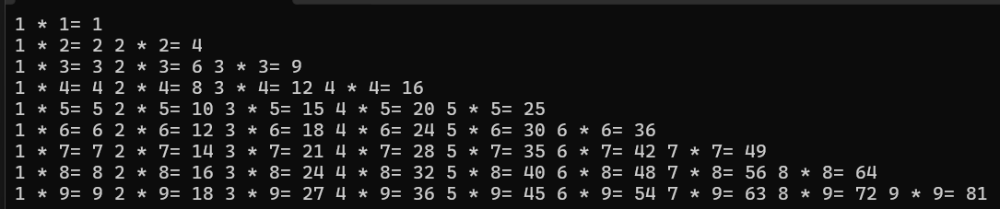


```c
#define _CRT_SECURE_NO_WARNINGS
#include <stdio.h>
int main()
{
	int i, j, n;
	scanf("%d", &n);
	while (n % 2 == 0)        
	{
		printf("请输入奇数：");
		scanf("%d", &n);
	}

	for (i = 0; i < n; i++)
	{
		for (j = 0; j < n - i - 1; j++)
			printf(" ");
		for (j = 0; j < 2*i+1; j++)
		{	
			if (j==0||j==2*i)
			{
				printf("*");
			}
			else if (i == n - 1)
				printf("*");
			else 
				printf(" ");
			
		}
		printf("\n");
	}
	return 0;
}

```

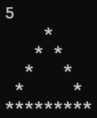


```c
#define _CRT_SECURE_NO_WARNINGS
#include <stdio.h>
int main()
{
	int i, j, n;
	scanf("%d", &n);
	while (n % 2 == 0)        
	{
		printf("请输入奇数：");
		scanf("%d", &n);
	}

	for (i = 0; i < n; i++)
	{
		for (j = 0; j < n - i - 1; j++)
			printf(" ");
		for (j = 0; j < 2 * i + 1; j++)
			printf("*");
		printf("\n");
	}
	// 下半部分
	for (i = n - 2; i >= 0; i--)
	{
		for (j = 0; j < n - i - 1; j++)
			printf(" ");
		for (j = 0; j < 2 * i + 1; j++)
			printf("*");
		printf("\n");
	}
	return 0;
}

```

​           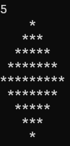          

（2）穷举法：公鸡3块钱一只，母鸡2块钱一只，小鸡5毛一只，小明有100块钱，问：花光所有的钱，有多少种购买组合。

```C
#define _CRT_SECURE_NO_WARNINGS
#include <stdio.h>
int main()
{
	/*公鸡3块钱一只，母鸡2块钱一只，小鸡5毛一只，小明有100块钱，
		问：花光所有的钱，有多少种购买组合。*/
	int count = 0;
	for(int i=0;i<=33;i++)
	{
		for(int j=0;j<=20;j++){
			for(int k=0;k<=200;k++){
				if(i*3+j*2+k*0.5==100){
					printf("公鸡：%d只，母鸡：%d只，小鸡：%d只\n",i,j,k);
					count++;
				}
			}
		}
	}
	printf("总共有%d种购买组合\n", count);
	return 0;
}

```

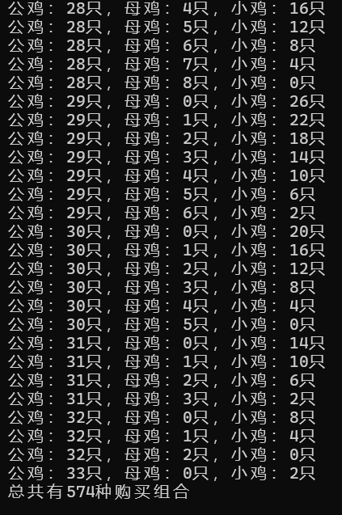

（3）.穷举法 ：百马百担问题解析

问题描述：

有 100 匹马，驮 100 担货物，其中：

大马每匹驮 3 担

中马每匹驮 2 担

小马每 2 匹驮 1 担

问：大马、中马、小马各有多少匹？

```c
#define _CRT_SECURE_NO_WARNINGS
#include <stdio.h>
int main()
{
	int count = 0;
	for(int i=0;i<34;i++)
	{
		for(int j=0;j<=50;j++){
			for(int k=0;k<200;k++){
				if((i*3+j*2+k*0.5==100)&&(i+j+k==100)){
					printf("大马：%d匹，中马：%d匹，小马：%d匹\n",i,j,k);
					count++;
				}
			}
		}
	}
	printf("总共有%d种组合\n", count);
	return 0;
}

```

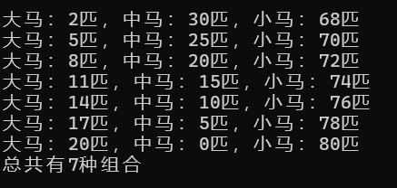

（4）题目：有红、白、黑三种球若干，其中红、白球共25个，白、黑球共31个，红、黑球共28个，求这三种球各有多少个？

```c
#define _CRT_SECURE_NO_WARNINGS
#include <stdio.h>
int main()
{
	//题目：有红、白、黑三种球若干，
	//	其中红、白球共25个，白、黑球共31个，红、黑球共28个，求这三种球各有多少个？
	int count = 0;
	for(int i=0;i<=25;i++)
	{
		for(int j=0;j<=31;j++){
			for(int k=0;k<=28;k++){
				if((i+j==25)&&(j+k==31)&&(i+k==28)){
					printf("红球：%d个，白球：%d个，黑球：%d个\n",i,j,k);
					count++;
				}
			}
		}
	}
	return 0;
}

```

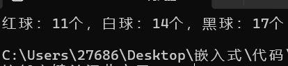

（5）题目：有 1、2、3、4 四个数字，能组成多少个互不相同且无重复数字的三位数？都是多少？

```c
#define _CRT_SECURE_NO_WARNINGS
#include <stdio.h>
int main()
{
	/*题目：有 1、2、3、4 四个数字，
		能组成多少个互不相同且无重复数字的三位数？都是多少？*/
	int count = 0;
	for(int i=1;i<=4;i++)
	{
		for(int j=1;j<=4;j++){
			for(int k=1;k<=4;k++){
				if((i!=j)&&(j!=k)&&(i!=k)){
					printf("%d%d%d\n",i,j,k);
					count++;
				}
			}
		}
	}
	printf("总共有%d个互不相同且无重复数字的三位数\n", count);
	return 0;
}

```

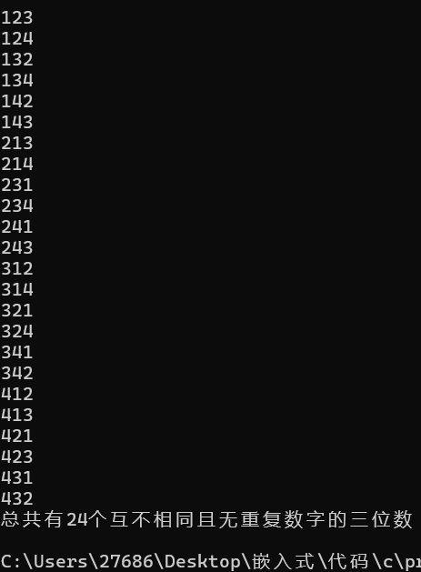

（6）输出 101 到 200 之间的素数（质数）。----理解它

```c
#define _CRT_SECURE_NO_WARNINGS
#include <stdio.h>
int main()
{
	/*（6）输出 101 到 200 之间的素数（质数）。
		----理解它*/
	int count = 0,i=0,j=0;
	for( i=101;i<=200;i++)
	{
		for( j=2;j<i;j++){
			
			if (i % j == 0)
			{
				break;
			}
		}
		if (i==j)
		{
			printf(" %d\n", i);
			count++;
		}
	}
	printf("101到200有%d个素数\n", count);
	return 0;
}

```

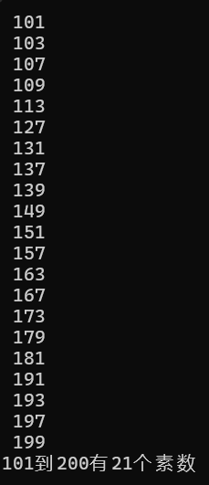

（7） 题目：古典问题（兔子生崽）：有一对兔子，从出生后第3个月起每个月都生一对兔子，小兔子长到第三个月后每个      月又生一对兔子，假如兔子都不死，问每个月的兔子总数为多少？（输出前40个月即可），并输出前40个月兔子总和

```c
#define _CRT_SECURE_NO_WARNINGS
#include <stdio.h>
int main()
{
	/*题目：古典问题（兔子生崽）：有一对兔子，从出生后第3个月起每个月都生一对兔子，
		小兔子长到第三个月后每个月又生一对兔子，假如兔子都不死，
		问每个月的兔子总数为多少（输出前40个月即可），并输出前40个月兔子总和*/
	int sum = 0,month1=1,month2=1,month=0;
	sum = month1 + month2;
	for(int i=3;i<=40;i++)
	{ 
		month = month1 + month2;
		sum += month;
		month1 = month2;
		month2 = month;
	}
	printf("前40个月兔子总数为：%d\n", sum);
	return 0;
}

```


（8） 编写一个函数，接受一个整数作为参数，计算并计算它的阶乘值。

并计算出阶乘的和n!+(n-1)!+(n-2)!……2!*1!

```c
#define _CRT_SECURE_NO_WARNINGS
#include <stdio.h>
int factorial(int n)
{
	int result = 1;
	for (int i = n ;i>=1; i--)
	{
		result *= i;
	}
	return result;

}
int main()
{
	int n;
	scanf("%d", &n);
	printf("%d",factorial(n));
	
	return 0;
}

```

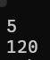

# 9.9

（1）题目：判断 101 到 200 之间的素数（质数），并输出所有质数。      

        程序分析：判断素数的方法：用一个数分别去除 2 到 sqrt(这个数)，如果能被整除，则表明此数不是素数，反之是素数。         （函数封装  先判断是不是质数，是质数是返回1 不是质数 返回0）（再封装 打印质数）

```c
#define _CRT_SECURE_NO_WARNINGS
#include <stdio.h>
int func() {
	
	for (int i = 101; i <= 200; i++)
	{
		int flag=1;
		for (int j = 2; j < i; j++)
		{
			if (i % j == 0)
			{
				flag = 0;
				break;
			}
		}
		if (flag==1)
		{
			printf(" %d  ", i);
		}

	}
	return 0;
}
int main()
{
	/*判断 101 到 200 之间的素数。

		程序分析：判断素数的方法：用一个数分别去除 2 到 sqrt(这个数)，
		如果能被整除，则表明此数不是素数，反之是素数。*/
	printf("100到200之间的素数：\n");
	func();


}
```

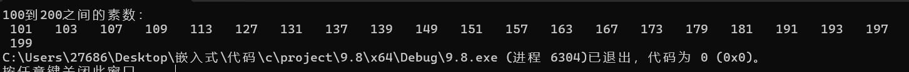

（2） 题目：封装带返回值函数  ，有四个整数形参， 输出这个四个形参中的最大值  或最小值， 

```c
#define _CRT_SECURE_NO_WARNINGS
#include <stdio.h>
int func(int a,int b,int c,int d) {
	int an[4] = { a,b,c,d },max=0,min=0;
	max=an[0];
	min= an[0];
	for(int i=0;i<4;i++)
	{
		if (an[i]>=max)
		{
			max = an[i];
		}
		if (an[i]<=min)
		{
			min = an[i];
		}
	}
	printf("最大值为%d\n", max);
	printf("最小值为%d\n", min);
	return 0;
}
int main()
{
	int a, b, c, d;
	/*封装带返回值函数  ，有四个整数形参， 输出这个四个形参中的最大值  或最小值，*/
	printf("输入四个数字\n");
	scanf("%d %d %d %d", &a, &b, &c, &d);
	func(a,b,c,d);


}
```

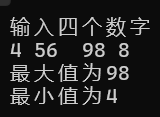

（3）斐波那契数列 输出第n项的值，及前n项的和。 （可以用普通方法，也可以用递归方法   尝试去做）

```c
#define _CRT_SECURE_NO_WARNINGS
#include <stdio.h>
int func(int n) {
	int current= 0,f1=1,f2=1,sum=0;
	for(int i=0;i<n;i++)
	{
		current = ((i == 1 || i == 0) ? 1 : f1 + f2);
		if(i > 1)
		{
			f1 = f2;
			f2 = current;
		}
		sum += current;
	}
	printf("前%d项的和为：%d\n", n, sum);
	printf("第%d项的值为：%d\n", n, current);
	return 0;
}
int main()
{
	int n;
	/*斐波那契数列 输出第n项的值，及前n项的和。 （可以用普通方法，也可以用递归方法   尝试去做）*/
	printf("请输入\n");
	scanf("%d", &n);
	func(n);


}
```

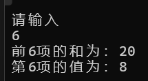


（4)猴子吃桃问题：猴子第一天摘下若干个桃子，当即吃了一半，还不瘾，又多吃了一个第二天早上又将剩下的桃子吃掉一半，又多吃了一个。以后每天早上都吃了前一天剩下的一半零一个。到第10天早上想再吃时，见只剩下一个桃子了。求第一天共摘了多少。

```c
#define _CRT_SECURE_NO_WARNINGS
#include <stdio.h>
int func() {
	int peach = 1;
	for( int i = 10; i >1; i--) {
		peach = (peach + 1) * 2;
	}
	printf("桃子%d个", peach);
	return 0;
}
int main()
{
	/*提升作业   菜鸟教程
		题目：猴子吃桃问题：猴子第一天摘下若干个桃子，当即吃了一半，还不瘾，又多吃了一个,第二天早上又将剩下的桃子吃掉一半，
		又多吃了一个。以后每天早上都吃了前一天剩下
		的一半零一个。到第10天早上想再吃时，见只剩下一个桃子了。求第一天共摘了多少。
		程序分析：采取逆向思维的方法，从后往前推断。设x1为前一天桃子数，设x2为第二天桃子数， 
		则：x2 = x1 / 2 - 1, x1 = (x2 + 1) * 2x3 = x2 / 2 - 1, x2 = (x3 + 1) * 2
		以此类推： x前 = (x后 + 1) * 2从第10天可以类推到第1天，是一个循环过程。*/
	printf("请输入\n");
	func();


}
```

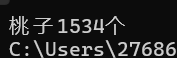

题目：一球从100米高度自由落下，每次落地后反跳回原高度的一半；再落下，求它在第10次落地时，共经过多少米？第10次反弹多高？

```c
#define _CRT_SECURE_NO_WARNINGS
#include <stdio.h>
int func() {
	float route =0,count=0;
	for (float i = 100; i > 0; i /= 2) {
		route += (i == 100) ? i : i * 2;
		count++;
		if (count == 10)
		{
			printf("第10次落地时，共经过%.5lf米\n",route);
			printf("第10次反弹高度为%.5lf米\n", i/2);
			break;
		}
	}
	return 0;
}
int main()
{
	/*一球从100米高度自由落下，每次落地后反跳回原高度的一半；
		再落下，求它在第10次落地时，共经过多少米？第10次反弹多高*/
	func();
}
```

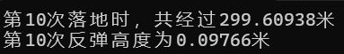

超市迎国庆，回馈新老客户，消费满1000元，商品打9.5折；满500元，打9.8折，根据用户消费金额，计算找零信息( 用函数实现)1.第一个函数 ： 一种商品    单价  数量      花费的钱数    封装

```c
#define _CRT_SECURE_NO_WARNINGS
#include <stdio.h>
float cost(float price,float count)
{ 
	return price*count;
}
float product() {
    float total = 0, price;
    int count;
    while (1) {
        printf("输入单价(0结束)：");
        scanf("%f", &price);
        if (price <= 0)
            break;
        printf("输入数量：");
        scanf("%d", &count);
        total += cost(price, count);
    }
    return total;
}
float discount(float total) {
    if (total >= 1000)
        return total * 0.95;
    else if (total >= 500)
        return total * 0.98;
    else
        return total;
}
int main()
{
	/*超市迎国庆，回馈新老客户，消费满1000元，商品打9.5折；满500元，打9.8折，
		根据用户消费金额，计算找零信息(用函数实现)1.第一个函数 ： 一种商品   
		单价  数量      花费的钱数    封装*/
\
	printf("总金额为：%.2f\n", discount(product()));


}
```

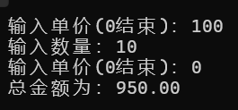


定义一个数组，输出全班学生的成绩，然后再输出    （人数由自己定义）

```c
#define _CRT_SECURE_NO_WARNINGS
#include <stdio.h>
#define N 6
int main()
{
   /* 定义一个数组，输入全班学生的成绩，然后再输出    
        （人数由自己定义）*/
    int a[N];
    printf("请输入学生成绩\n");
    for (int i = 0; i < 5; i++)
    {
        scanf("%d", &a[i]);
    }
    for (int i = 0; i < 5; i++)
    {
        printf(" %d\n", a[i]);
    }


}
```

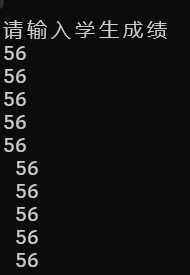

1定义长度为10的int类型数组，给数组元素依次赋值为 0，1，2，3，4，5，6，7，8，9并遍历数组中所有的元素

```c
#define _CRT_SECURE_NO_WARNINGS
#include <stdio.h>
int main()
{
    /*1定义长度为10的int类型数组，给数组元素依次赋值为 
        0，1，2，3，4，5，6，7，8，9并遍历数组中所有的元素*/
       
    int a[10];
    for (int i = 0; i < 10; i++)
    {
		a[i] = i;
		printf("%d ", a[i]);
    }

}
```

   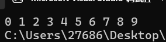

 2：定义一个int型的一维数组，包含10个元素，然后求出数组中的最大值，最小值，总和，平均值，并输出来。

  ```c
  #define _CRT_SECURE_NO_WARNINGS
  #include <stdio.h>
  int main()
  {
    /*  2：定义一个int型的一维数组，包含10个元素，
          然后求出数组中的最大值，最小值，总和，平均值，并输出来。*/
         
      int a[10] = { 5,6,9,8,2,6,45,5,6,10 }, max = 0, min = 0;
      float verage = 0, sum = 0;;
      max = a[0];
      min = a[0];
      for (int i = 0; i < 10; i++)
      {
          if (a[i] > max)
          {
  			max = a[i];
          }
          if (a[i]<min)
          {
              min = a[i];
          }
      }
      for (int j = 0;j<10;j++)
      {
          sum += a[j];
      }
      verage = sum / 10;
      printf(" max %d\n min %d\n sum %.0lf\n verage %.2lf\n ", max, min, sum, verage);
  
  }
  ```

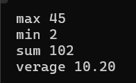

 3.评委打分
    分析以上需求，并用代码实现：
 （1）在编程竞赛中，有10位评委为参赛的选手打分，分数分别为：5，4，6，8，9，0，1，2，7，3
 （2）求选手的最后得分（去掉一个最高分和一个最低分后其余8位评委打分的平均值）

```c
#define _CRT_SECURE_NO_WARNINGS
#include <stdio.h>
#define N 10
int main()
{
  /*  3.评委打分
        分析以上需求，并用代码实现：
        （1）在编程竞赛中，有10位评委为参赛的选手打分，分数分别为：5，4，6，8，9，0，1，2，7，3
        （2）求选手的最后得分（去掉一个最高分和一个最低分后其余8位评委打分的平均值）*/
    int a[N] = {5,4,6,8,9,0,1,2,7,3},max=0,min=0;
    float verage=0,sum=0;
    max = a[0];
    min = a[0];
    for (int i = 0; i < 10; i++)
    {
        if (a[i] > max)
        {
            max = a[i];
        }
        if (a[i] < min)
        {
            min = a[i];
        }
        sum += a[i];
    }
    sum = sum - min - max;
    verage = sum / 8;
    printf("最终成绩 %.2lf", verage);

}
```


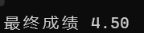

4..利用随机数 生成一个9个元素的数组，并把数组元素的反转。       （随机数可以控制在 50以内）

```c
#define _CRT_SECURE_NO_WARNINGS
#include <stdio.h>
#include <stdlib.h>
#include <time.h>
#define N 9
int main()
{
 /*   4..利用随机数 生成一个9个元素的数组，并把数组元素的反转。
        （随机数可以控制在 50以内）*/
    srand((unsigned int)time(NULL));
    int a[N];
    for (int i = 0; i < 9; i++)
    {
        a[i] = rand()%50;
       
    }
    printf("反转前\n");
    for (int i = 0; i < 9; i++)
    {
        printf(" %d ", a[i]);
    }
    for (int i = 0; i < 9/2; i++)
    {
        int temp = a[i];
        a[i] = a[8 - i];
        a[8 - i] = temp; 
    }
    printf(" \n反转后\n");
    for (int i = 0; i < 9; i++)
    {
        printf(" %d ", a[i]);
    }

}
```


   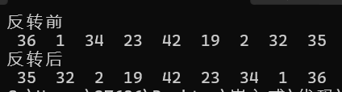
   5. 把一个数组  int arr[5]={50,10,30,60,20};  完成从小到大排序    ----利用冒泡算法可以完成

      ```C
      #define _CRT_SECURE_NO_WARNINGS
      #include <stdio.h>
      #include <stdlib.h>
      #include <time.h>
      #define N 9
      int main()
      {
          int a[5] = { 50,10,30,60,20 };
         /* 把一个数组  int arr[5] = { 50,10,30,60,20 };  
          完成从小到大排序----利用冒泡算法可以完成*/
          for (int i = 0; i < 5 - 1; i++)
          {
              for (int j = 0; j < 5 - 1 - i; j++)
              {
                  int temp=0;
                  if (a[j] > a[j+1])
                  {
                      temp = a[j];
                      a[j] = a[j + 1];
                      a[j + 1] = temp;
                  }
              }
          }
          for (int i = 0; i < 5; i++)
          {
              printf(" %d ",a[i]);
          }
      }
      ```

      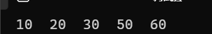

   6. 查找某一个元素，在不在数组中，如果在，返回第一次，出现的位置，如果不在，返回-1    （用函数来编程） int arr  [5]={50,10,30,60,20,10}

```c
#define _CRT_SECURE_NO_WARNINGS
#include <stdio.h>
#include <stdlib.h>
#include <time.h>
int func(int a[],int goal)
{ 
    int flag = 0;
    for (int j = 0; j < 5; j++)
    { 
        if (goal == a[j])
        {
            flag = 1;
            return j;
        }
    }
    if (flag==0)
    {
        return -1;
    }
}
int main()
{

  /*  查找某一个元素，在不在数组中，如果在，返回第一次，出现的位置，
        如果不在，返回 - 1    （用函数来编程） int arr[5] = { 50,10,30,60,20,10 }*/
    int goal = 0, a[5] = { 50,10,30,60,20 };
    printf("输入要查找的元素\n");
    for (int i = 0; i < 5; i++)
    {
        printf(" %d\n",a[i]);
    }
    scanf("%d", &goal);
    int  temp=func(a, goal);
    printf("第一次出现的位置 %d", temp);
}
```

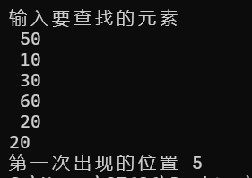

# 9.10

2.C 练习实例67
题目：输入数组，最大的与第一个元素交换，最小的与最后一个元素交换，输出数组。

```c
#define _CRT_SECURE_NO_WARNINGS
#include <stdio.h>
#include <stdlib.h>
#include "func.h"

int main()
{
    /*2.C 练习实例67
        题目：输入数组，最大的与第一个元素交换，最小的与最后一个元素交换，输出数组。*/

    int a[5];
    printf("请输入五位元素");
    for(int i=0;i<5;i++)
    {
        scanf(" %d", &a[i]);
    }
    func(a);
}

```

```c
#include <stdio.h>
int func(int a[])

{  /*2.C 练习实例67
		题目：输入数组，最大的与第一个元素交换，最小的与最后一个元素交换，输出数组。*/
	int max = 0, min = 0;
	max = a[0];
	min = a[0];
	for (int i = 0; i < 5; i++)
	{
		if (a[i] > max)
		{
			max = a[i];
		}
		if (a[i] < min)
		{
			min = a[i];
		}
	}
	for (int i = 0; i < 5; i ++ )
	{
		if (a[i] == max)
		{
			int temp=0;
			temp = a[0];
			a[0] = a[i];
			a[i] = temp;
		}
		if (a[i] == min)
		{
			int temp = 0;
			temp = a[4];
			a[4] = a[i];
			a[i] = temp;
		}
	}
	for (int i = 0; i < 5; i++)
	{
		printf(" %d ", a[i]);
	}
	return 0; 
}
```


3.C 练习实例68
题目：有 n 个整数，使其前面各数顺序向后移 m 个位置，最后m个数变成最前面的 m 个数。
程序分析：可以使用一个辅助数组来保存需要移动的元素，然后再将元素按照要求移动到正确的位置。

```c
#define _CRT_SECURE_NO_WARNINGS
#include <stdio.h>
#include <stdlib.h>
#include <time.h>
#include "func.h"
int main()
{
    /*3.C 练习实例68
        题目：有 n 个整数，使其前面各数顺序向后移 m 个位置，最后m个数变成最前面的 m 个数。
        程序分析：可以使用一个辅助数组来保存需要移动的元素，然后再将元素按照要求移动到正确的位置。*/

    int a[100],m=0,n=0;
    printf("请输入整数个数 n:");
    scanf("%d", &n);
    printf("请输入 %d 个整数:", n);
    for(int i=0;i<n;i++)
    {
        scanf(" %d", &a[i]);
    }
    printf("向后移动多少位\n");
    scanf("%d",&m);
    func(a,m,n);
}
```

```c
#include <stdio.h>
int func(int a[],int m,int n)

{
	/*3.C 练习实例68
		题目：有 n 个整数，使其前面各数顺序向后移 m 个位置，最后m个数变成最前面的 m 个数。
		程序分析：可以使用一个辅助数组来保存需要移动的元素，然后再将元素按照要求移动到正确的位置。*/
	
	int b[10];
	for (int i = 0; i < m; i++)
	{
		b[i] = a[n-m+i];
	}
	for (int i = n-1; i>m; i--)
	{
		a[i] = a[i - m];
	}
	for (int i = 0; i<m; i++)
	{
		a[i] = b[i];
	}
	for (int i = 0; i < n; i++)
	{
		printf("%d", a[i]);
	}
	return 0; 
}
```


--------------------------------------------------------------------------------------------------------
   预习二维数组  --提升作业
4.   可以用二维数组的方法    找规律
C 练习实例61 - 杨辉三角形
题目：打印出杨辉三角形（要求打印出10行）。
程序分析：
结构如下所示：

1
1    1
1    2    1
1    3    3    1
1    4    6    4    1

```c
#define _CRT_SECURE_NO_WARNINGS
#include <stdio.h>
#include <stdlib.h>
#include <time.h>
int main()
{
  /*  4.   可以用二维数组的方法    找规律
        C 练习实例61 - 杨辉三角形
        题目：打印出杨辉三角形（要求打印出10行）。
        程序分析：
        结构如下所示：

        1
        1    1
        1    2    1
        1    3    3    1
        1    4    6    4    1*/
    int a[10][10];
    for (int i = 0; i < 10; i++)
    {
        a[i][0] = 1;
        a[i][i] = 1;
    }
    for (int i = 2; i < 10; i++)
    {
        for (int j = 1; j < i; j++)
        {
                a[i][j] = a[i - 1][j - 1] + a[i - 1][j];
        }
    }
    for (int i = 0; i < 10; i++)
    {
        for (int j = 0; j <= i; j++)
        {
            printf(" %d ", a[i][j]);
        }
        printf("\n");
    }


}
```

5.自己封装一个函数，实现strlen的功能    （字符串长度计算不包含‘\0’）

```c
#define _CRT_SECURE_NO_WARNINGS
#include <stdio.h>
#include <stdlib.h>
#include <time.h>
#include "func.h"
int main()
{
   /* 自己封装一个函数，实现strlen的功能    （字符串长度计算不包含‘\0’）*/
    char a[100];
    printf("请输入字符串:");
    scanf("%s",a);
   printf("字符串长度为%d",func(a));

}
```

```c
#include <stdio.h>
int func(char a[])
{
	/*自己封装一个函数，实现strlen的功能    （字符串长度计算不包含‘\0’）*/
 int  length=0;
     while (a[length] != '\0')   // 从头数到结尾符 '\0' 为止
     {
         length++;
     }
     return length;
 }
```


6.封装一个函数，用户循环输入账号和密码，如果账号=="admin",密码=="123456"，停止输入
      提示开门成功，否则继续输入，5次还不成功，提示“锁住了，6秒后再输入”

```c
#define _CRT_SECURE_NO_WARNINGS
#include <stdio.h>
#include <stdlib.h>
#include <time.h>
#include "func.h"
int main()
{
   /* 6.封装一个函数，用户循环输入账号和密码，如果账号 == "admin", 密码 == "123456"，停止输入
        提示开门成功，否则继续输入，5次还不成功，提示“锁住了，6秒后再输入”*/
    func();
    return 0;
}
```

```c
#define _CRT_SECURE_NO_WARNINGS
#include <stdio.h>
#include <string.h>
int func()
{
   /* 6.封装一个函数，用户循环输入账号和密码，如果账号 == "admin", 密码 == "123456"，停止输入
        提示开门成功，否则继续输入，5次还不成功，提示“锁住了，6秒后再输入”*/
    char account[50],password[50];
    for (int i = 0; i < 5; i++)
    {
        printf("请输入账号:");
        scanf("%s", account);
        printf("请输入密码:");
        scanf("%s", password);
        if (strcmp(account, "admin")==0 && strcmp(password, "123456")==0)
        {
            printf("开门成功");
            return 0;
        }
        printf("密码或账户错误,请重新输入\n");

    }
    printf("你已失败超过五次,请30s后再尝试\n");
 
     return 0;
 }
```

# 9.15

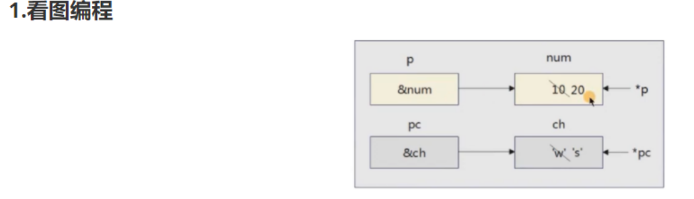

```c
#define _CRT_SECURE_NO_WARNINGS
#include <stdio.h>
int main()
{
 int num[]={10.20};
 int *p;
 char *pc;
 char ch[]={'w','s'};
 p=num;
 pc=ch;
 printf("%d %d\n",*p,*(p+1));
 printf("%c %c\n",*pc,*(pc+1));
}
```

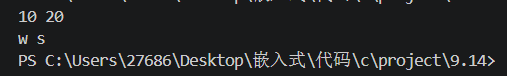

2定义指针变量p1、p2,默认各自指向整数a,b;a、b从键盘输入。设计程序，使得p1指向其中的较大值，p2指向其中的较小值。

```c
#define _CRT_SECURE_NO_WARNINGS
#include <stdio.h>
#include <stdlib.h>
#include <string.h>
#include <time.h>
int main()
{
    // 定义指针变量p1、p2,默认各自指向整数a,b;a、b从键盘输入。设计程序，使得p1指向其中的较大值，p2指向其中的较小值。
int a,b;
int *p1,*p2;
    p1=&a;
    p2=&b;
    printf("请输入a b\n");
    scanf("%d%d",&a,&b);
     printf("默认\np1 %d \np2 %d\n",*p1,*p2);
    if(a<b)
    {
        p1=&b;
        p2=&a;
    }else 
    {
    p1=&a;
    p2=&b;
    }
    printf("修改后\np1 %d \np2 %d",*p1,*p2);

}
```

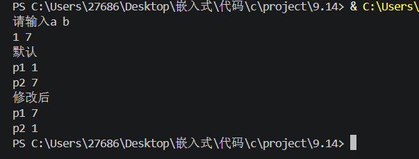

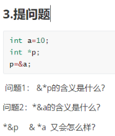

```c
#define _CRT_SECURE_NO_WARNINGS
#include <stdio.h>
#include <stdlib.h>
#include <string.h>
#include <time.h>
int main()
{

int a=10;
int *p;
p=&a;
printf(" &*P=%p \n",&*p);
printf(" *&a=%d \n",*&a);
printf(" *&P=%P \n",*&p);
// printf(" &*a=%d \n",&*a);

}
```

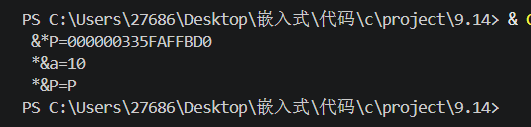

遍历一维数和二维数组，求数组是最大值和最小值(利用指针运算完成

```c
#define _CRT_SECURE_NO_WARNINGS
#include <stdio.h>
#include <time.h>
int main()
{
// 遍历一维数和二维数组，求数组是最大值和最小值(利用指针运算完成
int a[]={1,2,3,4,5,6,7,8,9};
int b[][9]={{1,2,3,4,5,6,7,8,9},
            {11,22,33,44,55,66,77,88,99},
            {111,222,333,444,555,666,777,888,999}};
int *p1,*p2;
p1=&a[0];
p2=&a[0];
for (int i= 0; i < 9; i++)
{
    if (a[i]>*p1)
    {
    p1=&a[i];
    }
    if(a[i]<*p2)
    {
        p2=&a[i];
    }
}
printf("数组a的最大值为%d 最小值为%d\n",*p1,*p2);
p1=&b[0][0];
p2=&b[0][0];
for (int i = 0; i <3; i++)
{
    for (int j = 1; j <9; j++)
    {   
        if (b[i][j]>*p1)
        {
        p1=&b[i][j];
        }
        if (b[i][i]<*p2)
        {
            p2=&b[i][j];
    
        } 
    }
}
printf("数组b的最大值为%d 最小值为%d",*p1,*p2);
}
```

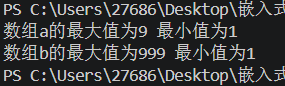

# 

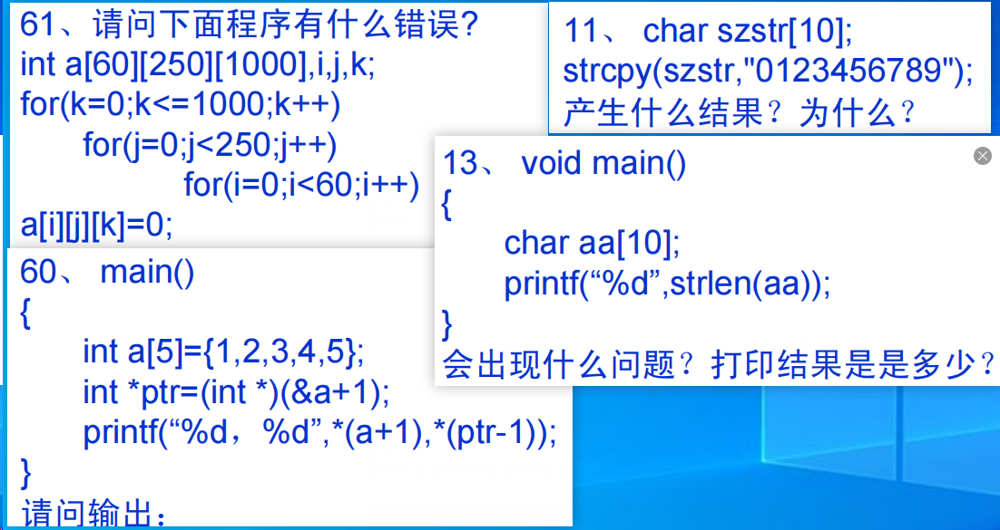

### 

61、请问下面程序有什么错误？

int a[60][250][1000], i, j, k;

for(k = 0; k <= 1000; k++)
    for(j = 0; j < 250; j++)
        for(i = 0; i < 60; i++)
            a[i][j][k] = 0;

```c
int定义在main函数里占用栈空间太大溢出
```

11、char szstr[10];

strcpy(szstr, "0123456789");

产生什么结果？为什么？

```c
szstr只有10字节,写入时候写入了11字节还有'\0' 结束符
```

60、main()
{
    int a[5] = {1, 2, 3, 4, 5};
    int *ptr = (int *)(&a + 1);

printf("%d, %d", *(a + 1), *(ptr - 1));

}

请问输出：

```c
2 5
```

13、void main()
{
    char aa[10];

printf("%d", strlen(aa));

}

会出现什么问题？打印结果是多少？

```c
越界 随机读取到的数组中的'\0'
```

# 9.16

（1）定义一个函数指针变量ptr，指向无参数、无返回值的函数。然后定义一个函数say_hi，它打印出"Hello, World!"，使用函数指针调用该函数。

```c
#define _CRT_SECURE_NO_WARNINGS
#include <stdio.h>
#include <stdlib.h>
void say_hi(void){

	printf("hello,world");
}
int main()
{
	/*（1）定义一个函数指针变量ptr，指向无参数、无返回值的函数。然后定义一个函数say_hi，
		它打印出"Hello, World!"，使用函数指针调用该函数。*/
	void(*ptr)(void);
	ptr= say_hi;
	ptr();
	return 0;
}
```

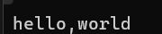

（2）编写一个函数get_res，它接受两个整型参数和一个函数指针opt作为回调函数。get_res函数将调用回调函数对给定的两个整数进行操作，并返回结果。编写两个回调函数max和min，分别返回2个整数的最大值和最小值。在主函数中调用get_res函数来演示这两个回调函数。

```c
#define _CRT_SECURE_NO_WARNINGS
#include <stdio.h>
#include <stdlib.h>
int MAX(int a, int b)
{
	if (a > b);
	return a;
}
int MIN(int a, int b)
{
	if (a > b);
	return b;
}
int get_res(int a,int b,int (*opt)(int,int))
{ 
	return  opt(a, b);
}
int main()
{
	//（2）编写一个函数get_res，它接受两个整型参数和一个函数指针opt作为回调函数。
	//	get_res函数将调用回调函数对给定的两个整数进行操作，并返回结果。
	//	编写两个回调函数max和min，分别返回2个整数的最大值和最小值。
	//	在主函数中调用get_res函数来演示这两个回调函数。
	int a = get_res(6, 1, MIN);
	int b = get_res(6, 1, MAX);
	printf("a=MIN=%d b=MAX=%d",a,b);
}
```

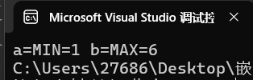

 （3）编写一个程序，要求用户输入5个整数，将它们存储在一个数组中，然后计算并输出这5个整数的平均值。（用指针去操作）


（4）编写一个函数find_index，接受一个整型数组、数组的长度和一个整数作为参数，查找并返回该整数在数组中的索引位置。如果该整数不存在于数组中，则返回-1。在主函数中定义一个包含10个元素的数组，并调用find_index函数查找某个整数的索引位置并输出。

（5）编写一个程序，接受用户输入的一个字符串，然后统计字符串中数字字符的个数并输出。

（6）请编写程序，定义一个字符 指针数组，用来存储四大名著的书名，并通过遍历该指针 数组，显示字符串信息，（即：定义一个指针数组，该数组的每个元素，指向的是一个字符串）。

# 9.17

   1）编程创建一个BOX结构体，在其中定义三个成员表示一个立方体的长、宽和高，长宽高可以通过控制参输入。

```c
#define _CRT_SECURE_NO_WARNINGS
#include <stdio.h>
struct BOX
{
	float len;
	float weight;
	float hight;
};

int main()
{
	/*1）编程创建一个BOX结构体，
		在其中定义三个成员表示一个立方体的长、宽和高，
		长宽高可以通过控制参输入。*/
	struct BOX box;
	printf("请输入长宽高");
	scanf("%f%f%f", &box.len, &box.weight, &box.hight);
	printf("长宽高分别为 %.2f %.2f %.2f", box.len, box.weight, box.hight);
	return 0;
}

```

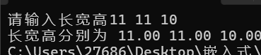

   2）定义一个函数获取立方体的体积（volume）。

```c
#define _CRT_SECURE_NO_WARNINGS
#include <stdio.h>
struct BOX
{
	float len;
	float weight;
	float hight;
};
int func(float a, float b, float c)
{ 
	return a * b * c;

}

int main()
{
	/*2）定义一个函数获取立方体的体积（volume）。*/
	struct BOX box;
	printf("请输入长宽高");
	scanf("%f%f%f", &box.len, &box.weight, &box.hight);
	printf("长宽高分别为 %.2f %.2f %.2f\n", box.len, box.weight, box.hight);
	float d=func(box.len,box.weight,box.hight);
	printf("长方体体积为%.2f",d);
	return 0;
}

```

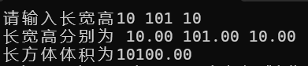

   3）创建一个结构体，打印给定尺寸的立方体的体积。

```c
#define _CRT_SECURE_NO_WARNINGS
#include <stdio.h>
struct BOX
{
	float len;
	float weight;
	float hight;
};
int func(float a, float b, float c)
{ 
	return a * b * c;

}
int main()
{
	/*创建一个结构体，打印给定尺寸的立方体的体积。*/
	struct BOX box;
	printf("请输入长宽高");
	scanf("%f%f%f", &box.len, &box.weight, &box.hight);
	printf("长宽高分别为 %.2f %.2f %.2f\n", box.len, box.weight, box.hight);
	float d=func(box.len,box.weight,box.hight);
	printf("长方体体积为%.2f",d);
	return 0;
}

```

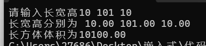

   4）下面题思考   ---面试题中提取  
      用变量a给出下面的定义      

​	a.一个有10个指针的数组，该指针是指向一个整型数 的;
​      b. 一个指向有10个整型数数组的指针 ;
​     c.一个指向函数的指针，该函数有一个整型参数并返 回一个整型数;
​     d.一个有10个指针的数组，该指针指向一个函数，该 函数有一个整型参数并返回一个整型数;

```c
int* p[10];
int (*p)[10];
int (*p)(int);
int(* p[10])(int);
```

   5）请问以下代码有什么问题：

char* s="AAA";
printf("%s",s);
s[0]='B';
printf("%s",s);   有什么错？

    s 指向字符串常量，不能修改

 6）int (*s[10])(int) 表示的是什么?              函数指针数组   （同第4题 的d）

    一个有十个指针的数组指向一个函数,该函数包含整型形参的函数返回整形数

3. 作业--提升

1）.定义一个结构体Person，包含人的姓名和年龄两个成员变量。编写程序，创建一个Person类型的结构体数组，包含3个人的信息，并输出每个人的姓名和年龄。

```c
#define _CRT_SECURE_NO_WARNINGS
#include <stdio.h>
struct Person
{
	char name[20];
	int age;
};

int main()
{
	/*1）.定义一个结构体Person，包含人的姓名和年龄两个成员变量。
		编写程序，创建一个Person类型的结构体数组，包含3个人的信息，
		并输出每个人的姓名和年龄。*/
	struct Person people[3] =
	{
		{"小胖",18},
		{"小鸡",20},
		{"小宇",22}
	};
	for (int i = 0; i < 3; i++)
	{
		printf("姓名：%s，年龄：%d\n", people[i].name, people[i].age);
	}
	return 0;
}

```

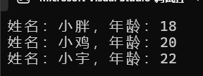

2）输入一个班级的学生信息（包含id 、name 、gender、score）,并把学习成绩超过全班平均成绩的学生找出来，输出这部分学生的姓名和成绩。

```c
#define _CRT_SECURE_NO_WARNINGS
#include <stdio.h>
struct Student
{
	int id;
	char name[20];
	char	gender[10];
	float score;
};

int main()
{
	/*2）输入一个班级的学生信息（包含id 、name 、gender、score）,
		并把学习成绩超过全班平均成绩的学生找出来，输出这部分学生的姓名和成绩。*/
	struct Student stu[100];
	int n;
	float sum = 0;
	printf("请输入学生人数\n");
	scanf("%d", &n);
	for (int i = 0; i <n; i++)
	{
		printf("输入第%d个学生id信息\n",i+1);
		scanf("%d", &stu[i].id);
		printf("输入第%d个学生name信息\n",i+1);
		scanf("%s", &stu[i].name);
		printf("输入第%d个学生gender信息\n",i+1);
		scanf("%s", &stu[i].gender);
		printf("输入第%d个学生score信息\n",i+1);
		scanf("%f", &stu[i].score);
		sum += stu[i].score;
	}
		float average = sum/n;
		printf("高于平均分的学生为");
		for (int i = 0; i < n; i++)
		{
			if (stu[i].score > average)
			{
				printf("学生是 %s  成绩 %.2f\n",stu[i].name, stu[i].score);
			}
		}
	return 0;
}

```

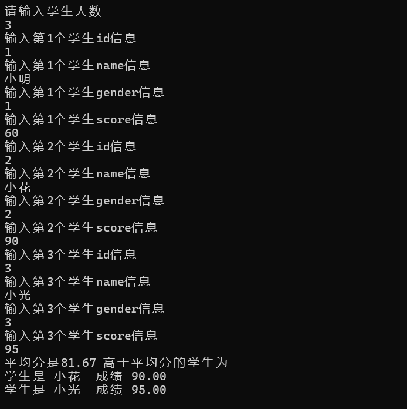

3）编写一个统计选票的系统，根据先后输入的侯选人姓名，统计各人的得票数。

```c

#include <stdio.h>
#include <string.h>

struct Candidate
{
    char name[20];
    int count;
};

int main()
{
    struct Candidate c[3] = {
        {"张三", 0},
        {"李四", 0},
        {"王五", 0}
    };

    char name[20];
    int i, j;

    for (i = 0; i < 5; i++)
    {
        scanf("%s", name);

        for (j = 0; j < 3; j++)
        {
            if (strcmp(name, c[j].name) == 0)
            {
                c[j].count++;
                break;
            }
        }
    }

    for (i = 0; i < 3; i++)
    {
        printf("%s %d\n", c[i].name, c[i].count);
    }

    return 0;
}
```

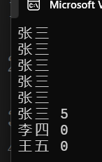

# 9.18周测

1. 数组元素的反转   int  arr[5]={10,2,8,4,5};    

```c
#define _CRT_SECURE_NO_WARNINGS
#include <stdio.h>
int main() {
    //1.  数组元素的反转   int  arr[5] = { 10,2,8,4,5 };
    int  a[5] = { 10,2,8,4,5 };
    for (int i = 0; i < 5/2; i++)
    {
        int  b = a[i];
        a[i] = a[4 - i];
        a[4 - i] = b;
    }
    for (int i = 0; i < 5; i++)
    {
        printf("%d ", a[i]);
    }
}       


```

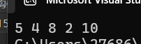

2.查找某一个元素，在不在数组中，如果在，返回第一次，出现的位置，如果不在，返回-1    （用函数来编程） int arr[5]={50,10,30,60,10};

```c
#define _CRT_SECURE_NO_WARNINGS
#include <stdio.h>
int   func(int  a[],int  find,int len)
{
    for (int i = 0; i < len; i++)
    {
        if (a[i] == find)
            return i + 1;
    }
    return -1;
}
int main() {
  /*  2.查找某一个元素，在不在数组中，如果在，
        返回第一次，出现的位置，如果不在，返回 - 1    
        （用函数来编程） */
        int a[5] = { 50,10,30,60,10 },find=0,len=0;
        len = sizeof(a) / sizeof(a[0]);
        printf("输入查找元素\n");
        scanf("%d",&find);
        int c = func(a, find, len);
        printf("元素出现的位置是%d", c);
}       


```

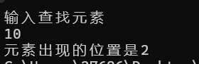

3.定义指针变量 p1、p2,默认各自指向整数a,b ;  a、b从键盘输入。设计程序，使得p1指向其中的较大值，p2指向其中的较小值。

```c
#define _CRT_SECURE_NO_WARNINGS
#include <stdio.h>
int   func(int *p1,int *p2)
{
    int *temp;
    if (*p1 < *p2)
    {
        temp = *p1;
        *p1 = *p2;
        *p2 = temp;
    }
   

}
int main() {
    /*3.定义指针变量 p1、p2, 默认各自指向整数a, b; 
    a、b从键盘输入。设计程序，使得p1指向其中的较大值，
        p2指向其中的较小值。*/
    int a, b;
    int* p1=&a, * p2=&b;
    scanf("%d%d", &a, &b);
    func(p1, p2);
    printf("max=%d,min=%d", *p1, *p2);
    return 0;
}       


```

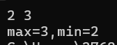

4.编写一个函数get_res，它接受两个整型参数和一个函数指针opt作为回调函数。get_res函数将调用回调函数对给定的两个整数进行操作，并返回结果。编写两个回调函数max和min，分别返回2个整数的最大值和最小值。在主函数中调用get_res函数来演示这两个回调函数。

```c
#define _CRT_SECURE_NO_WARNINGS
#include <stdio.h>
int MAX(int a, int b)
{
    return (a>b) ? a :b;
}
int MIN(int a, int b)
{
    return (a<b) ? a: b;
}
int get_res(int a, int b, char* opt(int, int))
{
    return opt(a, b);
}
int main() {
    /*4.编写一个函数get_res，它接受两个整型参数和一个函数指针opt作为回调函数。
        get_res函数将调用回调函数对给定的两个整数进行操作，并返回结果。
        编写两个回调函数max和min，分别返回2个整数的最大值和最小值。
        在主函数中调用get_res函数来演示这两个回调函数。*/
    int a, b;
    scanf("%d %d", &a, &b);
   int max1=get_res(a, b,MAX);
   int min2 = get_res(a, b, MIN);
   printf("max = % d  min = %d", max1, min2);

    return 0;
}       


```

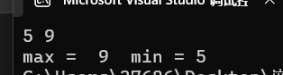

5.动态生成一个5个元素的一维数组并输出（10分）

```c
#define _CRT_SECURE_NO_WARNINGS
#include <stdio.h>
#include <stdlib.h>
#include <time.h>

int main()
{
    int *p;
    int i;

    // 动态申请5个int类型的空间
    p = (int *)malloc(5 * sizeof(int));

    // 设置随机数种子
    srand((unsigned int)time(NULL));

    // 随机生成5个数并保存到数组中
    for (i = 0; i < 5; i++)
    {
        p[i] = rand() % 100;   // 生成0~99的随机数
    }

    for (int i = 0; i < 5; i++)
    {
        printf("%d ", p[i]);
    }
    free(p);
    p = NULL;

    return 0;
}       


```

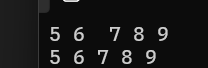

6.请编写程序，定义一个字符指针数组，用来存储四大名著的书名，并通过遍历该指针 数组，显示字符串信息。

```c

.
    v #define _CRT_SECURE_NO_WARNINGS
#include <stdio.h>
#include <stdlib.h>
#include <time.h>

int main()
{
   /* 6.请编写程序，定义一个字符指针数组，
        用来存储四大名著的书名，并通过遍历该指针 数组，显示字符串信息。*/
    char* p[4] = {
        {"西游记"},
        {"水浒传"},
        {"三国演义"},
        {"红楼梦"}
                };
    for (int i = 0; i < 4; i++)
    {
        printf("%s\n", p[i]);
    }
}       


``````..
    Z
```

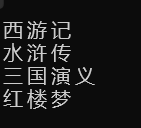

7.编写一个统计选票的系统，根据先后输入的侯选人姓名，统计各人的得票数。

```c
#define _CRT_SECURE_NO_WARNINGS
#include <stdio.h>
#include <stdlib.h>
#include <time.h>
typedef struct Ticket {
	char name[20];
	int num;
}ticket;
int main()
{
   /* 7.编写一个统计选票的系统，根据先后输入的侯选人姓名，统计各人的得票数。*/
	ticket tk[3] =
	{ {"小鸡",0},{"小明",0},{"小红",0} };
	char temp[10];
	printf("为小鸡 小明 小红 投票\n");
	for (int i = 0; i < 10; i++)
	{
		scanf("%s",temp);
		for (int j = 0; j < 3; j++) {
			if (strcmp(temp, tk[j].name) == 0)
			{
				tk[j].num++;
			}
		}
	}
	for (int i = 0; i < 3; i++)
	{
		printf("%s 的票数是%d \n", tk[i].name, tk[i].num);
	}
}       


```

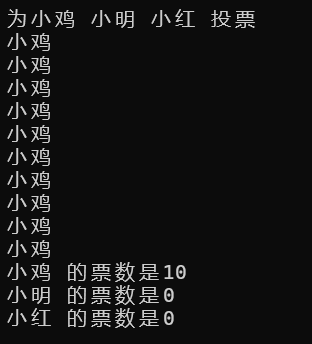

# 学生管理系统

```c
#define _CRT_SECURE_NO_WARNINGS
#include <stdio.h>
#include <stdlib.h>
#include <time.h>
#include <string.h>
typedef  struct Student
{
	char name[20];
	int age;
	char gender[10];
}student;
void Save(student stu[], int len)
{
	FILE* fp = fopen("student.dat", "wb");

	if (fp == NULL)
	{
		printf("保存失败\n");
		return;
	}

	// 先保存当前学生人数
	fwrite(&len, sizeof(int), 1, fp);

	// 再保存学生数据
	fwrite(stu, sizeof(student), len, fp);

	fclose(fp);
}
int Load(student stu[])
{
	FILE* fp = fopen("student.dat", "rb");

	// 第一次运行，没有文件
	if (fp == NULL)
	{
		return -1;
	}

	int len=0;

	// 读取人数
	fread(&len, sizeof(int), 1, fp);
	if (len < 0 || len > 100)
	{
		fclose(fp);
		return -1;
	}

	// 读取学生
	fread(stu, sizeof(student), len, fp);

	fclose(fp);

	return len;
}
int add(student stu[], int *len)
{
	printf("请输入添加学生的 姓名 年龄 性别\n");

	scanf("%s", stu[*len].name);
	scanf("%d", &stu[*len].age);
	scanf("%s", stu[*len].gender);
	printf("编号 姓名 年龄 性别\n");
	(*len)++;
	for (int i = 0; i < *len; i++)
	{
		printf("%d    %s    %d   %s\n", i + 1, stu[i].name, stu[i].age, stu[i].gender);
	}
	return *len;
}
int delet(student stu[], int *len)
{

	char temp[20];
	printf("请输入删除学生的姓名\n");
	scanf("%s",temp);
	for (int i = 0; i < *len; i++)
	{
		/*int number = 0;*/

		if (strcmp(temp,stu[i].name) == 0)
		{
			for (i; i < *len - 1; i++)
			{
				stu[i] = stu[i + 1];
			}
			(*len)--;
		}
	}
	printf("编号 姓名 年龄 性别\n");
	for (int i = 0; i < *len; i++)
	{
		printf("%d    %s    %d   %s\n", i + 1, stu[i].name, stu[i].age, stu[i].gender);
	}
	return *len;
}
void  Search(student stu[], int len)
{
	char name[20];
	printf("请输入要查询学生的姓名");
	scanf("%s", name);
	for (int i = 0; i < len; i++)
	{
		if (strcmp(name, stu[i].name) == 0)
		{
			printf("%d    %s    %d   %s\n", i + 1, stu[i].name, stu[i].age, stu[i].gender);
		}
	}
}
void  Modify(student stu[], int len)
{
	char name[20];
	printf("请输入要修改的学生姓名");
	scanf("%s", name);
	for (int i = 0; i < len; i++)
	{
		if (strcmp(name,stu[i].name) == 0)
		{
			printf("%d    %s    %d   %s\n", i + 1, stu[i].name, stu[i].age, stu[i].gender);
			printf("输入修改后的信息");
			scanf("%s    %d   %s", stu[i].name, &stu[i].age, stu[i].gender);
			printf("%d    %s    %d   %s\n", i + 1, stu[i].name, stu[i].age, stu[i].gender);
			break;
		}
	}
}
void  ShowStu(student stu[], int len)
{
	printf("所有学生信息如下 \n");
	printf("编号 姓名 年龄 性别\n");
	for (int i = 0; i < len; i++)
	{
		printf("%d    %s    %d   %s\n", i + 1, stu[i].name, stu[i].age, stu[i].gender);
	}
}

int Show()
{
	printf("欢迎使用学生信息管理系统\n");
	printf("*======================*\n");
	printf("*1添加                 *\n");
	printf("*2显示                 *\n");
	printf("*3查询                 *\n");
	printf("*4修改                 *\n");
	printf("*5删除                 *\n");
	printf("*6清屏                 *\n");
	printf("*7退出                 *\n");
	printf("*======================*\n");

	return 0;
}
int main()
{
	student stu[100] = {
		{"a",18,"man"},{"b",19,"women"},{"c",20,"man"},{"d",20,"man"}
	};
	int inst = 0, len = 4, flag = 1;
	int temp = Load(stu);

	if (temp != -1)
	{
		len = temp;
	}
	Show();
	while (flag == 1)
	{
		printf("请输入1~7的指令:");
		scanf("%d", &inst);
		switch (inst) {
		case 1: add(stu, &len);//添加
			break;
		case 2:  ShowStu(stu, len);//显示
			break;
		case 3:  Search(stu, len);//查询
			break;
		case 4:  Modify(stu, len);//修改
			break;
		case 5: delet(stu, &len);//删除
			break;
		case 6:   system("cls");
				Show();//清屏
			break;
		case 7:  flag = 0;
			Save(stu, len);  
			break;//退出
		}
	}

}

```

# 9.20

题目：写 C 函数，统计 1 个字节里面二进制位为 1 的个数

```c
unsigned int TestAsOne0(char ch)
{
    int i;
    unsigned int num=0, val;
    for(i=0; i<8; i++)   //1字节=8bit，循环8次
    {
        val = ch >> i;     //右移i位，把第i位移到最低位
        val &= 0x01;       //和0x01(二进制00000001)按位与，只保留最低位
        if(val)
            num++;        //最低位是1，计数+1
    }
    return num;
}

```

题目：C 函数，字符串转整数（简易版 atoi）

```c
int Invert(char *str)
{
    int num=0;
    while(*str!='\0')
    {
        int digital=*str-48;
        num=num*10+digital;
        str=str+1;
    }
    return num;
}
                                                                 
```

# 9.21

静态顺序表

```c
#define _CRT_SECURE_NO_WARNINGS
#include <stdio.h>
#include <stdlib.h>
#define  MAX 100                // 空间个数
typedef  struct  sqlist {
	int  data[MAX];
	int len;  //顺序表长度            data中添加的元素的数
}sqlist;

//0.菜单
void help_menu() {
	printf("\n");
	printf("\t欢迎操作顺序表\n");
	printf("*=======================================*\n");
	printf("* 1. 创建顺序表\t\t\t\t*\n");
	printf("* 2. 打印顺序表\t\t\t\t*\n");
	printf("* 3. 追加一个节点\t\t\t\t*\n");
	printf("* 4. 插入一个节点\t\t\t\t*\n");
	printf("* 5. 删除一个节点\t\t\t\t*\n");
	printf("* 6. 修改一个节点\t\t\t\t*\n");
	printf("* 7. 查找顺序表中的元素\t\t\t\t*\n");
	printf("* 8. 销毁顺序表\t\t\t\t*\n");
	printf("* 9 清屏\t\t\t\t*\n");
	printf("* 10. 退出\t\t\t\t*\n");
	printf("*=======================================*\n");
	printf("\n");
}

//1.创建顺序表     如果用指针定义的变量   动态开空间
//  传址  （直接定义二级指针  &S）              传值  (定义一级指针， 返回一个指针)
sqlist* createList() {
	sqlist* s = (sqlist*)malloc(sizeof(sqlist));
	if (s == NULL) {
		printf("空间开辟失败\n");
		return NULL;
	}
	//开辟成功   结构初始一下
	s->len = 0;//顺序的长度
	printf("顺序表初始化成功\n");
	return s;

}

//2.打印顺序表   assert()         assert.h
void printList(sqlist* s) {
	if (s== NULL) {
		printf("空间开辟失败\n");
		return;
	}
	for (int i = 0; i < s->len; i++) {
		printf("%d\t", s->data[i]);
	}
	printf("\n");
}
void addlist(sqlist* s,int num)
{
	if (s->len >= MAX)
	{
		printf("空间已满\n");
		return;
	}
	s->data[s->len] = num;
	s->len++;
	printf("追加成功\n");
}
void insertlist(sqlist* s, int num, int index)
{
	if (index < 0 || index >= s->len)
	{
		printf("超出范围\n");
		return;
	}
	if (s->len >= MAX)
	{
		printf("空间已满\n");
		return;
	}
	for (int i = s->len; i >= index; i--)
	{
		s->data[i + 1] = s->data[i];
	}
	s->data[index] = num;
	printf("插入成功\n");
	s->len++;
}
void delectlist(sqlist* s, int index)
{
	if (index < 0 || index >= s->len)
	{
		printf("超出范围\n");
		return;
	}
	for (int i = s->len; i >= index; i--)
	{
		s->data[i] = s->data[i+1];
	}
	s->len--;
	printf("删除成功\n");
}
void changelist(sqlist* s, int num, int index)
{
	if (index < 0 || index >= s->len)
	{
		printf("超出范围\n");
		return;
	}
	s->data[index] = num;
	printf("修改成功\n");
}
void findlist(sqlist* s, int num, int index)
{
	if (index < 0 || index >= s->len)
	{
		printf("超出范围\n");
		return;
	}
	printf("%d对应的的值为%d\n", index, s->data[index]);
}
int main() {
	sqlist* s = NULL;
	help_menu();
	int flag = 1;
	int num,index;
	int cmd;
	while (flag) {
		printf("请输入一个菜单指令1~7：");
		scanf("%d", &cmd);
		switch (cmd) {
		case 1:
			//1.创建顺序表
			s= createList();
			break;
		case 2:
			//2.打印顺序表
			printList(s);
			break;
		case 3:
			//3.追加一个节点
			printf("请输入追加的值");
			scanf("%d",&num);
			addlist(s, num);
			break;
		case 4:
			//4.插入一个节点
			printf("插入的值");
			scanf("%d",&num);
			printf("插入的位置0~%d",s->len);
			scanf("%d",&index);
			insertlist(s, num,index);
			break;

			break;
		case 5:
			//5.删除一个节点
			printf("删除的位置");
			scanf("%d", &index);
			delectlist(s,index);
			break;
		case 6:
			//6.修改一个节点
			printf("修改的值");
			scanf("%d", &num);
			printf("修改元素的位置");
			scanf("%d", &index);
			changelist(s, num, index);
			break;
		case 7:
			//7.查找顺序表中的元素
			printf("查找元素的值");
			scanf("%d", &num);
			printf("查找元素的位置");
			scanf("%d", &index);
			findlist(s, num, index);
			break;
		case 8:
			//8.销毁顺序表
			free(s);
			s = NULL;
			break;
		case 9:
			//6.清屏
			//system("pause");
			system("cls");
			help_menu();
			break;
		case 10:
			//7.退出
			flag = 0;
			break;
		default:
			//重新输入正确的指令
			break;
		}
	}
	return 0;
}
/*
一、线性表 -----逻辑结构来分它是线性结构

线性结构是一种数据结构，线性表典型的的线性结构
	  具有相同数据类型的n个数据元素的集合

	特点：
	1.存在唯一的第一个元素
	2.存在唯一的最后一个元素
	3.除了第一个元素外，其它元素，都有一个直接前驱
	4.除了最后一个元素外，其它元素，都有一个直接后继

	线性表的物理存储---顺序表      ，链表

	运算操作： 创键       增   删   改 查               销毁  等操作

二、顺序表
   1.各元素的逻辑顺序跟物理顺序一致，第i项就存在第i个位置。
		用数组方法来操作
  2.对顺序表中的所有元素，既可以顺序访问，也可以随机访问。
   for(int i=0;i<n;i++){
   }
  有索引号    arr[2]

   3.插入删除操作不方便，需要移动大量元素

  理解起来好理解，数组用的多

  三、操作顺序表
	  #define  MAX 100                 //空间个数
	 1. 定义结构体
	   typedef  struct  sqlist{
			int  data[MAX];
			int len;  //顺序表长度            data中添加的元素的数
	   }sql;

		typedef  struct  sqlist{
			int  * data;
			int n;//开辟几块空间  ，len==n   扩容
			int len;  //顺序表长度            data中添加的元素的数
	   }sql;


	   2. 定义结体变量 ，或者结构指针
	   sql  S;
	   sql * S=NULL;
*/

```


动态顺序表

```c
#define _CRT_SECURE_NO_WARNINGS
#include <stdio.h>
#include <stdlib.h>
#define  MAX 100                // 空间个数
typedef  struct  sqlist {
	int  *data;
	int n;
	int len;  //顺序表长度            data中添加的元素的数
}sqlist;

//0.菜单
void help_menu() {
	printf("          欢迎操作线性表中---顺序表\n");
	printf("* ======================================================= *\n");
	printf("* 1. 初始化动态数组                                       *\n");
	printf("* 2. 释放动态数组                                         *\n");
	printf("* 3. 调整动态数组内存大小                                 *\n");
	printf("* 4. 获取动态数组元素个数                                 *\n");
	printf("* 5. 在指定位置指入新元素                                 *\n");
	printf("* 6. 删除指定位置的元素，并返回被删除的元素               *\n");
	printf("* 7. 遍历所有元素                                         *\n");
	printf("* 8. 在末尾添加元素                                        *\n");
	printf("* 9 清屏                                                  *\n");
	printf("* 10 退出                                                  *\n");
	printf("* ======================================================= *\n");
}

//1.创建顺序表     如果用指针定义的变量   动态开空间
//  传址  （直接定义二级指针  &S）              传值  (定义一级指针， 返回一个指针)
void initlist (sqlist* s, int n)
{
	s->data = (int*)(sqlist*)malloc(n*sizeof(sqlist));
	if (s->data== NULL) {
		printf("空间开辟失败\n");
		return ;
	}
	s->n = n;
	s->len = 0;
	printf("动态顺序表初始化成功\n");
}

//2.释放动态数组    
void freelist(sqlist* s)
{
	free(s);
	s->data = NULL;
	s->len = 0;
	s->n = 0;
}
//3调整动态数组内存大小
void changelist(sqlist *s,int rewnum) 
{
	s->data = (int*)realloc(s->data,rewnum * sizeof(int));
	s->n = rewnum;
}
//4获取动态数组元素个数 
int getsize(sqlist *s)
{
	return s->len;
}
//5.在指定位置指入新元素
int addlist(sqlist* s, int index,int num)
{
	if (index<0 || index>s->len)
	{
		return -1;
	}
	if (s->len == s->n)
	{
		changelist(s, s->n * 2);
	}
	for (int i = s->len; i >= index; i--)
	{
		s->data[i] = s->data[i - 1];
	}
	s->data[index] = num;
	s->len++;
}
//6.删除指定位置的元素，并返回被删除的元素 
int delectlist(sqlist* s, int index)
{
	if (index<0 || index>s->len)
	{
		return -1;
	}
	int delect = s->data[index];
	for (int i = s->len; i >= index; i--)
	{
		s->data[i-1] = s->data[i];
	}
	s->len--;
	printf("删除的元素是%d\n",delect);	
	return 0;
}
//7.遍历所有元素  
void alllist(sqlist* s)
{
	for (int i =0;i<s->len; i++)
	{
		printf("%d\t", s->data[i]);
	}
	printf("\n");
}
//8.在末尾添加元素 
void addendlist(sqlist* s,int num)
{
	addlist(s, s->len, num);
}
int main() {
	sqlist* s = NULL;
	help_menu();
	int flag = 1;
	int newnum,index,cmd,size,num;
	while (flag) {
		printf("请输入一个菜单指令1~9：");
		scanf("%d",&cmd);
		switch (cmd) {
		case 1:
			//1.初始化动态数组
		initlist(&s,5);
			break;
		case 2:
			//2.释放动态数组
			freelist(&s);
			break;
		case 3:
			//3.调整动态数组内存大小 
			printf("请输入新的大小");
			scanf("%d", &newnum);
			changelist(&s,newnum);
			break;
		case 4:
			//4.获取动态数组元素个数 
			 size = getsize(&s);
			 printf("%d\n",size);
			break;
		case 5:
			//5.在指定位置指入新元素
			printf("输入要插入的位置");
			scanf("%d",&index);
			printf("输入要插入的元素");
			scanf("%d", &num);
			addlist(&s,index,num);
			break;
		case 6:
			//6.删除指定位置的元素，并返回被删除的元素 
			printf("删除元素的位置");
			scanf("%d",&index);
			delectlist(&s,index);

			break;
		case 7:
			//7.遍历所有元素    
			alllist(&s);
			break;
		case 8:
			//8.在末尾添加元素 
			 printf("添加的的元素");
			scanf("%d", &num);
			addendlist(&s,num);
			break;
		case 9:
			//6.清屏
			//system("pause");
			system("cls");
			help_menu();
			break;
		case 10:
			//7.退出
			flag = 0;
			break;
		default:
			//重新输入正确的指令
			break;
		}
	}
	return 0;
}
/*
一、线性表 -----逻辑结构来分它是线性结构

线性结构是一种数据结构，线性表典型的的线性结构
	  具有相同数据类型的n个数据元素的集合

	特点：
	1.存在唯一的第一个元素
	2.存在唯一的最后一个元素
	3.除了第一个元素外，其它元素，都有一个直接前驱
	4.除了最后一个元素外，其它元素，都有一个直接后继

	线性表的物理存储---顺序表      ，链表

	运算操作： 创键       增   删   改 查               销毁  等操作

二、顺序表
   1.各元素的逻辑顺序跟物理顺序一致，第i项就存在第i个位置。
		用数组方法来操作
  2.对顺序表中的所有元素，既可以顺序访问，也可以随机访问。
   for(int i=0;i<n;i++){
   }
  有索引号    arr[2]

   3.插入删除操作不方便，需要移动大量元素

  理解起来好理解，数组用的多

  三、操作顺序表
	  #define  MAX 100                 //空间个数
	 1. 定义结构体
	   typedef  struct  sqlist{
			int  data[MAX];
			int len;  //顺序表长度            data中添加的元素的数
	   }sql;

		typedef  struct  sqlist{
			int  * data;
			int n;//开辟几块空间  ，len==n   扩容
			int len;  //顺序表长度            data中添加的元素的数
	   }sql;


	   2. 定义结体变量 ，或者结构指针
	   sql  S;
	   sql * S=NULL;
*/

```

# 10.13

1、定义两个重载函数，分别能求矩形和圆的周长，然后在 main 函数中对这两个函数进 

行调用并测试其功能。求矩形的周长时需要输入矩形的长和宽；求圆的周长时需要输入圆的 

半径。 

```c
#include <iostream>
using namespace std;

// 重载1：矩形周长，传两个参数（长、宽）
double zhouchang(double length, double width)
{
    return 2 * (length + width);
}

// 重载2：圆的周长，传一个参数（半径）
double zhouchang(double radius)
{
    return 2 * 3.1415926 * radius;
}

int main()
{
    double a, b, r;

    cout << "请输入矩形的长和宽：";
    cin >> a >> b;
    cout << "矩形周长：" << zhouchang(a, b) << endl; // 传两个参数 → 自动调矩形版本

    cout << "请输入圆的半径：";
    cin >> r;
    cout << "圆的周长：" << zhouchang(r) << endl; // 传一个参数 → 自动调圆的版本

    return 0;
}

```


2、定义一个学生类，有学生的姓名、语文成绩、数学成绩和英语成绩4个属性，将其封装，再给出计算总成绩的方法，计算平均分的方法，输出学生信息(姓名、语数英各科成绩，总成绩、平均分)的方法

在类外创建对象传入参数，并调试

```c
#include <iostream>
using namespace std;

class student
{
private:
    string name;
    float chinese;
    float math;
    float english;

public:
    student(string n, float c, float m, float e)
        : name(n), chinese(c), math(m), english(e) {}
    void sum()
    {
        float s = chinese + math + english;
        cout << name << "的总成绩是 " << s << endl;
    }

    void average()
    {
        float avg = (chinese + math + english) / 3;
        cout << name << "的平均分是 " << avg << endl;
    }

    void show()
    {
        float s = chinese + math + english;
        float avg = s / 3;
        cout << "姓名：" << name << endl;
        cout << "语文：" << chinese << "  数学：" << math << "  英语：" << english << endl;
        cout << "总成绩：" << s << "  平均分：" << avg << endl;
    }
};

int main()
{
    student s("张三", 90, 85, 95); // 类外创建对象，传参数
    s.show();
    return 0;
}

```


3、幼儿园老师Teacher类，属性姓名和性别，性别默认是女。要求封装，给出姓名 的可读和可写接口。然后给出show方法，打印其中的属性值。

```c
#include <iostream>
using namespace std;

class teacher
{
private:
    string name;
    string gender;

public:
    teacher(string n, string g = "女"); // 类内只声明
    ~teacher();

    string getName();
    void setName(string n);
    void show();
};
// 类外实现，用 类名::函数名
teacher::teacher(string n, string g) : name(n), gender(g) {}
teacher::~teacher() {}
string teacher::getName()
{
    return name;
}

void teacher::setName(string n)
{
    name = n;
}

void teacher::show()
{
    cout << "姓名：" << name << "，性别：" << gender << endl;
}

int main()
{
    teacher t1("张老师");
    t1.show();

    t1.setName("王老师");
    cout << "读取到的姓名：" << t1.getName() << endl;
    t1.show();
    return 0;
}

```

# 10.14

封装一个ClassRoom类，教室的长、宽、总面积    总个数等属性，

创建若干个教室对象，最后输出教室(所有教室)的总面积和总个数

```c
#include <iostream>
// 封装一个ClassRoom类，教室的长、宽、总面积    总个数等属性，

// 创建若干个教室对象，最后输出教室(所有教室)的总面积和总个数
using namespace std;
class Classroom
{
private:
    int len;
    int width;

public:
    static int sum;
    static int S_area;
    Classroom(int len, int width) : len(len), width(width)
    {
        sum++;
        int s = len * width;
        S_area += s;
    };

    int area()
    {
        return len * width;
    }
};
int Classroom::sum = 0;
int Classroom::S_area = 0;
int main()
{
    Classroom c1(10, 5);
    Classroom c2(8, 4);
    Classroom c3(12, 6);

    cout << "教室总个数：" << Classroom::sum << endl;
    cout << "所有教室总面积：" << Classroom::S_area << endl;
    return 0;
}


```


1、写一个类Fish，有品种和重量两个属性，属性的类型自己选择，要求属性封装。

2、写一个类Cat,Cat中有一个公有的成员函数：

Fish& eat(Fish &f);

eat函数的功能要求判断Fish的品种：

如果品种是“秋刀鱼”，则输出“无论多沉，我都爱吃”，同时修改Fish&f的重量为0，并作为函数的返回值返回。

如果品种不是“秋刀鱼”，判断鱼的重量，若重量大于200，吃鱼输出信息并返回一个重量为0的Fish，若重量小于200，输出信息，不要修改鱼的重量，直接返回鱼的对象。

```c
#include <iostream>
using namespace std;
class Fish
{
private:
    string breed;  // 品种
    double weight; // 重量
public:
    Fish(string breed, double weight)
        : breed(breed), weight(weight) {}
        bool judge()
        {
            if("秋刀鱼"==breed)
            {
                return true;
            }
            else
                return false;
        }
        void change_weight(double weight)
        {
            this->weight = weight;
        }
        double get_weight()
        {
            return this->weight;
        }
};

class Cat
{
public:
    Fish& eat(Fish &f)
    {
    if (f.judge())
        {
        f.change_weight(0);
        cout << "无论多沉，我都爱吃" << endl;
        }
    else if(f.get_weight()>200)
    {
        cout << "虽然不是秋刀鱼，好歹是条大雨，吃光光。喵！" << endl;
        f.change_weight(0);
    }
    else{
            cout << "不吃" << f.get_weight() << "克的小鱼，太小了，猫猫不开心" << endl;
        }
        return f;

        }
};
int main(){
    while(true){
        cout << "~~~快来与小猫对话吧~~~" << endl;
        string bre;
        double wei;
        cout << "=====请主人输入=====" << endl;
        cout << "要投喂鱼的品种:";
        cin >> bre;
        cout << "要投喂鱼的重量:";
        cin >> wei;

        Fish f(bre,wei);

        //小猫回话了
        Cat cat;
        cat.eat(f);
        cout << endl;
        cout <<endl;


    }
}


```

11、猫吃鱼练习修改（举一反三）

1、写一个类Fish，有4个属性，用来存储鱼的品种和重量，以及一共给猫喂的所有鱼(包括被小猫放生的)的数量和总重量，属性的类型自己选择，要求属性封装。

2、写一个类Cat,有两个属性，用来存储一只猫吃的鱼的条数和鱼的重量，要求封装。

3、Cat中有一个公共的成员函数：Fish& eat(Fish &f);

​     eat函数的功能要求判断Fish的品种：

​     		如果品种是“秋刀鱼”，则输出“无论多沉，我都爱吃”，

​     同时修改Fish&f的重量为0，该猫吃鱼的条数+1，重量加上现在吃的这条鱼的重量，并返回该鱼对象。

​    		如果品种不是“秋刀鱼”，判断鱼的重量，若重量大于200，吃鱼输出信息并返回一个重量为0的	

​     Fish，猫吃鱼的条数+1，总重量加上现在吃的这条鱼的重量，若重量小于200，输出信息，不要修改鱼的重

​     量，且猫吃的鱼的条数不变，总重量也不变直接返回鱼的对象。

3、还要实现一直喂猫，直到猫吃的重量>1000，停止喂猫，此时可以输出喂给猫的所有鱼的条数(包括猫不吃的)，和所有鱼的总重量。

```c
#include <iostream>
#include <string>
using namespace std;
// 1、写一个类Fish，有4个属性，用来存储鱼的品种和重量，以及一共给猫喂的所有鱼(包括被小猫放生的)的数量和总重量，属性的类型自己选择，要求属性封装。
// 2、写一个类Cat,有两个属性，用来存储一只猫吃的鱼的条数和鱼的重量，要求封装。
// 3、Cat中有一个公共的成员函数：Fish& eat(Fish &f);
//      eat函数的功能要求判断Fish的品种：
//      		如果品种是“秋刀鱼”，则输出“无论多沉，我都爱吃”，
//      同时修改Fish&f的重量为0，该猫吃鱼的条数+1，重量加上现在吃的这条鱼的重量，并返回该鱼对象。
//     		如果品种不是“秋刀鱼”，判断鱼的重量，若重量大于200，吃鱼输出信息并返回一个重量为0的
//      Fish，猫吃鱼的条数+1，总重量加上现在吃的这条鱼的重量，若重量小于200，输出信息，不要修改鱼的重
//      量，且猫吃的鱼的条数不变，总重量也不变直接返回鱼的对象。

class Fish
{
private:
    string breed;
    double weight;

public:
    static int count;
    static double weights;
    Fish(string breed, double weight) : breed(breed), weight(weight)
    {
        count++;
        weights += weight;
    }
    bool is_fish()
    {
        if ("秋刀鱼" == breed)
        {
            return true;
        }
        else
            return false;
    }
    double get_weight()
    {
        return weight;
    }
    void change_weight(double weight)
    {
        this->weight = weight;
    }
    void show()
    {
        cout << "所有小鱼的重量:" << weights << endl;
        cout << "鱼的数量:" << count << endl;
    }
};
int Fish::count = 0;
double Fish::weights = 0;
class Cat
{
private:
    int count;
    double weight;

public:
    Cat() : count(0), weight(0) {};
    Fish &eat(Fish &f)
    {
        if (f.is_fish())
        {
            count++;
            double temp = f.get_weight();
            weight += temp;
            f.change_weight(0);
            cout << "“秋刀鱼无论多沉，我都爱吃”" << endl;
        }
        else if (f.get_weight() > 200)
        {
            count++;
            double temp = f.get_weight();
            weight += temp;
            f.change_weight(0);
            cout << "“不是秋刀鱼我也爱吃”" << endl;
        }
        else
        {
            cout << "“太小了我不喜欢吃”" << endl;
        }
        return f;
    }
    void show()
    {
        cout << "我目前吃了" << this->count << "条鱼了" << "总重量是" << this->weight << endl;
    }

    // 展示所有猫

    // 获取猫吃的鱼的重量
    double get_weight() const
    {
        return this->weight;
    }
};
// 3、还要实现一直喂猫，直到猫吃的重量>1000，停止喂猫，
// 此时可以输出喂给猫的所有鱼的条数(包括猫不吃的)，和所有鱼的总重量。
int main()
{
    Cat c1;
    cout << "开始喂猫吧" << endl;
    while (1)
    {
        string bre;
        double wei;
        cout << "请输入鱼的品种" << endl;
        cin >> bre;
        cout << "请输入鱼的重量" << endl;
        cin >> wei;
        Fish f(bre, wei);
        c1.eat(f);
        // 猫吃的总重量超过1000，停止投喂
        if (c1.get_weight() > 1000)
        {
            cout << "\n猫猫吃饱啦，停止投喂！" << endl;
            break;
        }
        cout << endl;
    }
    // 输出最终统计
    cout << "\n===== 投喂统计 =====" << endl;
    cout << "投喂鱼的总条数（含不吃的）：" << Fish::count << endl;
    cout << "投喂鱼的总重量：" << Fish::weights << " 克" << endl;
    c1.show();
    return 0;
}
```

把升级版的猫吃鱼改成多文件编程

```c

```

