### 12

```
#define _CRT_SECURE_NO_WARNINGS
#include <stdio.h>
int main()
{
	/*判断 101 到 200 之间的素数。

		程序分析：判断素数的方法：用一个数分别去除 2 到 sqrt(这个数)，
		如果能被整除，则表明此数不是素数，反之是素数。*/

	int i, j;
	printf("100到200之间的素数：\n");
	for (i = 101; i <= 200; i++)
	{
		for (j = 2; j < i; j++)
		{
			if (i % j == 0)
			{
				break;
			}
		}
		if (j == i)
		{
			printf("%d   ", i);
		}

	}

}
```

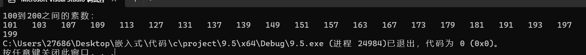


### 13

```c
#define _CRT_SECURE_NO_WARNINGS
#include <stdio.h>
#include <corecrt_math.h>
int digits(int num);
int isArmstrong(int num);
int main()
{
	/*题目：输入范围打印出所有的"水仙花数"*/
	int a, b, c, min, max;

	printf("输入范围：\n");
	scanf("%d %d", &min, &max);
	for (int i=min; i <=max;i++)
	{
		if(isArmstrong(i))
		{
			printf("%d\n", i);
		}
	}
}
int digits(int n)
{
	int count = 0;
	while (n > 0)
	{
		n /= 10;
		count++;
	}
	return count;
}
int isArmstrong(int n)
{
	int sum = 0;
	int temp = n;
	int d = digits(n);
	while (temp > 0)
	{
		int digit = temp % 10;
		sum += pow(digit, d);
		temp /= 10;
	}
	return sum == n;
}
```

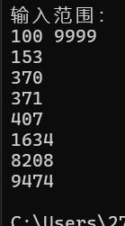


### 14

```c
#define _CRT_SECURE_NO_WARNINGS
#include <stdio.h>
int digits(int num);
int isArmstrong(int num);
int main()
{
	/*将一个正整数分解质因数。例如：输入 90, 打印出 90 = 2 * 3 * 3 * 5。*/
	int num;
	scanf("%d", &num);
	for (int i = 2; i < num; i++)
	{
		while(num % i == 0)
		{
			printf("%d ", i);
			num /= i;
			if (num!=1)
			{
				printf("*");
			}
			
		}
	}
}
```

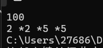


### 15

```c
#define _CRT_SECURE_NO_WARNINGS
#include <stdio.h>
int digits(int num);
int isArmstrong(int num);
int main()
{
	/*利用条件运算符的嵌套来完成此题：学习成绩 >= 90分的同学用A表示，
		60 - 89分之间的用B表示，60分以下的用C表示。
		程序分析：(a > b) ? a : b这是条件运算符的基本例子。*/
	int score;
	char lv;
	scanf("%d", &score);
	lv = (score >= 90) ? 'A' : (score >= 60) ? 'B' : 'C';
	printf("%c\n", lv);
}
```

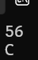


### 16

```c
#define _CRT_SECURE_NO_WARNINGS
#include <stdio.h>
int digits(int num);
int isArmstrong(int num);
int main()
{
	/*输入两个正整数m和n，求其最大公约数和最小公倍数
		a 和 b 的最大公约数，等于 b 和 a 除以 b 余数的最大公约数，
		以可以一直缩小规模直到余数为 0。
	最小公倍数就简单了，两个数相乘再除以最大公约数就行。还是 24 和 18，乘积是 432，除以最大公约数 6，
	得到72，这就是最小公倍数
	原理是两个数的乘积等于它们最大公约数和最小公倍数的乘积。*/
	int a, b, r,m, n;
	scanf("%d %d", &m, &n);
	a = m;
	b = n;
	while (b != 0)
	{
		r = a % b;
		a = b;
		b = r;
	}
	printf("最大公约数为：%d\n", a);
	r = m * n / a;
	printf("最小公倍数为：%d\n", r);
}
```

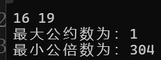

### 17

```c
#define _CRT_SECURE_NO_WARNINGS
#include <stdio.h>
#include <stdlib.h>  
#include <time.h> 

int main()
{
    /*题目：输入一行字符，分别统计出其中英文字母、空格、数字和其它字符的个数。
        程序分析：利用while语句, 条件为输入的字符不为'\n'。*/
    char a;
    int english = 0,space=0,other=0,digital=0;
    while ((a = getchar()) != '\n')
    {
        if ((a >= 'a' && a <= 'z') || (a >= 'A' && a <= 'Z'))
        {
            english++;
        }
        else if (a == ' ')
        {
            space++;
        }
        else if (a >= '0' && a <= '9')
        {
            digital++;
        }
        else
        {
            other++;
        }
    }
        printf("英文字母个数为：%d\n", english);
		printf("空格个数为：%d\n", space);
		printf("数字个数为：%d\n", digital);
		printf("其他字符个数为：%d\n", other);
}
```

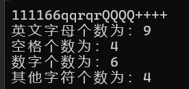


### 18

 ```c
 #define _CRT_SECURE_NO_WARNINGS
 #include <stdio.h>
 #include <stdlib.h>  
 #include <time.h> 
 
 int main()
 {
  /*   题目：求 s = a + aa + aaa + aaaa + aa...a 的值，其中 a 是一个数字，
         例如 2 + 22 + 222 + 2222 + 22222 (此时共有5个数相加)，几个数相加有键盘控制。
         程序分析：关键是计算出每一项的值。*/
     int a=0,count=0, sum=0;
 	printf("请输入一个数字：");
     scanf("%d", &a);
 	printf("请输入要相加的个数：");
     scanf("%d", &count);
     for(int i=0; i<count; i++)
     {
         int temp = 0;
         for(int j=0; j<=i; j++)
         {
             temp = temp * 10 + a; // 计算每一项的值
         }
         sum += temp; // 累加到总和
 	}
     printf("结果是：%d\n", sum);
 	return 0;
 
 
 }
 ```

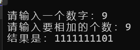

### 19

```c
#define _CRT_SECURE_NO_WARNINGS
#include <stdio.h>
#include <stdlib.h>  
#include <time.h> 

int main()
{
	//	题目：一个数如果恰好等于它的因子之和，这个数就称为"完数"，
	//	例如 6 = 1＋2＋3 ，请编程找出 1000 以内的所有完数。
	int b[100];
	for (int i = 1; i <1000; i++)
	{
		int count = 0;
		for ( int j = 1; j < i; j++)
		{
			if (i % j == 0)
			{
				b[count] = j;
				count++;
			}
		}
		int temp=0;
		for(int k = 0; k < count; k++)
		{

			temp += b[k];
		}
		if (i == temp)
		{
			printf(" %d \n", i);
		}
	}

}
```

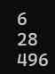

### 20

```c
#define _CRT_SECURE_NO_WARNINGS
#include <stdio.h>
#include <stdlib.h>  
#include <time.h> 

int main()
{
  /* 
        题目：一球从100米高度自由落下，每次落地后反跳回原高度的一半；
        再落下，求它在第10次落地时，共经过多少米？第10次反弹多高？
        程序分析：见下面注释。*/

	int count=0;
	double sum = 0;
    for (double i = 100; i > 0; i = i / 2)
    {
        sum += (i == 100) ? i : (2 * i);
        count++;
        if (count == 10)
        {
            printf("第10次落地时，共经过%f米\n", sum);
            printf("第10次反弹高度为%f米\n", i/2.0 );
            break;

        }
    }
}
```

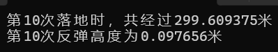

### 21

```c
#define _CRT_SECURE_NO_WARNINGS
#include <stdio.h>
#include <stdlib.h>  

int main()
{
	/*题目：猴子吃桃问题：猴子第一天摘下若干个桃子，当即吃了一半，还不瘾，又多吃了一个
		第二天早上又将剩下的桃子吃掉一半，又多吃了一个。以后每天早上都吃了前一天剩下
		的一半零一个。到第10天早上想再吃时，见只剩下一个桃子了。求第一天共摘了多少。
		程序分析：采取逆向思维的方法，从后往前推断。
		1) 设x1为前一天桃子数，设x2为第二天桃子数， 则：
		x2 = x1 / 2 - 1, x1 = (x2 + 1) * 2
		x3 = x2 / 2 - 1, x2 = (x3 + 1) * 2
		以此类推： x前 = (x后 + 1) * 2
		2) 从第10天可以类推到第1天，是一个循环过程。*/
	int sum = 1;
	for (int i = 10; i >=1; i--)
	{
		sum = (sum + 1) * 2;
	}
	printf("第一天共摘了%d个桃子\n", sum);
}
```

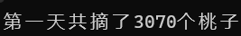

### 24

```c
#define _CRT_SECURE_NO_WARNINGS
#include <stdio.h>
#include <stdlib.h>
#include <string.h>
#include <time.h>
int main()
{
// 题目：有一分数序列：2/1，3/2，5/3，8/5，13/8，21/13...求出这个数列的前20项之和。
// 程序分析：请抓住分子与分母的变化规律。
    float sum1=0,sum2=0,sum=0;
    int a[20]={0},b[20]={0},count=0;
    a[0]=2,b[0]=1;
for (int i = 0; i < 20; i++)
{ count++;
    sum+=(double)a[i]/b[i];
    a[i+1]=a[i]+b[i];
    b[i+1]=a[i];
    printf("%.3lf %d \n",sum,count);
}

}

```

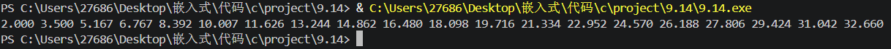

# 25

```c
```

