# 01_day  c的基础知识

## 一、笔记软件的设置

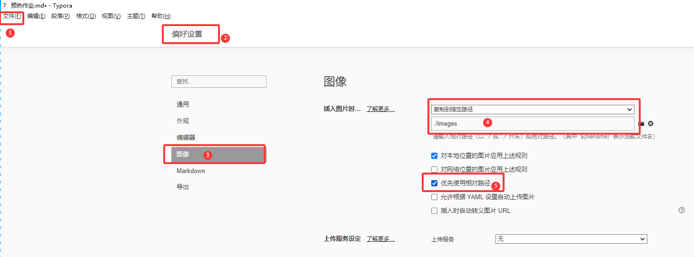

## 二、c语言是什么

c是编程语言，用于人机交互，  由一系列的语法和语义规则来描述程序行为逻辑，计算机底层是二进制语言，计算机需要把程序转为二进制，由CPU来执行。

语言=语法+逻辑

语言种类很多  Java  Python   c++   JavaScript .......


## 三、语言的发展

   第一代  机器语言           二进制   0   1代码       

   第二代  汇编语言         推广和移植困难   对环境有依赖性

  第三代  高级语言       C也是高级 相对于  Java 不算更高级           移植性好   对硬件没有限制


## 四、语言的由来

  C语言是UNIX系统的开发工具，   由汇编---B---C语言，最终由C语言来编写UNIX系统，丹尼斯 .  里奇   是c语言之父。


## 五、C语言特点：

​    简洁            高效          可移植性          模块化（函数和结构）     标准化

## 六、C的应用领域

### 1.系统软件 

​     操作系统    编译器         数据库 等

### 2.嵌入式系统  

   智能穿戴   智能汽车

### 3.游戏开发

  电脑 和手机游戏

### 4.网络设备

   路由器   防火墙


## 七、c语言标准

​    C89    C90        C99（变长数组   变量声明    内部函数）        C11 (2011)   对C++兼容性     ....

## 八、软件安装看课件，第一个程序

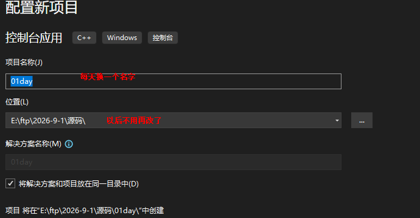

```c
#define _CRT_SECURE_NO_WARNINGS
#include  <stdio.h>
int main() {
	printf("hello world^~^\n");
	printf("马上下课^~^\n");

	int num;
	//scanf_s(" %d",&num);  //输入
	scanf(" %d", &num);
	//输出
	printf("num=%d\n", num);
	return 0;
}


/*
一、解释基础代码
#include  <stdio.h>      
包含            头文件  ----库函数         printf()             scanf()


    int                   main() {
//返回值是整数       入口函数   ---程序执行开始的地方

     //  代码块   放在 {}

	return 0;
	//结束函数   返回结果0    0表示成功     其它表示失败          省略上面的话，也会返回0
}

二、输入输出的认识
printf("hello world^~^\n");     //   "" 里面的内容 原样输出   \n换行
    int num;
	scanf_s(" %d",&num);  //输入

三、输入时用scanf()这个函数有报错 ，有两种解决方案
   方法一：scanf_s(）;
   方法二：#define _CRT_SECURE_NO_WARNINGS
                scanf(" %d", &num);

四、注释    
    行注释   //        块注释             ctrl+/                   ctrl+shift +/                ctrl +k + c  注释   ctrl+k + u   取消注释

*/
```


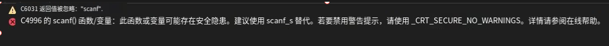

## 九、	变量知识

### 1.变量的概念

​    可以变化量，每个变量都会一个名字，名字就是变量名或标志符。

   在计算机程序中，变量是用来存储数据的一块内存区域，并用一个名字来表示这个区域。

### 2.变量定义及操作方法

> ####  
一、变量的定义方法
>
>    1. 先定义，再赋值
>       数据类型  变量名;
>       数据类型  变量名1,变量名2;
>       变量名=值;
>       变量名1=值1,变量名2=值2;
>
>    
>
>    2.定义的同时，即赋值   ---变量初始化
>       数据类型  变量名=值;
> 	  数据类型  变量名1=值1,变量名2=值2;
>
> 注意：变量名不能重复 ，  局部变量不赋值，是未知的，直接输出是报错。
>
>
> 二、操作变量
>     1.（增  删）--不操作
> 	2.改      变量名=新值;            以最后一次赋值为最后结果
> 	3.查 （取数据  输出数据）     直接输出即可
>
> 作业：  int a=10,b=20;      交换变量后           结果  a=20; b=10;
> 

                  ```c
                       #include <stdio.h>
                  int main() {
                  	//1. 先定义，再赋值
                  	int  a;  // 定义变量，变量名为a
                  	a = 10; //把10赋值给变量a
                  
                  	int b, c; //多变量定义以  逗名隔开
                  	/*b = 20;
                  	c = 30;*/
                  	b = 20, c = 30;  
                  
                  	//输出
                  	printf("a=%d\n", a);
                  	printf("b=%d c=%d\n", b, c);
                  
                  	//int e;
                  	//printf("e=%d\n", e);// 报错
                  	//------------------------------------------------------------
                  
                  	//2.定义的同时，即赋值-- - 变量初始化
                  	int a1 = 100;
                  	int b1 = 200, c1 = 300;
                  	printf("a1=%d  b1=%d   c1=%d\n", a1, b1, c1);


​                  
​                  	//--------------------------------------
​                  	 //3. 操作     改        （查） 取
​                  	a = 1000;
​                  	a = 500;
​                  	a = 50;
​                  	printf("a=%d\n", a);//a=50
​                  
​                  	a = b;  //把b赋值给变量a    b的值不变     修改是a的值
​                  	printf("a=%d\n", a);//a=20
​                  
​                  	return 0;
​                  }
​                  ```

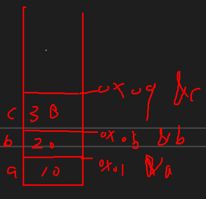


### 3.变量名的命名规则 （5点）

> 1.可以字母（a~z  A~Z）、数字（0~9）、下划线组成，不能以数字开头
>
> 2.严格区分大小写   Age      age;
>
> 3.建议有下划线命名法及驼峰命名法。     stu_name        stuName     StuName
>
> 4.见名知意，但是不要用中文命名。     count         flag       score    gender    
> 5.不要使用关键字命名      （不用记）
>      if    else       break     continue        (data  code   单片机中)     static    ....

```c
char     int         short   long    float   double    signed     unsigned    static    extern  
if  else   switch   case   break  continue     for     while       do    
auto  return  default       struct  enum  union    sizeof    const  typedef    volatile ...    
```


### 4.变量定义和变量声明的区别  （面试题）

>
> ​      extern int a;
> ​      int a=10;
>
> 	 1.定义变量，是开辟的空间，同一作用域不能重名定义
> 	 2.声明变量，是不开辟的空间，只是告诉编译器 变量在别的地方已开过空间了，可以直接使用。  声明变量可以声明多次       关键字是extern
>
>
> 	 声明应用场景：   定义在main函数外 的后面             ，跨文件使用变量     
> 	
>

```c
#include <stdio.h>
//声明
//extern int num;
extern int num;
extern int n;
int main() {
	int a123=10;
	int _a12 = 20;
	//int 12a;  //错
	//int a#12; //错
	//int if;  //错
	int if_1=10;
	printf("num=%d\n", num);
	printf("n=%d", n);
	return 0;
}
 int num = 10;

```

other.c

```c
int n = 20;
```


## 十、作业--交换变量的值

int a=10,b=20;      交换变量后           结果  a=20; b=10;

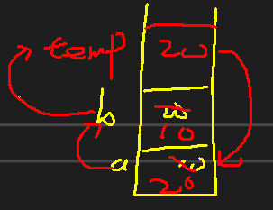

```c
#include <stdio.h>
int main() {
	int a = 10, b = 20;
	int temp;
	printf("a=%d  b=%d\n", a, b);

	temp = b;
	b = a;
	a = temp;
	printf("a=%d  b=%d\n", a, b);
	
	return 0;
}
//int a=10,b=20;      交换变量后           结果  a=20; b=10;
```

## 十一、数据类型及字符型知识

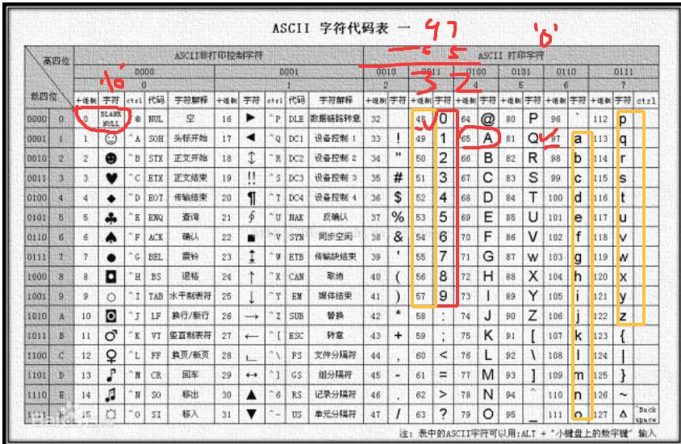

```c
#include <stdio.h>
int main() {
	//1.
	char  ch = 'A';//  单引号中只能有一个字符         汉字就不行
	printf("ch=%c\n", ch);//ch=A

	//char ch1 = 'he12';
	//printf("ch1=%c\n", ch1);//ch1=2
	//2.
	char ch2 = 'a';
	printf("ch2=%c  ch2=%d\n", ch2, ch2);//ch2=a  ch2=97
	char ch3 = 97;
	printf("ch3=%c  ch3=%d\n", ch3, ch3);

	//3. 值域     -128~127 正常                     
	char ch4 = 127;  //   0 111 1111      1 111 1111             1000 0000  规定-128
	//ch4 = 128;
	//ch4 = -129;
	printf("ch4=%d\n", ch4);

	unsigned  char ch5 = 255;  //无符号    1111   1111
	//ch5 = 256;
	printf("ch5=%d\n", ch5);

	//4.
	size_t len = sizeof(char);
	printf("len=%zu\n", len);//len=1

	printf("%zu\n", sizeof(int));//4
	return 0;
}

/*
一、数据类型分类  （四大类）
 1.基本数据类型---   字符型   char
                                整型       int        short int            long int       long long int
								实型（浮点型）   --单精度   float     双精度 double

 2.构造数据类型---    数组 Array         结构体 struct        共用体 union    枚举enum

 3.指针类型 ----  数据类型  *                    char * str="hello";

 4.空类型---void 类型
    void  fn( void){
	//无返回值  无形参
	
	}

	void *


	二、字符型 char
	   1.由 单引号引起来     里面只能有一个字符            ‘a’           char
	   2.字符型是一个字节的整型     字型的ASCII码
	             %c        %d       值   0~127
	   3.字符型    赋数字     值域                          有符号  -128~127
	                                                      无符号 0~255
      4. 测量数据类型大小 
	   size_t   len=sizeof(数据类型或变量名);

	     %zu

	   typedef  unsigned long long int  size_t;       


	   作业：  补充群里发的导图   补充上数据类型 的关键字   及 占字节大小
	         char   int    short     long  long  float   double         int *
	
	*/
```

##  十二 ：作业：

​    1.  补充群里发的导图   补充上数据类型 的关键字   及 占字节大小

​	         char   int    short     long  long  float   double         int *

2. 输入一个大写字母 转为小写  ，小写转为大写   （有基础话，可以增加条件语句）
3.  '0'    '\0' 有什么区别？（输出字符或输出数字的角度来表达）

```c
#define _CRT_SECURE_NO_WARNINGS
#include <stdio.h>
int main() {
	char ch = 'a';
	size_t len = sizeof(char);
	printf("len=%zu\n", len);//len=1
	//------------------------------------------
	printf("sizeof(int)=%zu\n", sizeof(int));//sizeof(int)=4
	printf("sizeof(short int)=%zu\n", sizeof(short int));  //2
	printf("sizeof(long int)=%zu\n", sizeof(long int)); //4
	printf("sizeof(long long int)=%zu\n", sizeof(long long )); //8
	printf("sizeof(float)=%zu\n", sizeof(float));//4
	printf("sizeof(double)=%zu\n", sizeof(double));//8
	printf("sizeof(double long)=%zu\n", sizeof(double long)); //8   
	//---------------------------------------------------------------
	printf("sizeof(double *)=%zu\n", sizeof(double *)); //8
	printf("sizeof(char *)=%zu\n", sizeof(char*));//8

	/*
	len=1
sizeof(int)=4
sizeof(short int)=2
sizeof(long int)=4
sizeof(long long int)=8
sizeof(float)=4
sizeof(double)=8
sizeof(double long)=8
sizeof(double *)=8
sizeof(char *)=8
	编译平台不一样    字节数会调整    比如：  int      51单片机   2字节     32单片机  4字节
	
	*/
//-----------------
	char  ch1;
	printf("输入一个字母：");
	scanf(" %c", &ch1);
	if (ch1 >= 'A' && ch1 <= 'Z') {
		ch1 = ch1 + 32;
		printf("转为小写ch1=%c", ch1);
	}
	else if (ch1 >= 'a' && ch1 <= 'z') {
		ch1 = ch1 - 32;
		printf("转为大写ch1=%c", ch1);
	}
	else {
		printf("不合法");
	}
	//-----------------

	char ch2 = '0';
	printf("ch2=%c   ch2=%d\n", ch2, ch2);//ch2=0   ch2=48

	char ch3 = '\0';
	printf("ch3=~~~%c~~~   ch3=%d", ch3, ch3);//ch2=''   ch2=0
	return 0;
}

/*
一、测常见数据类型长度
   数据单位     bit 位  0     1
                      Byte                          1B=8bit
					  KB   MB  GB  TB  PB            1KB=1024B      1MB=1024KB

 char   占1字节
 size_t len=sizeof(char);          %zu      %llu    %lld


 二、
 2. 输入一个大写字母 转为小写  ，小写转为大写   （有基础话，可以增加条件语句）
    ‘a’---97         'A'----65                    差值是32
 3. '0'    '\0' 有什么区别？（输出字符或输出数字的角度来表达）
     48      0
     '0'        ''
*/
```

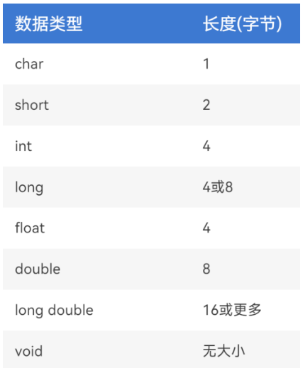

# 02day c基础数据类型及运算符

## 一、布尔类型

```c
#include <stdio.h>
#include <stdbool.h>
int main() {
	bool  isTrue = true;
	printf("%d\n", isTrue);//1
	//isTrue = false;
	//printf("%d\n", isTrue);//0
	
	if (isTrue) {
		printf("~~~~哈哈，是真的\n");
	}
	else {
		printf("~~~嘿嘿，是假的\n");
	}
	//----------------------
	int  flag = 1;   //1表示真          ，除了0这个数字  其它的数字都是真
	flag = 0;
	if (flag) {
		printf("哈哈，是真的\n");
	}
	else {
		printf("嘿嘿，是假的\n");
	}


	return 0;
}

/*
 c语言默认没有布尔类型的定义， 增加头文件 stdbool.h
 bool             true （1）       false  （0）        判断使用
 占一个字节
*/
```

## 二、可移植类型

```c
#include <stdio.h>
#include <stdint.h>
#include <inttypes.h>
int main() {
	int8_t  num = -10;  //  -128~127                0111 1111         1 111 1111    1000 0000
	uint8_t  num1 = 10; // 0~255            1111 1111
	int16_t  num2 = 32767;// -32768~32767   
	uint16_t  num3 = 65535; //0~65535
	printf("%d  %d  %d  %d\n", num, num1, num2, num3);
	printf("%zu  %zu  %zu  %zu\n", sizeof(num), sizeof(num1), sizeof(num2), sizeof(num3) );
	/*
-10  10  32767  65535
1  1  2  2
	
	*/
	return 0;
}

/*
可移植类型
  1.为什么要用可移植
   c语言是一门跨平台的编程语言，编好的程序可以在不同平台下运行，兼容性要达到，需要用到可移植类型，才能稳定运行。
    如：  int 类型      51编译平台    8位单片机      占2字节
	                                                 32位单片机   占4字节
				移植时 ，值域会调整    运行有出入    ，要采用可移植

  2.如何用可移植
    加入头文件   stdint.h             inttypes.h           
	int8_t          uint8_t               提供的好数据类型    移植 不会调值域
	int16_t        uint16_t
	int32_t          uint32_t
	int64_t        uint64_t
*/
```

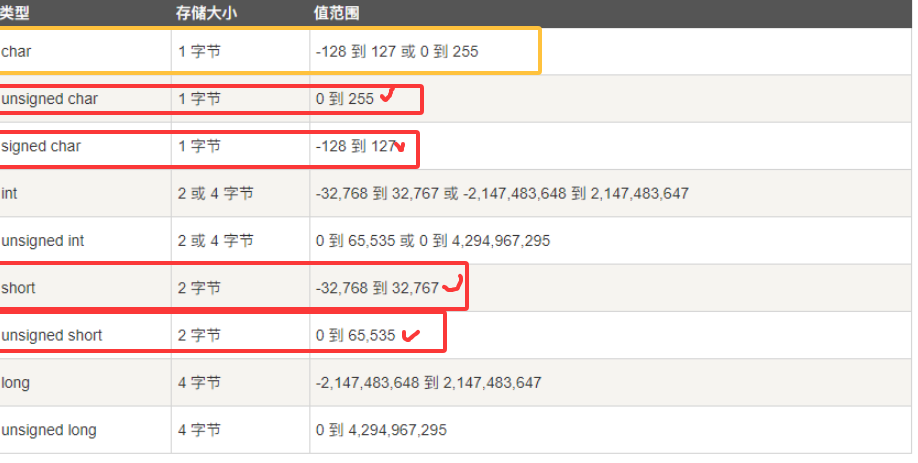

## 三、常量

```c
#include <stdio.h>
#include <float.h>
#include <stdint.h>
#define N 100

int main() {
	//1.
	printf("%.2lf\n", 3.14 + 1 + 'a');
	//2.
	printf("%d\n", N + 20);
	//N = N + 20;   //只读   不能改         错的

	const int  num = 200;
	printf("%d\n", num + 20);       //   %3d            %-3d            %03d        ????
	//num = num + 20;//只读   不能改         错的

	printf("%e\n", FLT_MIN);//1.175494e-38
	printf("%E\n", FLT_MAX);//3.402823E+38

	printf("%d\n", INT32_MIN);
	printf("%d\n", INT32_MAX);

	/*
	1.175494e-38
   3.402823E+38
  -2147483648
  2147483647
	
	
	*/
	return 0;
}

/*
常量：在程序执行过程中，值不发生的量。
  一、  直接量  3.14      -1   “hello"          3.14f

 二、	自定义的常量（两种定义方法）  *
	 1.#define  N  100             后面不能写 分号       建议用大写   全局定义    不占内存   没有规定数据类型  只做文本替换 
	 2. const  int  num=200;   //只读变量     块级作用域 { }    分配内存的  有数据类型

	 作业：  请用常量的方法 定义自己的出生年月日，输出格式   xxxx-xx-xx
三、系统常量
   float.h            limits.h         stdint.h

   #define FLT_MIN          1.175494351e-38F
   #define FLT_MAX          3.402823466e+38F        // max value

   #define INT32_MIN        (-2147483647i32 - 1)

   #define INT32_MAX        2147483647i32
*/
```

## 四、进制转换

```c
#include <stdio.h>
#include <stdint.h>
int main() {
	int8_t  num = 60;               
	//转为二进制   0b00111100
	printf("%d  %#o  %#x\n", num,num, num);//60  074  0x3c
	return 0;
}

/*
一、数值表示 ----	n进制  =   2   4    8    16
十进制（0~9）       二进制 （0  1）            八进制 （0~7）            十六进制（0~9 ABCDEF）
 逢n进一
  5                            0b101                           05                                0x5
  -------------------------------------------------------------------------------------
  0                                0                               0                                     0
  1                                1                               1                                    1
  2                               10                              2                                    2
  3                               11                             3                                     3
  4                              100                            4                                     4
  ...
  8                              1000                          10                                     8
  ...
  10                            1010                          12                                    A
  ...
  15                             1111                          15                                  F

二、十进制和其它进制的互转换
    
	  对 n进制  进行取余  倒序排列

	  其它进制转为 十进制 
	         
	 111100=   0*2^0+0*2^1+1*+2^2+1*2^3+1*+2^4+1*2^5

	 074=4*8^0+7*8^1= 4+56=60
	 0x3c=12*16^0+3*16^1= 12+48=60

三、把二进制转 八进制                 三位一体            计算为十进制数
          十进制转八进制                 四位一体              计算为十进制数--转十六进制符号

		   111  100  =  074
		   0011 1100=0x3c


	1  1  1  1   1  1  1  1
四、数值存储方式
   原码          反码        补码                计算机底层以补码存储        

   十进制---直接转成的二进制      就是原码
   反码：  正数或无符号        和原码一样                         +2              0   0000010
               负数                      符号位不变，其它位取取      -2              1   0000010  
   补码：  正数或无符号          和原码一样 
                负数                     反码+1

				规定：1000 000   表示-128

	作业：    十进制80----二       八        十六进制
	             0b 0101 1101  1101  1110  ------八进制       
				                                            ------十六进制
				  0xf8912 ------转为二进制
				  076543------转为二进制
*/  
```

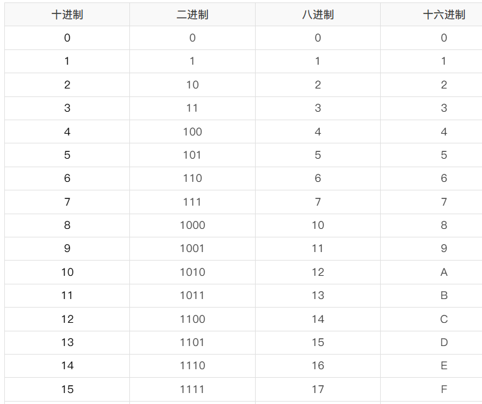

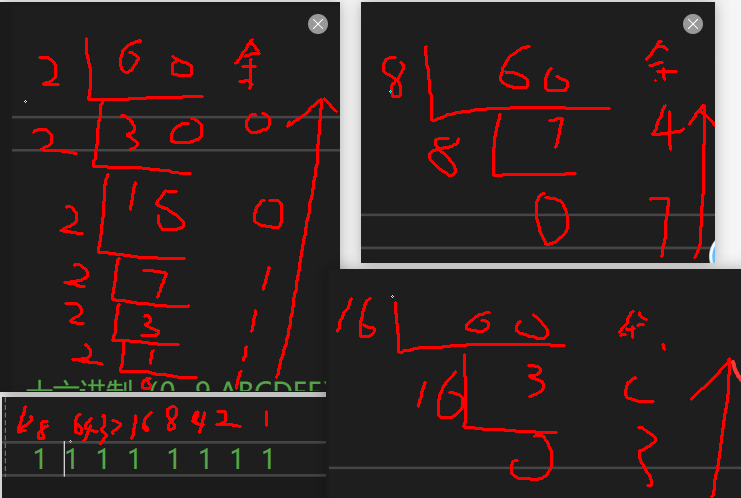

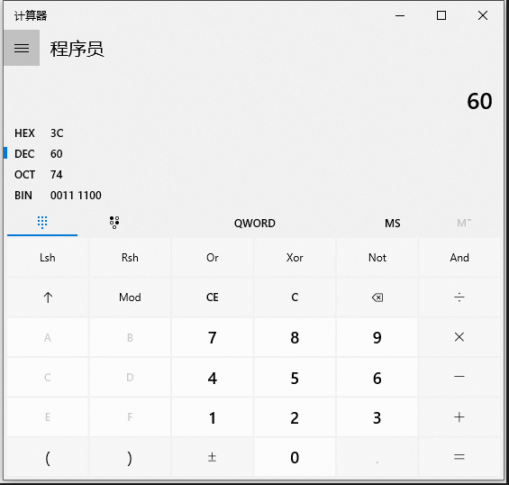

## 五、运算符

### 1、算术运算符

```c
#include <stdio.h>
int main() {
	//算术运算符
	int  a = 10;
	int  b = 30;

	int res = a + b;
	printf("res=%d\n", res);

	//printf("a-b=%d\n", a - b);

	printf("%d-%d=%d\n",a,b, a - b);
	printf("%d*%d=%d\n", a, b, a * b);
	//-----------注意     两个整数相除得不到小数，    只能留下整数部分  *
	printf("%d/%d=%d\n", a, b, a / b);  //得到舍去 小数点后的数 得到整数
	printf("%d/%d=%.2lf\n", a, b, (double)a / b);  //如果想是小数，其中一个得是小数*

	//-------注意：  取余   必须是两个整数
	printf("%d\n", 10 % 30);//10         分子小  分母大  余数一律是分子
	printf("%d\n", 30 % 10);//0
	//printf("%d", 30 % 10.0); //报错
	printf("%d %% %d=%d\n", a, b, a % b);  //10 % 30=10                  %%----%

	//-----------------------------------------------------------------自增 自减
	int i = 1;
	i++;//i=  i+1
	++i;//i=  i+1

	printf("i=%d\n", i);//i=3

	i--; //i=  i-1
	--i;//i=  i-1

	printf("i=%d\n", i);//i=3	
	
	//总结： 没有参加其它运算，自身在自增自减     前置后置没有区别

	//--------------------------------------自增自减 参与其它的运算 ，前置后置有区别
	int j = 1;
	int m=j++;   //后置        后赋值，再自增（自减）

	printf("m=%d  j=%d\n", m, j);//m=1  j=2

	m = ++j;  //前置           先自增（自减），再赋值
	printf("m=%d  j=%d\n", m, j); //m=3  j=3

	m = j--;
	printf("m=%d  j=%d\n", m, j); //m=3  j=2

	//---------------------------------注意

	printf("%d\n", --j);// 1 res=--j;    printf("%d\n", res);
	printf("j=%d\n", j);//j=1

	printf("%d\n", j--);// 1 res=j--;    printf("%d\n", res);
	printf("j=%d\n", j);//0
	return 0;
}

/*
运算符
 1.算术运算符
   +    -    *    /    %(取余   取模)     ---二元
   ++  自增   --自减               ---一元
   +正号   -负号

   --注意     两个整数相除得不到小数，    只能留下整数部分
   --注意：  取余   必须是两个整数
  --    %%----%
  //总结： 没有参加其它运算，自身在自增自减     前置后置没有区别
     自增自减 参与其它的运算 ，前置后置有区别
     后置        后赋值，再自增（自减）
     前置           先自增（自减），再赋值

 2.赋值运算符
  =       +=     -=    *=    \=             %=
  位运算中  
  &=    |=      ^=    ~=    >>=    <<=

  3.关系运算符 （比较运算符）
     >      >=        <    <=
	 ==   !=

4.逻辑运算符
  &&         ||            ！

  5.位运算符
  &     |     ^
  ~     >>   <<


*/
```

### 2.赋值运算符

```c
#include  <stdio.h>
int main() {
	int a = 10;// 把10赋值给变量a

	a += 20; //  a= a+20
	printf("a=%d\n", a);  //30

	a -= 20;//  a= a-20
	printf("a=%d\n", a);//10

	a *= 20;//  a= a*20
	printf("a=%d\n", a);//200

	a /= 20;//  a= a/20
	printf("a=%d\n", a);//10

	a %= 20;//  a= a%20
	printf("a=%d\n", a);//10
	return 0;
}
/*2.赋值运算符    ---优先级较低
= += -= *= \ = %=

位运算中     (转为二进制)---暂时不讲
&= |= ^= ~= >>= <<=
*/
```

### 3.关系运算符（比较运算符）

```c
#include <stdio.h>
int main() {
	int a = 10;
	int b = 20;

	int res = a >= b;   //  >=            大于或等于     只有一项成立即成立
	printf("res=%d\n", res);// 假   0

	res = a <= b;   //  <=            小于或等于     只有一项成立即成立
	printf("res=%d\n", res);// 真  1

	printf("%d  %d  %d  %d\n", 8 == 8, 8 >= 8, 8 <= 8, 6 != 8);//1  1  1  1

	if (8 >= 8) {
		printf("是真的，下课");
	}
	else {
		printf("是真的，先下课");
	}
	return 0;
}

/*3.关系运算符 （比较运算符）
	 > >= < <=
	==   !=

	结果：是布尔值   真 （1）      假（0）

	适用场景：  判断  条件语句   循环 判断
	*/
```

# 03day 逻辑及位运算符及输入输出

## 一、运算符续

### 4.逻辑运算符

```c
#define _CRT_SECURE_NO_WARNINGS
#include <stdio.h>
int main(){
 //   int a = 10;
 //   int b = 20;

 //   //int res = a >= b && ++b;   //短路逻辑
 //   //printf("res=%d   b=%d", res, b);// 0     20

 //   //res = a <= b && ++b;    //由++b 决定结果        数字除了0 之外的数字，都是真
 //   //printf("res=%d   b=%d\n", res, b);// 1    21

 //   //printf("%d   %d\n", 8 >= 5 && 8 < 8,  8&&9);//0   1


 //   int res = a >= b || ++b;   //    由++b 决定结果        数字除了0 之外的数字，都是真
 //   printf("res=%d   b=%d", res, b);// 1     21

 //   res = a <= b || ++b;    //短路逻辑          ++b不再执行
 // printf("res=%d   b=%d\n", res, b);// 1    21

 // //优先级时  &&   比 || 优先级高
 //// 输入一个年份，判断是平年还是闰年            能被4整除且不能被100整除 ，或者能被400整除
 // int year;
 // printf("请输入一个年份：");
 // scanf(" %d", &year);
 // if (year%4==0&&year%100!=0||year%400==0) {
 //     printf("%d是闰年", year);
 // }
 // else {
 //     printf("%d是平年", year);
 // }

 // //！

 // printf("%d   %d\n", !(8 >= 8), !(10<2));// 0   1

  //2.设有下面的程序段  int x= 0,y=0,t;       t=x&&++y;  执行语句后y 和t的值为 多少    
  int x = 0, y = 0, t;       t = x && ++y;
  printf("t=%d y= %d\n", t, y);//t=0 y= 0

  //4.若int a = 1, b = 4, c = 3, 则表达式a && b + c || b - c的值为
  int a = 1, b = 4, c = 3;
  printf("%d\n", a && b + c || b - c);//1
return 0;
}
/*
4.逻辑运算符
  &&         ||            ！

  a>b && a>c
  && 逻辑与       两边的操作数 有一个为假（0）  结果为假（0 ）      两个都为真（1） 结果才为真（1）
                          短路逻辑 ----如果第一个操作为假（0），结果为假（0） ，第二个操作数不再执行
                                              如果第一个操作为真（1），由第二操作数决定结果

a>b ||a<c
||逻辑或        两边的操作数 有一个为真（1）  结果为真（1 ）      两个都为假（0） 结果才为假（0） 
                    短路逻辑 ----如果第一个操作为真（1），结果为真（1） ，第二个操作数不再执行
                                        如果第一个操作为假（0），由第二操作数决定结果

  运算结果： 真 1   假0


  !逻辑非          取反 

*/
```

### 5.位运算符

```c
#include <stdio.h>
#include <stdint.h>
int main() {
	//有符号                 单片机大部分用的是无符号
	int8_t  a = 20;
	int8_t  b = 40;
	int8_t res = a & b;
	/*
	     00010100
	&  00101000
	---------------------
	     00000000
	*/
	printf("%d   %#x", res, res); //0   0


	res = a | b;
	/*
		 00010100
	|    00101000
	---------------------
		 00111100
	*/
	printf("%d   %#x\n", res, res); //60   0x3c


	res = a ^ b;
	/*
		  00010100
	^    00101000
	---------------------
		   00111100
	*/
	printf("%d   %#x\n", res, res); //60   0x3c

	//---------------------------------------------------------下面注意
	//res = ~a;  //  a不变   res 接到a取反后的结果

	a = ~a;//   a~=a
	/*                                                               逆运算（符号位是1）
	  原反补               取反（补码）                     反   （补码-1）                          原
	00010100             11101011                             11101010                         10010101 （转为十进制）   
	                     （十六进制输出 这个就是）
	
	*/
	printf("%d   %#x\n", a, (uint8_t)a);//-21   0xeb

	//b = b << 2;//  b<<=2   
	///*                                                      逆运算（符号位是1）                 
	//   原反补                 移位（补）          反 （补-1）                      原
	// 00101000            10100000              10011111                11100000
	//                     （十六进制输出 这个就是）
	//*/
	//printf("%d   %#x\n",b, (uint8_t)b); //-96   0xa0


	b = b << 3;//  b<<=3   
	/*                                                      
	   原反补                 移位（补）        不需逆运算  原反补同一个码   
	 00101000               01000000             
							（十六进制输出 这个就是）
	*/
	printf("%d   %#x\n", b, (uint8_t)b); //64     0x40

	//-----------------------------

	int8_t  c = -40;
	c = c >> 2;//c>>=2;
	/*                                                             逆运算
	原     反                 补（反+1）          移位（补码）      反 （补-1）           原
	10101000    11010111      11011000       11110110        11110101             10001010
	                                       （十六进制输出 这个就是）
	*/
	printf("%d   %#x\n", c, (uint8_t)c); //-10   0xf6

	return 0;
}

/*
位运算符   -----以补码          无符号数和正数     原反补  同一个码           负数      原    反  补（用它来运算）


& 按位与                   010&110=010            对应位的有一个为0 ，此位即为0        两个都1 此位为1
| 按位 或                     010|110=110            对应位的有一个为1，此位即为1        两个都0此位为0
^按位异或                  010^110=100            对应位   不同为1   相同为0
----------------------------------------------------------------------------
~按位取反
<<左移      溢出不要，不足位一律初0

>>右移     算术移位和逻辑移位（无符号或正数都是逻辑移位 ），溢出不丢掉，不足补0

                 算术移位     符号位1    溢出不丢掉，不足补1
				                    符号位0    溢出不丢掉，不足补0
	//总结：移位 后或取反后  如果符号位是0的话，不需要逆运算
	                                                         是1的话 需要逆运算

*/

/*
   // 将变量a的第2位设置为1，其他位保持不变

        
	  uint8_t a = 0b10110011; // 0xb3;

	  //左边是高位         右边低位
	  // 最低位是第0位      最高位第7位
	  //  &   |   ^  ~   >>    <<        (0x01  ---1         0x80)    
	  
	  0b10110 011
	|     00000 100    (0x01<<2)    
	  ------------------
           10110 111
a=a|(0x01<<2);

a|=0x01<<2;
printf("%d  %#x",a,a);
*/
```

## 二、运算符作业

```c
#include <stdio.h>
#include <stdint.h>
int main() {

 /*   /四、预习提升-- - 如果不太会，可以不做
        （1）案例需求：  倒数第1位    是0位      最低位        正数第1最高位 7位  写出前两题分析过程 输出结果*/
        // 将变量a的第2位设置为1，其他位保持不变
        uint8_t a = 0b10110011; // 0xb3;
        /*
            0b10110   0  11
       |    0b00000   1   00       <----(0x01<<2)            (1<<2)
        --------------------
           0b10110   1 11
        
        */
        a |= 1 << 2;
        printf("a=%d    a=%#x\n", a, a); //a=183    a=0xb7

      // 将变量b的第2位、第6位设置为1，其他位保持不变
    uint8_t b = 0b10110011; // 0xb3;

    /*
           0b1  0  110  0  11
      |    0b0  1   000 1   00       <----(0x01<<2)  |   (0x01<<6 )           (1<<2)|(1<<6)
       --------------------
         0b1  1  110  1  11
       */
  /*  b |= 1 << 6;
    b |= 1 << 2;*/
    b |= (1 << 6) | (1 << 2);
    printf("b=%d    b=%#x\n", b, b); //b=247    b=0xf7

     // 将变量c的第5位设置为0，其他位保持不变
    uint8_t c = 0b10110011;  // 0xb3;

    /*
      0b10   1     10011
   &     11   0    11111           <-----    ~ (1<<5 )
  ---------------------
    0b10   0   10011
    */
    c &= ~(1 << 5);
    printf("c=%d    c=%#x\n", c, c); //c=147    c=0x93

    // 将变量d的第0~3位设置为0，其他位保持不变
    uint8_t d = 0b11111111;  // 0xff;

    d &= ~(1 << 0 | 1 << 1 | 1 << 2 | 1 << 3);
    printf("d=%d    d=%#x\n", d, d);//d=240    d=0xf0

    // 将变量e的第2位取反，其他位保持不变
    uint8_t e = 0b10110011;  // 0xb3;

     e ^= 1 << 2;
     printf("e=%d    e=%#x\n", e, e);
    // 将变量f取出8-15位
    uint32_t f = 0x12345678;

    uint8_t g = f >> 8;
    printf("g=%d    g=%#x\n", g, g);//g=86    g=0x56

    f=(f >> 8) & 0x000000FF;
    printf("f=%d    f=%#x\n", f, f); //f=86    f=0x56

    // 总结 上面的题结出结论      &         |      ^
	return 0;
}


```

```c
#include <stdio.h>
int main() {
//   1.设a和b均为整型数值型变量,且a=5,b=7,则表达式1.0+a/b的值为多少，并保留两位小数
    //int a = 5, b = 7;
    //printf("%.2lf\n", 1.0 + a / b);//1.00
    //printf("%.2lf\n", 1.0 + (double)a / b);//1.71

    // 3.若a是整型数值型变量,则执行表达式"a=25/3%3"后,a的值为
    //int a;
    //a = 25 / 3 % 3;
    //printf("%d", a);//2
    //  5.若int a=1,b=2;运算a+b+(a++==  b)+(++a == b)       可以对a和b换不同的值
    int a = 1, b = 2;
    int res = a + b + (a++ == b) + (++a == b);
    /*
       res=  a+b +(1==2)  +（3==2）     =   3+2+0+0=5 
   内存                  2               3
    */
    printf("%d\n", res);//5


    //----------- 另外用#define    
    const int  year = 2004;
    const int  month =9;
    const int  day = 3;

    printf("%4d - %02d -%02d", year, month, day);
	return 0;
}

/*
    1.设a和b均为整型数值型变量,且a=5,b=7,则表达式1.0+a/b的值为多少，并保留两位小数
    2.设有下面的程序段  int x= 0,y=0,t;       t=x&&++y;  执行语句后y 和t的值为 多少
    3.若a是整型数值型变量,则执行表达式"a=25/3%3"后,a的值为
    4.若int a=1,b=4,c=3,则表达式a&&b+c||b-c的值为
    5.若int a=1,b=2;运算a+b+(a++==  b)+(--a == b)       可以对a和b换不同的值
     提升：
    6. 输入一个年份，判断是平年还是闰年            能被4整除且不能被100整除 ，或者能被400整除

    1. 作业：  用常量的方法  定义您的出生 年  月   日（可以两种不同的方法定义）     ，输出  xxxx-xx-xx

*/
```


## 三、输入输出及格式化符号

```c
#define _CRT_SECURE_NO_WARNINGS
#include <stdio.h>
int main() {
	int a, b;
	printf("请输入两个整数：");
	//scanf(" %d%d", &a, &b);
	int num=scanf(" %d %d", &a, &b);
	//scanf(" %d,%d", &a, &b);
	printf("a=%d  b=%d", a, b);
	//if (num == 2) {
	//
	//}
	//else {
	//	printf("输入不匹配\n");
	//}
	
	return 0;
}

/*
一、语法
scanf()
语法：int scanf(const char *format, ...)
返回值  
如果成功，该函数返回成功匹配和赋值的个数。如果到达文件末尾或发生读错误，则返回 EOF（-1）。
printf()
语法：printf("<格式化字符串>", <参量表>);

二、常用输入
scanf(" %d %d",&a,&b);
scanf(" %d%d",&a,&b);
scanf(" %d,%d",&a,&b);

三、格式化符号
 %d         %c          %f             %lf
 %zu      %x %X    %o      %e   %E

 %s    字符串    %p   地址  指针

 %u    %hu   %hu   短整   %ld  %lu 长整

 %lld   %llu  长长整

 %.2lf            %3d      %-3d (输出)               %10s  （输入）
*/
```

## 四、优先级了解一下

运算符优先级：一个表达式中有多个运算符时，优先级高的先结合。
例如：2 + 3 * 4 的结果是 14，因为 * 的优先级高于 +。

### 常用优先级（从高到低）

1. `()` `[]` `.` `->` 后置`++` 后置`--`
2. 前置`++` 前置`--` `!` `~` 正号`+` 负号`-` `(类型转换)` `sizeof`
3. `*` `/` `%`
4. `+` `-`
5. `<<` `>>`
6. `<` `<=` `>` `>=`
7. `==` `!=`
8. `&`
9. `^`
10. `|`
11. `&&`
12. `||`
13. `?:`（条件运算符）
14. `=` `+=` `-=` `*=` `/=` `%=` `&=` `|=` `^=` `<<=` `>>=`
15. `,`（逗号运算符）

记忆重点：算术运算中，`()` > `* / %` > `+ -`；逻辑运算中，`!` > `&&` > `||`；赋值运算符优先级较低；`&&` 的优先级高于 `||`。

### 结合性

优先级相同时，按结合性决定组合方向。大多数二元运算符从左到右结合，例如 `20 / 5 * 2` 等价于 `(20 / 5) * 2`，结果为 `8`。赋值、条件和前置单目运算符从右到左结合，例如 `a = b = 10` 等价于 `a = (b = 10)`。

> 注意：优先级只决定表达式如何组合，不一定决定各部分的执行先后顺序。不要在一个表达式中多次修改同一个变量，例如 `i = i++ + 1` 是未定义行为，应拆成多条语句。

```c

#include <stdio.h>
int main() {
    int a = 2, b = 3, c = 4;

    printf("%d\n", a + b * c);
    printf("%d\n", (a + b) * c);
    printf("%d\n", a < b + c);
    printf("%d\n", a == b || c > a);

    int x, y;
    x = y = 10;
    printf("x=%d y=%d\n", x, y);
    return 0;
}
```

## 五、数据类型转换

数据类型转换：把一种数据类型的值转换为另一种数据类型的值，分为自动类型转换（隐式转换）和强制类型转换（显式转换）两大类。

### 一、自动类型转换（隐式转换）

由编译器自动完成，一般是“小类型转为大类型”。`char`、`short` 参与运算时通常会先提升为 `int`；整数和浮点数一起运算时，整数会转为浮点数。

```c
#include <stdio.h>
int main() {
    char ch = 'A';
    int num = ch;
    printf("num=%d\n", num);

    int a = 10;
    double result = a / 4.0;
    printf("result=%.2lf\n", result);

    double pi = 3.14;
    int n = pi;
    printf("n=%d\n", n);

    return 0;
}
```

上面输出的 `num` 为 `65`，`result` 为 `2.50`，`n` 为 `3`。其中 `double` 转为 `int` 时，小数部分会丢失。

### 二、强制类型转换（显式转换）

由程序员主动指定目标类型，语法为：`(目标类型)表达式`。常用于控制运算结果的数据类型。

```c
#include <stdio.h>
int main() {
    int b = 5, c = 2;
    double quotient = (double)b / c;
    printf("quotient=%.2lf\n", quotient);

    int ascii = 97;
    char letter = (char)ascii;
    printf("letter=%c\n", letter);

    return 0;
}
```

上面输出的 `quotient` 为 `2.50`，`letter` 为 `a`。

> 注意：整数除以整数的结果仍是整数，例如 `5 / 2` 的结果为 `2`。想保留小数时，应让至少一个操作数转为浮点型，如 `(double)5 / 2`。浮点型转整型会直接舍去小数部分，不是四舍五入；大类型转小类型还可能丢失数据。写复杂表达式时，建议使用括号明确优先级，例如 `(double)(a + b) / c`。


# 9.7循环


#### 一、循环的概念

循环：在满足条件时，重复执行一段代码。例如输出 1~100、计算累加和、重复读取数据等。

C 语言有三种循环语句：`while`、`do...while`、`for`。

理解循环时，要看清四个部分：

1. 初始化：循环从什么状态开始。
2. 循环条件：什么情况下继续执行。数值条件中，`0` 为假，非 `0` 为真。
3. 循环体：每次需要重复执行的代码。
4. 状态更新：改变循环变量或其他状态，使循环能够进入下一次判断，并在需要时结束。

> 初始化和状态更新不一定写在循环语句内部，但分析循环时要找到它们。下面带有 `main` 的代码示例应分别运行；语法格式和局部代码用于辅助理解。

#### 二、while 循环（先判断，后执行）

##### 1.基本语法

```c
初始化;
while (循环条件) {
    循环体;
    状态更新;
}
```

执行顺序：初始化 → 判断条件 → 条件为真时执行循环体、更新状态 → 再判断条件；条件为假时退出循环。

特点：先判断再执行；如果第一次条件就不成立，循环体一次也不执行。 常用于循环次数不确定、由条件控制结束的情况。

##### 2.示例：输出 1~5

```c
#include <stdio.h>

int main(void) {
    int i = 1;                 // 初始化

    while (i <= 5) {            // 循环条件
        printf("%d ", i);       // 循环体
        i++;                   // 更新循环变量
    }

    printf("\n结束时 i=%d\n", i);
    return 0;
}
```

输出结果：

```text
1 2 3 4 5
结束时 i=6
```

循环体执行了 5 次，条件判断了 6 次。最后一次判断时，`i` 已经变为 `6`，`i <= 5` 为假，所以退出循环。

#### 三、do...while 循环（先执行，后判断）

##### 1.基本语法

```c
初始化;
do {
    循环体;
    状态更新;
} while (循环条件);
```

执行顺序：初始化 → 执行循环体、更新状态 → 判断条件 → 条件为真时继续执行，为假时退出。

特点：先执行再判断，循环体至少执行一次。 适用于需要先做一次操作，再决定是否重复的情况，例如显示菜单后判断是否继续。

> 注意：`do...while` 末尾的分号 `;` 不能省略。

##### 2.示例：比较 while 和 do...while

```c
#include <stdio.h>

int main(void) {
    int a = 6;
    while (a <= 5) {
        printf("while: %d\n", a);
        a++;
    }

    int b = 6;
    do {
        printf("do...while: %d\n", b);
        b++;
    } while (b <= 5);

    printf("a=%d b=%d\n", a, b);
    return 0;
}
```

输出结果：

```text
do...while: 6
a=6 b=7
```

虽然初始值都是 `6`，`while` 的循环体执行 0 次，`do...while` 的循环体仍执行 1 次。

#### 四、for 循环

##### 1.基本语法及执行顺序

```c
for (初始化表达式; 循环条件; 更新表达式) {
    循环体;
}
```

执行顺序：

1. 执行初始化，只执行一次。
2. 判断循环条件，为假则退出循环。
3. 条件为真时，执行循环体。
4. 执行更新表达式，再回到第 2 步判断条件。

记忆：初始化 → 判断 → 循环体 → 更新 → 判断……

`for` 把循环控制集中在一行，常用于循环次数明确的情况。

##### 2.示例：计算 1~100 的累加和

```c
#include <stdio.h>

int main(void) {
    int sum = 0;                // 累加变量从 0 开始

    for (int i = 1; i <= 100; i++) {
        sum += i;              // 相当于 sum = sum + i
    }

    printf("sum=%d\n", sum);    // sum=5050
    return 0;
}
```

> 注意：`sum` 要在循环外初始化，否则每次循环都重新置为 `0`，就无法保留之前的累加结果。

##### 3.补充知识点

- `for (int i = 0; ...)` 是 C99 起支持的写法；这里的 `i` 只在该 `for` 语句范围内有效，循环结束后不能直接使用它。若需要在循环后查看 `i`，可以先在循环外定义。
- 三个部分都可以省略，但括号内的两个分号必须保留。省略循环条件时，视为条件始终成立。
- `for (;;)` 和 `while (1)` 都可以表示无限循环；可以用 `break` 等方式退出。
- 更新表达式不一定是 `i++`，也可以是 `i--`、`i += 2` 等，要与条件配合。
- 单独作为更新表达式时，`i++` 与 `++i` 对下一次判断时 `i` 的值没有区别。

#### 五、三种循环的区别

| 循环语句 | 判断时机 | 循环体最少执行次数 | 常见使用场景 |
| --- | --- | --- | --- |
| `while` | 执行循环体之前 | 0 次 | 根据条件重复，次数不确定 |
| `do...while` | 执行循环体之后 | 1 次 | 先执行一次，再判断是否继续 |
| `for` | 执行循环体之前 | 0 次 | 次数明确、按步长遍历 |

三种循环通常可以通过调整写法完成相同任务，选择时主要考虑代码是否清楚。`while` 也能计数，`for` 也能用于次数不确定的循环。

#### 六、break、continue 和 return

##### 1.break：结束当前这一层循环

执行 `break` 后，直接跳到当前循环之后，当前循环中剩余的语句不再执行。

```c
#include <stdio.h>

int main(void) {
    for (int i = 1; i <= 5; i++) {
        if (i == 3) {
            break;
        }
        printf("%d ", i);
    }

    printf("\n循环结束\n");
    return 0;
}
```

输出 `1 2`，然后输出“循环结束”。当 `i == 3` 时，整个 `for` 循环结束，后续的 `4` 和 `5` 也不再处理。

> `break` 结束距离它最近的一层循环或 `switch`。如果循环内部还有 `switch`，写在该 `switch` 中的 `break` 只退出 `switch`。

##### 2.continue：跳过本次循环剩余代码

```c
#include <stdio.h>

int main(void) {
    for (int i = 1; i <= 5; i++) {
        if (i == 3) {
            continue;
        }
        printf("%d ", i);
    }

    printf("\n");
    return 0;
}
```

输出 `1 2 4 5`。当 `i == 3` 时，只跳过本次的输出，后续循环继续执行。

执行 `continue` 后，不同循环的下一步：

- `for`：先执行更新表达式，再判断循环条件。
- `while`：直接重新判断循环条件。
- `do...while`：转到末尾判断循环条件。

> 在 `while` 或 `do...while` 中，如果把更新语句放在 `continue` 后面，可能跳过更新，导致循环无法结束。应确保需要的状态更新能够执行。

##### 3.return：结束当前函数

| 语句 | 作用 |
| --- | --- |
| `break` | 退出最近的一层循环或 `switch` |
| `continue` | 跳过所在循环的本次剩余代码，进入该循环的下一步 |
| `return` | 结束当前函数，函数内尚未执行的循环也随之结束 |

`return 0;` 放在 `main` 中表示结束主函数，并向运行环境返回成功状态；放在其他返回 `int` 的函数中，则表示结束该函数并向调用者返回 `0`。

#### 七、循环嵌套

循环体中还包含循环，叫作循环嵌套。

外层循环执行一次，内层循环从初始化开始运行，直到内层循环结束。 常见应用：打印图形、九九乘法表、处理多行多列的数据。

##### 示例：九九乘法表

```c
#include <stdio.h>

int main(void) {
    for (int i = 1; i <= 9; i++) {          // 外层控制行
        for (int j = 1; j <= i; j++) {      // 内层控制这一行的内容
            printf("%d*%d=%-2d ", j, i, i * j);
        }
        printf("\n");                      // 一行输出完，再换行
    }

    return 0;
}
```

前 3 行的内容为：

```text
1*1=1
1*2=2  2*2=4
1*3=3  2*3=6  3*3=9
```

- `i` 表示当前行，`j` 每进入新的一行都会重新从 `1` 开始。
- `%-2d` 表示左对齐、最小输出宽度为 2；数字本身超过 2 位时不会被截断。
- 乘法项一共输出 `1 + 2 + ... + 9 = 45` 次。
- 内层的 `break` 只结束内层循环；内层的 `continue` 只影响内层本次循环。
- 如果外层执行 `m` 次，每次内层都完整执行 `n` 次，则内层循环体共执行 `m * n` 次。乘法表的内层次数随行数变化，不能直接按 `9 * 9` 计算。

#### 八、常见易错点

##### 1.while、for 后面误加分号

```c
int i = 1;
while (i <= 5);     // 错误示例：分号形成空循环体，i 不会更新
{
    i++;
}
```

这个分号会让后面的 `{}` 不属于循环体，循环无法正常运行到 `i++`。`for (...) ;` 也有同类问题；与此不同，`do...while (条件);` 结尾的分号是语法要求，不能省略。

##### 2.边界条件写错，多执行或少执行一次

- `for (int i = 0; i < 5; i++)`：`i` 依次为 `0、1、2、3、4`，执行 5 次。
- `for (int i = 1; i <= 5; i++)`：`i` 依次为 `1、2、3、4、5`，执行 5 次。
- `for (int i = 0; i <= 5; i++)`：`i` 依次为 `0、1、2、3、4、5`，执行 6 次。

分析时先写出初值、最后一次满足条件的值，以及更新后第一次不满足条件的值。

##### 3.循环条件和更新方向不匹配

例如从 `i = 1` 开始，用 `i <= 5` 判断，却一直执行 `i--`，就无法按预期结束。还要避免忘记更新、在循环体中反复把 `i` 重置为初值。

##### 4.把比较写成赋值

`i == 5` 是比较，`i = 5` 是赋值。`while (i = 5)` 会反复把 `5` 赋给 `i`，其条件值非零，并不是“判断 i 是否等于 5”。

##### 5.累加和累乘的初值不同

- 累加：`sum = 0`，循环中使用 `sum += i`。
- 累乘：`product = 1`，循环中使用 `product *= i`。若初值为 `0`，乘积就一直为 `0`。
- 保存累计结果的变量要在循环外初始化；计算范围较大时，要考虑所选类型能否容纳结果。

##### 6.无符号变量倒数时条件恒真

`unsigned int` 类型的值不会小于 `0`，所以不要用 `i >= 0` 作为无符号变量递减循环的结束条件。当 `i` 为 `0` 时再递减，会回绕到该无符号类型的最大值。

需要倒数输出 `5~0` 时，可以使用：

```c
for (int i = 5; i >= 0; i--) {
    printf("%d ", i);
}
```

##### 7.省略大括号导致范围看错

`while`、`for` 的循环体如果不用 `{}`，只控制后面紧接着的一条语句，缩进不会改变执行范围。初学时建议始终写大括号。

#### 九、练习与复习重点

1. 分别用 `while`、`do...while`、`for` 输出 `1~10`，比较执行顺序。
2. 计算 `1~100` 中所有偶数的和。提示：使用 `i % 2 == 0` 判断，或从 `2` 开始每次加 `2`。结果为 `2550`。
3. 计算 `5! = 1 * 2 * 3 * 4 * 5`。注意累乘变量初值为 `1`，结果为 `120`。
4. 输出 `1~20`，跳过 `3` 的倍数，遇到 `16` 就结束循环。分别使用 `continue` 和 `break`。
5. 用嵌套循环打印 5 行星号，第 1 行 1 个，第 2 行 2 个，依次增加到第 5 行 5 个。

复习时重点掌握：三种循环的执行顺序、边界次数、状态更新、break 与 continue 的区别，以及嵌套循环中每条语句属于哪一层。
# 9.9函数

#### 一、函数的概念与作用

函数：把完成某项任务的一段代码组织起来，取一个名字，需要时通过函数名调用。

例如：求两个数的最大值、判断闰年、打印菜单，都可以分别写成函数。

- 减少重复代码：同一个功能写一次，可以调用多次。
- 拆分任务：把大问题分成几个小功能，程序更容易理解。
- 便于修改和检查：某个功能需要调整时，集中修改对应函数。

| 分类 | 含义 | 示例 |
| --- | --- | --- |
| 库函数 | C 标准库等已经提供的函数 | `printf`、`scanf`、`strlen` |
| 自定义函数 | 程序员根据需要编写的函数 | `add`、`max_value`、`is_leap_year` |

使用标准库函数时，应包含对应头文件，例如 `printf` 对应 `<stdio.h>`，`strlen` 对应 `<string.h>`。

> 本节示例使用 C99 及之后的常用写法。带有 `main` 的完整程序应分别运行；标明“局部示例”或“多个文件”的代码要按说明组合。

#### 二、函数的定义

##### 1.基本语法

```text
返回值类型 函数名(形参列表) {
    函数体;
    return 返回值;    // 有返回值时使用
}
```

例如，定义一个求和函数：

```c
int add(int a, int b) {
    int sum = a + b;
    return sum;
}
```

- `int`：返回值类型，表示函数会返回一个整数。
- `add`：函数名，命名规则与变量名类似，建议见名知意。
- `int a, int b`：形参列表，表示接收两个整数。
- `{}`：函数体，里面写具体操作。
- `return sum;`：结束当前函数，并把 `sum` 的值交给调用者。

形参之间用逗号隔开，每个形参都要写类型，不能把 `int a, int b` 简写为 `int a, b`。

##### 2.函数不会因为写出了定义就自动执行

定义函数相当于准备好一个功能；执行到函数调用时，才会运行该函数体。

在本节的普通桌面程序中，程序从 `main` 开始执行。其他自定义函数由 `main` 或其他函数调用。

#### 三、函数的声明、定义和调用

##### 1.三者的区别

| 名称 | 作用 | 写法 |
| --- | --- | --- |
| 声明（函数原型） | 提前告诉编译器函数名、返回类型和参数类型 | `int add(int a, int b);` |
| 定义 | 给出函数的具体实现 | `int add(int a, int b) { return a + b; }` |
| 调用 | 让函数执行，并按需要使用结果 | `int result = add(3, 5);` |

- 在调用之前，应让编译器看到匹配的声明或定义。
- 如果定义写在 `main` 后面，通常先在 `main` 前声明。
- 如果定义已经写在调用位置前面，就可以省略单独的提前声明。
- 声明末尾有分号；定义中函数头后直接接 `{}`，中间不能加分号。
- 兼容的声明可以重复出现；同一个函数不能重复定义。
- 声明中的形参名可以省略，例如 `int add(int, int);`；初学时建议保留有意义的名字。

##### 2.完整示例

```c
#include <stdio.h>

int add(int a, int b);          // 函数声明

int main(void) {
    int x = 3, y = 5;
    int result = add(x, y);     // 函数调用

    printf("result=%d\n", result);
    printf("add(10, 20)=%d\n", add(10, 20));
    return 0;
}

int add(int a, int b) {         // 函数定义
    return a + b;
}
```

输出结果：

```text
result=8
add(10, 20)=30
```

第一次调用的过程：执行 `add(x, y)` → 把 `3、5` 分别传给 `a、b` → 计算并返回 `8` → 回到调用位置，把 `8` 赋给 `result` → 继续执行后面的语句。

调用时只写实参，不写类型，例如写 `add(x, y)`，不能写 `add(int x, int y)`。

#### 四、参数和返回值的四种组合

| 类型 | 函数定义示例 | 调用示例 |
| --- | --- | --- |
| 无参、无返回值 | `void show_menu(void) { printf("1.Start\n"); }` | `show_menu();` |
| 有参、无返回值 | `void print_num(int n) { printf("%d\n", n); }` | `print_num(10);` |
| 无参、有返回值 | `int get_default(void) { return 100; }` | `int n = get_default();` |
| 有参、有返回值 | `int add(int a, int b) { return a + b; }` | `int sum = add(3, 5);` |

表中使用 `printf` 的函数需要包含 `<stdio.h>`。

`void` 出现在不同位置，含义不同：

- 函数名前的 `void`：不返回结果值。
- 参数列表中的 `void`：明确表示没有参数。
- `void show_menu(void)`：既无参数，也无返回值；调用时写 `show_menu()`。

> 建议用 `(void)` 明确表示无参数。在 C17 及更早标准中，单独的声明 `int f();` 不提供参数数量和类型信息，与 `int f(void);` 含义不同。

#### 五、形参与实参：C 语言按值传递

##### 1.形参与实参

对于 `int add(int a, int b)` 和调用 `add(x, 5)`：

- 形参：定义中的 `a、b`，用来接收本次调用传入的值。
- 实参：调用中的 `x、5`，可以是变量、常量或表达式，例如 `add(x + 1, 5)`。
- 对本节这类固定参数函数，实参个数应匹配，顺序应与形参含义对应，类型应能正确匹配或转换。

**C 语言函数的参数都是按值传递：形参接收实参值的副本。修改普通形参，不会改变调用者的变量。

##### 2.普通参数与指针参数对照：交换两个变量

下面先用普通参数交换，再用指针参数交换。

```c
#include <stdio.h>

void swap_value(int a, int b) {
    int temp = a;
    a = b;
    b = temp;
    printf("inside: a=%d b=%d\n", a, b);
}

void swap(int *a, int *b) {
    int temp = *a;
    *a = *b;
    *b = temp;
}

int main(void) {
    int x = 10, y = 20;

    swap_value(x, y);
    printf("after swap_value: x=%d y=%d\n", x, y);

    swap(&x, &y);
    printf("after swap: x=%d y=%d\n", x, y);
    return 0;
}
```

输出结果：

```text
inside: a=20 b=10
after swap_value: x=10 y=20
after swap: x=20 y=10
```

理解指针版本时，先记住：

- `&x`：取得变量 `x` 的地址。
- `int *a`：声明一个接收整数地址的指针形参。
- `*a`：访问该地址对应的整数对象；给 `*a` 赋值，会修改它指向的变量。

第一次只交换了形参 `a、b` 的值。第二次通过地址修改了 `x、y` 本身。

> 传入指针仍然是按值传递，复制的是地址值。修改 `*a` 会影响它指向的对象；只修改指针形参 `a` 本身，不会改变调用者的指针变量。本例要求传入有效、可写的整数对象地址，不能传入空指针或无效地址。

#### 六、return 与返回值

##### 1.return 会立即结束当前函数

- 有返回值的函数使用 `return 表达式;`。
- 返回类型为 `void` 的函数可以使用 `return;` 提前结束，也可以正常执行到函数体末尾。
- 一个函数可以有多条 `return`，但每次调用只会执行其中一条并结束本次调用。
- `return` 即使写在循环内，也会结束整个当前函数。

局部示例：求最大值。

```c
int max_value(int a, int b) {
    if (a > b) {
        return a;
    }
    return b;
}
```

编写有返回值的函数时，应让每条正常结束的执行路径都有合适的返回值。不要只在 `if` 成立时返回，却漏掉其他情况。

##### 2.返回值与打印结果不同

`return a + b;` 把结果交给调用者；`printf("%d", a + b);` 把内容输出到屏幕。只打印计算结果，不等于把该结果返回给调用者。

- `int sum = add(3, 5);`：用变量接收返回值。
- `printf("%d\n", add(3, 5));`：把返回值作为另一个函数的实参。
- `add(3, 5);`：调用后丢弃返回值。
- `void` 函数没有可接收的结果，不能写 `int n = show_menu();`。

##### 3.返回类型会影响结果

局部示例：计算两个整数的平均值。

```c
double average(int a, int b) {
    return ((double)a + b) / 2.0;
}
```

`average(3, 4)` 返回 `3.5`。如果函数返回类型写成 `int`，这个结果返回时就会丢失小数部分。

> 常见桌面程序使用 `int main(void)`，`return 0;` 表示正常结束。C99 起，执行到 `main` 末尾相当于返回 `0`，但不要把这个特殊规则套到其他有返回值的函数上。自定义函数返回的 `0` 代表什么，由该函数的约定决定。

#### 七、函数之间的调用

一个函数可以调用另一个函数，也可以把一个函数的返回值作为另一个函数的实参。

局部示例：

```c
int square(int n) {
    return n * n;
}

int sum_of_squares(int a, int b) {
    return square(a) + square(b);
}
```

`sum_of_squares(3, 4)` 返回 `9 + 16 = 25`。这里假定输入较小，中间运算结果没有超出 `int` 范围。

- 可以在函数内部调用其他函数，但标准 C 不允许在函数内部定义另一个函数。
- 参数表达式的求值先后顺序不能一概假定为从左到右。
- 不要写 `add(i++, i++)`：两次对同一个变量的修改没有规定的先后关系，属于未定义行为。需要顺序操作时，先拆成多条语句，再调用函数。

#### 八、局部变量、作用域和 static

作用域：名字在代码的哪些位置可以使用。生命周期：对象从何时存在到何时结束。

| 类型 | 可使用的范围 | 存在时间与特点 |
| --- | --- | --- |
| 普通局部变量 | 从声明处到所在块结束 | 每次进入该块有本次的对象，离开时生命周期结束 |
| 形参 | 对应函数定义的作用域内 | 每次调用接收本次实参值，各次调用相互独立 |
| `static` 局部变量 | 从声明处到所在块结束 | 整个程序运行期间存在，多次调用之间保留值 |
| 文件作用域变量（常称全局变量） | 从声明处到该文件末尾，可能被同名局部变量遮蔽 | 整个程序运行期间存在 |

普通未初始化的局部变量不能直接读取；`static` 局部变量和文件作用域变量如果没有显式初始化，会被初始化为零值。跨文件使用全局变量还涉及声明和链接规则，不代表“所有文件自动都能使用”。

##### 示例：普通局部变量与静态局部变量

```c
#include <stdio.h>

void count_calls(void) {
    int normal = 0;
    static int saved = 0;

    normal++;
    saved++;
    printf("normal=%d saved=%d\n", normal, saved);
}

int main(void) {
    count_calls();
    count_calls();
    count_calls();
    return 0;
}
```

输出结果：

```text
normal=1 saved=1
normal=1 saved=2
normal=1 saved=3
```

每次调用时，`normal` 都重新初始化为 `0`；`saved` 的初始化只进行一次，此后保留上次的值。

> 不能返回普通局部变量的地址供调用者继续使用，例如函数内定义 `int n = 10;` 后 `return &n;`。函数结束后，该对象的生命周期已结束。返回它的值（如 `return n;`）则没有这个问题。

#### 九、递归函数

递归：函数直接或间接调用自身。

递归要有两个关键条件：

1. 终止条件：什么时候停止继续调用。
2. 递推过程：每次调用都向终止条件靠近。

##### 示例：求阶乘

数学关系：`0! = 1`；当 `n >= 1` 时，`n! = n × (n - 1)!`。

```c
#include <stdio.h>

// 使用约定：n 为 0~20；更大的阶乘可能超出返回类型范围
unsigned long long factorial(unsigned int n) {
    if (n == 0) {
        return 1;
    }
    return n * factorial(n - 1);
}

int main(void) {
    printf("5! = %llu\n", factorial(5));
    printf("0! = %llu\n", factorial(0));
    return 0;
}
```

输出结果：

```text
5! = 120
0! = 1
```

以 `factorial(3)` 为例：

```text
向下调用：factorial(3) → factorial(2) → factorial(1) → factorial(0)
到达终点：factorial(0) 返回 1
逐层返回：factorial(1) 返回 1 → factorial(2) 返回 2 → factorial(3) 返回 6
```

- 每层递归调用都有自己的形参和普通局部变量；`static` 局部变量则由各次调用共享。
- 漏写终止条件，或参数始终没有向终止条件变化，可能导致调用层数不断增加。
- 递归通常需要保存每层调用的信息，层数过深可能耗尽栈空间。嵌入式开发中尤其要留意栈容量。
- 阶乘也可以用循环实现；计算范围较大时，要先考虑数据类型能否容纳结果。本例不自动检查输入范围。

#### 十、数组作为函数参数（补充）

数组形参中的 `int arr[]` 会调整为 `int *arr`，不会把整个数组复制到函数中。因此，通常需要额外传入数组长度。

```c
#include <stdio.h>

int array_sum(const int arr[], size_t len) {
    int sum = 0;
    for (size_t i = 0; i < len; i++) {
        sum += arr[i];
    }
    return sum;
}

int main(void) {
    int nums[] = {1, 2, 3, 4, 5};
    size_t len = sizeof(nums) / sizeof(nums[0]);

    printf("sum=%d\n", array_sum(nums, len));
    return 0;
}
```

输出 `sum=15`。

- `const int arr[]` 表示函数不能通过 `arr` 修改数组元素，适合只读操作。
- 如果形参写成 `int arr[]`，函数可以通过 `arr[i]` 修改原数组元素。
- 长度必须与实际可访问的元素范围匹配，否则可能越界；求和结果也应在返回类型范围内。
- `sizeof(nums) / sizeof(nums[0])` 在这里的 `main` 中能求元素个数，因为 `nums` 是数组。
- 在 `array_sum` 内，`arr` 是指针，`sizeof(arr)` 得到的是指针大小，不能用同样的方法求原数组长度。

#### 十一、多个文件中使用函数（补充）

常见组织方式：头文件 `.h` 放函数声明，源文件 `.c` 放函数定义。调用者包含头文件，构建时编译并链接相关源文件。

以下三个文件组成同一个程序，应一起构建。

`calc.h`：

```c
#ifndef CALC_H
#define CALC_H

int add(int a, int b);

#endif
```

`calc.c`：

```c
#include "calc.h"

int add(int a, int b) {
    return a + b;
}
```

`main.c`：

```c
#include <stdio.h>
#include "calc.h"

int main(void) {
    printf("%d\n", add(3, 5));
    return 0;
}
```

输出 `8`。

- `#ifndef / #define / #endif` 用来防止头文件在同一次编译中被重复包含。
- 自定义头文件通常用双引号包含；标准库头文件通常用尖括号包含。
- 不要通过 `#include "calc.c"` 代替正常的多文件构建。
- 通常不要在头文件中放普通函数定义，否则多个源文件包含后可能产生重复定义。
- 文件作用域函数加上 `static`（如 `static int helper(int n)`），表示它只供当前源文件这个翻译单元内部使用。这与局部变量加 `static` 后保留值的用途不同。

#### 十二、常见易错点与练习

##### 1.常见易错点

| 易错写法或想法 | 正确理解 |
| --- | --- |
| 先调用函数，后面再写定义，不声明 | 调用前先声明，或把定义移到调用位置前面 |
| 定义写成 `int add(int a, int b); { ... }` | 函数头与函数体之间不能加分号 |
| 形参写成 `int a, b` | 每个形参单独写类型：`int a, int b` |
| 认为修改普通形参就能修改实参 | C 按值传递；要修改调用者对象，可传入其地址 |
| 只写 `printf`，认为已经返回计算结果 | 输出与返回不同；需要结果时使用 `return` |
| 有返回值函数漏写某条分支的 `return` | 检查所有正常结束路径 |
| 返回普通局部变量的地址 | 对象离开生命周期后，不能再通过该地址访问它 |
| 递归没有终止条件 | 明确终点，并使每次调用向终点靠近 |
| 在数组形参上用 `sizeof` 求数组长度 | 数组形参已经调整为指针，长度通常额外传入 |
| 定义同名函数，仅用参数不同来区分 | C 不支持这种函数重载，应使用不同函数名 |

##### 2.练习与复习重点

1. 编写 `int max_value(int a, int b)`，返回较大值。检查 `(3, 5)`、`(-2, -8)`、`(4, 4)`，结果分别为 `5、-2、4`。
2. 编写 `int is_even(int n)`，偶数返回 `1`，奇数返回 `0`。测试 `0、7、-4`，结果为 `1、0、1`。
3. 编写 `int is_leap_year(int year)`：能被 4 整除且不能被 100 整除，或者能被 400 整除。测试 `1900、2000、2024`，结果为 `0、1、1`。
4. 编写 `void print_table(void)`，把前面循环章节的九九乘法表封装为函数，在 `main` 中调用。
5. 用普通参数和指针参数分别交换两个变量，解释为什么只有指针版本能改变调用者的变量。
6. 分别用循环和递归计算 `5!`，并检查 `0!` 的结果应为 `1`。

复习时重点掌握：声明、定义、调用的区别；形参与实参；按值传递；return 与 printf 的区别；局部变量的生命周期；递归的终止条件。

# 9.10数组

#### 一、数组的概念

数组：使用一个统一的名字，保存多个类型相同的数据。数组中的每个数据叫作数组元素，通过下标访问。

例如，要保存 5 名学生的成绩，可以写成：

```c
int scores[5] = {86, 92, 75, 88, 90};
```

- `int`：数组中每个元素的数据类型。
- `scores`：数组名。
- `[5]`：数组有 5 个元素。
- 数组元素在内存中连续存放。
- C 语言数组的下标从 `0` 开始，因此有效下标为 `0~4`。

对应关系：

| 数组元素 | `scores[0]` | `scores[1]` | `scores[2]` | `scores[3]` | `scores[4]` |
| --- | ---: | ---: | ---: | ---: | ---: |
| 保存的值 | 86 | 92 | 75 | 88 | 90 |

#### 二、一维数组的定义与初始化

##### 1.先定义，后逐个赋值

```c
int numbers[5];

numbers[0] = 10;
numbers[1] = 20;
numbers[2] = 30;
numbers[3] = 40;
numbers[4] = 50;
```

普通局部数组如果没有初始化，元素的值是不确定的，不能直接读取。

##### 2.定义时全部初始化

```c
int numbers[5] = {10, 20, 30, 40, 50};
```

初始值的个数不能超过数组容量。

##### 3.只初始化一部分元素

```c
int numbers[5] = {10, 20};
```

结果为：

```text
10 20 0 0 0
```

定义时只提供一部分初始值，剩余元素会初始化为 `0`。将整个数组初始化为零，可以写成：

```c
int numbers[5] = {0};
```

`int numbers[5] = {1};` 只会把第一个元素初始化为 `1`，其余元素仍为 `0`，并不是把所有元素都设置为 `1`。全局数组和 `static` 数组没有显式初始化时，所有元素会初始化为零值。

##### 4.根据初始值自动确定长度

```c
int numbers[] = {10, 20, 30, 40, 50};
```

编译器根据初始值确定该数组有 5 个元素。省略长度时必须提供初始值。

> 初始化只能在定义数组时进行。数组定义以后，不能再写 `numbers = {1, 2, 3, 4, 5};`，需要逐个修改元素或使用循环等方法复制。

#### 三、数组元素的访问与遍历

数组元素可以像普通变量一样读取和修改：

```c
int numbers[3] = {10, 20, 30};

printf("%d\n", numbers[0]);
numbers[1] = 200;
printf("%d\n", numbers[1]);
```

数组通常配合循环使用。

##### 示例：输入并输出 5 个整数

```c
#define _CRT_SECURE_NO_WARNINGS
#include <stdio.h>

#define COUNT 5

int main(void) {
    int numbers[COUNT];

    printf("请输入%d个整数：\n", COUNT);

    for (int i = 0; i < COUNT; i++) {
        printf("第%d个数：", i + 1);
        scanf("%d", &numbers[i]);
    }

    printf("数组中的数据为：");
    for (int i = 0; i < COUNT; i++) {
        printf("%d ", numbers[i]);
    }
    printf("\n");

    return 0;
}
```

注意区分：

- 第几个元素是日常计数，通常从第 1 个开始。
- 数组下标从 `0` 开始，第 1 个元素是 `numbers[0]`。
- 长度为 `COUNT` 时，循环条件应写成 `i < COUNT`，不能写成 `i <= COUNT`。
- 使用 `scanf` 输入一个数组元素时，需要写地址：`&numbers[i]`。

#### 四、数组长度与 sizeof

当变量本身确实是一个数组时，可以用下面的方法计算元素个数：

```c
int numbers[] = {10, 20, 30, 40, 50};

size_t total_bytes = sizeof(numbers);
size_t one_bytes = sizeof(numbers[0]);
size_t length = sizeof(numbers) / sizeof(numbers[0]);

printf("数组总字节数：%zu\n", total_bytes);
printf("一个元素的字节数：%zu\n", one_bytes);
printf("数组元素个数：%zu\n", length);
```

计算原理：

```text
数组元素个数 = 数组总字节数 / 一个元素的字节数
```

建议写成：

```c
size_t length = sizeof(numbers) / sizeof(numbers[0]);
```

这样即使以后改变元素类型，也不需要手动修改 `sizeof(int)`。

这个结果表示数组的总容量，不能自动判断其中有多少个元素已经保存了“有效数据”。

> 这个方法只能在能够看到“真正数组”的位置使用。数组传入函数后，形参会调整为指针，在函数内使用 `sizeof(形参数组)` 得到的是指针大小，不能计算原数组长度。因此，函数通常还要单独接收长度。

#### 五、数组的常见计算

##### 1.求和与平均值

```c
int numbers[] = {10, 20, 30, 40, 50};
size_t length = sizeof(numbers) / sizeof(numbers[0]);
int sum = 0;

for (size_t i = 0; i < length; i++) {
    sum += numbers[i];
}

double average = (double)sum / length;
printf("sum=%d average=%.2f\n", sum, average);
```

输出：

```text
sum=150 average=30.00
```

求平均值时使用 `(double)sum`，避免整数除法丢失小数部分。实际程序还应确保数组不是空数组，并考虑求和结果是否会超出数据类型范围。

##### 2.求最大值和最小值

```c
int numbers[] = {31, 8, 25, 46, 17};
size_t length = sizeof(numbers) / sizeof(numbers[0]);
int max_value = numbers[0];
int min_value = numbers[0];

for (size_t i = 1; i < length; i++) {
    if (numbers[i] > max_value) {
        max_value = numbers[i];
    }

    if (numbers[i] < min_value) {
        min_value = numbers[i];
    }
}

printf("最大值：%d\n", max_value);
printf("最小值：%d\n", min_value);
```

输出：

```text
最大值：46
最小值：8
```

最大值和最小值要用数组中真实存在的第一个元素初始化，不能随意都初始化为 `0`。例如数组中的数全部小于 `0` 时，把最大值初始化为 `0` 就会得到错误结果。

##### 3.查找指定元素

```c
int numbers[] = {12, 25, 8, 36, 19};
size_t length = sizeof(numbers) / sizeof(numbers[0]);
int target = 36;
int position = -1;

for (size_t i = 0; i < length; i++) {
    if (numbers[i] == target) {
        position = (int)i;
        break;
    }
}

if (position == -1) {
    printf("没有找到\n");
} else {
    printf("找到，下标为%d\n", position);
}
```

这种从头到尾逐个比较的方法叫作顺序查找。用 `-1` 表示没有找到，因为合法下标不会是负数。

##### 4.逆序交换数组元素

```c
int numbers[] = {1, 2, 3, 4, 5};
size_t length = sizeof(numbers) / sizeof(numbers[0]);

for (size_t i = 0; i < length / 2; i++) {
    int temp = numbers[i];
    numbers[i] = numbers[length - 1 - i];
    numbers[length - 1 - i] = temp;
}
```

结果为 `5 4 3 2 1`。只需要交换前一半和后一半；如果全部循环一遍，后半段会把前面已经交换好的元素再次换回去。

#### 六、数组作为函数参数

把数组传给函数时，通常同时传入数组长度：

```c
#include <stdio.h>

void print_array(const int arr[], size_t length) {
    for (size_t i = 0; i < length; i++) {
        printf("%d ", arr[i]);
    }
    printf("\n");
}

long long array_sum(const int arr[], size_t length) {
    long long sum = 0;

    for (size_t i = 0; i < length; i++) {
        sum += arr[i];
    }

    return sum;
}

int main(void) {
    int numbers[] = {10, 20, 30, 40, 50};
    size_t length = sizeof(numbers) / sizeof(numbers[0]);

    print_array(numbers, length);
    printf("sum=%lld\n", array_sum(numbers, length));
    return 0;
}
```

说明：

- 调用时直接写数组名 `numbers`，不写 `numbers[]`，也不写 `&numbers`。
- 形参 `const int arr[]` 表示函数只读取元素，不能通过 `arr` 修改它们。
- 如果函数需要修改原数组，可以去掉 `const`，写成 `int arr[]`。
- 数组形参中的 `int arr[]` 和 `int *arr` 在这里表示同类参数形式，本质上接收首元素地址。
- C 语言仍然是按值传递；这里复制的是首元素地址，不会复制整个数组。
- 函数无法仅凭这个地址知道数组有多少个元素，所以通常需要额外传入 `length`。

##### 示例：通过函数求最大值和最小值

```c
#include <stdio.h>

void find_min_max(const int arr[], size_t length,
                  int *min_value, int *max_value) {
    *min_value = arr[0];
    *max_value = arr[0];

    for (size_t i = 1; i < length; i++) {
        if (arr[i] < *min_value) {
            *min_value = arr[i];
        }

        if (arr[i] > *max_value) {
            *max_value = arr[i];
        }
    }
}

int main(void) {
    int numbers[] = {31, 8, 25, 46, 17};
    size_t length = sizeof(numbers) / sizeof(numbers[0]);
    int min_value;
    int max_value;

    find_min_max(numbers, length, &min_value, &max_value);

    printf("最大值：%d\n", max_value);
    printf("最小值：%d\n", min_value);
    return 0;
}
```

这个函数要求 `length > 0`，并且传入的地址有效。函数通过 `min_value` 和 `max_value` 两个指针参数，把两个结果交给调用者。

#### 七、二维数组

二维数组可以理解为由多行、多列组成的表格。

##### 1.定义与初始化

```c
int matrix[2][3] = {
    {1, 2, 3},
    {4, 5, 6}
};
```

- `2` 表示 2 行。
- `3` 表示每行有 3 列。
- `matrix[0][0]` 是第 1 行第 1 列，值为 `1`。
- `matrix[1][2]` 是第 2 行第 3 列，值为 `6`。

也可以写成：

```c
int matrix[][3] = {
    {1, 2, 3},
    {4, 5, 6}
};
```

有初始值时可以省略行数，但不能省略列数，因为编译器需要知道每一行有多少个元素。

##### 2.使用双层循环遍历

```c
#include <stdio.h>

#define ROWS 2
#define COLS 3

int main(void) {
    int matrix[ROWS][COLS] = {
        {1, 2, 3},
        {4, 5, 6}
    };

    for (int row = 0; row < ROWS; row++) {
        for (int col = 0; col < COLS; col++) {
            printf("%d ", matrix[row][col]);
        }
        printf("\n");
    }

    return 0;
}
```

输出：

```text
1 2 3
4 5 6
```

二维数组按照行连续存放：先存第 0 行，再存第 1 行。

在能够看到真正二维数组的位置，还可以计算行数和列数：

```c
size_t rows = sizeof(matrix) / sizeof(matrix[0]);
size_t cols = sizeof(matrix[0]) / sizeof(matrix[0][0]);
```

##### 3.二维数组作为函数参数

```c
#include <stdio.h>

#define ROWS 2
#define COLS 3

void print_matrix(const int matrix[][COLS], size_t rows) {
    for (size_t row = 0; row < rows; row++) {
        for (size_t col = 0; col < COLS; col++) {
            printf("%d ", matrix[row][col]);
        }
        printf("\n");
    }
}

int main(void) {
    int matrix[ROWS][COLS] = {
        {1, 2, 3},
        {4, 5, 6}
    };

    print_matrix(matrix, ROWS);
    return 0;
}
```

传递二维数组时，通常可以省略第一维长度，但后面的列数必须明确。函数要知道列数，才能正确计算 `matrix[row][col]` 的位置。

#### 八、字符数组与字符串

C 语言没有单独的字符串基本类型，通常使用字符数组保存字符串。

```c
char word[] = "hello";
```

内存中的内容为：

```text
'h' 'e' 'l' 'l' 'o' '\0'
```

字符串末尾必须有结束标志 `\0`。因此，上面的数组实际有 6 个元素。

也可以逐个字符初始化：

```c
char word[] = {'h', 'e', 'l', 'l', 'o', '\0'};
```

##### 1.sizeof 与 strlen 的区别

```c
#include <stdio.h>
#include <string.h>

int main(void) {
    char word[] = "hello";

    printf("sizeof(word)=%zu\n", sizeof(word));
    printf("strlen(word)=%zu\n", strlen(word));
    return 0;
}
```

输出：

```text
sizeof(word)=6
strlen(word)=5
```

- `sizeof(word)` 得到整个字符数组所占的字节数，包含末尾的 `\0`。
- `strlen(word)` 计算字符串中 `\0` 之前的字符个数，不包含 `\0`。
- 使用 `strlen` 需要包含头文件 `<string.h>`。

##### 2.输入和输出字符串

```c
#define _CRT_SECURE_NO_WARNINGS
#include <stdio.h>

int main(void) {
    char name[20];

    printf("请输入名字：");
    scanf("%19s", name);

    printf("你好，%s\n", name);
    return 0;
}
```

- 字符数组名在这个表达式中会转换为首元素地址，因此这里写 `name`，不写 `&name`。
- `%19s` 最多读取 19 个字符，给末尾的 `\0` 留一个位置。
- `scanf("%s", ...)` 遇到空格、制表符或换行就停止，因此不能读取包含空格的一整行文字。
- 需要读取一整行时可以使用 `fgets(name, sizeof(name), stdin)`；如果读到了换行符，换行符也可能保存在数组中。

> `char letters[5] = {'h', 'e', 'l', 'l', 'o'};` 是字符数组，但不是以 `\0` 结尾的合法 C 字符串，不能把它直接交给 `%s`、`strlen` 等要求字符串的操作。

#### 九、冒泡排序

冒泡排序：反复比较相邻的两个元素，如果顺序不符合要求就交换。每一轮会把当前未排序部分中的较大值移动到后面。

```c
#include <stdio.h>

void bubble_sort(int arr[], size_t length) {
    if (length < 2) {
        return;
    }

    for (size_t i = 0; i + 1 < length; i++) {
        for (size_t j = 0; j + 1 < length - i; j++) {
            if (arr[j] > arr[j + 1]) {
                int temp = arr[j];
                arr[j] = arr[j + 1];
                arr[j + 1] = temp;
            }
        }
    }
}

int main(void) {
    int numbers[] = {5, 2, 8, 1, 4};
    size_t length = sizeof(numbers) / sizeof(numbers[0]);

    bubble_sort(numbers, length);

    for (size_t i = 0; i < length; i++) {
        printf("%d ", numbers[i]);
    }
    printf("\n");

    return 0;
}
```

输出：

```text
1 2 4 5 8
```

- 外层循环控制比较轮数。
- 内层循环比较 `arr[j]` 和 `arr[j + 1]`。
- 每完成一轮，末尾就多一个已经排好位置的元素，因此内层比较范围逐渐缩小。
- 如果需要从大到小排列，把判断条件改成 `arr[j] < arr[j + 1]`。

#### 十、数组与地址（补充理解）

在大多数表达式中，数组名会转换为指向第一个元素的指针：

```c
int numbers[] = {10, 20, 30};

printf("%d\n", numbers[1]);
printf("%d\n", *(numbers + 1));
```

两条语句都输出 `20`，因为：

```text
numbers[i] 等价于 *(numbers + i)
```

但是数组和指针仍然不是完全相同的东西：

- `sizeof(numbers)` 在当前作用域中得到整个数组大小。
- 指针变量的 `sizeof` 只得到指针自身大小。
- 数组名不能像普通指针变量一样执行 `numbers++`。
- `&numbers[0]` 是第一个元素的地址，通常与数组名转换后的地址值相同。

#### 十一、常见易错点

##### 1.数组越界

```c
int numbers[4] = {10, 20, 30, 40};

for (int i = 0; i <= 4; i++) {  // 错误：最后会访问numbers[4]
    printf("%d\n", numbers[i]);
}
```

数组的有效下标是 `0~3`，循环条件应写成 `i < 4`。访问越界属于未定义行为，可能得到错误数据、破坏其他数据或导致程序崩溃。

你前面比较 `an[i]` 和 `an[i + 1]` 时，如果数组有 4 个元素，`i` 最大只能到 `2`；当 `i == 3` 时，`an[i + 1]` 就是越界的 `an[4]`。

##### 2.直接使用未初始化的局部数组

```c
int numbers[5];
printf("%d\n", numbers[0]);  // 错误用法：值不确定
```

应先输入、赋值或初始化，再读取元素。

##### 3.把数组长度和最后一个下标混淆

长度为 5 的数组有 5 个元素，最后一个有效下标是 `4`。

```text
有效下标范围：0 ~ 长度-1
```

##### 4.复制数组时直接赋值

```c
int a[3] = {1, 2, 3};
int b[3];

// b = a;  // 错误：数组不能这样整体赋值

for (int i = 0; i < 3; i++) {
    b[i] = a[i];
}
```

##### 5.在函数内错误计算形参数组长度

```c
void func(int arr[]) {
    // sizeof(arr) / sizeof(arr[0])不能得到原数组长度
}
```

应额外传入长度：

```c
void func(int arr[], size_t length);
```

##### 6.字符串空间没有给 \0 留位置

保存 `"hello"` 至少需要 6 个字符的位置：5 个可见字符加 1 个 `\0`。

```c
char word[6] = "hello";
```

#### 十二、练习与复习重点

1. 输入 10 个整数，输出它们的和与平均值。
2. 输入 10 个整数，找出最大值、最小值及它们第一次出现的下标。
3. 把数组 `{1, 2, 3, 4, 5, 6}` 逆序为 `{6, 5, 4, 3, 2, 1}`。
4. 输入一个整数，在数组中查找它；找到时输出下标，否则输出“没有找到”。
5. 统计数组中正数、负数和零分别有多少个。
6. 把斐波那契数列的前 20 项保存到数组中，再输出第 `n` 项及前 `n` 项的和。
7. 使用二维数组保存 3 名学生的 4 科成绩，分别计算每名学生的总分。
8. 使用冒泡排序把 10 个整数从小到大排列。
9. 定义字符数组保存一个单词，分别使用循环和 `strlen` 计算字符数量。

复习时重点掌握：数组下标从 0 开始；有效范围是 `0~长度-1`；数组必须先初始化或赋值再读取；遍历通常使用循环；传给函数时要额外提供长度；字符数组作为字符串使用时必须正确包含 `\0`。

# 9.14指针

#### 一、地址与指针的概念

程序中的变量会占用内存空间，内存中的位置可以用地址表示。指针变量是专门保存地址的变量。

```c
int number = 10;
int *p = &number;
```

- `number` 是一个 `int` 变量，值为 `10`。
- `&number` 表示取得 `number` 的地址。
- `p` 是指向 `int` 的指针，保存了 `number` 的地址。
- `*p` 表示访问 `p` 指向的对象，此时得到 `number` 的值 `10`。
- 指针变量本身也是变量，所以 `p` 自己也有地址，可以用 `&p` 取得。

可以把它理解为：

```text
p中保存number的地址  ──────>  number中保存整数10
```

地址的具体数值由程序每次运行时的内存安排决定，不要把某次输出的地址写死在程序中。

#### 二、指针的定义、初始化和使用

##### 1.基本语法

```text
数据类型 *指针变量名;
```

常见写法：

```c
int number = 10;
int *p = &number;
```

这里的 `int *` 表示 `p` 应当指向 `int` 对象。声明了指针不代表它已经自动指向了可用对象，必须先给它一个有效地址或初始化为空指针。

##### 2.通过指针读取和修改变量

```c
#include <stdio.h>

int main(void) {
    int number = 10;
    int *p = &number;

    printf("number=%d\n", number);
    printf("&number=%p\n", (void *)&number);
    printf("p=%p\n", (void *)p);
    printf("*p=%d\n", *p);

    *p = 50;
    printf("修改后number=%d\n", number);

    return 0;
}
```

其中两个地址的具体数字不固定，但 `&number` 和 `p` 保存的地址值相同。执行 `*p = 50;` 时，修改的是 `p` 指向的 `number`，所以 `number` 变为 `50`。

打印对象指针应使用 `%p`，并转换为 `void *`：

```c
printf("%p\n", (void *)p);
```

不能使用 `%d` 打印指针。

##### 3.指针改变指向与修改所指对象

```c
int a = 10;
int b = 20;
int *p = &a;

*p = 100;   // 修改a，p仍然指向a
p = &b;     // p改为指向b，a和b的值没有因此交换
*p = 200;   // 修改b
```

要分清：

| 语句 | 作用 |
| --- | --- |
| `p = &a;` | 改变指针 `p` 保存的地址，让它指向 `a` |
| `*p = 100;` | 修改 `p` 指向的对象 |

##### 4.一次定义多个变量的易错点

```c
int *p, q;
```

这行中只有 `p` 是指针，`q` 是普通 `int` 变量。如果想保持相同含义，可以拆开写成：

```c
int *p;
int q;
```

如果想定义两个指针，建议分别写成：

```c
int *p;
int *q;
```

#### 三、& 和 * 的不同含义

同一个符号出现在不同位置时，含义不同。

| 写法 | 含义 | 示例 |
| --- | --- | --- |
| 声明中的 `*` | 声明指针变量 | `int *p;` |
| 表达式中的 `&` | 取得对象地址 | `p = &number;` |
| 表达式中的 `*` | 解引用，访问所指对象 | `value = *p;`、`*p = 20;` |
| 两个操作数之间的 `*` | 乘法 | `result = a * b;` |
| 两个操作数之间的 `&` | 按位与 | `result = a & b;` |

对于下面的代码：

```c
int number = 10;
int *p = &number;
```

- `number`：整数值 `10`。
- `&number`：`number` 的地址。
- `p`：指针中保存的地址，与 `&number` 相同。
- `*p`：该地址中的整数值 `10`。
- `&p`：指针变量 `p` 自己的地址。

#### 四、指针类型与指针大小

不同数据类型通常使用对应类型的指针：

```c
char ch = 'A';
int number = 10;
double value = 3.14;

char *pc = &ch;
int *pi = &number;
double *pd = &value;
```

指针类型决定两件重要的事情：

1. 对指针解引用时，按照什么类型访问对象。
2. 指针执行 `+1` 时，前进一个什么类型的元素。

可以使用 `sizeof` 查看本机指针变量的大小：

```c
printf("sizeof(pc)=%zu\n", sizeof(pc));
printf("sizeof(pi)=%zu\n", sizeof(pi));
printf("sizeof(pd)=%zu\n", sizeof(pd));
```

指针大小由编译环境和目标平台决定，不能固定认为一定是 4 字节或 8 字节。即使某个平台上的几种指针大小相同，它们指向的对象类型和允许的操作仍然不同。

#### 五、空指针、野指针和悬空指针

##### 1.空指针 NULL

空指针表示当前没有指向可访问的对象。

```c
#include <stdio.h>
#include <stddef.h>

int *p = NULL;

if (p != NULL) {
    printf("%d\n", *p);
}
```

- `p = NULL` 没有创建或分配一个整数，只是让 `p` 当前不指向对象。
- 空指针不能解引用，不能执行 `*p`。
- `if (p != NULL)` 也可以简写成 `if (p)`。
- 检查非空只能排除 `NULL`，不能保证一个来源不明的指针一定有效。

##### 2.野指针

普通函数块内的自动局部指针如果没有初始化，其值不确定，通常称为野指针。

```c
void example(void) {
    int *p;       // 自动局部指针未初始化
// *p = 10;   // 错误：不知道p指向哪里
}
```

文件作用域指针和 `static` 局部指针没有显式初始化时，会自动初始化为空指针。

应在定义时初始化：

```c
int number = 10;
int *p1 = &number;
int *p2 = NULL;
```

##### 3.悬空指针

指针曾经指向有效对象，但该对象的生命周期已经结束，这个指针就会悬空。

错误示例：返回普通局部变量的地址。

```c
int *wrong(void) {
    int number = 10;
    return &number;    // 错误：函数结束后number不再存在
}
```

动态内存释放以后，原来指向那块内存的指针也会悬空。不能继续解引用；可以在 `free` 后把当前指针变量设置为 `NULL`，减少误用机会。

#### 六、指针作为函数参数

C 语言的参数一律按值传递。传入指针时，函数得到的是地址值的副本，但可以通过这个地址修改调用者的对象。

##### 示例：交换两个变量

```c
#include <stdio.h>

void swap(int *a, int *b) {
    int temp = *a;
    *a = *b;
    *b = temp;
}

int main(void) {
    int x = 10;
    int y = 20;

    swap(&x, &y);

    printf("x=%d y=%d\n", x, y);
    return 0;
}
```

调用过程：

1. `&x` 和 `&y` 分别取得两个变量的地址。
2. 形参 `a` 和 `b` 接收这两个地址值。
3. `*a` 表示 `x`，`*b` 表示 `y`。
4. 通过 `*a`、`*b` 修改了调用者中的变量。

如果只给指针形参本身重新赋值，不会改变调用者的指针变量：

```c
void clear_wrong(int *p) {
    p = NULL;     // 只修改形参p自己的副本
}
```

想修改调用者的指针变量，需要使用后面介绍的二级指针。

#### 七、数组与指针

数组与指针不是同一种对象，但数组名在大多数表达式中会转换为指向第一个元素的指针。

```c
int numbers[] = {10, 20, 30, 40};
int *p = numbers;
```

这里 `p` 与 `&numbers[0]` 指向同一个元素，并且：

```text
numbers[i] 等价于 *(numbers + i)
p[i]       等价于 *(p + i)
```

##### 示例：通过指针遍历数组

```c
#include <stdio.h>

int main(void) {
    int numbers[] = {10, 20, 30, 40};
    size_t length = sizeof(numbers) / sizeof(numbers[0]);
    int *p = numbers;

    for (size_t i = 0; i < length; i++) {
        printf("%d ", *(p + i));
    }
    printf("\n");

    return 0;
}
```

数组和指针的区别：

| 数组 | 指针变量 |
| --- | --- |
| 数组包含所有元素的存储空间 | 指针变量主要保存一个地址 |
| `sizeof(numbers)` 得到整个数组大小 | `sizeof(p)` 只得到指针变量自身大小 |
| 数组名不能执行 `numbers++` | 指针变量在合法范围内可以执行 `p++` |
| 数组定义后不能整体重新赋值 | 指针变量可以改为指向其他兼容对象 |

数组作为函数参数时，形参会调整为指针，因此要另外传入长度：

```c
void print_array(const int arr[], size_t length);
```

在这个函数内，不能使用 `sizeof(arr) / sizeof(arr[0])` 计算调用者数组的元素个数。

> 二维数组也不能简单地使用 `int ` 接收。`int matrix[2][3]` 在传参时对应的是指向“含 3 个 int 的数组”的指针，常见形参写法是 `int matrix[][3]`。

#### 八、指针运算

指针主要用于数组范围内的移动和访问。

```c
int numbers[] = {10, 20, 30, 40};
int *p = numbers;

printf("%d\n", *p);       // 10
p++;
printf("%d\n", *p);       // 20
printf("%d\n", *(p + 1)); // 30
```

`p + 1` 表示移动到下一个所指类型的元素，不是简单地固定增加一个字节。例如 `int *p` 加 1 后指向下一个 `int` 元素。

常见指针运算：

| 运算 | 含义 |
| --- | --- |
| `p + n` | 向后移动 `n` 个元素 |
| `p - n` | 向前移动 `n` 个元素 |
| `p++`、`p--` | 移动到下一个或上一个元素 |
| `p2 - p1` | 得到同一数组中两个位置相差的元素个数 |
| `p1 == p2` | 判断两个指针值是否相等 |

指针加减及大小比较只应在同一个数组对象的合法范围内进行。可以形成“尾后指针”作为循环边界，但不能解引用它：

```c
int numbers[] = {10, 20, 30, 40};
size_t length = sizeof(numbers) / sizeof(numbers[0]);

for (int *p = numbers; p < numbers + length; p++) {
    printf("%d ", *p);
}

// numbers + length可以作为边界，但不能执行*(numbers + length)
```

##### *p++ 与 (*p)++ 的区别

后置 `++` 的优先级高于 `*`：

```c
int value = *p++;  // 等价于value = *(p++)，取当前位置的值后p移到下一项
(*p)++;            // p不移动，把p指向的整数值加1
```

为了避免看错，建议写出括号或把操作拆成多条语句。

#### 九、const 与指针

`const` 放在不同位置，限制的对象不同。

| 声明 | 含义 |
| --- | --- |
| `const int *p` | 可以改变 `p` 的指向，不能通过 `p` 修改所指对象 |
| `int *const p = &number` | `p` 的指向不能改变，可以修改所指对象 |
| `const int *const p = &number` | 指向不能改变，也不能通过 `p` 修改所指对象 |

示例：

```c
int a = 10;
int b = 20;

const int *p1 = &a;
p1 = &b;           // 可以改变p1的指向
// *p1 = 30;       // 错误：不能通过p1修改对象

int *const p2 = &a;
*p2 = 30;          // 可以修改a
// p2 = &b;        // 错误：p2的指向不能改变

const int *const p3 = &a;
// *p3 = 40;       // 错误
// p3 = &b;        // 错误
```

`const int *p1` 只限制“不能通过 `p1` 修改”，不代表原来的非 `const` 对象绝不会通过其他合法方式改变。函数只读取数组时，推荐使用：

```c
void print_array(const int arr[], size_t length);
```

#### 十、字符数组与字符指针

字符数组保存了可以修改的数组内容：

```c
char text[] = "hello";
text[0] = 'H';              // 可以修改，结果为Hello
```

字符串字面量不应被修改，指向它时推荐使用 `const char *`：

```c
const char *message = "hello";
printf("%s\n", message);

// message[0] = 'H';        // 错误：不能修改字符串字面量
```

二者的区别：

| `char text[] = "hello";` | `const char *message = "hello";` |
| --- | --- |
| 创建字符数组并复制字符串内容 | 指针指向字符串字面量 |
| 数组元素可以修改 | 不应修改字面量内容 |
| `sizeof(text)` 是整个数组大小 | `sizeof(message)` 是指针自身大小 |

使用 `%s`、`strlen` 等字符串操作时，字符序列必须正确地以 `\0` 结束。

#### 十一、二级指针

一级指针保存普通对象的地址；二级指针保存一级指针变量的地址。

```c
int number = 10;
int *p = &number;
int **pp = &p;
```

- `p` 指向 `number`。
- `pp` 指向指针变量 `p`。
- `*pp` 得到一级指针 `p`。
- `**pp` 得到整数 `number` 的值。

```c
printf("%d\n", number);  // 10
printf("%d\n", *p);      // 10
printf("%d\n", **pp);    // 10

**pp = 50;
printf("%d\n", number);  // 50
```

##### 示例：通过函数修改调用者的指针

```c
#include <stdio.h>
#include <stddef.h>

void point_to(int **target, int *value_address) {
    *target = value_address;
}

int main(void) {
    int number = 100;
    int *p = NULL;

    point_to(&p, &number);

    printf("*p=%d\n", *p);
    return 0;
}
```

调用时传入 `&p`，函数中的 `*target` 就表示调用者的指针变量 `p`，因此能够改变 `p` 保存的地址。

> `int ` 表示二级指针，并不等于二维数组。真正的二维数组具有固定的行列布局，应使用与其元素和列数匹配的类型。

#### 十二、void 指针

`void *` 是通用对象指针，可以暂时保存不同对象的地址：

```c
int number = 10;
void *generic = &number;
int *p = generic;

printf("%d\n", *p);
```

在 C 语言中，`void *` 与其他对象指针类型可以直接转换。使用时要注意：

- `void *` 不记录原对象类型、数组长度或内存归属。
- 不能直接对 `void *` 解引用，因为编译器不知道对象的具体类型。
- 标准 C 不允许直接对 `void *` 做 `+1`、`-1` 等指针运算。
- 访问对象前，要使用正确的具体指针类型。
- `void *` 用于对象指针，不应假定它可以可移植地保存任意函数指针。

标准库函数 `malloc` 返回的就是 `void *`。

#### 十三、动态内存（补充）

普通数组的长度通常在定义时确定。需要在程序运行时决定容量时，可以使用 `<stdlib.h>` 中的动态内存函数。

| 函数 | 作用 |
| --- | --- |
| `malloc` | 分配指定字节数，原有内容不确定 |
| `calloc` | 为若干元素分配空间，并把分配空间的所有字节置零 |
| `realloc` | 调整已分配内存块的大小，必要时可能移动到新位置 |
| `free` | 释放动态分配的内存 |

##### 示例：动态创建整数数组

```c
#include <stdio.h>
#include <stdlib.h>

int main(void) {
    size_t count = 5;
    int *numbers = malloc(count * sizeof(*numbers));

    if (numbers == NULL) {
        printf("内存分配失败\n");
        return 1;
    }

    for (size_t i = 0; i < count; i++) {
        numbers[i] = (int)(i + 1) * 10;
    }

    for (size_t i = 0; i < count; i++) {
        printf("%d ", numbers[i]);
    }
    printf("\n");

    free(numbers);
    numbers = NULL;
    return 0;
}
```

输出：

```text
10 20 30 40 50
```

重点：

- 推荐写 `malloc(count * sizeof(*numbers))`，元素类型变化时不需要手动修改字节数。
- C 语言中不必强制转换 `malloc` 的返回值，但必须包含 `<stdlib.h>`。
- 分配以后先检查是否为 `NULL`，再访问内存。
- `malloc` 得到的内容尚未初始化，读取前先赋值。
- 使用结束后调用 `free`，否则可能造成内存泄漏。
- `free(NULL)` 是允许的，不会执行其他操作。
- 不能重复释放同一块内存，也不能释放普通局部变量、字符串字面量或动态内存块中间位置的地址。
- `free(numbers)` 后不能再访问原内存。把 `numbers` 设为 `NULL` 只会清理这个指针变量；其他指向同一内存的指针仍然已经失效。
- 如果数组长度来自输入，要先检查长度是否合法，还要避免计算总字节数时发生溢出。

调整内存大小时，不要直接覆盖原指针。对于大于零的新容量，可先使用临时指针：

```c
int *temp = realloc(numbers, new_count * sizeof(*numbers));

if (temp != NULL) {
    numbers = temp;
    count = new_count;
} else {
    // 调整失败时，原来的numbers仍然有效
}
```

如果 `realloc` 成功，原分配对象已经结束，旧指针不能继续使用；即使返回地址看起来相同，也应只使用返回的新指针。原来指向旧内存块或其内部位置的其他指针也需要重新处理。嵌入式系统的内存通常比较有限，是否使用动态内存还要遵守具体项目的规则，并考虑内存碎片和分配失败。

#### 十四、函数指针（补充）

函数也有地址。函数指针可以保存兼容函数的地址，常用于回调、菜单处理和状态机。

```c
#include <stdio.h>

typedef int (*Operation)(int, int);

int add(int a, int b) {
    return a + b;
}

int multiply(int a, int b) {
    return a * b;
}

int calculate(int a, int b, Operation operation) {
    return operation(a, b);
}

int main(void) {
    printf("add=%d\n", calculate(3, 5, add));
    printf("multiply=%d\n", calculate(3, 5, multiply));
    return 0;
}
```

输出：

```text
add=8
multiply=15
```

函数指针的基本写法：

```c
int (*operation)(int, int) = add;
int result1 = operation(3, 5);
int result2 = (*operation)(3, 5);
```

两种调用写法效果相同。括号不能省略：

- `int (*operation)(int, int)`：指向函数的指针。
- `int *operation(int, int)`：一个函数，返回 `int *`。

函数指针的返回类型和参数类型必须与目标函数兼容。

本例中的 `calculate` 要求传入指向类型兼容函数的有效指针。如果接口允许传入 `NULL`，调用前必须先检查是否为空；非空本身不能证明函数指针一定有效。

#### 十五、嵌入式中的指针与 volatile（补充）

嵌入式程序经常通过地址访问内存映射寄存器。寄存器值可能由硬件改变，因此设备头文件中常能看到 `volatile`。

概念写法：

```c
volatile unsigned int *reg;  // 只展示类型，使用前必须取得有效寄存器地址
```

这里表示通过 `reg` 访问的对象可能在程序代码没有主动修改时发生变化，编译器需要按要求实际读取或写入它。

- `volatile` 不代表指针自动有效。
- `volatile` 不保证操作是原子的，也不等于线程同步。
- 寄存器地址、位宽和访问权限必须以芯片手册及厂商头文件为准。
- 普通电脑程序不要随意把数字强制转换为指针后解引用。

#### 十六、常见易错点

| 易错写法或想法 | 正确理解 |
| --- | --- |
| `int *p; *p = 10;` | `p` 没有初始化，是野指针，不能解引用 |
| `int *p = NULL; printf("%d", *p);` | 空指针不能解引用 |
| 认为 `p != NULL` 就一定有效 | 非空只能排除空指针，指针仍可能悬空或非法 |
| `int *p, q;` 中认为两者都是指针 | 只有 `p` 是指针，建议分开声明 |
| 使用 `%d` 输出地址 | 对象指针使用 `%p`，并转换为 `(void *)` |
| 把数组和指针认为是完全相同的类型 | 数组只是在大多数表达式中转换为首元素指针 |
| 在指针形参上用 `sizeof` 求原数组长度 | 得到的是指针大小，数组长度要另外传入 |
| 访问 `*(array + length)` | 这是尾后位置，可以作边界但不能解引用 |
| 返回普通局部变量的地址 | 函数结束后对象生命周期结束，指针悬空 |
| `free` 后继续访问或再次 `free` | 属于释放后使用或重复释放 |
| 丢失动态内存的最后一个有效地址 | 无法再释放，造成内存泄漏 |
| 修改字符串字面量 | 字面量不应修改，使用 `const char *` 指向 |
| 把二维数组直接传给 `int ` | 二维数组和二级指针的类型及内存布局不同 |
| 把 `*p++` 当作数值加 1 | 它等价于 `*(p++)`；数值加 1 应写 `(*p)++` |

#### 十七、练习与复习重点

1. 定义一个整数和指针，分别输出整数值、整数地址、指针值及解引用结果。
2. 使用指针把一个变量的值修改为原来的 2 倍。
3. 编写 `swap(int *a, int *b)`，交换两个整数。
4. 使用指针遍历数组，计算总和、最大值和最小值。
5. 分别使用下标和指针运算输出数组中的所有元素。
6. 解释 `const int *p`、`int *const p` 和 `const int *const p` 的区别。
7. 使用二级指针编写函数，修改调用者的指针变量。
8. 使用 `malloc` 创建一个由用户指定长度的整数数组，使用结束后正确释放。
9. 使用函数指针分别调用加法函数和乘法函数。
10. 找出并改正野指针、空指针解引用、数组越界、返回局部变量地址和释放后使用等错误。

复习时重点掌握：指针保存地址；`&` 取得地址；`*` 解引用；指针使用前必须指向有效对象；C 语言传指针仍是按值传递；数组与指针关系密切但不是同一种对象；指针运算必须限制在合法数组范围内；动态内存使用后必须正确释放。

# 9.21复合类型

复合类型用于把多个数据组织成一个整体。数组把多个同类型元素组合起来；结构体可以组合不同类型的成员；联合体让多个成员共用同一块存储空间；枚举用名字表示一组整数常量。

本章重点学习：`struct`、`union`、`enum` 和常与它们配合使用的 `typedef`。

#### 一、结构体的定义

结构体可以把描述同一个对象的多项数据放在一起。

```c
struct Student {
    char name[20];
    int age;
    float score;
};
```

说明：

1. `struct Student` 是结构体类型，`Student` 是结构体标签。
2. `name`、`age`、`score` 是结构体成员。
3. 类型定义末尾的分号不能省略。
4. 定义结构体类型只是说明数据的组织方式，还没有创建结构体变量。

创建并初始化结构体变量：

```c
struct Student stu = { "小明", 18, 92.5f };
```

访问普通结构体变量的成员使用点运算符 `.`：

```c
printf("姓名：%s\n", stu.name);
printf("年龄：%d\n", stu.age);
printf("成绩：%.1f\n", stu.score);
```

完整示例：

```c
#include <stdio.h>

struct Student {
    char name[20];
    int age;
    float score;
};

int main(void)
{
    struct Student stu = { "小明", 18, 92.5f };

    stu.age = 19;

    printf("姓名：%s\n", stu.name);
    printf("年龄：%d\n", stu.age);
    printf("成绩：%.1f\n", stu.score);

    return 0;
}
```

输出：

```text
姓名：小明
年龄：19
成绩：92.5
```

#### 二、结构体变量、成员和初始化

同一种结构体类型可以创建多个变量：

```c
struct Student stu1 = { "小明", 18, 92.5f };
struct Student stu2 = { "小红", 19, 95.0f };
```

省略一部分初始化值时，剩余成员会被初始化为相应类型的零值：

```c
struct Student stu = { "小明" };  /* age为0，score为0.0f */
```

结构体中的字符数组不能在变量定义完成后用 `=` 整体赋值：

```c
/* stu.name = "小红"; */           /* 错误：数组不能整体赋值 */
```

需要修改字符数组时，可以逐个字符写入，或使用符合当前编译环境要求的字符串复制函数，并保证目标数组容量足够。

同类型结构体变量之间可以整体赋值：

```c
struct Student a = { "小明", 18, 90.0f };
struct Student b;

b = a;
```

这会复制各个成员；即使结构体中含有数组成员，也会作为结构体的一部分一起复制。赋值完成后，`a` 和 `b` 是两个独立的结构体对象。

#### 三、结构体数组

结构体数组适合保存多条格式相同的记录。

```c
#include <stdio.h>

struct Student {
    char name[20];
    int age;
    float score;
};

int main(void)
{
    struct Student students[] = {
        { "小明", 18, 92.5f },
        { "小红", 19, 95.0f },
        { "小刚", 18, 88.0f }
    };
    size_t count = sizeof students / sizeof students[0];

    for (size_t i = 0; i < count; i++) {
        printf("%s  %d岁  %.1f分\n",
               students[i].name,
               students[i].age,
               students[i].score);
    }

    return 0;
}
```

`students[i]` 表示第 `i` 个结构体元素，`students[i].score` 表示该元素的 `score` 成员。

#### 四、结构体指针和 `->`

指针指向结构体时，使用箭头运算符 `->` 访问成员：

```c
struct Student stu = { "小明", 18, 92.5f };
struct Student *p = &stu;

printf("%s\n", p->name);
p->score = 96.0f;
```

下面两种写法等价：

```c
p->score
(*p).score
```

`(*p).score` 中的括号不能省略，因为 `.` 的优先级高于 `*`。

#### 五、结构体作为函数参数

C 语言的函数参数按值传递。直接传入结构体时，函数得到整个结构体的副本；在函数中修改副本不会改变调用者的结构体。

```c
void show_student(struct Student stu)
{
    printf("%s %.1f\n", stu.name, stu.score);
}
```

结构体较大时，通常传递指针以减少复制。只读取数据时使用指向 `const` 的指针：

```c
void show_student(const struct Student *stu)
{
    if (stu != NULL) {
        printf("%s %.1f\n", stu->name, stu->score);
    }
}
```

需要修改调用者的结构体时，传递普通结构体指针：

```c
void add_score(struct Student *stu, float value)
{
    if (stu != NULL) {
        stu->score += value;
    }
}
```

调用方式：

```c
show_student(&stu);
add_score(&stu, 3.0f);
```

#### 六、嵌套结构体和自引用结构体

结构体成员也可以是另一个结构体：

```c
struct Date {
    int year;
    int month;
    int day;
};

struct Person {
    char name[20];
    struct Date birthday;
};
```

访问嵌套成员：

```c
struct Person person = { "小明", { 2008, 5, 20 } };
printf("%d\n", person.birthday.year);
```

结构体不能直接包含一个与自身类型相同的完整对象，否则大小无法确定；但可以包含指向自身类型的指针：

```c
struct Node {
    int data;
    struct Node *next;
};
```

这种形式是链表、树等数据结构的基础。

#### 七、结构体的内存对齐和填充

结构体成员在内存中按声明顺序排列，但编译器可能在成员之间或结构体末尾加入填充字节，以满足处理器的对齐要求。因此：

```c
struct Example {
    char ch;
    int number;
};
```

`sizeof(struct Example)` 可能大于 `sizeof(char) + sizeof(int)`。

可以使用 `<stddef.h>` 中的 `offsetof` 查看成员相对于结构体起始位置的偏移量：

```c
#include <stddef.h>
#include <stdio.h>

struct Example {
    char ch;
    int number;
};

int main(void)
{
    printf("结构体大小：%zu\n", sizeof(struct Example));
    printf("ch偏移量：%zu\n", offsetof(struct Example, ch));
    printf("number偏移量：%zu\n", offsetof(struct Example, number));
    return 0;
}
```

注意：

1. 对齐规则与处理器、编译器及编译选项有关。
2. 调整成员顺序有时可以减少填充，但应同时考虑可读性和接口要求。
3. 不要直接把结构体原始字节当作固定的文件格式、网络协议或通信协议；填充、字节序和类型大小可能不同。
4. 与外设寄存器或通信帧对应时，应按照芯片手册和编译器规则明确处理布局。

#### 八、联合体 `union`

联合体的所有成员共用同一块存储空间。在某一时刻，程序通常只把其中一个成员当作当前有效数据。

```c
union Data {
    int integer;
    float decimal;
    unsigned char bytes[4];
};
```

联合体大小至少能够容纳最大的成员，并可能因对齐产生额外空间。

```c
union Data data;

data.integer = 100;
printf("%d\n", data.integer);

data.decimal = 3.14f;  /* 新写入的数据会覆盖共用的存储空间 */
printf("%.2f\n", data.decimal);
```

写入一个成员后再把另一个无关成员当作值读取，其结果与具体实现有关，也可能得到无效表示，不适合作为可移植的类型转换方法。需要复制对象的字节表示时，可使用 `memcpy` 并明确目标类型和字节数。

#### 九、带标签的联合体

只使用联合体时，程序无法自动知道当前保存的是哪一种数据。常见做法是用枚举记录数据种类，这称为带标签的联合体。

```c
#include <stdio.h>

enum ValueType {
    VALUE_INT,
    VALUE_FLOAT
};

struct Value {
    enum ValueType type;
    union {
        int integer;
        float decimal;
    } data;
};

void print_value(const struct Value *value)
{
    if (value == NULL) {
        return;
    }

    switch (value->type) {
    case VALUE_INT:
        printf("整数：%d\n", value->data.integer);
        break;
    case VALUE_FLOAT:
        printf("小数：%.2f\n", value->data.decimal);
        break;
    default:
        printf("未知类型\n");
        break;
    }
}

int main(void)
{
    struct Value first = { VALUE_INT, { 100 } };
    struct Value second = { VALUE_FLOAT };

    second.data.decimal = 3.14f;

    print_value(&first);
    print_value(&second);
    return 0;
}
```

标签 `type` 和实际写入的联合体成员必须保持一致。

#### 十、枚举 `enum`

枚举用有意义的名字表示一组整数常量，可提高程序的可读性。

```c
enum State {
    STATE_OFF,
    STATE_ON,
    STATE_ERROR
};
```

没有明确指定数值时，第一个枚举常量通常从 `0` 开始，后面的值依次加 `1`：

```c
STATE_OFF    /* 0 */
STATE_ON     /* 1 */
STATE_ERROR  /* 2 */
```

也可以明确指定：

```c
enum ErrorCode {
    ERROR_NONE = 0,
    ERROR_TIMEOUT = 10,
    ERROR_CRC = 20
};
```

枚举常量可以不连续，也可以出现相同的数值。枚举类型提高了表达能力，但不能自动阻止程序把范围外的整数写入枚举对象，因此对外部输入仍要检查。

示例：

```c
enum State state = STATE_ON;

switch (state) {
case STATE_OFF:
    printf("设备关闭\n");
    break;
case STATE_ON:
    printf("设备运行\n");
    break;
case STATE_ERROR:
    printf("设备故障\n");
    break;
default:
    printf("状态无效\n");
    break;
}
```

#### 十一、`typedef` 类型别名

`typedef` 为已有类型创建别名，不会创建一种本质上完全不同的新类型。

```c
typedef unsigned char uint8_alias;
```

它经常与结构体配合使用：

```c
typedef struct {
    char name[20];
    int age;
    float score;
} Student;

Student stu = { "小明", 18, 92.5f };
```

也可以保留结构体标签，便于自引用：

```c
typedef struct Node {
    int data;
    struct Node *next;
} Node;
```

谨慎给指针创建别名，因为它可能隐藏 `*`：

```c
typedef int *IntPtr;
IntPtr p1, p2;  /* p1和p2都是int指针 */
```

对于初学者，直接写 `int *p1; int *p2;` 往往更清楚。

#### 十二、位域（补充）

位域可以让结构体成员占用指定数量的位：

```c
struct Flags {
    unsigned int enabled : 1;
    unsigned int mode : 2;
    unsigned int error : 1;
};
```

注意：

1. 位域的排列顺序、对齐方式和整体布局与实现有关。
2. 不能对位域成员使用 `&` 取得普通指针。
3. 位域不一定比普通成员访问更快。
4. 在嵌入式开发中，不要仅凭一个位域结构体就假定它与硬件寄存器或通信协议完全对应；必须核对编译器、ABI 和芯片手册。

#### 十三、复合类型对比

| 类型 | 主要特点 | 常见用途 |
| --- | --- | --- |
| 数组 | 多个相同类型元素连续排列 | 样本、缓冲区、查找表 |
| 结构体 | 多个成员各自拥有存储空间 | 学生信息、传感器数据、配置项 |
| 联合体 | 多个成员共用同一块存储空间 | 多种数据选一、节省空间 |
| 枚举 | 用名字表示整数常量 | 状态、模式、错误码 |
| `typedef` | 给已有类型创建别名 | 简化声明、统一接口写法 |

#### 十四、常见错误

| 错误写法或想法 | 问题 |
| --- | --- |
| 忘记结构体定义末尾的分号 | 造成编译错误 |
| 对结构体变量使用 `->` | 普通对象使用 `.`，结构体指针使用 `->` |
| 对结构体指针使用 `.` | 应使用 `->` 或先解引用再使用 `.` |
| 认为结构体大小等于所有成员大小之和 | 编译器可能加入填充字节 |
| 使用 `==` 比较两个普通结构体 | C 语言不支持结构体整体使用 `==`，应按成员比较 |
| 写入一个联合体成员后随意读取另一个成员 | 结果依赖具体实现，且可能不代表有效值 |
| 联合体标签与实际成员不一致 | 程序会按错误类型解释数据 |
| 认为枚举只能保存列出的值 | 外部输入仍需验证 |
| 把 `typedef` 当作创建全新的强类型 | 它只是已有类型的别名 |
| 假定位域布局在所有平台上相同 | 位域布局与编译器和平台有关 |

#### 十五、练习与复习重点

1. 定义一个学生结构体，保存姓名、年龄和三门成绩，并计算平均分。
2. 创建学生结构体数组，找出总成绩最高的学生。
3. 编写函数，通过结构体指针修改学生成绩。
4. 定义日期结构体，并把它嵌套到个人信息结构体中。
5. 使用枚举表示红、黄、绿三种交通灯状态，并用 `switch` 输出含义。
6. 使用“枚举标签 + 联合体”保存整数或浮点数，并正确输出当前数据。
7. 使用 `sizeof` 和 `offsetof` 观察结构体的大小及成员偏移量。
8. 定义自引用的链表节点结构体，创建两个节点并连接起来。

复习时重点掌握：结构体的成员各自占有存储空间；联合体成员共用存储空间；普通结构体对象使用 `.`，结构体指针使用 `->`；结构体按值传参会产生副本；枚举用名字表达整数常量；实际内存布局必须考虑对齐、填充和具体平台。

# 9.21内存管理

内存管理不只是“申请和释放内存”，还包括对象放在哪里、何时存在、由谁负责、能访问多大范围，以及使用前是否已经初始化。

#### 一、常见的程序内存区域

在常见的编译环境中，程序内存通常可以理解为以下几个区域。具体名称和布局由处理器、操作系统、链接脚本和编译器决定，并不是 C 语言标准规定的固定图。

| 常见区域 | 通常存放的内容 | 主要特点 |
| --- | --- | --- |
| 代码区 | 编译后的机器指令 | 通常只读，可放在 Flash 或可执行文件中 |
| 只读数据区 | 字符串字面量、部分只读常量 | 通常不可修改 |
| 已初始化数据区 `.data` | 有非零初值的全局变量、静态变量 | 嵌入式系统启动时常从 Flash 复制到 RAM |
| 未初始化数据区 `.bss` | 未显式初始化或初始化为零的全局变量、静态变量 | 程序启动时初始化为零 |
| 栈 | 自动局部变量、函数调用所需信息 | 通常自动分配和回收，容量有限 |
| 堆 | `malloc` 等函数申请的动态内存 | 由程序决定申请和释放时间 |

例如：

```c
#include <stdio.h>

int global_a = 10;       /* 通常位于.data */
int global_b;            /* 通常位于.bss，初值为0 */
static int global_c = 5; /* 通常位于.data */

int main(void)
{
    int local = 20;      /* 常见实现中通常位于栈 */
    static int count;    /* 静态存储期，通常位于.bss */

    printf("global_a=%d, global_b=%d, global_c=%d\n",
           global_a, global_b, global_c);
    printf("local=%d, count=%d\n", local, count);
    return 0;
}
```

编译器可能把未使用变量优化掉，或把数据放入寄存器及其他区域，因此源代码和最终地址之间不一定是一一对应关系。

#### 二、作用域和生命周期不是一回事

- 作用域：程序中的哪个位置能使用这个名字。
- 生命周期（存储期）：对象从什么时候开始存在，到什么时候结束。

```c
void func(void)
{
    int a = 1;          /* 自动存储期：每次进入代码块时创建 */
    static int b = 1;   /* 静态存储期：整个程序运行期间存在 */

    a++;
    b++;
    printf("a=%d, b=%d\n", a, b);
}
```

多次调用 `func` 时，`a` 每次重新初始化，而 `b` 会保留上一次调用后的值。

常见存储期：

| 存储期 | 典型对象 | 生命周期 |
| --- | --- | --- |
| 自动存储期 | 普通局部变量 | 执行进入所属代码块时开始，离开时结束 |
| 静态存储期 | 全局变量、`static` 变量 | 整个程序运行期间 |
| 分配存储期 | `malloc`、`calloc`、`realloc` 得到的对象 | 成功分配后开始，释放后结束 |

动态内存本身没有普通局部变量那样的块作用域。指向它的指针变量可能已经离开作用域，但如果内存没有释放，已分配的空间仍然存在，并可能因此泄漏。

#### 三、栈和堆的区别

| 对比项 | 栈上的自动对象 | 堆上的动态对象 |
| --- | --- | --- |
| 创建方式 | 进入代码块时由实现自动处理 | 使用 `malloc`、`calloc`、`realloc` |
| 释放方式 | 离开作用域时自动结束生命周期 | 使用 `free` 主动释放 |
| 生命周期 | 通常较短，由代码块决定 | 可以跨越创建它的函数调用 |
| 容量 | 通常较小 | 通常可使用更大的内存区域，但仍有限 |
| 速度和确定性 | 通常开销较小、较可预测 | 分配时间可能变化，并可能产生碎片 |
| 常见风险 | 栈溢出、返回局部变量地址 | 泄漏、重复释放、释放后使用、碎片化 |

“栈”和“堆”是常见实现模型。C 语言更关心对象的存储期和合法访问范围，实际系统可能采用不同的内存组织方式。

#### 四、动态内存分配函数

动态内存函数声明在 `<stdlib.h>` 中。

| 函数 | 作用 | 初始内容 |
| --- | --- | --- |
| `malloc(size)` | 申请 `size` 个字节 | 未初始化，不能直接假定为零 |
| `calloc(count, size)` | 申请 `count * size` 个字节 | 所有字节被置为零 |
| `realloc(ptr, new_size)` | 调整已有动态内存大小 | 保留可容纳范围内的旧数据，新增加部分未初始化 |
| `free(ptr)` | 释放动态内存 | 释放后原对象生命周期结束 |

在 C 语言中，不需要把 `malloc` 的返回值强制转换成其他指针类型：

```c
int *data = malloc(10 * sizeof *data);
```

使用 `sizeof *data` 比直接写 `sizeof(int)` 更容易与指针类型保持一致。

#### 五、`malloc` 的完整使用过程

```c
#include <stdio.h>
#include <stdlib.h>

int main(void)
{
    size_t count = 5;
    int *data = malloc(count * sizeof *data);

    if (data == NULL) {
        printf("内存申请失败\n");
        return 1;
    }

    for (size_t i = 0; i < count; i++) {
        data[i] = (int)(i + 1) * 10;
    }

    for (size_t i = 0; i < count; i++) {
        printf("%d ", data[i]);
    }
    printf("\n");

    free(data);
    data = NULL;

    return 0;
}
```

输出：

```text
10 20 30 40 50
```

基本步骤：

1. 计算需要申请的字节数。
2. 检查返回值是否为 `NULL`。
3. 在合法范围内初始化并使用内存。
4. 使用结束后调用 `free`。
5. 当前指针不再使用时可置为 `NULL`，减少误用风险。

把当前指针置为 `NULL` 不能自动修复其他仍指向同一已释放空间的指针。

#### 六、防止申请大小计算溢出

当元素数量来自用户、文件或通信数据时，`count * sizeof *data` 可能在计算阶段溢出，造成实际申请空间小于预期。

```c
#include <stdint.h>
#include <stdlib.h>

if (count > SIZE_MAX / sizeof *data) {
    /* 数量过大，不能进行乘法 */
}
else {
    data = malloc(count * sizeof *data);
}
```

元素数量和内存大小通常使用 `size_t` 表示。即使乘法没有溢出，也仍要检查分配是否成功。

#### 七、`calloc` 的使用

```c
int *data = calloc(count, sizeof *data);
```

`calloc` 会把申请到的所有字节置为零。对整数数组，这适合得到全零的初始内容；不要把“所有字节为零”简单理解为所有平台上任意类型都一定获得程序想要的语义值。初始化复杂对象时，按成员明确赋值更清楚。

#### 八、正确使用 `realloc`

`realloc` 可能在原地址扩展，也可能申请新空间并搬移数据。若成功，旧指针值不应再使用；若失败，它返回 `NULL`，原内存仍然有效。

错误写法：

```c
data = realloc(data, new_count * sizeof *data);
```

如果失败，`data` 被改成 `NULL`，旧内存的地址丢失，造成泄漏。

正确写法：

```c
int *temp = realloc(data, new_count * sizeof *data);

if (temp == NULL) {
    /* data仍指向原内存，可以继续使用或释放 */
}
else {
    data = temp;
    count = new_count;
}
```

还要先检查 `new_count * sizeof *data` 是否溢出。不要依赖 `realloc(ptr, 0)` 的具体行为；需要释放时直接调用 `free(ptr)`。

#### 九、`free` 的规则

1. 只能释放动态分配函数返回的地址，或空指针。
2. `free(NULL)` 是安全的，什么也不会发生。
3. 同一块内存只能释放一次。
4. 不能释放普通局部变量、全局变量、静态变量或字符串字面量。
5. 不能释放动态数组中间某个元素的地址。
6. 释放后不能再读取或写入原对象。

```c
int *data = malloc(5 * sizeof *data);

if (data != NULL) {
    free(data);
    data = NULL;
}
```

下面的写法错误：

```c
int value = 10;
/* free(&value); */       /* 错误：不是动态分配的内存 */

int *data = malloc(5 * sizeof *data);
/* free(data + 1); */     /* 错误：不是分配函数返回的起始地址 */
```

#### 十、所有权和借用

编写函数接口时，应明确“谁负责释放内存”。

- 所有者：负责保证对象有效，并在适当时间释放它。
- 借用者：临时使用对象，不负责释放；使用时间不能超过对象生命周期。

```c
int *create_value(int value)
{
    int *p = malloc(sizeof *p);

    if (p != NULL) {
        *p = value;
    }
    return p;  /* 调用者获得所有权 */
}
```

调用者必须释放：

```c
int *number = create_value(100);

if (number != NULL) {
    printf("%d\n", *number);
    free(number);
    number = NULL;
}
```

如果一个函数只借用内存，应在接口说明中写清楚，并且不能擅自 `free`。

#### 十一、常用内存操作函数

以下函数声明在 `<string.h>` 中：

| 函数 | 作用 | 关键要求 |
| --- | --- | --- |
| `memset(dest, value, count)` | 按字节设置内存 | `value` 会转换为 `unsigned char` |
| `memcpy(dest, src, count)` | 复制不重叠的内存 | 源和目标区域不能重叠 |
| `memmove(dest, src, count)` | 复制可能重叠的内存 | 能正确处理区域重叠 |
| `memcmp(a, b, count)` | 比较两段字节 | 比较的是对象表示，不等于所有类型的语义比较 |

示例：

```c
#include <stdio.h>
#include <string.h>

int main(void)
{
    int source[] = { 10, 20, 30, 40 };
    int target[4];

    memcpy(target, source, sizeof source);

    for (size_t i = 0; i < 4; i++) {
        printf("%d ", target[i]);
    }
    printf("\n");

    return 0;
}
```

注意：

1. `memset(array, 0, sizeof array)` 是按字节清零，不是“把每个元素赋任意数值”的通用方法。
2. `memset(array, 1, sizeof array)` 会把每个字节设置为 `0x01`，整数元素通常不会等于 `1`。
3. 结构体可能有填充字节，因此不能仅靠 `memcmp` 判断两个结构体的各成员是否在语义上相等。
4. 复制包含指针成员的结构体只会复制指针值，不会自动复制指针所指向的数据，这称为浅拷贝。

#### 十二、浅拷贝和深拷贝

```c
struct Buffer {
    size_t length;
    int *data;
};
```

如果执行：

```c
struct Buffer b = a;
```

`a.data` 和 `b.data` 会保存相同地址。两个结构体共享同一块动态内存，这可能导致互相影响或重复释放。

- 浅拷贝：只复制成员值，指针成员仍指向原来的对象。
- 深拷贝：重新申请空间，再复制指针所指向的内容。

进行深拷贝时，要检查申请是否成功，并明确失败后由谁清理已经申请的资源。

#### 十三、常见内存错误

| 错误 | 含义 | 改进方法 |
| --- | --- | --- |
| 未初始化读取 | 使用了尚未获得确定值的对象 | 定义时初始化或使用前完整赋值 |
| 数组越界 | 访问下标不在 `0` 到 `length - 1` 内 | 保存并检查实际长度 |
| 内存泄漏 | 动态内存失去最后一个有效地址且未释放 | 明确所有者，保证每条路径都能清理 |
| 重复释放 | 对同一分配块多次 `free` | 统一释放责任，释放后不再使用别名 |
| 释放后使用 | 对生命周期已经结束的对象读写 | 释放后停止所有访问 |
| 悬空指针 | 指针仍保存已经失效对象的地址 | 控制生命周期，更新相关指针 |
| 野指针 | 指针未初始化就被使用 | 定义时指向有效对象或初始化为 `NULL` |
| 错误的 `sizeof` | 申请数组时误用 `sizeof(pointer)` | 使用 `count * sizeof *pointer` |
| 非法释放 | 释放非动态内存或分配块中间地址 | 只释放分配函数返回的起始地址 |
| 大小计算溢出 | 申请字节数小于预期 | 乘法前使用 `SIZE_MAX` 检查 |
| 栈溢出 | 局部数组过大、递归过深等耗尽栈 | 估算最坏情况并调整设计 |

这些错误可能不会立即崩溃，也可能在另一台设备、另一种优化级别或运行很久后才出现，因此“暂时能运行”不能证明内存访问正确。

#### 十四、统一清理资源

函数中有多个可能失败的步骤时，可以集中清理已经获得的资源，避免遗漏：

```c
int process_data(size_t count)
{
    int result = 1;
    int *first = NULL;
    int *second = NULL;

    first = malloc(count * sizeof *first);
    if (first == NULL) {
        goto cleanup;
    }

    second = malloc(count * sizeof *second);
    if (second == NULL) {
        goto cleanup;
    }

    /* 正常处理数据 */
    result = 0;

cleanup:
    free(second);
    free(first);
    return result;
}
```

这里的 `goto` 只用于跳到同一函数末尾的清理区域，可以减少多条错误路径中的重复代码。调用前仍应检查 `count * sizeof` 的溢出风险。

#### 十五、嵌入式系统中的内存管理

嵌入式设备的 RAM 通常有限，而且实时任务要求执行时间可预测，需要特别注意：

1. 通过链接器生成的 `.map` 文件查看代码、`.data`、`.bss` 等区域的占用。
2. 大型全局数组和静态缓冲区会直接占用 RAM，应按最大需求合理规划。
3. 大型局部数组、深层函数调用和递归会增加栈使用量。
4. 中断服务函数也需要栈空间，并可能在任务栈使用较深时发生中断。
5. 频繁申请和释放不同大小的堆内存可能产生碎片。
6. 动态分配的耗时和成功与否可能不确定，严格实时程序常在初始化阶段一次性分配，或使用固定大小内存池和静态缓冲区。
7. 是否允许动态内存应服从项目规范、实时要求和安全要求，而不是简单认为堆一定能用或一定不能用。
8. `volatile` 只影响特定访问的编译器优化，不负责防止越界、竞争、重复释放，也不提供内存所有权管理。

#### 十六、内存管理检查清单

每次使用数组、指针或动态内存时，可以依次检查：

1. 指针是否已经初始化并指向仍然存在的对象？
2. 访问范围是否在已分配空间以内？
3. 长度和字节数是否使用合适的 `size_t`，计算是否可能溢出？
4. 读取前是否已经写入确定值？
5. 谁拥有这块内存，谁负责释放？
6. 每条成功和失败路径是否都能正确清理？
7. 释放后是否还有其他指针继续访问同一空间？
8. 嵌入式目标的 RAM、栈和实时限制是否满足？

#### 十七、练习与复习重点

1. 观察全局变量、静态变量和普通局部变量在多次函数调用中的值变化。
2. 使用 `malloc` 创建整数数组，输入或生成数据后求和，并正确释放。
3. 把 `malloc` 改为 `calloc`，观察初始化差别。
4. 使用临时指针安全地把动态数组从 5 个元素扩展到 10 个元素。
5. 找出并修复一段代码中的泄漏、越界、重复释放和释放后使用。
6. 比较 `memcpy` 和 `memmove`，说明内存区域重叠时应该使用哪一个。
7. 为包含指针成员的结构体编写深拷贝函数和释放函数。
8. 查看一个嵌入式工程的 `.map` 文件，记录代码区、`.data`、`.bss` 和可用 RAM 的大小。
9. 估算一个含有大型局部数组的函数会占用多少栈空间。

复习时重点掌握：作用域决定名字在哪里可见，存储期决定对象何时存在；动态内存必须检查申请结果并明确所有权；数组访问必须遵守边界；`realloc` 应使用临时指针；释放后所有相关指针都不能再访问原对象；嵌入式系统还要关注 RAM 容量、栈深度、碎片和执行时间的确定性。

# 9.22数据结构与算法第一节

数据结构研究“数据怎样组织”，算法研究“问题怎样一步步解决”。二者通常一起出现：只有把数据组织好，并为数据设计合适的操作步骤，程序才能既正确又高效。

本节先建立整体框架，重点学习：逻辑结构、存储结构、数据运算、算法的基本特征，以及时间复杂度和空间复杂度。 顺序表、链表、栈、队列、树和图等具体结构将在后续章节逐步展开。

#### 一、用计算机解决问题的基本步骤

使用计算机解决一个具体问题，通常要经过以下三个步骤：

1. 分析问题，确定数据模型：问题中有哪些数据？数据之间有什么关系？
2. 设计算法：应该按照什么步骤处理这些数据？
3. 编写、运行和调试程序：用 C 语言实现算法，并通过测试确认结果正确。

例如，要管理一个班级的学生成绩：

- 数据包括学号、姓名和成绩；
- 多名学生之间可以按照学号排成一个线性序列；
- 需要进行增加、删除、修改、查找、排序和统计等操作；
- 最后选择数组或链表等方式保存数据，再用 C 语言实现这些操作。

因此，不能一看到题目就急着写代码。应先回答两个问题：

1. 数据应该怎样组织？
2. 数据应该怎样处理？

#### 二、什么是数据结构

数据结构是按照一定关系组织起来的一组数据，以及这些数据在计算机中的存储方式和可以执行的操作。

可以把它暂时理解为：

> 数据结构 = 数据元素之间的关系 + 数据的存储方式 + 对数据的操作

常见基本概念如下：

| 概念 | 含义 | 学生成绩表示例 |
| --- | --- | --- |
| 数据 | 能被计算机处理的信息 | 全班学生的学号、姓名和成绩 |
| 数据元素 | 组成数据集合的基本单位 | 一名学生的完整记录 |
| 数据项 | 一个数据元素内部更小的组成部分 | 学号、姓名或成绩 |
| 关键字 | 能用于识别或查找数据元素的数据项 | 唯一学号 |

注意：数据结构不等于 C 语言的 `struct`。 `struct` 只是 C 语言用来组合多个成员的一种语法工具；数组、链表、栈、队列、树、图和散列表都属于数据结构。

学习数据结构通常可以分为三个层次：

1. 认识各种结构的特点、存储方法、优点和限制；
2. 用 C 语言实现创建、增加、删除、修改、查找、遍历等操作；
3. 通过练习分析和改进算法，例如在力扣、牛客网等平台训练。

#### 三、数据结构研究的三个方面

```text
数据结构
├─ 逻辑结构：数据元素之间是什么关系
├─ 存储结构：这些关系怎样存进计算机内存
└─ 运算集合：需要对数据执行哪些操作
```

| 研究方面 | 主要回答的问题 | 特点 |
| --- | --- | --- |
| 逻辑结构 | 数据元素之间有什么关系？ | 从具体问题中抽象出来，不考虑内存地址 |
| 存储结构 | 数据和关系在内存中怎样表示？ | 是逻辑结构在计算机中的具体实现 |
| 运算集合 | 要对数据做什么？ | 包括创建、销毁、增、删、改、查、遍历和排序等 |

例如，“学生按学号依次排列”描述的是逻辑结构；“使用数组保存学生”描述的是存储结构；“查找 1003 号学生”描述的是一种数据运算。

#### 四、数据的四种逻辑结构

逻辑结构只描述数据元素之间的关系，不关心它们在内存中是否连续。

| 逻辑结构 | 元素之间的典型关系 | 常见例子 |
| --- | --- | --- |
| 集合结构 | 除了同属一个集合，没有其他特定关系 | 一组互不重复的编号 |
| 线性结构 | 一对一 | 数组、顺序表、链表、栈、队列 |
| 树形结构 | 一对多 | 文件目录、组织结构、二叉树 |
| 图形结构 | 多对多 | 道路网络、社交关系、通信网络 |

##### 1.集合结构

集合中的元素只具有“属于同一个集合”的关系，没有固定的先后顺序或层级关系。

##### 2.线性结构

线性结构中的元素按顺序排列。对于一个含多个元素的典型线性序列：

- 第一个元素没有直接前驱；
- 最后一个元素没有直接后继；
- 中间每个元素通常只有一个直接前驱和一个直接后继。

```text
A → B → C → D
```

##### 3.树形结构

树形结构体现一对多的层级关系，一个上层节点可以连接多个下层节点。

```text
          老师
        /  |  \
     学生1 学生2 学生3
```

##### 4.图形结构

图形结构也称网状结构，一个节点可以和多个节点发生联系，节点的前驱和后继数量通常不固定。

#### 五、数据的四种存储结构

存储结构也称物理结构，是逻辑结构在计算机内存中的具体表示。

| 存储结构 | 基本思想 | 主要特点 |
| --- | --- | --- |
| 顺序存储 | 元素存放在一段连续空间中 | 可按下标快速访问，但中间插入、删除常要移动元素 |
| 链式存储 | 节点可分散存放，通过指针连接 | 插入、删除连接较灵活，但要额外保存指针，不能直接按下标访问 |
| 索引存储 | 数据之外再建立索引表 | 可加快检索，但索引也会占用空间并需要维护 |
| 散列存储 | 通过散列函数把关键字映射为存储位置 | 平均查找很快，但要处理散列冲突，最坏情况不一定是 `O(1)` |

##### 1.顺序存储

数组是最常见的顺序存储方式：

```c
int score[5] = { 80, 95, 72, 88, 90 };
```

数组元素连续存放，因此知道首地址和下标后，就能快速定位某个元素。数组长度确定后，容量通常不容易直接改变。

##### 2.链式存储

链表节点在内存中不必连续，每个节点通过指针记录下一个节点的位置：

```c
struct Node {
    int data;
    struct Node *next;
};
```

```text
[10 | next] → [20 | next] → [30 | NULL]
```

节点本身可以分散在不同位置，`next` 把它们组织成一条逻辑上的线性表。

##### 3.索引存储

索引存储可以类比书的目录：先在较小的索引表中找到线索，再定位真正的数据。

```text
索引存储 = 数据区域 + 索引表
```

##### 4.散列存储

散列存储也称哈希存储。它根据关键字计算存储位置，例如：

```text
位置 = 手机号码 % 2000
```

不同关键字可能算出相同位置，这叫散列冲突。实际程序必须使用开放定址、链表等方法处理冲突，不能只计算位置而忽略冲突。

#### 六、逻辑结构与存储结构的关系

逻辑结构是抽象的数据关系，存储结构是这种关系的具体实现。同一种逻辑结构可以使用不同的存储结构。

例如，线性表既可以使用数组实现，也可以使用链表实现：

| 对比项 | 数组实现的顺序表 | 链表实现的线性表 |
| --- | --- | --- |
| 内存位置 | 通常连续 | 可以不连续 |
| 按位置访问 | 快，可按下标定位 | 需要从前向后寻找 |
| 中间插入、删除 | 常要移动后续元素 | 找到位置后主要修改指针 |
| 额外空间 | 不需要为每个元素保存链接 | 每个节点需要指针域 |
| 容量变化 | 固定数组不易扩展 | 可按需增加或删除节点 |

选择存储结构时，要根据实际需求权衡，不能简单认为数组或链表永远更好。

#### 七、数据运算

数据运算是对数据实施的操作，常见操作包括：

1. 创建和销毁；
2. 增加和删除；
3. 修改和查找；
4. 遍历和统计；
5. 排序和合并。

数据运算有两个层面：

- 运算的定义：说明“要完成什么功能”，它基于逻辑结构；
- 运算的实现：说明“具体怎样完成”，它基于存储结构并由算法实现。

例如，“查找某个学号”是运算的定义。若学生存储在普通数组中，可以从头到尾比较；若使用合适的散列表，则可以通过散列函数寻找位置。功能相同，实现方法和效率可能不同。

#### 八、什么是算法

算法是为解决某一类特定问题而设计的、由有限条明确指令组成的操作步骤。

数据结构和算法解决的是两个相互联系的问题：

- 数据结构负责组织数据；
- 算法负责操作数据并得到结果。

常见概括是：

```text
程序 = 数据结构 + 算法
软件 = 程序 + 文档等工程内容
```

这是一种帮助理解的概括。完整软件通常还包含接口、测试、配置、错误处理和文档等内容。

算法和程序也不完全相同。算法必须在有限步骤后结束；某些程序可以长期运行，例如操作系统主循环或嵌入式设备的事件循环，但其中处理一次具体任务的过程仍可以由有限算法完成。

#### 九、算法的五个基本特征

| 特征 | 含义 |
| --- | --- |
| 有穷性 | 对合法输入，算法应在有限步骤内结束，每一步也能在有限时间内完成 |
| 确切性 | 每一步含义清楚，没有二义性 |
| 可行性 | 每一步都能通过有限次基本操作实现 |
| 输入性 | 可以有零个或多个输入；零个输入表示初始数据已经由算法给出 |
| 输出性 | 应有一个或多个与输入相对应的结果 |

例如，下面的步骤不是合格算法：

```text
1. 随便选一个数
2. 一直计算到感觉合适为止
```

“随便”和“感觉合适”不确切，“一直”也不能保证有穷性。

#### 十、算法的四种常见描述方法

| 描述方法 | 优点 | 局限 |
| --- | --- | --- |
| 自然语言 | 容易阅读和交流 | 复杂时容易产生歧义 |
| 流程图 | 分支和循环关系直观 | 大型算法的图可能很复杂 |
| 伪代码 | 接近程序又不受具体语法限制 | 不能直接编译执行 |
| 高级程序设计语言 | 可以编译、运行和测试 | 需要遵守具体语言语法 |

用伪代码描述“统计数组中的奇数个数”：	

```text
输入：数组 data 和长度 n
count ← 0
从下标 0 遍历到 n - 1：
    如果 data[i] 不能被 2 整除：
        count ← count + 1
输出：count
```

#### 十一、衡量算法好坏的标准

同一个问题通常可以有多种算法。评价算法时，不能只看代码是否短，还要考虑：

1. 正确性：对规定范围内的输入能够得到正确结果；
2. 可使用性：接口清楚，调用方便，能满足实际需求；
3. 可读性：逻辑清晰，命名合理，便于理解和维护；
4. 健壮性：面对空数据、非法参数或极端情况时能合理处理；
5. 效率：在满足正确性的前提下，运行时间和额外存储量合理。

正确性始终是前提。一个运行很快但结果错误的算法没有实际价值。

#### 十二、时间复杂度与空间复杂度

##### 1.问题规模 `n`

分析复杂度前，要先说明 `n` 表示什么。例如：

- 对数组算法，`n` 通常表示元素个数；
- 对矩阵算法，可能使用行数和列数两个规模；
- 对图算法，常分别使用顶点数和边数。

##### 2.时间复杂度

时间复杂度描述：当问题规模 `n` 增大时，算法基本操作次数的增长趋势。

```text
T(n) = O(f(n))
```

它不是简单地测量程序运行了多少秒，因为实际时间还受 CPU、编译器、操作系统和输入数据等因素影响。

也不能机械地认为“有几层循环就是几次方”。循环边界、每次变化的步长、递归深度以及所调用函数的代价都会影响结果。循环次数只是分析时间复杂度的重要线索之一。

##### 3.空间复杂度

空间复杂度描述：当问题规模 `n` 增大时，算法运行所需存储空间的增长趋势。

分析时通常关注辅助空间，即输入数据本身以外，为算法额外申请的空间；如果采用其他统计口径，应明确说明。

空间复杂度不是简单“数变量个数”：

- 固定数量的普通变量通常是 `O(1)`；
- 长度随 `n` 增长的辅助数组是 `O(n)`；
- `n × n` 的辅助矩阵是 `O(n²)`；
- 递归还要计算每一层调用占用的栈空间。

#### 十三、大 O 渐进表示法

大 O 表示法关注输入规模很大时的增长量级，通常省略对增长趋势影响较小的常数、低阶项和非零常数系数。

例如：

```text
T(n) = n² + n + 10
```

当 `n` 很大时，`n²` 是主要部分，因此记为：

```text
T(n) = O(n²)
```

初学时可以使用以下简化步骤：

1. 去掉加法中的常数项；
2. 只保留增长最快的最高阶项；
3. 去掉最高阶项的非零常数系数。

例如：

```text
3n³ + 20n² + 100  →  O(n³)
```

常见复杂度从增长较慢到较快排列如下：

```text
O(1) < O(log n) < O(n) < O(n log n) < O(n²) < O(n³) < O(2ⁿ)
```

| 复杂度 | 名称 | 常见情况 |
| --- | --- | --- |
| `O(1)` | 常数阶 | 数组按下标访问、固定次数操作 |
| `O(log n)` | 对数阶 | 每次把待处理范围缩小为原来的一部分，如二分查找 |
| `O(n)` | 线性阶 | 完整遍历一次数组 |
| `O(n log n)` | 线性对数阶 | 归并排序、堆排序，常见高效排序的平均或最坏量级 |
| `O(n²)` | 平方阶 | 两两比较、某些双层循环、冒泡排序最坏情况 |
| `O(n³)` | 立方阶 | 某些三层嵌套处理 |
| `O(2ⁿ)` | 指数阶 | 穷举许多组合情况 |

`O(1)` 不表示只执行一次，而表示执行次数不随 `n` 增长。例如，无论输入规模多大都固定循环 100 次，仍然是 `O(1)`。

大 O 描述增长趋势，不等于精确运行时间。对于很小的输入，常数、内存访问方式和硬件特性仍可能明显影响实际速度。

#### 十四、时间复杂度分析示例

##### 1.统计数组中的奇数个数：`O(n)`

```c
#include <stdio.h>

size_t count_odd(const int data[], size_t length)
{
    size_t count = 0;

    for (size_t i = 0; i < length; i++) {
        if (data[i] % 2 != 0) {
            count++;
        }
    }

    return count;
}

int main(void)
{
    int data[] = { 3, 8, 11, 20, 25 };
    size_t length = sizeof data / sizeof data[0];

    printf("奇数个数：%zu\n", count_odd(data, length));
    return 0;
}
```

输出：

```text
奇数个数：3
```

数组中每个元素都检查一次，因此时间复杂度是 `O(n)`；只使用固定数量的辅助变量，因此辅助空间复杂度是 `O(1)`。

##### 2.顺序语句与嵌套循环：`O(n²)`

```c
for (size_t i = 0; i < n; i++) {
    for (size_t j = 0; j < n; j++) {
        count++;
    }
}

for (size_t k = 0; k < n; k++) {
    count++;
}

for (int m = 0; m < 10; m++) {
    count++;
}
```

基本操作次数的量级为：

```text
n² + n + 10
```

只保留最高阶项后，时间复杂度为 `O(n²)`。

##### 3.每次扩大为 2 倍：`O(log n)`

```c
size_t value = 1;

while (value <= n / 2) {
    value *= 2;
}
```

执行 `t` 次后，`value` 大约是 `2ᵗ`。当 `2ᵗ` 达到 `n` 的量级时循环结束，所以 `t` 是 `log₂n` 的量级，时间复杂度是 `O(log n)`。

复杂度中通常不写对数的底数，因为不同固定底数之间只相差常数倍。

##### 4.外层 `n` 次、内层 `log n` 次：`O(n log n)`

```c
for (size_t i = 0; i < n; i++) {
    size_t value = 1;

    while (value <= n / 2) {
        value *= 2;
    }
}
```

外层执行 `n` 次，每次内层执行 `log n` 量级的次数，因此总时间复杂度是 `O(n log n)`。

#### 十五、冒泡排序的复杂度

下面是带“提前结束”优化的冒泡排序：

```c
#include <stdbool.h>
#include <stdio.h>

void bubble_sort(int data[], size_t length)
{
    if (length < 2) {
        return;
    }

    for (size_t end = length - 1; end > 0; end--) {
        bool swapped = false;

        for (size_t j = 0; j < end; j++) {
            if (data[j] > data[j + 1]) {
                int temp = data[j];
                data[j] = data[j + 1];
                data[j + 1] = temp;
                swapped = true;
            }
        }

        if (!swapped) {
            break;
        }
    }
}

int main(void)
{
    int data[] = { 50, 10, 30, 60, 20 };
    size_t length = sizeof data / sizeof data[0];

    bubble_sort(data, length);

    for (size_t i = 0; i < length; i++) {
        printf("%d ", data[i]);
    }
    printf("\n");

    return 0;
}
```

输出：

```text
10 20 30 50 60
```

复杂度分析：

- 最坏情况：比较次数约为 `(n - 1) + (n - 2) + ... + 1`，所以是 `O(n²)`；
- 平均情况：`O(n²)`；
- 最好情况：数组已经有序，第一轮没有交换，借助 `swapped` 提前结束，因此是 `O(n)`；
- 辅助空间复杂度：只使用固定数量的变量，因此是 `O(1)`。

如果没有 `swapped` 和提前结束判断，即使数组一开始已经有序，普通双层循环版本仍会继续比较，最好情况也还是 `O(n²)`。

#### 十六、空间复杂度示例

| 情况 | 辅助空间复杂度 | 原因 |
| --- | --- | --- |
| 只使用若干个固定变量 | `O(1)` | 变量数量不随 `n` 增长 |
| 动态申请 `n` 个整数的辅助数组 | `O(n)` | 空间随元素个数线性增长 |
| 动态申请 `n × n` 个元素的辅助矩阵 | `O(n²)` | 空间随 `n` 的平方增长 |
| 递归深度为 `n`，每层占固定空间 | `O(n)` | 同时存在的调用栈帧随深度增长 |
| 原地冒泡排序 | `O(1)` | 只用固定的交换变量和循环变量 |

时间和空间有时可以互相换取：

- 建立索引或散列表会使用更多空间，但可能加快查找；
- 不保存额外结果可以减少空间，但可能需要重复计算；
- 是否值得交换，要根据数据规模、速度要求和可用内存决定。

#### 十七、最好、平均和最坏情况

同一个算法面对不同输入，执行次数可能不同。

例如，在长度为 `n` 的无序数组中从前向后查找目标值：

- 最好情况：第一个元素就是目标，只比较 1 次；
- 最坏情况：目标在最后或不存在，要比较 `n` 次；
- 平均情况：在给定概率假设下，比较次数通常仍是 `n` 的量级。

因此线性查找的最好时间可以写为 `O(1)`，最坏时间是 `O(n)`。讨论复杂度时，应说明分析的是最好、平均还是最坏情况；如果没有特别说明，工程分析常优先关注最坏情况。

#### 十八、嵌入式系统中的算法选择

嵌入式系统常受到 RAM、Flash、CPU 性能、实时期限和功耗限制，不能只看平均速度。

1. 关注最坏执行时间：实时任务必须确保最慢情况下也能在截止时间前完成。
2. 关注辅助空间：大型数组、查找表和递归调用都可能超过有限的 RAM 或任务栈。
3. 谨慎使用递归：递归深度可能受输入影响，容易导致栈使用量难以预测。
4. 谨慎使用动态内存：运行期间频繁 `malloc` 和 `free` 可能失败或产生碎片，执行时间也可能不稳定。
5. 考虑数据上限：如果最大数据量已知且较小，固定容量数组往往更简单、可预测。
6. 测量真实目标平台：复杂度用于比较增长趋势，最终还应在实际芯片、编译选项和数据规模下测量。
7. 不要在中断中做无界工作：中断服务函数中的循环次数应有明确上限，耗时操作尽量交给主循环或任务处理。

#### 十九、常见易错点

| 易错理解 | 正确理解 |
| --- | --- |
| 数据结构就是 `struct` | `struct` 是语言工具；数据结构还包括数组、链表、栈、队列、树和图等 |
| 逻辑结构就是内存布局 | 逻辑结构描述关系，存储结构才描述内存中的实现 |
| 所有线性表都连续存储 | 线性是逻辑关系，链表也是线性结构但节点可以不连续 |
| 有一层循环就是 `O(n)` | 要看循环边界和步长；固定次数是 `O(1)`，每次乘 2 可能是 `O(log n)` |
| 两层循环一定是 `O(n²)` | 还要分析每层实际执行次数，不能只数循环层数 |
| `O(1)` 就是只执行一次 | 它表示操作次数不随 `n` 增长，固定 100 次仍是 `O(1)` |
| 空间复杂度就是数变量 | 要看所占空间怎样随 `n` 增长，并计算数组、动态内存和递归栈 |
| 散列表查找永远是 `O(1)` | 平均情况可能接近 `O(1)`，冲突严重时最坏情况会变差 |
| 二分查找能用于任意数组 | 二分查找要求数据已经按适当规则有序，并能方便定位中间元素 |
| 已有序数组上的冒泡一定是 `O(n)` | 只有实现了未交换时提前结束，最好情况才是 `O(n)` |
| 数据结构中的栈就是内存区域中的栈 | 前者是后进先出的抽象结构，后者是常见运行时内存区域，含义不同 |
| 复杂度更低就一定更快 | 大 O 只描述增长趋势，小数据下还会受常数和硬件等因素影响 |

#### 二十、练习与复习重点

1. 说明数据结构研究的三个方面，并各举一个例子。
2. 将班级名单、文件目录、城市道路网分别归入合适的逻辑结构。
3. 比较顺序存储和链式存储的优点、限制与适用场景。
4. 说明逻辑结构与存储结构为什么不是同一个概念。
5. 分别使用自然语言和伪代码描述“求数组最大值”的算法。
6. 写出一个算法，并检查它是否满足有穷性、确切性、可行性、输入性和输出性。
7. 分析顺序访问数组、完整遍历数组和双层遍历数组的时间复杂度。
8. 分析循环变量每次加 1、乘 2、乘 3 时的执行次数增长趋势。
9. 给普通冒泡排序增加 `swapped` 标志，并说明优化前后最好情况的差别。
10. 分析一个递归函数的调用深度，说明为什么递归会占用额外栈空间。
11. 对长度为 `n` 的无序数组进行线性查找，分别说明最好和最坏情况。
12. 结合一个嵌入式项目，列出选择算法时需要考虑的 RAM、实时性和数据上限。

复习时重点掌握：数据结构由逻辑结构、存储结构和运算集合共同构成；逻辑结构描述关系，存储结构负责实现；算法是解决特定问题的有限、明确步骤；时间复杂度和空间复杂度描述资源消耗随问题规模增长的趋势；分析复杂度时要明确 `n` 的含义、循环或递归的真实执行规律，以及最好、平均或最坏情况。

# 9.23数据结构与算法第二节——线性表与顺序表

第一节建立了数据结构与算法的整体框架。本节开始学习第一个具体结构：线性表，并使用数组实现线性表的顺序存储形式——顺序表。

本节重点是：区分逻辑长度和存储容量，掌握顺序表的初始化、访问、查找、插入、删除和遍历，理解元素移动方向、下标边界及各操作的时间复杂度。

#### 一、线性表的概念

线性表是由零个或多个同类数据元素组成的有限序列，常记为：

```text
L = (a₁, a₂, a₃, ..., aₙ)
```

- `L` 表示一个线性表；
- `n` 是线性表的长度；
- `n == 0` 时称为空表。
- 当 `n > 0` 时，`a₁` 是第一个元素，没有直接前驱，`aₙ` 是最后一个元素，没有直接后继；
- 当 `n == 1` 时，首元素和尾元素是同一个元素；
- 当 `n > 1` 时，除首元素外，每个元素有且仅有一个直接前驱；除尾元素外，每个元素有且仅有一个直接后继。

线性表描述的是元素之间一对一的逻辑关系，不规定元素在内存中如何存放。它可以使用顺序存储，也可以使用链式存储。

常见线性表包括：

- 学生名单；
- 一段时间内的传感器采样值；
- 待处理任务序列；
- 顺序表和链表；
- 栈和队列等受限线性表。

#### 二、线性表的基本操作

数据结构不仅包含数据，还包含对数据的操作。线性表常见操作如下：

| 操作 | 作用 |
| --- | --- |
| 初始化 | 建立一个合法的空表 |
| 销毁 | 释放线性表拥有的资源，使其不再可用 |
| 清空 | 删除所有逻辑元素，但对象本身仍可继续使用 |
| 判空 | 判断长度是否为 0 |
| 求长度 | 返回当前有效元素个数 |
| 按位置取值 | 读取指定位置的元素 |
| 按值查找 | 查找第一个等于目标值的元素 |
| 修改 | 改变指定位置的元素 |
| 插入 | 在指定位置增加一个元素 |
| 删除 | 删除指定位置的元素 |
| 遍历 | 按顺序访问所有有效元素 |

##### 本章统一使用 C 下标

有些教材使用第 `1` 到第 `n` 个位置；C 数组使用 `0` 开始的下标。为了直接对应代码，本章统一规定：

- 访问、修改、删除的合法下标为 `0` 到 `length - 1`；
- 插入的合法下标为 `0` 到 `length`；
- 在 `index == length` 处插入，表示在表尾追加元素。

例如，顺序表为 `[10, 20, 30]`，`length == 3`：

```text
下标：       0    1    2
元素：      10   20   30
可插入下标：0    1    2    3
```

#### 三、什么是顺序表

顺序表是线性表的顺序存储实现。它使用一段连续存储空间保存元素，逻辑上相邻的元素在内存中也相邻。

固定容量顺序表可以定义为：

```c
#include <stdbool.h>
#include <stddef.h>

#define SEQ_LIST_CAPACITY 8

typedef struct {
    int data[SEQ_LIST_CAPACITY];
    size_t length;
} SeqList;
```

其中：

- `data` 是真正保存元素的数组；
- `SEQ_LIST_CAPACITY` 是最多可以保存的元素个数；
- `length` 是当前已经保存的有效元素个数。

顺序表必须始终满足以下条件：

```text
0 <= length <= capacity
有效元素位于 data[0] 到 data[length - 1]
data[length] 到 data[capacity - 1] 是备用空间，不是当前表中的元素
```

示意图：

```text
下标       0      1      2      3      4      5      6      7
         +------+------+------+------+------+------+------+------+
data     |  10  |  20  |  30  | 备用 | 备用 | 备用 | 备用 | 备用 |
         +------+------+------+------+------+------+------+------+
length = 3                                      capacity = 8
```

注意：数组已经分配了 8 个位置，不代表顺序表当前有 8 个元素。当前逻辑长度只有 3。

#### 四、初始化、清空和销毁

##### 1.初始化静态顺序表

```c
void seq_list_init(SeqList *list)
{
    if (list != NULL) {
        list->length = 0;
    }
}
```

初始化的关键是把 `length` 设为 `0`。不必把整个 `data` 数组清零，因为 `length == 0` 表示当前没有任何有效元素。

##### 2.清空静态顺序表

```c
void seq_list_clear(SeqList *list)
{
    if (list != NULL) {
        list->length = 0;
    }
}
```

清空后，原来的数组内容可能仍然残留在内存中，但它们已经不再属于线性表，不能通过顺序表接口继续读取。

##### 3.清空和销毁的区别

| 操作 | 逻辑元素 | 已分配存储 | 操作后能否继续使用 |
| --- | --- | --- | --- |
| 清空 | 全部删除 | 通常保留 | 可以重新插入元素 |
| 销毁 | 全部删除 | 动态资源需要释放 | 必须重新初始化后才能使用 |

静态数组不需要调用 `free`。动态顺序表的缓冲区来自 `malloc` 或 `realloc`，销毁时必须释放，后面会给出示例。

#### 五、访问、修改、查找和遍历

##### 1.按下标访问

数组可以根据首地址、元素大小和下标直接计算元素位置，因此合法下标访问的时间复杂度是 `O(1)`。

```c
bool seq_list_get(const SeqList *list, size_t index, int *value)
{
    if (list == NULL || value == NULL || index >= list->length) {
        return false;
    }

    *value = list->data[index];
    return true;
}
```

不能只判断 `index < capacity`。备用空间虽然存在，但不属于当前线性表，必须判断 `index < length`。

##### 2.修改元素

```c
bool seq_list_set(SeqList *list, size_t index, int value)
{
    if (list == NULL || index >= list->length) {
        return false;
    }

    list->data[index] = value;
    return true;
}
```

修改已知下标的时间复杂度也是 `O(1)`。

##### 3.按值查找

```c
bool seq_list_find(const SeqList *list, int target, size_t *index)
{
    if (list == NULL || index == NULL) {
        return false;
    }

    for (size_t i = 0; i < list->length; i++) {
        if (list->data[i] == target) {
            *index = i;
            return true;
        }
    }

    return false;
}
```

普通顺序表按值查找需要从前向后比较：

- 最好情况：第一个元素就是目标，`O(1)`；
- 最坏情况：目标在最后或不存在，`O(n)`；
- 通常把最坏时间复杂度记为 `O(n)`。

##### 4.遍历

遍历只访问 `0` 到 `length - 1`，不能遍历整个容量：

```c
for (size_t i = 0; i < list.length; i++) {
    printf("%d ", list.data[i]);
}
```

遍历 `n` 个有效元素的时间复杂度是 `O(n)`。

#### 六、顺序表的插入

假设当前顺序表为 `[10, 20, 30]`，要在下标 `1` 处插入 `99`：

```text
插入前：[10, 20, 30]

第1步：30 向后移动一格
第2步：20 向后移动一格
第3步：把 99 放入 data[1]

插入后：[10, 99, 20, 30]
```

##### 为什么必须从后向前移动

如果从前向后移动，前面的赋值会覆盖后面尚未保存的原数据。

```text
正确方向：从最后一个元素开始，向后移动
错误方向：从插入位置开始，向后移动
```

插入函数：

```c
bool seq_list_insert(SeqList *list, size_t index, int value)
{
    if (list == NULL || index > list->length) {
        return false;
    }

    if (list->length == SEQ_LIST_CAPACITY) {
        return false;
    }

    for (size_t i = list->length; i > index; i--) {
        list->data[i] = list->data[i - 1];
    }

    list->data[index] = value;
    list->length++;
    return true;
}
```

这里使用 `i > index`，而不是 `i >= index`。因为 `size_t` 是无符号类型，如果 `index == 0`，`i--` 从 `0` 再减会回绕成一个很大的数，造成越界甚至死循环。

插入操作的复杂度：

- 表尾插入：不需要移动元素，本次操作是 `O(1)`；
- 表头插入：需要移动所有已有元素，是 `O(n)`；
- 按最坏情况计算：`O(n)`。

#### 七、顺序表的删除

假设当前顺序表为 `[10, 20, 30, 40]`，删除下标 `1` 的元素：

```text
删除的元素：20
30 向前移动一格
40 向前移动一格
删除结果：[10, 30, 40]
```

删除函数：

```c
bool seq_list_erase(SeqList *list, size_t index, int *removed)
{
    if (list == NULL || index >= list->length) {
        return false;
    }

    if (removed != NULL) {
        *removed = list->data[index];
    }

    for (size_t i = index; i < list->length - 1; i++) {
        list->data[i] = list->data[i + 1];
    }

    list->length--;
    return true;
}
```

删除时要从前向后移动后续元素。函数先检查 `index < length`，所以进入循环时 `length` 一定大于 `0`，表达式 `length - 1` 不会发生无符号下溢。

删除操作的复杂度：

- 删除最后一个元素：不需要移动其他元素，本次操作是 `O(1)`；
- 删除第一个元素：需要移动其余元素，是 `O(n)`；
- 按最坏情况计算：`O(n)`。

#### 八、完整示例：固定容量顺序表

```c
#include <stdbool.h>
#include <stddef.h>
#include <stdio.h>

#define SEQ_LIST_CAPACITY 8

typedef struct {
    int data[SEQ_LIST_CAPACITY];
    size_t length;
} SeqList;

void seq_list_init(SeqList *list)
{
    if (list != NULL) {
        list->length = 0;
    }
}

bool seq_list_insert(SeqList *list, size_t index, int value)
{
    if (list == NULL || index > list->length) {
        return false;
    }

    if (list->length == SEQ_LIST_CAPACITY) {
        return false;
    }

    for (size_t i = list->length; i > index; i--) {
        list->data[i] = list->data[i - 1];
    }

    list->data[index] = value;
    list->length++;
    return true;
}

bool seq_list_erase(SeqList *list, size_t index, int *removed)
{
    if (list == NULL || index >= list->length) {
        return false;
    }

    if (removed != NULL) {
        *removed = list->data[index];
    }

    for (size_t i = index; i < list->length - 1; i++) {
        list->data[i] = list->data[i + 1];
    }

    list->length--;
    return true;
}

bool seq_list_get(const SeqList *list, size_t index, int *value)
{
    if (list == NULL || value == NULL || index >= list->length) {
        return false;
    }

    *value = list->data[index];
    return true;
}

bool seq_list_find(const SeqList *list, int target, size_t *index)
{
    if (list == NULL || index == NULL) {
        return false;
    }

    for (size_t i = 0; i < list->length; i++) {
        if (list->data[i] == target) {
            *index = i;
            return true;
        }
    }

    return false;
}

void seq_list_print(const SeqList *list)
{
    if (list == NULL) {
        return;
    }

    printf("[");
    for (size_t i = 0; i < list->length; i++) {
        if (i > 0) {
            printf(", ");
        }
        printf("%d", list->data[i]);
    }
    printf("]\n");
}

int main(void)
{
    SeqList list;
    int value;
    size_t index;

    seq_list_init(&list);

    seq_list_insert(&list, 0, 10);
    seq_list_insert(&list, 1, 30);
    seq_list_insert(&list, 1, 20);

    printf("插入后：");
    seq_list_print(&list);

    if (seq_list_erase(&list, 0, &value)) {
        printf("删除下标0的元素：%d\n", value);
    }

    printf("删除后：");
    seq_list_print(&list);

    if (seq_list_get(&list, 1, &value)) {
        printf("下标1的元素：%d\n", value);
    }

    if (seq_list_find(&list, 20, &index)) {
        printf("20位于下标%zu\n", index);
    }

    printf("长度：%zu，容量：%d\n", list.length, SEQ_LIST_CAPACITY);
    return 0;
}
```

输出：

```text
插入后：[10, 20, 30]
删除下标0的元素：10
删除后：[20, 30]
下标1的元素：30
20位于下标0
长度：2，容量：8
```

#### 九、动态顺序表

固定容量顺序表简单、可预测，但容量在编译时已经确定。动态顺序表把数据缓冲区放在动态内存中，可以在空间不足时扩容。

```c
typedef struct {
    int *data;
    size_t length;
    size_t capacity;
} DynamicSeqList;
```

三个成员的含义：

- `data`：动态数组首地址；
- `length`：当前有效元素个数；
- `capacity`：当前已经分配的元素容量。

动态顺序表仍然必须满足：

```text
0 <= length <= capacity
capacity == 0 时，data 可以为 NULL
capacity > 0 时，data 必须指向足够容纳 capacity 个元素的有效空间
```

下面的示例实现初始化、扩容、插入、输出和销毁：

```c
#include <stdbool.h>
#include <stdint.h>
#include <stdio.h>
#include <stdlib.h>

typedef struct {
    int *data;
    size_t length;
    size_t capacity;
} DynamicSeqList;

bool dynamic_list_init(DynamicSeqList *list, size_t initial_capacity)
{
    if (list == NULL) {
        return false;
    }

    list->data = NULL;
    list->length = 0;
    list->capacity = 0;

    if (initial_capacity == 0) {
        return true;
    }

    if (initial_capacity > SIZE_MAX / sizeof *list->data) {
        return false;
    }

    list->data = malloc(initial_capacity * sizeof *list->data);
    if (list->data == NULL) {
        return false;
    }

    list->capacity = initial_capacity;
    return true;
}

void dynamic_list_destroy(DynamicSeqList *list)
{
    if (list != NULL) {
        free(list->data);
        list->data = NULL;
        list->length = 0;
        list->capacity = 0;
    }
}

bool dynamic_list_reserve(DynamicSeqList *list, size_t new_capacity)
{
    int *temp;

    if (list == NULL) {
        return false;
    }

    if (new_capacity <= list->capacity) {
        return true;
    }

    if (new_capacity > SIZE_MAX / sizeof *list->data) {
        return false;
    }

    temp = realloc(list->data, new_capacity * sizeof *list->data);
    if (temp == NULL) {
        return false;
    }

    list->data = temp;
    list->capacity = new_capacity;
    return true;
}

bool dynamic_list_insert(DynamicSeqList *list, size_t index, int value)
{
    if (list == NULL || index > list->length) {
        return false;
    }

    if (list->length == list->capacity) {
        size_t new_capacity;

        if (list->capacity == 0) {
            new_capacity = 4;
        }
        else {
            if (list->capacity > SIZE_MAX / 2) {
                return false;
            }
            new_capacity = list->capacity * 2;
        }

        if (!dynamic_list_reserve(list, new_capacity)) {
            return false;
        }
    }

    for (size_t i = list->length; i > index; i--) {
        list->data[i] = list->data[i - 1];
    }

    list->data[index] = value;
    list->length++;
    return true;
}

void dynamic_list_print(const DynamicSeqList *list)
{
    if (list == NULL) {
        return;
    }

    printf("[");
    for (size_t i = 0; i < list->length; i++) {
        if (i > 0) {
            printf(", ");
        }
        printf("%d", list->data[i]);
    }
    printf("]\n");
}

int main(void)
{
    DynamicSeqList list;

    if (!dynamic_list_init(&list, 2)) {
        printf("初始化失败\n");
        return 1;
    }

    for (int value = 0; value < 50; value += 10) {
        if (!dynamic_list_insert(&list, list.length, value)) {
            printf("插入失败\n");
            dynamic_list_destroy(&list);
            return 1;
        }
    }

    if (!dynamic_list_insert(&list, 2, 99)) {
        printf("插入失败\n");
        dynamic_list_destroy(&list);
        return 1;
    }

    dynamic_list_print(&list);
    printf("长度：%zu，容量：%zu\n", list.length, list.capacity);

    dynamic_list_destroy(&list);
    return 0;
}
```

输出：

```text
[0, 10, 99, 20, 30, 40]
长度：6，容量：8
```

#### 十、为什么通常按倍数扩容

如果每次空间不足时只增加一个位置，那么连续追加 `n` 个元素会频繁申请空间并搬移旧数据，总搬移量可能达到 `O(n²)`。

按 `2` 倍等比例扩容时：

```text
容量变化：2 → 4 → 8 → 16 → 32 → ...
```

虽然某一次扩容需要复制已有元素，最坏时间是 `O(n)`，但扩容不会每次发生。把多次表尾追加操作的总代价平均到每次操作上，表尾追加的均摊时间复杂度可以认为是 `O(1)`。

注意：

- “均摊 `O(1)`”不代表每一次追加都是 `O(1)`；
- 它也不等于对随机输入求平均的“平均情况复杂度”；
- 严格实时程序仍需考虑某一次扩容带来的最坏延迟。

动态扩容还必须遵守 `realloc` 的规则：

1. 使用临时指针接收返回值；
2. 检查新容量乘元素大小是否溢出；
3. 扩容成功后，原分配对象的生命周期结束；此前取得的元素指针一律不再使用，必须从新的 `list->data` 重新取得地址；
4. 扩容失败时，原缓冲区仍然有效；
5. 销毁时由顺序表所有者统一释放内存。

#### 十一、顺序表各操作的复杂度

设当前有效元素个数为 `n`：

| 操作 | 最好时间 | 最坏时间 | 原因 |
| --- | --- | --- | --- |
| 按下标读取或修改 | `O(1)` | `O(1)` | 可以直接计算元素地址 |
| 按值线性查找 | `O(1)` | `O(n)` | 可能需要比较所有元素 |
| 遍历 | `O(n)` | `O(n)` | 每个有效元素都要访问 |
| 表头插入 | `O(n)` | `O(n)` | 需要移动已有元素 |
| 表尾插入且容量足够 | `O(1)` | `O(1)` | 不需要移动已有元素 |
| 动态表尾插入 | `O(1)` | `O(n)` | 扩容时需要搬移数据；按倍数扩容时均摊为 `O(1)` |
| 指定位置插入 | `O(1)` | `O(n)` | 移动数量取决于插入位置 |
| 删除最后一个元素 | `O(1)` | `O(1)` | 只需减少长度 |
| 删除指定位置 | `O(1)` | `O(n)` | 可能需要前移后续元素 |
| 清空 | `O(1)` | `O(1)` | 对普通整数表只需把长度设为 0 |

如果元素本身拥有需要逐个释放的资源，清空操作不能只修改长度，还要先正确释放每个元素拥有的资源。

#### 十二、普通数组与顺序表的区别

| 对比项 | 普通数组 | 顺序表 |
| --- | --- | --- |
| 本质 | C 语言对象 | 线性表的顺序存储实现，是一种具体数据结构 |
| 大小信息 | 数组类型含有固定元素个数 | 另外维护逻辑长度，动态版本还维护容量 |
| 有效元素 | 通常由程序员自行约定 | 明确规定为 `0` 到 `length - 1` |
| 操作接口 | 直接读写下标 | 通过插入、删除、查找等函数维护规则 |
| 容量变化 | 普通数组自身不能扩容 | 动态顺序表可重新分配更大缓冲区 |

顺序表不是“只定义一个数组”就完成了。还必须维护 `length`，检查边界，并保证每次操作后结构仍处于合法状态。

#### 十三、顺序表与链表对比预习

| 对比项 | 顺序表 | 链表 |
| --- | --- | --- |
| 存储位置 | 连续 | 节点可不连续 |
| 按下标访问 | `O(1)` | 通常为 `O(n)` |
| 插入、删除 | 可能移动大量元素 | 已知节点位置时主要修改指针 |
| 额外空间 | 动态表可能有未使用容量 | 每个节点需要指针域 |
| 内存局部性 | 通常较好 | 节点分散时较差 |
| 容量变化 | 固定或成块扩容 | 可逐个节点增减 |

不能简单说“链表插入一定比顺序表快”。如果必须先从头查找插入位置，查找本身仍可能是 `O(n)`；而顺序表在尾部且容量足够时插入是 `O(1)`。

#### 十四、嵌入式系统中的顺序表

顺序表在嵌入式系统中很常用，但要根据实时性和内存限制选择实现方式。

1. 数据上限已知时优先考虑固定容量：静态数组占用可计算，没有运行时分配失败和堆碎片问题。
2. 检查最坏移动次数：表头插入或删除最多需要移动 `n` 个元素，可能不适合有严格时间上限的中断函数。
3. 中断中避免动态扩容：`malloc`、`realloc` 的耗时和成功与否可能不确定。
4. 合理设置容量：容量太小会溢出，太大又浪费有限 RAM；应根据最大任务数或采样数估算。
5. 并发访问要保护一致性：主循环和中断同时修改 `length` 或元素时，可能看到一半完成的状态，需要临界区、锁或单生产者单消费者等设计。
6. 队列场景不应频繁整体移动：串口接收等先进先出场景通常更适合循环队列，通过头尾下标复用数组空间。
7. 结构修改完成后再公开新长度：先写入或移动数据，最后更新 `length`，能减少观察到不完整状态的风险，但这不能代替并发同步。

#### 十五、常见易错点

| 错误 | 后果 | 正确做法 |
| --- | --- | --- |
| 把容量当作长度 | 读取未加入表中的备用空间 | 只访问 `0` 到 `length - 1` |
| 初始化时没有设置 `length` | 长度为未知值，随后发生越界 | 初始化为 `0` |
| 插入时只允许 `index < length` | 无法向空表或表尾插入 | 插入允许 `index <= length` |
| 访问或删除时允许 `index == length` | 访问第一个无效位置 | 必须满足 `index < length` |
| 插入时从前向后移动 | 后面的原数据被覆盖 | 从后向前移动 |
| 删除时从后向前移动 | 无法正确填补删除位置 | 从删除位置开始向前移动后续元素 |
| 插入前不检查满表 | 写到数组范围之外 | 先判断 `length == capacity` |
| 删除空表时计算 `length - 1` | `size_t` 无符号下溢 | 先验证删除下标合法 |
| 倒序循环写成 `i >= 0` | `size_t` 永远不小于 0，造成死循环 | 使用 `i > index` 等不会下溢的条件 |
| 移动前先增加 `length` | 边界更难判断，错误时状态不一致 | 成功放入元素后再增加长度 |
| `realloc` 直接赋给原指针 | 失败时丢失原内存地址 | 先保存到临时指针并检查 |
| 扩容后继续使用旧元素指针 | 成功扩容后旧分配对象的生命周期已经结束 | 从更新后的 `list->data` 重新取得元素地址 |
| 每次只扩容一个元素 | 连续追加可能产生 `O(n²)` 搬移量 | 通常按固定倍数扩容 |
| 把均摊 `O(1)` 当作最坏 `O(1)` | 低估某次扩容延迟 | 分清单次最坏复杂度和均摊复杂度 |
| 使用 `memcpy` 移动重叠区域 | 行为未定义，数据可能损坏 | 使用手写方向正确的循环或 `memmove` |

#### 十六、练习与复习重点

1. 解释线性表、顺序表和普通数组三者的区别。
2. 写出空表、只有一个元素的表和满表分别满足的 `length`、`capacity` 条件。
3. 在固定容量顺序表中实现判空、求长度和清空操作。
4. 实现 `seq_list_set`，修改指定下标的元素并处理非法下标。
5. 将完整示例改为保存 5 个传感器采样值，并求最大值、最小值和平均值。
6. 在下标 `0`、中间位置和表尾分别插入元素，记录需要移动的元素数量。
7. 在表头、中间和表尾分别删除元素，分析最好和最坏时间复杂度。
8. 故意把插入的移动方向改为从前向后，跟踪数组内容并解释数据为什么丢失。
9. 为动态顺序表补充删除、按下标取值、按值查找和清空函数。
10. 让动态顺序表记录每次扩容前后的容量，观察 `2、4、8、16` 的变化过程。
11. 如果一个 `int` 占 4 字节，估算容量为 1000 的静态顺序表至少需要多少字节保存数组。
12. 设计一个最多保存 32 个任务编号的嵌入式顺序表，说明满表时采用拒绝、覆盖还是报警策略。
13. 思考为什么串口接收队列通常使用循环数组，而不是每出队一个字节就移动其余全部数据。

复习时重点掌握：线性表描述元素之间一对一的逻辑关系；顺序表使用连续空间实现线性表；`length` 表示有效元素数，`capacity` 表示可用总容量；访问合法元素要求 `index < length`，插入允许 `index <= length`；插入从后向前移动，删除从前向后移动；顺序表按下标访问是 `O(1)`，按值查找及指定位置增删最坏为 `O(n)`；动态扩容必须检查溢出和失败，并区分单次最坏复杂度与均摊复杂度。

# 9.29数据结构与算法第三节——链表

上一节使用连续内存实现了顺序表。本节学习线性表的另一种实现：链式存储。链表的节点可以分散在内存中，节点之间通过指针建立逻辑顺序。

本节以无哨兵的单链表为主，重点学习节点、头指针、二级指针、遍历、插入、删除、反转和销毁。循环链表、双向链表和带头结点的链表放在后面作对比。

#### 一、单链表的概念

单链表由若干节点组成，每个节点至少包含两部分：

1. 数据域：保存当前节点的数据；
2. 指针域：保存下一个节点的地址。

```c
typedef struct Node {
    int data;
    struct Node *next;
} Node;
```

一个单链表可以表示为：

```text
head
  │
  ▼
[10 | next] → [20 | next] → [30 | NULL]
```

- `head` 是头指针，保存第一个数据节点的地址；
- 每个节点的 `next` 指向后继节点；
- 最后一个节点的 `next == NULL`；
- 空链表满足 `head == NULL`。

节点不要求连续存储。下面三个节点在物理内存中可能相距很远，只要 `next` 保存的地址正确，在逻辑上仍然是一条链。

#### 二、头指针、头结点与二级指针

##### 1.头指针

无头结点链表中：

```text
head → 第一个数据节点
```

`head` 本身是一个 `Node *` 变量。给 `head` 重新赋值，会改变谁是第一个节点。

##### 2.头结点或哨兵节点

带头结点的链表会额外创建一个固定节点，它通常不保存有效业务数据：

```text
sentinel → 第一个数据节点 → 第二个数据节点 → NULL
```

空表可以表示为：

```text
sentinel->next == NULL
```

头结点可以统一部分边界操作，但遍历时不能把它的 `data` 当作普通数据输出。

##### 3.为什么有些函数需要 `Node **head`

如果函数只读取链表，或只修改某个已经存在节点的成员，传入 `Node *` 通常就够了。

如果函数需要改变调用者的头指针，例如头插、删除首节点、反转或销毁，则可以传入头指针变量的地址：

```text
head       ：Node *，保存首节点地址
&head      ：Node ，是头指针变量自己的地址
*head_addr ：Node *，取得调用者的头指针
**head_addr：Node，取得首节点对象
```

例如：

```c
bool list_insert(Node **head, size_t index, int value);
bool list_erase(Node **head, size_t index, int *removed);
void list_destroy(Node **head);
```

C 语言参数仍然是按值传递。传 `Node ` 是把“头指针变量的地址”复制给函数，使函数可以通过这个地址修改外部的 `head`。

#### 三、遍历、按位置访问、查找和修改

##### 1.遍历

遍历从 `head` 开始，不断令当前指针指向下一个节点，直到 `NULL`：

```c
const Node *current = head;

while (current != NULL) {
    printf("%d ", current->data);
    current = current->next;
}
```

不要直接移动唯一的头指针：

```c
/* 不推荐：遍历结束后，head变成NULL，原首节点地址丢失 */
while (head != NULL) {
    head = head->next;
}
```

应另外使用 `current` 或 `temp` 保存遍历位置。

##### 2.按下标访问

链表不能像数组那样直接计算第 `index` 个元素的地址，必须从头逐个向后寻找：

```c
bool list_get(const Node *head, size_t index, int *value)
{
    const Node *current = head;

    if (value == NULL) {
        return false;
    }

    for (size_t i = 0; i < index && current != NULL; i++) {
        current = current->next;
    }

    if (current == NULL) {
        return false;
    }

    *value = current->data;
    return true;
}
```

按下标访问最坏需要经过 `n` 个节点，因此时间复杂度是 `O(n)`。

##### 3.按值查找

```c
const Node *list_find(const Node *head, int target)
{
    const Node *current = head;

    while (current != NULL) {
        if (current->data == target) {
            return current;
        }
        current = current->next;
    }

    return NULL;
}
```

返回 `const Node *` 表示调用者可以读取找到的节点，但不能通过这个返回值修改节点。

#### 四、单链表的插入

插入节点时最重要的是：先让新节点接住原来的后半段链表，再让前驱节点指向新节点。

假设在节点 `B` 后插入新节点 `N`：

```c
N->next = B->next;
B->next = N;
```

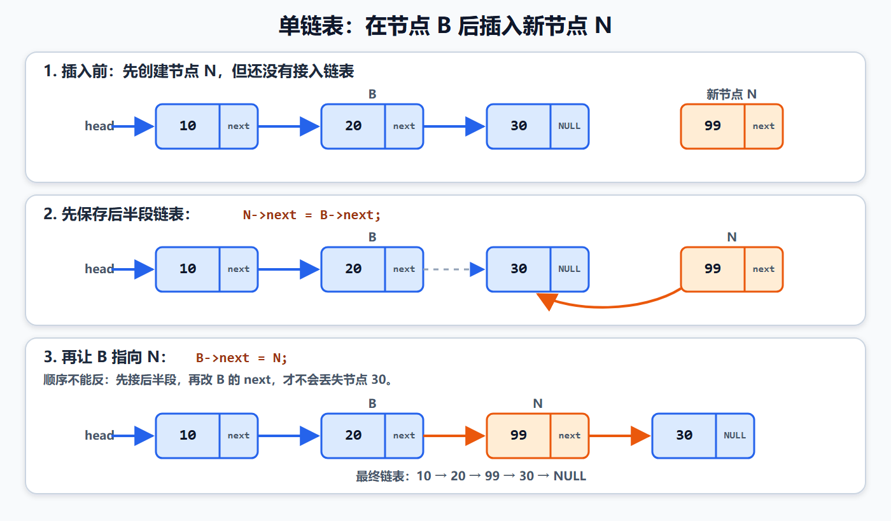

图中原链表为：

```text
10 → 20 → 30 → NULL
```

要在值为 `20` 的节点 `B` 后插入值为 `99` 的节点 `N`：

1. 创建并初始化节点 `N`；
2. 执行 `N->next = B->next`，使 `N` 先指向节点 `30`；
3. 执行 `B->next = N`，把 `N` 正式接入链表；
4. 最终得到 `10 → 20 → 99 → 30 → NULL`。

如果错误地先执行：

```c
B->next = N;
N->next = B->next;
```

第二句读到的 `B->next` 已经是 `N`，结果会变成 `N->next == N`，形成自环，同时丢失原来的节点 `30`。

##### 1.表头插入

表头插入会改变头指针，因此需要 `Node **head` 或返回新的头指针：

```c
new_node->next = *head;
*head = new_node;
```

```text
插入前：head → A → B → NULL
第一步：new → A
第二步：head → new → A → B → NULL
```

##### 2.按下标插入

本章使用 C 的零基下标：

- `index == 0` 表示头插；
- 其他位置先找到下标 `index - 1` 的前驱节点；
- 允许 `index == length`，表示尾插；
- 不允许 `index > length`。

```c
bool list_insert(Node **head, size_t index, int value)
{
    Node *new_node;

    if (head == NULL) {
        return false;
    }

    if (index == 0) {
        new_node = malloc(sizeof *new_node);
        if (new_node == NULL) {
            return false;
        }

        new_node->data = value;
        new_node->next = *head;
        *head = new_node;
        return true;
    }

    Node *previous = *head;
    for (size_t i = 1; i < index && previous != NULL; i++) {
        previous = previous->next;
    }

    if (previous == NULL) {
        return false;
    }

    new_node = malloc(sizeof *new_node);
    if (new_node == NULL) {
        return false;
    }

    new_node->data = value;
    new_node->next = previous->next;
    previous->next = new_node;
    return true;
}
```

先确认插入位置合法，再申请新节点，可以避免位置非法时无意义地申请和释放内存。

#### 五、单链表的删除

删除中间节点时，应先保存待删除节点，再让前驱节点跨过它，最后释放节点。

```c
Node *target = previous->next;
previous->next = target->next;
free(target);
```

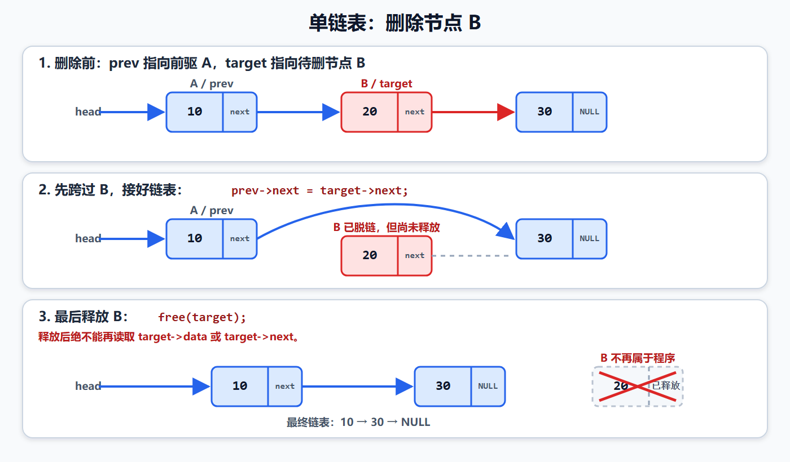

图中的 `prev` 是 `previous` 的缩写，两者都表示节点 `B` 的前驱节点。

图中删除值为 `20` 的节点 `B`：

1. `target` 保存 `B` 的地址；
2. `previous->next = target->next`，让节点 `10` 直接指向节点 `30`；
3. 如果需要返回被删值，必须在释放前读取 `target->data`；
4. 执行 `free(target)`；
5. 释放后绝不能再读取 `target->data` 或 `target->next`。

##### 1.删除首节点

首节点没有普通前驱，需要直接修改头指针：

```c
target = *head;
*head = target->next;
free(target);
```

##### 2.按下标删除

```c
bool list_erase(Node **head, size_t index, int *removed)
{
    Node *target;

    if (head == NULL || *head == NULL) {
        return false;
    }

    if (index == 0) {
        target = *head;
        *head = target->next;
    }
    else {
        Node *previous = *head;

        for (size_t i = 1; i < index && previous != NULL; i++) {
            previous = previous->next;
        }

        if (previous == NULL || previous->next == NULL) {
            return false;
        }

        target = previous->next;
        previous->next = target->next;
    }

    if (removed != NULL) {
        *removed = target->data;
    }

    free(target);
    return true;
}
```

删除要求 `index < length`。如果链表为空或下标不存在，函数返回 `false`，并且不能改变原链表。

#### 六、完整示例：单链表的增、删、改、查、反转和销毁

```c
#include <stdbool.h>
#include <stddef.h>
#include <stdio.h>
#include <stdlib.h>

typedef struct Node {
    int data;
    struct Node *next;
} Node;

bool list_insert(Node **head, size_t index, int value)
{
    Node *new_node;

    if (head == NULL) {
        return false;
    }

    if (index == 0) {
        new_node = malloc(sizeof *new_node);
        if (new_node == NULL) {
            return false;
        }

        new_node->data = value;
        new_node->next = *head;
        *head = new_node;
        return true;
    }

    Node *previous = *head;
    for (size_t i = 1; i < index && previous != NULL; i++) {
        previous = previous->next;
    }

    if (previous == NULL) {
        return false;
    }

    new_node = malloc(sizeof *new_node);
    if (new_node == NULL) {
        return false;
    }

    new_node->data = value;
    new_node->next = previous->next;
    previous->next = new_node;
    return true;
}

bool list_erase(Node **head, size_t index, int *removed)
{
    Node *target;

    if (head == NULL || *head == NULL) {
        return false;
    }

    if (index == 0) {
        target = *head;
        *head = target->next;
    }
    else {
        Node *previous = *head;

        for (size_t i = 1; i < index && previous != NULL; i++) {
            previous = previous->next;
        }

        if (previous == NULL || previous->next == NULL) {
            return false;
        }

        target = previous->next;
        previous->next = target->next;
    }

    if (removed != NULL) {
        *removed = target->data;
    }

    free(target);
    return true;
}

bool list_get(const Node *head, size_t index, int *value)
{
    const Node *current = head;

    if (value == NULL) {
        return false;
    }

    for (size_t i = 0; i < index && current != NULL; i++) {
        current = current->next;
    }

    if (current == NULL) {
        return false;
    }

    *value = current->data;
    return true;
}

bool list_set(Node *head, size_t index, int value)
{
    Node *current = head;

    for (size_t i = 0; i < index && current != NULL; i++) {
        current = current->next;
    }

    if (current == NULL) {
        return false;
    }

    current->data = value;
    return true;
}

const Node *list_find(const Node *head, int target)
{
    const Node *current = head;

    while (current != NULL) {
        if (current->data == target) {
            return current;
        }
        current = current->next;
    }

    return NULL;
}

size_t list_length(const Node *head)
{
    size_t length = 0;

    while (head != NULL) {
        length++;
        head = head->next;
    }

    return length;
}

void list_reverse(Node **head)
{
    Node *previous = NULL;
    Node *current;

    if (head == NULL) {
        return;
    }

    current = *head;
    while (current != NULL) {
        Node *next = current->next;
        current->next = previous;
        previous = current;
        current = next;
    }

    *head = previous;
}

void list_destroy(Node **head)
{
    if (head == NULL) {
        return;
    }

    while (*head != NULL) {
        Node *next = (*head)->next;
        free(*head);
        *head = next;
    }
}

void list_print(const Node *head)
{
    const Node *current = head;

    printf("[");
    while (current != NULL) {
        printf("%d", current->data);
        if (current->next != NULL) {
            printf(" -> ");
        }
        current = current->next;
    }
    printf("]\n");
}

int main(void)
{
    Node *head = NULL;
    const Node *found;
    int value;

    if (!list_insert(&head, 0, 20) ||
        !list_insert(&head, 0, 10) ||
        !list_insert(&head, 2, 40) ||
        !list_insert(&head, 2, 30)) {
        printf("插入失败\n");
        list_destroy(&head);
        return 1;
    }

    printf("插入后：");
    list_print(head);

    if (list_get(head, 2, &value)) {
        printf("下标2的元素：%d\n", value);
    }

    if (list_set(head, 1, 25)) {
        printf("修改后：");
        list_print(head);
    }

    found = list_find(head, 30);
    if (found != NULL) {
        printf("找到元素：%d\n", found->data);
    }

    if (list_erase(&head, 0, &value)) {
        printf("删除表头元素：%d\n", value);
    }

    if (list_erase(&head, 1, &value)) {
        printf("删除中间元素：%d\n", value);
    }

    printf("删除后：");
    list_print(head);

    if (!list_insert(&head, 5, 99)) {
        printf("非法位置插入已拒绝\n");
    }

    list_reverse(&head);
    printf("反转后：");
    list_print(head);
    printf("长度：%zu\n", list_length(head));

    list_destroy(&head);
    printf("销毁后：%s\n", head == NULL ? "空表" : "非空表");
    return 0;
}
```

输出：

```text
插入后：[10 -> 20 -> 30 -> 40]
下标2的元素：30
修改后：[10 -> 25 -> 30 -> 40]
找到元素：30
删除表头元素：10
删除中间元素：30
删除后：[25 -> 40]
非法位置插入已拒绝
反转后：[40 -> 25]
长度：2
销毁后：空表
```

#### 七、单链表反转

反转链表需要三个指针：

```text
previous：已经反转好的前半段
current ：当前正在处理的节点
next    ：提前保存尚未处理的后半段
```

核心步骤：

```c
while (current != NULL) {
    Node *next = current->next;
    current->next = previous;
    previous = current;
    current = next;
}
```

必须先保存 `next`，再改变 `current->next`。否则会失去后半段链表的地址。

反转需要访问每个节点一次，时间复杂度为 `O(n)`，只使用固定数量的指针，辅助空间复杂度为 `O(1)`。

#### 八、销毁链表与内存所有权

动态创建的每个节点都必须最终释放。销毁时应先保存后继节点，再释放当前节点：

```c
while (*head != NULL) {
    Node *next = (*head)->next;
    free(*head);
    *head = next;
}
```

不能写成：

```c
free(*head);
*head = (*head)->next;  /* 错误：释放后又访问原节点 */
```

销毁完成后，调用者的 `head` 应变为 `NULL`。节点由链表拥有；仅用于遍历的临时指针只是借用者，不能擅自释放节点。

#### 九、单链表操作复杂度

| 操作 | 时间复杂度 | 说明 |
| --- | --- | --- |
| 访问第一个节点 | `O(1)` | 直接使用 `head` |
| 按下标访问或修改 | `O(n)` | 需要从头遍历 |
| 按值查找 | `O(n)` | 最坏遍历全部节点 |
| 已知前驱节点后插入 | `O(1)` | 只修改两个 `next` |
| 按下标插入 | `O(n)` | 先寻找前驱节点 |
| 删除首节点 | `O(1)` | 修改头指针并释放节点 |
| 已知前驱节点后删除 | `O(1)` | 摘链并释放目标节点 |
| 按下标删除 | `O(n)` | 先寻找前驱节点 |
| 只有头指针时尾插 | `O(n)` | 需要找到最后一个节点 |
| 反转或销毁 | `O(n)` | 每个节点处理一次 |

“链表插入和删除是 `O(1)`”必须加前提：已经获得目标节点或其前驱节点的位置。如果还要从头查找，整体操作仍是 `O(n)`。

#### 十、单链表、循环链表和双向链表

| 类型 | 节点指针 | 末端特征 | 主要特点 |
| --- | --- | --- | --- |
| 单链表 | `next` | 尾节点指向 `NULL` | 只能沿一个方向遍历 |
| 单向循环链表 | `next` | 尾节点指回首节点或哨兵 | 可循环遍历，终止条件不是 `NULL` |
| 双向链表 | `prev`、`next` | 两端通常指向 `NULL` | 可前后遍历，删除已知节点更方便 |
| 双向循环链表 | `prev`、`next` | 首尾互相连接 | 常配合固定哨兵统一边界操作 |

带哨兵的双向循环空链表满足：

```c
sentinel.next = &sentinel;
sentinel.prev = &sentinel;
```

遍历从 `sentinel.next` 开始，以再次遇到 `&sentinel` 为结束条件，不能等待 `NULL`。

在固定哨兵地址不改变的情况下，头插、尾插只是修改节点成员，传 `Node *sentinel` 即可；只有需要替换调用者保存的哨兵指针变量时才需要 `Node `。

#### 十一、嵌入式系统中的链表

1. 动态链表可以按需增加节点，但每个节点都有指针开销。
2. 频繁 `malloc` 和 `free` 可能产生堆碎片，执行时间也不容易预测。
3. 最大节点数已知时，可以使用静态节点池和空闲链表，避免运行期间动态分配。
4. 不要在中断服务函数中直接进行无界遍历或动态内存分配。
5. 节点分散会降低内存局部性，在带缓存的处理器上可能比数组访问慢。
6. 主循环和中断同时修改链表时，要保护多条指针更新的完整性；`volatile` 不能代替并发同步。
7. 删除节点前要确认没有其他模块继续保存该节点地址，否则会产生悬空指针。

#### 十二、链表常见易错点

| 错误 | 后果 | 正确做法 |
| --- | --- | --- |
| 新节点的 `next` 未初始化 | 遍历进入未知地址 | 插入前明确设置 `next` |
| 插入时先覆盖前驱的 `next` | 丢失后半段链表或形成自环 | 先 `new->next = previous->next` |
| 删除后没有修改前驱的 `next` | 链表仍指向已释放节点 | 先摘链，再释放 |
| `free` 后读取节点成员 | 释放后使用，行为未定义 | 释放前保存后继和数据 |
| 头插只修改函数内的 `head` 形参 | 调用者头指针不变 | 传 `Node ` 或返回新头指针 |
| 空表时直接解引用 `head` | 空指针解引用 | 先检查 `head` 或 `*head` |
| 遍历时直接移动唯一头指针 | 丢失首节点地址 | 使用临时指针遍历 |
| 销毁时先释放再找后继 | 无法安全取得下一个节点 | 先保存 `next` |
| 循环链表仍以 `NULL` 为终止 | 死循环 | 以再次到达首节点或哨兵为终止 |
| 把链表插入一律写成 `O(1)` | 忽略寻找位置的代价 | 区分“已知位置”和“按下标” |
| 忘记检查 `malloc` | 分配失败后解引用 `NULL` | 先检查，再接入链表 |
| 多个模块共同释放同一节点 | 重复释放 | 明确所有权和销毁责任 |

#### 十三、链表练习与复习重点

1. 画出 `head → 10 → 20 → 30 → NULL` 中每个指针保存的地址关系。
2. 使用 `Node **head` 编写头插函数，并解释 `head`、`*head` 和 `**head`。
3. 手工跟踪在值为 `20` 的节点后插入 `99` 的两条指针语句。
4. 故意颠倒两条插入语句，说明为什么会形成自环并丢失后继节点。
5. 编写删除第一个等于目标值的节点的函数。
6. 删除链表的首节点、中间节点和尾节点，分别测试空表和单节点表。
7. 编写尾插函数；再增加尾指针，使尾插从 `O(n)` 变为 `O(1)`。
8. 使用三个指针原地反转单链表，并画出第一轮循环后的状态。
9. 实现链表长度、查找、修改和销毁函数。
10. 使用快慢指针判断单链表是否有环。
11. 为最大 32 个节点设计静态节点池，记录空闲节点和已用节点。
12. 比较无头结点链表和固定哨兵链表在头部插入、删除时的代码差异。

复习时重点掌握：单链表通过节点的 `next` 建立逻辑顺序；无头结点链表的 `head` 直接指向首数据节点；需要替换调用者头指针时传 `Node ` 或返回新头指针；插入必须先接住后半段再修改前驱指针；删除必须先摘链并保存所需数据，再释放目标节点；释放后不能继续访问；按下标查找位置需要 `O(n)`，只有已知节点位置时局部插入和删除才是 `O(1)`。

# 9.29数据结构与算法第四节——栈

栈（Stack）是一种只能在同一端进行插入和删除的线性结构。这个允许操作的一端叫作栈顶，另一端叫作栈底。

栈的核心规律是：后进先出（Last In First Out，LIFO）。最后进入栈的元素最先离开。

例如依次把 `10`、`20`、`30` 压入栈：

```text
栈顶
 ↓
[30]  最后入栈，最先出栈
[20]
[10]
-----
栈底
```

如果执行一次出栈，取出的元素是 `30`，剩余元素为 `10`、`20`。

#### 一、栈的基本术语与操作

| 名称 | 常用英文 | 含义 |
| --- | --- | --- |
| 入栈 | `push` | 在栈顶加入一个元素 |
| 出栈 | `pop` | 删除栈顶元素，并可取回它的值 |
| 查看栈顶 | `peek` / `top` | 读取栈顶元素但不删除 |
| 判空 | `is_empty` | 判断栈中是否没有元素 |
| 判满 | `is_full` | 顺序栈中判断存储空间是否已满 |
| 栈溢出 | overflow | 满栈继续入栈 |
| 栈下溢 | underflow | 空栈继续出栈 |

栈是“受限的线性表”：不能直接从中间插入或删除，也不应该绕过接口随意修改内部元素。

#### 二、顺序栈的表示

顺序栈使用连续数组保存元素：

```c
#define STACK_CAPACITY 8

typedef struct {
    int data[STACK_CAPACITY];
    size_t size;
} ArrayStack;
```

这里把 `size` 定义为当前元素个数，同时也是下一次入栈要写入的下标：

```text
空栈：size == 0
栈顶元素下标：size - 1
下一空位下标：size
满栈：size == STACK_CAPACITY
```

以容量为 `8`、当前含有 `10`、`20`、`30` 的栈为例：

```text
下标：  0    1    2    3    4    5    6    7
数组： [10] [20] [30] [  ] [  ] [  ] [  ] [  ]
                    ↑    ↑
                  栈顶  size=3，下一次写入位置
```

这种定义不需要让无符号类型 `size_t` 保存 `-1`。如果采用“`top` 表示栈顶下标”的写法，空栈常用 `top == -1`，此时 `top` 应选择能表示负数的有符号类型，不能盲目使用 `size_t`。

#### 三、入栈、出栈和查看栈顶

入栈必须先判断是否已满：

```c
stack->data[stack->size] = value;
stack->size++;
```

出栈必须先判断是否为空，并先取得旧栈顶：

```c
int removed = stack->data[stack->size - 1U];
stack->size--;
```

这里减少 `size` 就已经完成逻辑删除，无须把数组原位置清零。旧数据即使暂时还在内存中，也已经不属于栈的有效范围。

查看栈顶只读取 `data[size - 1]`，不能改变 `size`。

#### 四、顺序栈完整示例

下面的程序实现初始化、判空、判满、入栈、出栈、查看栈顶和打印。`pop` 的输出参数允许传入 `NULL`，表示只删除而不需要取回元素值。

```c
#include <stdbool.h>
#include <stddef.h>
#include <stdio.h>

#define STACK_CAPACITY 8

typedef struct {
    int data[STACK_CAPACITY];
    size_t size;
} ArrayStack;

static void stack_init(ArrayStack *stack)
{
    if (stack != NULL) {
        stack->size = 0U;
    }
}

static bool stack_is_empty(const ArrayStack *stack)
{
    return stack != NULL && stack->size == 0U;
}

static bool stack_is_full(const ArrayStack *stack)
{
    return stack != NULL && stack->size == STACK_CAPACITY;
}

static bool stack_push(ArrayStack *stack, int value)
{
    if (stack == NULL || stack_is_full(stack)) {
        return false;
    }

    stack->data[stack->size] = value;
    stack->size++;
    return true;
}

static bool stack_pop(ArrayStack *stack, int *value)
{
    int removed;

    if (stack == NULL || stack_is_empty(stack)) {
        return false;
    }

    removed = stack->data[stack->size - 1U];
    stack->size--;

    if (value != NULL) {
        *value = removed;
    }

    return true;
}

static bool stack_peek(const ArrayStack *stack, int *value)
{
    if (stack == NULL || value == NULL || stack_is_empty(stack)) {
        return false;
    }

    *value = stack->data[stack->size - 1U];
    return true;
}

static void stack_print(const ArrayStack *stack)
{
    size_t i;

    if (stack == NULL) {
        return;
    }

    printf("栈底 [");
    for (i = 0U; i < stack->size; ++i) {
        if (i > 0U) {
            printf(", ");
        }
        printf("%d", stack->data[i]);
    }
    printf("] 栈顶\n");
}

int main(void)
{
    ArrayStack stack;
    const int input[] = {10, 20, 30};
    size_t i;
    int value;

    stack_init(&stack);

    for (i = 0U; i < sizeof(input) / sizeof(input[0]); ++i) {
        if (!stack_push(&stack, input[i])) {
            printf("%d 入栈失败\n", input[i]);
        }
    }

    printf("入栈后：");
    stack_print(&stack);

    if (stack_peek(&stack, &value)) {
        printf("栈顶元素：%d\n", value);
    }

    if (stack_pop(&stack, &value)) {
        printf("出栈元素：%d\n", value);
    }

    printf("出栈后：");
    stack_print(&stack);
    printf("元素数：%zu，容量：%d\n", stack.size, STACK_CAPACITY);

    return 0;
}
```

运行结果：

```text
入栈后：栈底 [10, 20, 30] 栈顶
栈顶元素：30
出栈元素：30
出栈后：栈底 [10, 20] 栈顶
元素数：2，容量：8
```

#### 五、链栈

栈也可以用单链表实现。通常把链表首节点作为栈顶，这样入栈和出栈都只操作头部：

```text
top
 ↓
[30|next] → [20|next] → [10|NULL]
```

链栈入栈与单链表头插相同：

```c
new_node->next = *top;
*top = new_node;
```

链栈出栈与删除首节点相同：

```c
Node *removed = *top;
*top = removed->next;
free(removed);
```

需要修改调用者的 `top`，所以函数可以接收 `Node **top`，也可以返回新的栈顶指针。

| 实现方式 | 优点 | 局限 |
| --- | --- | --- |
| 顺序栈 | 内存连续、访问快、无节点指针开销 | 容量固定或扩容时需要搬移存储 |
| 链栈 | 可按需增长，不要求连续大块空间 | 每个节点有指针开销，动态分配可能失败 |

无论采用哪种实现，只要不需要扩容，入栈、出栈和查看栈顶的时间复杂度都是 `O(1)`。

#### 六、栈的典型应用

1. 函数调用与返回地址保存。
2. 表达式求值和中缀表达式转后缀表达式。
3. 括号匹配，例如检查 `([]{})` 是否配对。
4. 撤销操作：每次修改压栈，撤销时弹出最近修改。
5. 深度优先搜索（DFS）和非递归遍历。
6. 反转数据，例如把字符依次入栈后再出栈。

注意区分两个概念：本节自己实现的“数据结构栈”是程序中的一个容器；系统运行函数时使用的“调用栈”由编译器、处理器和运行环境共同管理。两者都遵循后进先出，但不是同一块数据。

#### 七、嵌入式系统中的栈

1. MCU 的 RAM 较小，数组栈容量应根据最坏情况计算，不能只按平均情况估计。
2. 递归会消耗调用栈，递归深度不可控时容易造成系统栈溢出；资源受限系统常改用显式数组栈。
3. 中断嵌套、局部大数组和较深的函数调用都会增加调用栈用量。
4. 固定容量顺序栈的运行时间和内存占用更容易预测，常比运行期间动态分配的链栈适合实时系统。
5. 主循环和中断若共享同一个栈，入栈和出栈的复合操作必须保证原子性；仅给变量加 `volatile` 不能保证数据结构一致。
6. 满栈和空栈都应返回明确状态，不能覆盖仍然有效的数据，也不能从无效位置读取。

#### 八、栈的常见易错点

| 错误 | 后果 | 正确做法 |
| --- | --- | --- |
| 入栈前不判满 | 数组越界写入 | 先比较 `size` 与容量 |
| 出栈、查看栈顶前不判空 | 访问 `data[-1]` 或发生无符号下溢 | 先检查 `size == 0` |
| 先减少 `size`，又读取 `data[size - 1]` | 读到错误元素甚至越界 | 统一并严格遵守下标约定 |
| 用 `size_t top` 并以 `-1` 表示空栈 | 得到巨大的无符号数 | 使用 `size` 计数法或有符号 `top` |
| 把查看栈顶写成出栈 | 无意删除元素 | `peek` 只能读，不能改变 `size` |
| 认为出栈必须把数组元素清零 | 混淆物理内容与逻辑有效范围 | 减少 `size` 即可完成逻辑删除 |
| 链栈出栈后忘记 `free` | 内存泄漏 | 摘下首节点后释放它 |
| 把数据结构栈和调用栈混为一谈 | 难以判断内存问题 | 分别讨论容器容量与系统栈空间 |

#### 九、栈练习与复习重点

1. 手工跟踪 `push(10)`、`push(20)`、`pop()`、`push(30)` 后数组和 `size` 的状态。
2. 将顺序栈改为可存放字符，并判断一串括号是否匹配。
3. 连续向容量为 3 的栈压入 4 个元素，验证第 4 次入栈失败且已有数据不变。
4. 对空栈连续执行 `pop` 和 `peek`，验证函数安全返回失败。
5. 使用单链表实现链栈，并在销毁时释放全部节点。
6. 使用两个栈实现一个队列。
7. 估算一个递归函数每层大约占用的局部变量空间，说明递归深度为什么会影响 MCU 稳定性。

复习时重点掌握：栈遵循后进先出；顺序栈使用 `size` 时，栈顶下标是 `size - 1`，下一写入位置是 `size`；入栈先判满，出栈和查看栈顶先判空；出栈会改变栈，查看栈顶不会；链栈通常在链表头部完成 `O(1)` 的入栈和出栈。

# 9.29数据结构与算法第五节——队列

队列（Queue）是一种在一端插入、在另一端删除的线性结构。允许插入的一端叫作队尾，允许删除的一端叫作队首。

队列的核心规律是：先进先出（First In First Out，FIFO）。最早进入队列的元素最先离开。

```text
出队方向 ← [10] [20] [30] ← 入队方向
             ↑         ↑
           队首       队尾
```

#### 一、队列的基本操作

| 名称 | 常用英文 | 含义 |
| --- | --- | --- |
| 入队 | `enqueue` | 在队尾加入一个元素 |
| 出队 | `dequeue` | 删除队首元素，并可取回它的值 |
| 查看队首 | `peek` / `front` | 读取队首元素但不删除 |
| 判空 | `is_empty` | 判断队列中是否没有元素 |
| 判满 | `is_full` | 固定容量队列中判断空间是否已满 |

#### 二、普通顺序队列为什么会浪费空间

如果数组队列只让 `front` 和 `rear` 一直向右移动，出队后数组左侧会留下空位：

```text
容量 5，先入队 10、20、30、40：
下标：   0    1    2    3    4
       [10] [20] [30] [40] [  ]
        ↑                   ↑
      front                rear
                    （下一写入位置为下标 4）

再出队 10、20：
       [  ] [  ] [30] [40] [  ]
                  ↑         ↑
                front     rear
```

此时数组左边明明有两个空位，但 `rear` 很快就会到达数组末端。如果每次出队都把剩余元素整体向左搬移，单次出队会变成 `O(n)`。

循环队列把数组首尾在逻辑上连接起来，让下标到达末端后回到 `0`，从而重复利用空位。

#### 三、循环队列的结构与约定

```c
#define QUEUE_CAPACITY 5

typedef struct {
    int data[QUEUE_CAPACITY];
    size_t front;
    size_t rear;
    size_t size;
} CircularQueue;
```

本例采用以下约定：

```text
front：下一次出队要读取的位置
rear ：下一次入队要写入的位置
size ：当前有效元素个数
空队列：size == 0
满队列：size == QUEUE_CAPACITY
```

每次移动下标都使用取模运算：

```c
queue->rear = (queue->rear + 1U) % QUEUE_CAPACITY;
queue->front = (queue->front + 1U) % QUEUE_CAPACITY;
```

当下标从 `QUEUE_CAPACITY - 1` 再加 `1` 时，取模结果为 `0`，因此实现回绕。

循环队列常见的判空、判满方案有三种：

| 方案 | 判空 | 判满 | 实际可用容量 |
| --- | --- | --- | --- |
| 额外记录 `size` | `size == 0` | `size == capacity` | 全部空间 |
| 永远空出一个位置 | `front == rear` | `(rear + 1) % capacity == front` | `capacity - 1` |
| 额外记录 `full` 标志 | `front == rear && !full` | `front == rear && full` | 全部空间 |

本例选择记录 `size`。因此当 `front == rear` 时，队列既可能为空，也可能为满，必须结合 `size` 判断，不能只看两个下标。

#### 四、入队和出队的指针变化

入队先写入 `rear` 指向的位置，再让 `rear` 前进：

```c
queue->data[queue->rear] = value;
queue->rear = (queue->rear + 1U) % QUEUE_CAPACITY;
queue->size++;
```

出队先读取 `front` 指向的元素，再让 `front` 前进：

```c
int removed = queue->data[queue->front];
queue->front = (queue->front + 1U) % QUEUE_CAPACITY;
queue->size--;
```

假设容量为 5，`10`、`20` 已出队，`front == 2`，随后继续入队 `50`、`60`、`70`：

```text
物理数组下标：   0    1    2    3    4
物理存储内容： [60] [70] [30] [40] [50]
                       ↑
                  front=2，rear=2

逻辑出队顺序：30 → 40 → 50 → 60 → 70
```

物理数组中的顺序不一定等于逻辑队列顺序。打印和遍历时应从 `front` 开始，根据：

```c
index = (front + i) % QUEUE_CAPACITY;
```

依次取得第 `i` 个逻辑元素。

#### 五、循环队列完整示例

```c
#include <stdbool.h>
#include <stddef.h>
#include <stdio.h>

#define QUEUE_CAPACITY 5

typedef struct {
    int data[QUEUE_CAPACITY];
    size_t front;
    size_t rear;
    size_t size;
} CircularQueue;

static void queue_init(CircularQueue *queue)
{
    if (queue != NULL) {
        queue->front = 0U;
        queue->rear = 0U;
        queue->size = 0U;
    }
}

static bool queue_is_empty(const CircularQueue *queue)
{
    return queue != NULL && queue->size == 0U;
}

static bool queue_is_full(const CircularQueue *queue)
{
    return queue != NULL && queue->size == QUEUE_CAPACITY;
}

static bool queue_enqueue(CircularQueue *queue, int value)
{
    if (queue == NULL || queue_is_full(queue)) {
        return false;
    }

    queue->data[queue->rear] = value;
    queue->rear = (queue->rear + 1U) % QUEUE_CAPACITY;
    queue->size++;
    return true;
}

static bool queue_dequeue(CircularQueue *queue, int *value)
{
    int removed;

    if (queue == NULL || queue_is_empty(queue)) {
        return false;
    }

    removed = queue->data[queue->front];
    queue->front = (queue->front + 1U) % QUEUE_CAPACITY;
    queue->size--;

    if (value != NULL) {
        *value = removed;
    }

    return true;
}

static bool queue_peek(const CircularQueue *queue, int *value)
{
    if (queue == NULL || value == NULL || queue_is_empty(queue)) {
        return false;
    }

    *value = queue->data[queue->front];
    return true;
}

static void queue_print(const CircularQueue *queue)
{
    size_t i;

    if (queue == NULL) {
        return;
    }

    printf("[");
    for (i = 0U; i < queue->size; ++i) {
        const size_t index = (queue->front + i) % QUEUE_CAPACITY;

        if (i > 0U) {
            printf(", ");
        }
        printf("%d", queue->data[index]);
    }
    printf("]\n");
}

int main(void)
{
    CircularQueue queue;
    const int first_batch[] = {10, 20, 30, 40};
    const int second_batch[] = {50, 60, 70};
    size_t i;
    int value;

    queue_init(&queue);

    for (i = 0U; i < sizeof(first_batch) / sizeof(first_batch[0]); ++i) {
        (void)queue_enqueue(&queue, first_batch[i]);
    }

    if (queue_dequeue(&queue, &value)) {
        printf("出队：%d\n", value);
    }
    if (queue_dequeue(&queue, &value)) {
        printf("出队：%d\n", value);
    }

    for (i = 0U; i < sizeof(second_batch) / sizeof(second_batch[0]); ++i) {
        (void)queue_enqueue(&queue, second_batch[i]);
    }

    printf("回绕入队后：");
    queue_print(&queue);
    printf("满队列状态：front=%zu，rear=%zu，size=%zu\n",
           queue.front,
           queue.rear,
           queue.size);

    if (queue_peek(&queue, &value)) {
        printf("队首元素：%d\n", value);
    }

    if (!queue_enqueue(&queue, 80)) {
        printf("队列已满，80入队失败\n");
    }

    if (queue_dequeue(&queue, &value)) {
        printf("再次出队：%d\n", value);
    }

    printf("当前队列：");
    queue_print(&queue);

    return 0;
}
```

运行结果：

```text
出队：10
出队：20
回绕入队后：[30, 40, 50, 60, 70]
满队列状态：front=2，rear=2，size=5
队首元素：30
队列已满，80入队失败
再次出队：30
当前队列：[40, 50, 60, 70]
```

#### 六、链式队列

链式队列使用链表节点存储元素，同时保存队首指针 `front` 和队尾指针 `rear`：

```text
front                                   rear
  ↓                                       ↓
[10|next] → [20|next] → [30|NULL]
```

入队时把新节点接到 `rear` 后面，再让 `rear` 指向新节点；出队时删除 `front` 指向的首节点。

必须特别处理两个边界：

1. 第一个节点入队后，`front` 和 `rear` 都要指向它。
2. 最后一个节点出队后，`front` 和 `rear` 都要恢复为 `NULL`。

如果最后一次出队只修改 `front`，却让 `rear` 继续指向已释放节点，就会留下悬空指针。

链式队列的入队和出队都是 `O(1)`，但每个节点需要额外指针空间，并且动态分配可能失败。

#### 七、栈与队列对比

| 对比项 | 栈 | 队列 |
| --- | --- | --- |
| 顺序规律 | 后进先出 LIFO | 先进先出 FIFO |
| 插入位置 | 栈顶 | 队尾 |
| 删除位置 | 栈顶 | 队首 |
| 典型操作 | `push`、`pop`、`peek` | `enqueue`、`dequeue`、`peek` |
| 常见应用 | 函数调用、撤销、DFS、括号匹配 | 任务调度、缓存、BFS、消息传递 |
| 顺序存储关键状态 | `size` 或 `top` | `front`、`rear`，以及 `size` 或满标志 |

固定容量且无需扩容时，循环队列的入队、出队、查看队首都是 `O(1)`。遍历或打印全部元素需要 `O(n)`。

#### 八、嵌入式系统中的队列

1. 串口、SPI、网络收发常使用环形缓冲区，让中断快速写入、主循环按顺序处理。
2. 生产者速度短时间高于消费者时，队列可吸收突发数据，但容量仍必须按最坏情况设计。
3. 队列满时必须事先决定策略：拒绝新数据、覆盖最旧数据、阻塞等待或报告错误；不能默默破坏数据。
4. 中断和主循环共享环形队列时，需要考虑读写下标更新的原子性、内存可见性和单生产者/多生产者模型。
5. `volatile` 只影响编译器访问方式，不能自动保证多个字段的一致更新，也不能代替临界区或原子操作。
6. 实时系统中常使用静态循环队列，避免 `malloc` 带来的失败、碎片和不确定执行时间。
7. DMA 环形接收缓冲区与普通软件队列概念相近，但还要正确读取 DMA 剩余计数和处理回绕位置。

#### 九、队列的常见易错点

| 错误 | 后果 | 正确做法 |
| --- | --- | --- |
| 入队前不判满 | 覆盖尚未出队的数据 | 明确满队列条件和溢出策略 |
| 出队、查看队首前不判空 | 读取无效数据 | 先判断 `size == 0` |
| `front`、`rear` 含义前后不一致 | 次序错误或跳过元素 | 写明它们指向当前元素还是下一空位 |
| 下标加一时忘记取模 | 到达数组末端后越界 | 使用 `(index + 1) % capacity` |
| 只用 `front == rear` 同时判断空和满 | 无法区分两种状态 | 使用 `size`、空一格或满标志 |
| 按物理数组下标从 0 打印 | 回绕后显示次序错误 | 从 `front` 按逻辑顺序遍历 |
| 每次出队都整体移动数组 | 出队退化为 `O(n)` | 使用循环队列 |
| 链式队列删完最后节点后不清空 `rear` | `rear` 成为悬空指针 | 同时令 `front = rear = NULL` |
| 共享队列只添加 `volatile` | 复合更新仍可能被并发打断 | 根据运行环境使用原子操作或临界区 |

#### 十、队列练习与复习重点

1. 对容量为 5 的循环队列，手工跟踪两次出队、三次入队后的 `front`、`rear` 和 `size`。
2. 画出物理数组为 `[60, 70, 30, 40, 50]`、`front == 2` 时的逻辑出队顺序。
3. 把本例改为“空出一个位置”的方案，并写出新的判满条件。
4. 连续向满队列入队，验证失败后原有元素及三个状态变量均不改变。
5. 连续清空队列，再执行一次出队，验证安全返回失败。
6. 使用单链表实现链式队列，重点测试第一次入队和最后一次出队。
7. 使用两个队列实现一个栈。
8. 设计一个容量为 64 字节的 UART 接收环形缓冲区，并说明队满时采用什么策略。
9. 增加 `queue_clear` 函数，说明清空时是否必须把整个数组置零。
10. 思考容量为 2 的幂时，何时可以用位与运算代替取模，以及这样做的前提。

复习时重点掌握：队列遵循先进先出；循环队列使用固定数组重复利用前部空间；本例中 `front` 指向下一出队位置，`rear` 指向下一入队位置；下标移动必须回绕；`front == rear` 不能单独区分空和满；使用 `size` 时空队列为 `size == 0`，满队列为 `size == capacity`；入队和出队为 `O(1)`。

# 9.30数据结构与算法第六节——树与二叉树

当前 `笔记链接.txt` 中没有新增的树与二叉树讲义，本节按照“线性结构之后学习树形结构”的常见课程序列，对树和二叉树进行系统整理。

线性表、栈和队列主要描述“一对一”的前后关系；树用于描述“一对多”的层次关系。文件目录、组织结构、菜单、表达式语法树、二叉搜索树、堆和哈夫曼编码都可以使用树结构表示。

#### 一、从线性结构到树形结构

| 结构 | 节点之间的关系 | 典型例子 |
| --- | --- | --- |
| 线性表 | 除端点外，每个元素有一个直接前驱和一个直接后继 | 数组、链表 |
| 栈 | 只允许在栈顶操作，后进先出 | 调用记录、撤销记录 |
| 队列 | 队尾进入、队首离开，先进先出 | 任务队列、环形缓冲区 |
| 树 | 一个父节点可以拥有多个子节点 | 文件目录、菜单、语法树 |

一棵非空树满足：

1. 有且只有一个没有父节点的节点，称为根节点；
2. 除根节点外，每个节点有且只有一个直接父节点；
3. 一个节点可以拥有零个或多个子节点；
4. 从根出发可以到达所有节点；
5. 节点之间不能形成环。

因此，树既是连通的，又是无环的。如果一个结构中某个节点有两个直接父节点，或者沿着子节点指针最终又回到自己，它就不再是普通树。

#### 二、树的基本术语

以下面这棵普通树为例：

```text
             A
          /  |  \
         B   C   D
            / \   \
           E   F   G
```

| 术语 | 含义 | 示例 |
| --- | --- | --- |
| 根节点 | 没有父节点的节点 | `A` |
| 父节点 | 某节点的直接上一层节点 | `C` 是 `E`、`F` 的父节点 |
| 子节点 | 某节点直接连接的下一层节点 | `B`、`C`、`D` 是 `A` 的子节点 |
| 兄弟节点 | 拥有同一个父节点的节点 | `E` 与 `F` |
| 祖先 | 从根到当前节点路径上的上层节点 | `A`、`C` 是 `F` 的祖先 |
| 后代 | 以某节点为根的子树中的下层节点 | `E`、`F` 是 `C` 的后代 |
| 叶子节点 | 没有子节点，即度为 0 的节点 | `B`、`E`、`F`、`G` |
| 分支节点 | 至少拥有一个子节点的节点 | `A`、`C`、`D` |
| 节点的度 | 该节点拥有的子节点数量 | `A` 的度为 3，`C` 的度为 2 |
| 树的度 | 所有节点度数的最大值 | 该树的度为 3 |
| 子树 | 以某个节点为根以及其全部后代组成的树 | 以 `C` 为根的部分 |
| 森林 | 若干棵互不相交的树组成的集合 | 删除根 `A` 后得到三棵子树 |

本节统一采用以下约定：

- 根节点位于第 `1` 层；
- 根节点的深度为 `0`；
- 节点深度等于“从根到该节点经过的边数”；
- 节点层次等于“深度加 `1`”；
- 树的高度按层数计算；
- 空树高度为 `0`，只有根节点的树高度为 `1`。

在上图中：

```text
路径 A → C → F 经过 2 条边，所以路径长度为 2；
F 的深度为 2，位于第 3 层；
整棵树共有 3 层，所以树高为 3。
```

不同教材也可能把“高度”定义为最长路径的边数，此时只有根节点的树高度为 `0`。阅读公式或代码时，必须先确认采用哪一种约定。本章的公式和程序都采用“高度等于层数”。

#### 三、普通树的性质与存储方式

##### 1.普通树的基本性质

一棵含有 `n` 个节点的非空树满足：

```text
边数 = n - 1
所有节点的度数之和 = n - 1
```

原因是除根节点外，每个节点都恰好通过一条来自父节点的边连接到树中。

删除根节点以及与根相连的边后，根的每棵子树彼此分离，形成森林。反过来，也可以增加一个新根，把森林中的每棵树连接为新根的子树。

##### 2.普通树的常见存储方式

| 存储方式 | 保存的信息 | 优点 | 局限 |
| --- | --- | --- | --- |
| 双亲表示法 | 每个节点保存父节点的数组下标 | 查找父节点方便 | 查找全部子节点通常需要扫描数组 |
| 孩子链表 | 每个节点连接一条自己的孩子链表 | 遍历一个节点的全部孩子方便 | 结构和内存管理较复杂 |
| 孩子兄弟表示法 | 保存第一个孩子和下一个兄弟 | 每个节点只需要两个指针 | 两个指针不表示原树的左、右孩子 |

孩子兄弟表示法可以写成：

```c
typedef struct TreeNode {
    int data;
    struct TreeNode *first_child;
    struct TreeNode *next_sibling;
} TreeNode;
```

其中：

```text
first_child ：指向当前节点的第一个子节点
next_sibling：指向与当前节点同父的下一个兄弟节点
```

这种结构虽然每个节点只有两个指针，看起来像二叉结构，但它表示的原树仍然可以拥有任意数量的孩子，不能因此说原树就是二叉树。

#### 四、二叉树的定义

二叉树（Binary Tree）是一种每个节点最多拥有两个子节点的有序树。这两个位置分别称为左子树和右子树。

必须注意：

1. “最多两个”包括 `0` 个、`1` 个和 `2` 个孩子，并不是每个节点都必须有两个孩子；
2. 左孩子和右孩子的位置有区别，不能随意交换；
3. 只有一个孩子时，“只有左孩子”和“只有右孩子”代表两棵不同的二叉树；
4. `root == NULL` 表示空二叉树；
5. 普通二叉树只规定形状，不规定数据大小关系，因此没有统一的插入和删除位置。

例如，下面两棵树并不相同：

```text
只有左孩子：       只有右孩子：

    A                  A
   /                    \
  B                      B
```

#### 五、几种容易混淆的二叉树

##### 1.斜二叉树

每个节点最多只有一个孩子，整体形状接近链表：

```text
A
 \
  B
   \
    C
     \
      D
```

含有 `n` 个节点的斜二叉树高度可达到 `n`，递归遍历时调用栈也可能达到 `n` 层。

##### 2.满二叉树

按照中文数据结构教材中的常见定义，满二叉树的每一层都达到最大节点数：

```text
        A
       / \
      B   C
     / \ / \
    D  E F  G
```

高度为 `h` 的满二叉树共有：

```text
2^h - 1 个节点
```

所有叶子节点都位于第 `h` 层。

##### 3.完全二叉树

完全二叉树满足：

1. 除最后一层外，其余各层全部填满；
2. 最后一层的节点必须从左向右连续排列，中间不能出现空位。

```text
        A
       / \
      B   C
     / \ /
    D  E F
```

满二叉树一定是完全二叉树，完全二叉树不一定是满二叉树。

下面的形状不是完全二叉树，因为最后一层出现了“左边空、右边有节点”：

```text
        A
       / \
      B   C
       \
        D
```

##### 4.严格二叉树

严格二叉树要求每个节点的度只能是 `0` 或 `2`，即分支节点必须同时拥有左右孩子，但叶子不必位于同一层：

```text
        A
       / \
      B   C
         / \
        D   E
```

英文资料中的 `full binary tree` 有时表示“严格二叉树”，而中文教材里的“满二叉树”通常表示每层都填满。遇到英文术语时应查看其具体定义，不能只按字面翻译。

#### 六、二叉树的重要性质

本节继续采用“根在第 `1` 层，树高等于层数”的约定。

下面涉及节点数 `n` 的对数公式均假设 `n >= 1`；空树的高度单独定义为 `0`。

| 性质 | 公式或结论 |
| --- | --- |
| 第 `i` 层最多的节点数 | `2^(i - 1)` |
| 高度为 `h` 时最多的节点数 | `2^h - 1` |
| 高度为 `h` 时最少的节点数 | `h`，对应斜二叉树 |
| `n` 个节点的最小高度 | `ceil(log2(n + 1))` |
| `n` 个节点的最大高度 | `n` |
| `n` 个节点的完全二叉树高度 | `floor(log2(n)) + 1` |
| `n` 个节点的完全二叉树叶子数 | `ceil(n / 2)` |

##### 1.叶子节点与度为 2 的节点

设一棵非空二叉树中：

```text
n0：度为 0 的节点数，也就是叶子节点数
n1：度为 1 的节点数
n2：度为 2 的节点数
```

则一定满足：

```text
n0 = n2 + 1
```

推导过程：

```text
节点总数：n = n0 + n1 + n2
边的总数：n - 1 = n1 + 2n2

将第一式代入第二式并整理：
n0 = n2 + 1
```

该公式针对非空二叉树；空树没有节点，不能机械地代入。

##### 2.链式二叉树中的空指针数量

如果每个节点都有 `left`、`right` 两个孩子指针，`n` 个节点共有 `2n` 个指针域。

非空孩子链接恰好等于树的边数 `n - 1`，因此空指针域数量为：

```text
2n - (n - 1) = n + 1
```

线索二叉树会利用这些原本为空的指针保存遍历前驱或后继信息。

#### 七、二叉树的存储方式

##### 1.顺序存储

完全二叉树非常适合使用数组保存。采用 C 语言常见的 `0` 下标时，节点下标为 `i`：

```text
左孩子下标：2 * i + 1
右孩子下标：2 * i + 2
父节点下标：(i - 1) / 2，要求 i > 0
```

孩子下标只有在小于节点总数 `n` 时才真实存在。

例如数组：

```text
下标：  0    1    2    3    4    5
数据： [A]  [B]  [C]  [D]  [E]  [F]
```

表示：

```text
        A
       / \
      B   C
     / \ /
    D  E F
```

在含有 `n` 个节点的完全二叉树中：

```text
下标 n / 2 到 n - 1 是叶子节点；
当 n >= 2 时，下标 n / 2 - 1 是最后一个分支节点。
```

普通稀疏二叉树或斜二叉树使用顺序存储会留下大量空槽，更适合使用链式存储。实际代码计算 `2 * i + 2` 时还要考虑无符号整数溢出，不能只在计算完成后检查下标。

##### 2.链式存储

链式二叉树的每个节点保存数据、左孩子指针和右孩子指针：

```c
typedef struct TreeNode {
    int data;
    struct TreeNode *left;
    struct TreeNode *right;
} TreeNode;
```

含义为：

```text
TreeNode *root：保存根节点地址
root->left   ：指向左子树的根节点
root->right  ：指向右子树的根节点
NULL         ：对应位置没有孩子
```

每棵左子树和右子树本身又是一棵二叉树，因此二叉树天然适合用递归方式描述和处理。

#### 八、二叉树的四种遍历

后面的讲解和完整程序统一使用下面这棵普通二叉树：

```text
        1
       / \
      2   3
     / \   \
    4   5   6
       /
      7
```

##### 1.先序遍历

```text
根节点 → 左子树 → 右子树
```

对示例树的访问顺序为：

```text
1 2 4 5 7 3 6
```

先序遍历常用于复制树、输出层次目录，以及配合空节点标记序列化二叉树。

##### 2.中序遍历

```text
左子树 → 根节点 → 右子树
```

对示例树的访问顺序为：

```text
4 2 7 5 1 3 6
```

普通二叉树的中序遍历结果不一定有序。只有二叉搜索树满足相应大小规则时，中序遍历才会得到有序序列。

##### 3.后序遍历

```text
左子树 → 右子树 → 根节点
```

对示例树的访问顺序为：

```text
4 7 5 2 6 3 1
```

后序遍历先处理左右子树、最后处理父节点，适合释放整棵树、计算目录大小和表达式求值。

##### 4.层序遍历

```text
从上到下，同一层从左到右
```

对示例树的访问顺序为：

```text
1 2 3 4 5 6 7
```

层序遍历属于广度优先搜索，需要使用队列：

```text
1. 根节点入队；
2. 当队列非空时，让队首节点出队并访问；
3. 左孩子非空则入队；
4. 右孩子非空则入队；
5. 重复步骤 2～4，直到队列为空。
```

三种递归深度优先遍历的区别，仅仅是“访问根节点”的位置不同：

```text
先序：访问根 → 递归左子树 → 递归右子树
中序：递归左子树 → 访问根 → 递归右子树
后序：递归左子树 → 递归右子树 → 访问根
```

#### 九、完整示例：创建、遍历、统计、查找和销毁二叉树

下面的程序完成以下操作：

1. 动态创建前面的 7 节点示例树；
2. 递归实现先序、中序和后序遍历；
3. 使用队列实现层序遍历；
4. 统计节点总数、叶子数量和树高；
5. 在普通二叉树中按先序顺序查找目标值；
6. 按后序顺序释放所有节点，并把外部根指针设为 `NULL`。

```c
#include <stdbool.h>
#include <stddef.h>
#include <stdio.h>
#include <stdlib.h>

typedef struct TreeNode {
    int data;
    struct TreeNode *left;
    struct TreeNode *right;
} TreeNode;

static TreeNode *tree_node_create(int data)
{
    TreeNode *node = malloc(sizeof(*node));

    if (node == NULL) {
        return NULL;
    }

    node->data = data;
    node->left = NULL;
    node->right = NULL;
    return node;
}

static void tree_destroy(TreeNode **root)
{
    TreeNode *node;

    if (root == NULL || *root == NULL) {
        return;
    }

    node = *root;
    tree_destroy(&node->left);
    tree_destroy(&node->right);
    free(node);
    *root = NULL;
}

static bool tree_build_sample(TreeNode **out_root)
{
    TreeNode *root;

    if (out_root == NULL || *out_root != NULL) {
        return false;
    }

    root = tree_node_create(1);
    if (root == NULL) {
        return false;
    }

    root->left = tree_node_create(2);
    if (root->left == NULL) {
        tree_destroy(&root);
        return false;
    }

    root->right = tree_node_create(3);
    if (root->right == NULL) {
        tree_destroy(&root);
        return false;
    }

    root->left->left = tree_node_create(4);
    if (root->left->left == NULL) {
        tree_destroy(&root);
        return false;
    }

    root->left->right = tree_node_create(5);
    if (root->left->right == NULL) {
        tree_destroy(&root);
        return false;
    }

    root->right->right = tree_node_create(6);
    if (root->right->right == NULL) {
        tree_destroy(&root);
        return false;
    }

    root->left->right->left = tree_node_create(7);
    if (root->left->right->left == NULL) {
        tree_destroy(&root);
        return false;
    }

    *out_root = root;
    return true;
}

static void print_data(int data, bool *is_first)
{
    if (!*is_first) {
        putchar(' ');
    }

    printf("%d", data);
    *is_first = false;
}

static void preorder_recursive(const TreeNode *root, bool *is_first)
{
    if (root == NULL) {
        return;
    }

    print_data(root->data, is_first);
    preorder_recursive(root->left, is_first);
    preorder_recursive(root->right, is_first);
}

static void inorder_recursive(const TreeNode *root, bool *is_first)
{
    if (root == NULL) {
        return;
    }

    inorder_recursive(root->left, is_first);
    print_data(root->data, is_first);
    inorder_recursive(root->right, is_first);
}

static void postorder_recursive(const TreeNode *root, bool *is_first)
{
    if (root == NULL) {
        return;
    }

    postorder_recursive(root->left, is_first);
    postorder_recursive(root->right, is_first);
    print_data(root->data, is_first);
}

static void tree_print_preorder(const TreeNode *root)
{
    bool is_first = true;

    preorder_recursive(root, &is_first);
    if (is_first) {
        printf("空树");
    }
    putchar('\n');
}

static void tree_print_inorder(const TreeNode *root)
{
    bool is_first = true;

    inorder_recursive(root, &is_first);
    if (is_first) {
        printf("空树");
    }
    putchar('\n');
}

static void tree_print_postorder(const TreeNode *root)
{
    bool is_first = true;

    postorder_recursive(root, &is_first);
    if (is_first) {
        printf("空树");
    }
    putchar('\n');
}

static size_t tree_count_nodes(const TreeNode *root)
{
    if (root == NULL) {
        return 0U;
    }

    return tree_count_nodes(root->left)
         + tree_count_nodes(root->right)
         + 1U;
}

static size_t tree_count_leaves(const TreeNode *root)
{
    if (root == NULL) {
        return 0U;
    }

    if (root->left == NULL && root->right == NULL) {
        return 1U;
    }

    return tree_count_leaves(root->left)
         + tree_count_leaves(root->right);
}

static size_t tree_height(const TreeNode *root)
{
    size_t left_height;
    size_t right_height;

    if (root == NULL) {
        return 0U;
    }

    left_height = tree_height(root->left);
    right_height = tree_height(root->right);

    return (left_height > right_height ? left_height : right_height) + 1U;
}

static const TreeNode *tree_find(const TreeNode *root, int target)
{
    const TreeNode *found;

    if (root == NULL) {
        return NULL;
    }

    if (root->data == target) {
        return root;
    }

    found = tree_find(root->left, target);
    if (found != NULL) {
        return found;
    }

    return tree_find(root->right, target);
}

static bool tree_print_level_order(const TreeNode *root)
{
    const TreeNode **queue;
    size_t node_count;
    size_t front = 0U;
    size_t rear = 0U;
    bool is_first = true;

    if (root == NULL) {
        printf("空树\n");
        return true;
    }

    node_count = tree_count_nodes(root);
    queue = malloc(node_count * sizeof(*queue));
    if (queue == NULL) {
        return false;
    }

    queue[rear++] = root;

    while (front < rear) {
        const TreeNode *node = queue[front++];

        print_data(node->data, &is_first);

        if (node->left != NULL) {
            queue[rear++] = node->left;
        }

        if (node->right != NULL) {
            queue[rear++] = node->right;
        }
    }

    putchar('\n');
    free(queue);
    return true;
}

int main(void)
{
    TreeNode *root = NULL;

    if (!tree_build_sample(&root)) {
        fprintf(stderr, "创建示例树失败\n");
        return EXIT_FAILURE;
    }

    printf("先序遍历：");
    tree_print_preorder(root);

    printf("中序遍历：");
    tree_print_inorder(root);

    printf("后序遍历：");
    tree_print_postorder(root);

    printf("层序遍历：");
    if (!tree_print_level_order(root)) {
        fprintf(stderr, "层序遍历时申请队列内存失败\n");
        tree_destroy(&root);
        return EXIT_FAILURE;
    }

    printf("节点总数：%zu\n", tree_count_nodes(root));
    printf("叶子数量：%zu\n", tree_count_leaves(root));
    printf("树的高度：%zu\n", tree_height(root));
    printf("查找 5：%s\n",
           tree_find(root, 5) != NULL ? "找到" : "未找到");
    printf("查找 8：%s\n",
           tree_find(root, 8) != NULL ? "找到" : "未找到");

    tree_destroy(&root);
    printf("销毁后根指针：%s\n",
           root == NULL ? "NULL" : "非 NULL");

    return EXIT_SUCCESS;
}
```

运行结果：

```text
先序遍历：1 2 4 5 7 3 6
中序遍历：4 2 7 5 1 3 6
后序遍历：4 7 5 2 6 3 1
层序遍历：1 2 3 4 5 6 7
节点总数：7
叶子数量：3
树的高度：4
查找 5：找到
查找 8：未找到
销毁后根指针：NULL
```

##### 1.创建失败时为什么不会泄漏

`tree_build_sample` 每创建一个节点就检查返回值。只要某次 `malloc` 失败，就调用 `tree_destroy(&root)`，将已经接入示例树的节点全部释放。函数只有在整棵树创建成功后才把根地址写入 `*out_root`。

`out_root == NULL` 表示没有传入合法的根指针变量地址；`*out_root != NULL` 表示调用者原来已经保存着一棵树，本例拒绝直接覆盖它，避免失去旧树地址而造成内存泄漏。

##### 2.为什么销毁函数需要二级指针

```c
tree_destroy(&root);
```

传入的是调用者根指针变量的地址：

```text
root       ：根节点地址
&root      ：根指针变量自身的地址
TreeNode ：能够修改 root 的类型
```

销毁函数先递归释放左右子树，再释放当前节点，最后执行：

```c
*root = NULL;
```

因此调用结束后，外部 `root` 也会变成 `NULL`。不能先 `free(node)` 再访问 `node->left` 或 `node->right`，否则属于释放后使用。

##### 3.层序队列为什么不会写越界

本例先使用 `tree_count_nodes` 得到节点总数，再申请同样数量的指针槽位。每个节点只会入队一次，因此最多写入 `node_count` 个队列元素。

这是一种容易理解的容量保证方式。更通用的实现可以使用可扩容队列或经过严格判满的循环队列。

#### 十、递归过程与复杂度

##### 1.递归终止条件

所有递归函数都先处理空树：

```c
if (root == NULL) {
    return;
}
```

对于统计函数，空树返回 `0`：

```c
if (root == NULL) {
    return 0U;
}
```

递归每深入一层，就把一个子树根指针交给下一次函数调用；当指针为 `NULL` 时停止，并逐层返回。

##### 2.高度的递归含义

```text
当前树高度 = max(左子树高度, 右子树高度) + 1
空树高度 = 0
```

因此叶子节点左右子树高度都为 `0`，叶子本身高度为 `1`。示例树最长的根到叶路径为 `1 → 2 → 5 → 7`，共有 4 层，所以程序输出高度 `4`。

##### 3.常见操作复杂度

设节点数为 `n`、树高为 `h`、最大宽度为 `w`：

| 操作 | 时间复杂度 | 额外空间 | 说明 |
| --- | --- | --- | --- |
| 先序、中序、后序遍历 | `O(n)` | `O(h)` | 每个节点访问一次，递归栈深度由树高决定 |
| 统计节点、叶子或高度 | `O(n)` | `O(h)` | 普通二叉树需要检查全部节点 |
| 普通二叉树查找 | 最坏 `O(n)` | `O(h)` | 没有大小规则可用于排除某个子树 |
| 层序遍历 | `O(n)` | 算法上 `O(w)` | 队列最多同时保存一层附近的节点 |
| 销毁整棵树 | `O(n)` | `O(h)` | 必须访问并释放每个节点 |

本例为了简单可靠，层序遍历一次性申请了 `n` 个指针槽位，所以本例实际申请空间为 `O(n)`；如果使用可复用的动态队列，遍历过程中同时保存的节点数量由最大宽度 `w` 决定。

较平衡的树高度通常接近 `log2(n)`；斜二叉树的高度可达到 `n`。因此同样是递归遍历，斜树更容易消耗大量调用栈。

#### 十一、遍历序列、二叉搜索树与堆

##### 1.遍历序列能否唯一确定一棵树

只有一条普通遍历序列时，通常不能唯一确定二叉树。当所有节点值互不相同时：

| 已知序列 | 能否唯一还原 | 原因 |
| --- | --- | --- |
| 先序 + 中序 | 可以 | 先序确定根，中序划分左右子树 |
| 后序 + 中序 | 可以 | 后序确定根，中序划分左右子树 |
| 先序 + 后序 | 通常不可以 | 只有一个孩子时无法确定它在左边还是右边 |
| 只有先序、中序或后序 | 通常不可以 | 缺少划分左右子树的信息 |

如果先序序列同时记录所有空孩子，例如用 `#` 表示 `NULL`：

```text
ABD##E##C#F##
```

那么一条带空标记的先序序列也可以还原二叉树。节点值为多字符或变长数据时，需要使用分隔符或长度信息保证每个值能够被明确解析；节点值重复本身不影响树的重建。如果还要区分同值节点的业务身份，则需额外保存唯一标识。

##### 2.普通二叉树不等于二叉搜索树

| 结构 | 形状或数据规则 | 中序结果 | 常见用途 |
| --- | --- | --- | --- |
| 普通二叉树 | 每个节点最多两个孩子，没有统一大小关系 | 不一定有序 | 表达式树、决策结构 |
| 二叉搜索树 | 左子树值较小、右子树值较大，重复值策略需另定 | 按规则可得到有序序列 | 动态查找、插入、删除 |
| 二叉堆 | 完全二叉树，父子满足最大堆或最小堆关系 | 不保证整体有序 | 优先队列、任务调度 |

普通二叉树没有统一的插入、删除规则；二叉搜索树按照关键字大小选择左右方向；堆通常在完全二叉树末尾插入，再通过上浮或下沉恢复堆序。

二叉搜索树的查找、插入和删除时间取决于树高：较平衡时约为 `O(log n)`，退化成斜树时最坏为 `O(n)`。

#### 十二、嵌入式系统中的树

1. 多级菜单、设备配置项和命令结构可以用普通树表示。
2. 表达式树可以用于命令解析、规则判断和计算。
3. 完全二叉树适合用数组实现堆，可用于优先级任务或定时事件调度。
4. 哈夫曼树可用于数据压缩和变长编码。
5. 决策树可表示较简单的分层判断流程，但规则很少时普通状态机可能更清晰。
6. MCU 调用栈有限，树高不可控时不要直接使用深递归；可以改用固定容量的显式栈。
7. 层序遍历使用队列时必须检查容量，不能假设树宽永远较小。
8. 实时系统常使用静态节点池或数组索引代替频繁的 `malloc`、`free`，避免堆碎片和不确定耗时。
9. 不要在中断服务函数中递归遍历大型树，也不要在中断中动态申请和释放节点。
10. 主循环与中断共同访问树时，要明确节点所有权并保护多条指针更新；`volatile` 不能代替同步。
11. 若树保存在 Flash 中，可用数组下标或偏移量表示关系，减少 RAM 指针开销，但要检查地址和边界。

#### 十三、树与二叉树的常见易错点

| 错误 | 后果或误解 | 正确做法 |
| --- | --- | --- |
| 认为每个二叉树节点都有两个孩子 | 忽略叶子和单孩子节点 | 二叉树规定的是“最多两个” |
| 随意交换左、右孩子 | 改变了二叉树结构和遍历结果 | 把左右位置视为有序关系 |
| 混淆深度、层次和高度 | 公式与程序输出相差 1 | 先声明根从第 0 层还是第 1 层 |
| 把满二叉树和完全二叉树当成同一概念 | 错误判断树形 | 满二叉树是完全二叉树的特殊情况 |
| 认为严格二叉树一定所有叶子同层 | 混淆“度为 0 或 2”与“每层填满” | 分别检查节点度和所在层 |
| 递归函数没有处理 `root == NULL` | 解引用空指针或无法终止 | 每次递归首先判断空树 |
| 使用 `malloc(sizeof(TreeNode *))` 创建节点 | 只申请了一个指针大小 | 使用 `malloc(sizeof *node)` |
| 创建节点后不把孩子设为 `NULL` | 遍历进入未知地址 | 初始化 `left`、`right` |
| 先释放父节点，再访问左右孩子 | 释放后使用 | 后序释放：左、右、根 |
| 销毁后外部根指针仍保存旧地址 | 形成悬空指针 | 传 `TreeNode **root` 并设为 `NULL` |
| 认为普通二叉树中序一定递增 | 把普通二叉树误当搜索树 | 只有满足搜索树规则时才有序 |
| 层序遍历不检查队列容量 | 队列越界写入 | 使用可证明足够的容量或动态队列 |
| 对斜树仍假定递归空间为 `O(log n)` | 低估调用栈用量 | 最坏递归深度为 `O(n)` |
| 用数组保存极度稀疏的树 | 产生大量空槽 | 稀疏树优先考虑链式存储 |
| 认为普通二叉树有统一删除算法 | 不知道该用哪个节点替换 | 先明确搜索树、堆或其他具体规则 |

#### 十四、练习与复习重点

1. 对示例树手工写出先序、中序、后序和层序遍历结果。
2. 画出递归计算示例树高度时，节点 `5` 和节点 `2` 分别得到的左右子树高度。
3. 编写函数统计度为 `1` 和度为 `2` 的节点数，并验证 `n0 = n2 + 1`。
4. 编写函数交换每个节点的左右子树，生成镜像树，再比较四种遍历结果。
5. 使用显式栈实现非递归先序遍历，避免依赖函数递归。
6. 使用上一节的循环队列重新实现层序遍历，并处理队满失败。
7. 编写函数判断两棵二叉树的形状和数据是否完全相同。
8. 判断一棵二叉树是否为完全二叉树：层序扫描中一旦遇到空位置，后面不能再出现非空节点。
9. 已知完全二叉树数组下标 `i`，计算父节点和两个孩子下标，并检查边界。
10. 使用带 `#` 空标记的先序字符串创建并还原一棵二叉树。
11. 为最多 32 个节点设计静态节点池，替代运行期间的 `malloc`、`free`。
12. 将 `tree_find` 改成返回目标节点的父节点，并说明查找根节点时如何处理。
13. 创建一棵只有右孩子的 10 节点斜树，比较它与较平衡树的高度和递归深度。
14. 说明普通二叉树、二叉搜索树和二叉堆各自根据什么规则决定插入位置。

复习时重点掌握：树用于表示一对多的无环层次关系；非空 `n` 节点树有 `n - 1` 条边；二叉树每个节点最多有两个有顺序的孩子；满二叉树一定是完全二叉树，完全二叉树不一定满；本章把空树高度定义为 `0`、单节点树高度定义为 `1`；先序、中序、后序只改变访问根的位置，层序遍历需要队列；递归遍历的时间复杂度为 `O(n)`、调用栈空间为 `O(h)`；销毁必须先释放左右子树再释放根，并在需要时通过 `TreeNode ` 把外部根指针设为 `NULL`；普通二叉树、中序有序的二叉搜索树以及满足堆序的完全二叉堆不能混为一谈。

# 10.8周测

```c
选择题
    1.D 2.A 3.D 4.c 5.C 6.C7.C 8.A 9.C 10.A 11.B 12.A 13.A 14.C  15.D 16.D 17.D 18.Q 19.C 20.A
填空
    1. 数据结构是相互之间存在一种或多种特定关系的数据元素的集合。
逻辑结构、物理、数据的运算。
    
2.集合、线性结构、树形结构、图状结构。
顺序存储、链式存储、索引存储、散列存储。
    
3. 运算受限的线性结构，运算受限的线性结构，线性表。
后进先出（LIFO）；先进先出（FIFO）。
树是一种非线性结构。
    
4.线性结构，有且仅有一个开始结点和一个终端结点，除首尾外每个结点有且仅有一个前驱和一个后继，元素之间一对一。
顺序表和链式表。

5.具体的机器指令执行时间，算法执行过程中基本语句的执行次数（。
不是实际占用的具体存储单元字节数，是算法运行时所需的辅助存储空间随问题规模 n 增长的变化趋势
通常表示形式是 O( )。

6. 先序遍历和中序遍历、后序遍历。
根结点 → 左子树 → 右子树（DLR）。   
简答题
    
    折半查找只适用于有序顺序表。每次取中间位置 `mid` 的关键字与给定值 `key` 比较：若相等则查找成功；若 `key < a[mid]`，则目标只可能在左半区间，把右边界移到 `mid-1`；若 `key > a[mid]`，则目标只可能在右半区间，把左边界移到 `mid+1`。每次比较都把查找范围缩小一半，直到找到或区间为空（查找失败）。
    
  在待排序序列中任取一个元素作为枢轴（pivot）（通常取首元素），通过一趟划分把表分成两部分：左边都 ≤ 枢轴，右边都 ≥ 枢轴，枢轴落到最终位置；然后对左、右两个子区间递归地做同样的划分，直到区间长度为 0 或 1，整个序列有序。
  
```

编程题  
    1.链表实现反转 （单链表即可），给大家准备好一个int arr[5]={1,2,3,4,5}, 实现    创建     打印    反转     销毁四个功能。

```c
#define _CRT_SECURE_NO_WARNINGS
#include <stdio.h>
#include <stdlib.h>
typedef  struct LinkList {
    int data;
    struct LinkList* next;
}LinkList;
//生成链表
LinkList* createLinkList(int *arr, int len)
{
    LinkList* list = NULL;
    list = (LinkList*)malloc(sizeof(LinkList));
	list->data = arr[0];
    list->next = NULL;
    LinkList* p = list;
    for (int i = 1; i < len; i++)
    {
        LinkList* node = (LinkList*)malloc(sizeof(LinkList));
        node->data = arr[i];
        node->next = NULL;
        p->next = node;
        p = node;
    }
	return list;
}
//打印链表
void printlist(LinkList *list)
{
    if (list == NULL)
    {
        return;
    }
    LinkList* temp = list;
    while (temp)
    {
        printf("%d\t", temp->data);
        temp = temp->next;
    }
}
//反转链表
LinkList* changelist(LinkList* list)

{
    if (list == NULL)
    {
        return;
    }
    LinkList* pre = NULL;
    LinkList *next, * cur;
    cur = list;
    while (cur)
    {
        next = cur->next;
        cur->next = pre;
        pre = cur;
        cur = next;
    }
    return pre;
}
//销毁链表
void destory(LinkList** list)
{
    if (list == NULL || *list == NULL) {
        printf("没有链表，不需要销毁");
        return;
    }
    LinkList* temp =NULL;
    while (*list)
    {
        temp = *list;
        *list = (*list)->next;
        free(temp);
        temp = NULL;
    }
}
int main() 
{
    LinkList* list = NULL;
    int  arr[5] = { 10,20,30,40,50 };
    list = createLinkList(arr, 5);
    if (list != NULL) {
        printf("链表创建成功\n");

    }
    printf("翻转前：");
    printlist(list);

    list = changelist(list);
    printf("翻转后：");
    printlist(list);

    destory(&list);
    return 0;
}

```


2.请写出带头循环双链表的  创建     头部插入     尾部插入   中间插入   头删     尾删    销毁链表的操作。（14分） 

```c
#define _CRT_SECURE_NO_WARNINGS

#include <stdio.h>
#include <stdlib.h>
typedef struct sqlist
{
    int data;               // 当前结点保存的数据
    struct sqlist* next;    // 下一个结点的地址
    struct sqlist* pre;
} sqlist;
sqlist* createlist()
{
    sqlist* list = malloc(sizeof(sqlist));
    if (list == NULL)
    {
        printf("空间开辟失败");
        return;
    }
    return list;
}
//1初始化链表
sqlist* init()
{
    sqlist* list = createlist();
    list->next = list;
    list->pre = list;
    printf("初始化成功\n");
    return list;
}
//2. 打印链表
void printflist(sqlist *list)
{
    sqlist* temp;
    if (list == NULL)
    {
        printf("空间开辟失败");
        return;
    };
    temp = list->next;
    while (temp!=list)
    {
        printf("%d ",temp->data);
        temp = temp->next;
    }
    printf("\n");
 
}
//3. 头插
void headadd(sqlist *list,int value)
{
    if (list == NULL) {
        return;
    }
    sqlist* ptr=createlist();
    if(ptr==NULL)
    {
        printf("开辟失败");
        return;
    }
    ptr->data = value;
    sqlist* temp;
    temp = list->next;
    list->next = ptr;
    ptr->pre = list;
    ptr->next = temp;
    temp->pre = ptr;
    printf("插入%d成功\n",value);
 
}
//4. 尾插 
void endadd(sqlist* list, int value)
{
    if (list == NULL) {
        return;
    }
    sqlist* ptr = createlist();
    if (ptr == NULL)
    {
        printf("开辟失败");
        return;
    }
    sqlist* temp=list->pre;
    ptr->data = value;
    list->pre = ptr;
    ptr->next = list;
    ptr->pre = temp;
    temp->next = ptr;
    printf("尾插%d成功\n", ptr->data);
 
}
//5. 头删
void headdel(sqlist* list)
{
    if (list == NULL) {
        printf("未初始化\n");
        return;
    }
    sqlist* temp;
    temp= list->next;
    if (list->next == list)
    {
        printf("链表为空\n");
        return;
    }
    list->next = temp->next;
    temp->next->pre = temp;
    printf("头删成功\n");
}
//6. 尾删
void enddel(sqlist* list)
{
    if (list == NULL) {
        printf("未初始化\n");
        return;
    }
    sqlist* temp;
    temp = list->pre;
    if (list->pre == list)
    {
        printf("链表为空\n");
        return;
    }
    list->pre = temp->pre;
    temp->pre->next = list;
    printf("尾删成功\n");
}
//7. 查找元素
sqlist* find(sqlist* list,int value)
{
    if (list == NULL) {
        printf("未初始化\n");
        return NULL;
    }
    sqlist* temp;
    temp = list->next;
    if (list->pre == list)
    {
        printf("链表为空\n");
        return NULL;
    }
    while (temp != list)
    {
        if (temp->data ==value)
        {
            printf("查找成功 ,元素%d的地址为 %p\n", temp->data, (void*)temp);
            return temp;
        }
        temp = temp->next;
    }
    return NULL;
}
//8. 链表节点的修改
void change(sqlist* pos,int value)
{
    pos->data = value;
}
//9. 中间插入
void afteradd(sqlist* pos, int value)
{
    headadd(pos, value);
}
//10中间删除
void afterdel(sqlist *list,sqlist *pos)
{
    if (list == NULL || pos == NULL)
    {
        printf("没找到指定节点\n");
        return;
    }
    if (list->next == list)
    {
        printf("链表为空\n");
        return;
    }
    sqlist* ptr=pos;
    pos->pre->next = pos->next;
    pos->next->pre = pos->pre;
    printf("删除的元素是%d\n", ptr->data);
    free(ptr);
}
//11. 销毁链表
void destroy(sqlist** list)
{
    if (list == NULL || *list == NULL)
    {
        printf("链表未初始化\n");
        return;
    }
    sqlist* ptr = (*list)->next;
    sqlist* temp = NULL;
    while (ptr != *list)
    {
        temp = ptr->next;
        free(ptr);
        ptr = temp;
    }
    free(*list);
    *list = NULL;
    printf("销毁成功\n");
}
/* 0.菜单 */
void help_menu(void)
{
    printf("\n");
    printf("          欢迎操作单链表\n");
    printf("* ======================================== *\n");
    printf("* 1. 初始化链表                            *\n");
    printf("* 2. 打印链表                              *\n");
    printf("* 3. 头插                                  *\n");
    printf("* 4. 尾插                                  *\n");
    printf("* 5. 头删                                  *\n");
    printf("* 6. 尾删                                  *\n");
    printf("* 7. 查找                                  *\n");
    printf("* 8. 修改链表的值                          *\n");
    printf("* 9. 中间插入                              *\n");
    printf("* 10. 中间删除                             *\n");
    printf("* 11. 销毁链表                             *\n");
    printf("* 12. 清屏                                 *\n");
    printf("* 0. 退出                                  *\n");
    printf("* ======================================== *\n");
}
int main()
{
    sqlist* list = NULL;
    sqlist* pos;
    int order,value,agevalue;
    /*
    防止异常退出循环后存在内存泄漏
    */
    help_menu();
    while (1)
    {
        printf("请输入指令: ");
        scanf("%d", &order);
        switch (order) {

        case 1://初始化链表
            list = init();
            break;
        case 2://打印链表
            printflist(list);
            break;
        case 3://头插
            printf("请输入插入的元素:");
            scanf("%d", &value);
            headadd(list,value);
            break;
        case 4:
            //尾插
            printf("请输入插入的元素:");
            scanf("%d", &value);
            endadd(list, value);
            break;
        case 5:
            //头删
            headdel(list);
            break;
        case 6:
            //尾删
            enddel(list);
            break;
        case 7://查找
            printf("要查找的目标元素:");
            scanf("%d", &value);
            pos=find(list, value);
            if (pos==NULL)
            {
                printf("查找失败");
            }
            break;
        case 8://修改链表的值
            printf("请输入要修改的值 ");
            scanf("%d", &agevalue);
           pos= find(list, agevalue);
           printf("请输入修改后的值 ");
           scanf("%d", &value);
           change(pos, value);
            break;
        case 9://中间插入
            printf("请输入要插入在哪里 ");
            scanf("%d", &agevalue);
            pos = find(list, agevalue);
            printf("请输入要插入的值 ");
            scanf("%d", &value);
            afteradd(pos, value);
            break;
        case 10://中间删除
            printf("请输入要删除哪里 ");
            scanf("%d", &agevalue);
            pos = find(list, agevalue);
            afterdel(list,pos);
            break;
        case 11://销毁
            destroy(&list);
            break;
        case 12://清屏
            system("cls");
            help_menu();
            break;
        case 0:
            return;
        }
    }
}

```

# 10.9数据结构与算法第七节——排序算法

排序是按照某个关键字的大小或优先级，把一组数据重新排列成约定顺序的过程。例如把整数从小到大排列，或者按照学生成绩从高到低排列。

前面的基础章节已经介绍过冒泡排序，本章会把它与插入、选择、快速和归并排序放在一起比较。周测中出现过快速排序的划分思想，本节将继续补充完整程序和复杂度分析。

#### 一、排序问题的基本概念

对整数从小到大排序，要求排序后满足：

```text
a[0] <= a[1] <= a[2] <= ... <= a[n - 1]
```

如果排序对象是结构体，通常只按其中一个字段比较，这个字段叫作**关键字**。例如学生记录按成绩排序时，成绩是关键字；姓名、学号等其他信息是卫星数据，排序过程中应和记录一起移动。

| 概念 | 含义 |
| --- | --- |
| 升序 | 从小到大排列 |
| 降序 | 从大到小排列 |
| 稳定性 | 两个关键字相等的记录，排序后相对先后次序是否保持不变 |
| 原地排序 | 除少量固定变量或递归栈外，不需要与数据规模成比例的额外存储空间 |
| 内部排序 | 待排序数据可以整体放入内存中处理 |
| 外部排序 | 数据量大于可用内存，需要借助文件或外部存储分批处理 |

稳定性对整数本身不明显，但对完整记录很重要。例如两个学生成绩相同，稳定排序可以保持他们在排序前的先后顺序。

#### 二、五种常见排序算法的比较

表中 `n` 是元素个数；归并排序额外空间包含临时数组，快速排序空间主要是递归调用栈。

| 算法 | 最好时间 | 平均时间 | 最坏时间 | 稳定性 | 额外空间 |
| --- | --- | --- | --- | --- | --- |
| 冒泡排序（带提前结束） | `O(n)` | `O(n^2)` | `O(n^2)` | 稳定 | `O(1)` |
| 插入排序 | `O(n)` | `O(n^2)` | `O(n^2)` | 稳定 | `O(1)` |
| 选择排序 | `O(n^2)` | `O(n^2)` | `O(n^2)` | 通常不稳定 | `O(1)` |
| 快速排序 | `O(n log n)` | 期望 `O(n log n)` | `O(n^2)` | 不稳定 | 平均 `O(log n)`，最坏 `O(n)` 递归栈 |
| 归并排序 | `O(n log n)` | `O(n log n)` | `O(n log n)` | 稳定 | `O(n)` |

常见扩展算法：

| 算法 | 主要特点 | 使用前提或注意点 |
| --- | --- | --- |
| 希尔排序 | 按不同间隔分组进行插入排序，逐渐缩小间隔 | 复杂度与间隔序列有关，不能脱离具体序列给出统一结论 |
| 堆排序 | 利用完全二叉堆选择当前最大或最小元素 | 最坏 `O(n log n)`，原地但不稳定 |
| 计数排序 | 统计每个键值出现次数 | 键值范围 `k` 不能远大于元素个数；整数或有限类别数据适用 |
| 基数排序 | 按个位、十位等逐位稳定排序 | 需要定义位数和每位的稳定排序方式 |

不能只看平均复杂度选择算法。还要考虑数据规模、是否基本有序、是否要求稳定、额外 RAM、最坏执行时间和关键字范围。

#### 三、冒泡排序：相邻比较与提前结束

冒泡排序反复比较相邻元素。如果前一个比后一个大，就交换它们。每一轮会把当前未排序部分的最大值移动到末尾。

例如：

```text
初始： 5  2  4  1
第1轮：2  4  1  5    最大值 5 到达末尾
第2轮：2  1  4  5    最大值 4 到达倒数第二位
第3轮：1  2  4  5    本轮没有交换，排序结束
```

如果一轮比较中没有发生任何交换，说明整个数组已经有序，可以提前结束。只有实现了这个标志，冒泡排序在已有序数组上的最好情况才是 `O(n)`。

对应代码：每轮把未排序部分的最大值移到末尾；`swapped` 保证输入已有序时及时结束。

```c
static void bubble_sort(int data[], size_t length)
{
    size_t end;

    for (end = length; end > 1U; --end) {
        size_t i;
        bool swapped = false;

        for (i = 0U; i + 1U < end; ++i) {
            if (data[i] > data[i + 1U]) {
                const int temp = data[i];
                data[i] = data[i + 1U];
                data[i + 1U] = temp;
                swapped = true;
            }
        }

        if (!swapped) {
            break;
        }
    }
}
```

#### 四、插入排序：把新元素插入有序区

插入排序把数组分成左侧的“已排序区”和右侧的“未处理区”。每次取未处理区的第一个元素，向左寻找合适位置，并把较大的元素依次右移。

```text
初始： [5] | 2  4  1
取 2： [2  5] | 4  1
取 4： [2  4  5] | 1
取 1： [1  2  4  5]
```

核心做法：先保存待插入值，再右移元素，最后写入空出的下标。比较条件使用 `>` 而不是 `>=`，相等元素不会越过彼此，因此这种插入排序是稳定的。

插入排序适合小数组或基本有序的数据。若数组已升序，内层只需比较一次就停止，最好时间复杂度为 `O(n)`。

对应代码：先把待插入元素保存到 `value`，再从右向左移动比它大的元素，最后填入空位。

```c
static void insertion_sort(int data[], size_t length)
{
    size_t i;

    for (i = 1U; i < length; ++i) {
        const int value = data[i];
        size_t position = i;

        while (position > 0U && data[position - 1U] > value) {
            data[position] = data[position - 1U];
            --position;
        }

        data[position] = value;
    }
}
```

#### 五、选择排序：每轮选出最小值

选择排序每一轮从未排序区找到最小元素，再和未排序区的第一个元素交换：

```text
初始： 5  2  4  1
第1轮：1 | 2  4  5       选出最小值 1
第2轮：1  2 | 4  5       选出最小值 2
第3轮：1  2  4 | 5
```

无论输入数据原来是否有序，选择排序都要反复扫描未排序区，所以最好、平均和最坏时间复杂度都是 `O(n^2)`。它的交换次数通常较少，但普通“找到最小值后交换”的实现不稳定。例如 `5a, 5b, 1` 第一轮交换后变成 `1, 5b, 5a`，两个相等的 `5` 顺序改变了。

对应代码：`min_index` 记录未排序区最小元素的位置；完成扫描后再交换到本轮起点。

```c
static void selection_sort(int data[], size_t length)
{
    size_t i;

    for (i = 0U; i < length; ++i) {
        size_t min_index = i;
        size_t j;

        for (j = i + 1U; j < length; ++j) {
            if (data[j] < data[min_index]) {
                min_index = j;
            }
        }

        if (min_index != i) {
            const int temp = data[i];
            data[i] = data[min_index];
            data[min_index] = temp;
        }
    }
}
```

#### 六、快速排序：划分后递归处理

快速排序选取一个枢轴（pivot），把当前区间划分为两侧：较小或相等的元素放到左侧，较大的元素放到右侧；枢轴放到最终位置后，再分别排序左右子区间。

本章示例使用区间 `[low, high)`，即包含 `low`，不包含 `high`：

```text
输入：  6  2  7  3  5
枢轴：  5
划分后：2  3 | 5 | 6  7
                 ↑
             枢轴最终位置
```

快速排序平均或期望时间为 `O(n log n)`，但如果每次都选到非常偏斜的划分，最坏会达到 `O(n^2)`。下面的程序固定选当前区间最后一个元素作为枢轴；对于已经有序或大量相等的数据，可能产生较差划分。工程实现通常会采用随机枢轴、三数取中或三路划分等方式改善。

对应代码：`partition` 返回枢轴最终位置，递归区间不再包含枢轴。区间统一采用左闭右开 `[low, high)`。

```c
static void swap_int(int *left, int *right)
{
    const int temp = *left;
    *left = *right;
    *right = temp;
}

static size_t partition(int data[], size_t low, size_t high)
{
    const int pivot = data[high - 1U];
    size_t store = low;
    size_t i;

    for (i = low; i < high - 1U; ++i) {
        if (data[i] <= pivot) {
            swap_int(&data[i], &data[store]);
            ++store;
        }
    }

    swap_int(&data[store], &data[high - 1U]);
    return store;
}

static void quick_sort_range(int data[], size_t low, size_t high)
{
    size_t pivot_index;

    if (high - low < 2U) {
        return;
    }

    pivot_index = partition(data, low, high);
    quick_sort_range(data, low, pivot_index);
    quick_sort_range(data, pivot_index + 1U, high);
}

static void quick_sort(int data[], size_t length)
{
    quick_sort_range(data, 0U, length);
}
```

#### 七、归并排序：分别排序再合并

归并排序把区间不断分成左右两半，直到每个子区间只含一个元素；然后把两个已经有序的子区间合并成一个有序区间。

```text
          5  2  4  1
         /       \
       5  2       4  1
       / \       / \
      5   2     4   1
       \ /       \ /
       2  5       1  4
          \       /
           1  2  4  5
```

合并时，如果左右两边当前元素相等，先取左侧元素，可以保持原始相对次序，因此标准归并排序是稳定的。其时间复杂度始终为 `O(n log n)`，但需要 `O(n)` 临时空间。

对应代码：先递归排好两个子区间，再将它们按顺序写入 `temp`，最后复制回原数组。相等时优先取左边，维持稳定性。

```c
static void merge(int data[], int temp[], size_t begin,
                  size_t middle, size_t end)
{
    size_t left = begin;
    size_t right = middle;
    size_t output = begin;

    while (left < middle && right < end) {
        if (data[left] <= data[right]) {
            temp[output] = data[left];
            ++left;
        }
        else {
            temp[output] = data[right];
            ++right;
        }
        ++output;
    }

    while (left < middle) {
        temp[output] = data[left];
        ++left;
        ++output;
    }

    while (right < end) {
        temp[output] = data[right];
        ++right;
        ++output;
    }

    for (output = begin; output < end; ++output) {
        data[output] = temp[output];
    }
}

static void merge_sort_range(int data[], int temp[],
                             size_t begin, size_t end)
{
    size_t middle;

    if (end - begin < 2U) {
        return;
    }

    middle = begin + (end - begin) / 2U;
    merge_sort_range(data, temp, begin, middle);
    merge_sort_range(data, temp, middle, end);
    merge(data, temp, begin, middle, end);
}

static void merge_sort(int data[], int temp[], size_t length)
{
    merge_sort_range(data, temp, 0U, length);
}
```

#### 八、五种算法的完整 C 示例

以下程序对同一组数据分别运行冒泡、插入、选择、快速和归并排序，并检查每种结果是否有序。归并排序的辅助数组由调用者提供，避免在递归的每一层重复动态申请内存。

```c
#include <stdbool.h>
#include <stddef.h>
#include <stdio.h>

static void swap_int(int *left, int *right)
{
    const int temp = *left;
    *left = *right;
    *right = temp;
}

static void bubble_sort(int data[], size_t length)
{
    size_t end;

    for (end = length; end > 1U; --end) {
        size_t i;
        bool swapped = false;

        for (i = 0U; i + 1U < end; ++i) {
            if (data[i] > data[i + 1U]) {
                swap_int(&data[i], &data[i + 1U]);
                swapped = true;
            }
        }

        if (!swapped) {
            break;
        }
    }
}

static void insertion_sort(int data[], size_t length)
{
    size_t i;

    for (i = 1U; i < length; ++i) {
        const int value = data[i];
        size_t position = i;

        while (position > 0U && data[position - 1U] > value) {
            data[position] = data[position - 1U];
            --position;
        }

        data[position] = value;
    }
}

static void selection_sort(int data[], size_t length)
{
    size_t i;

    for (i = 0U; i < length; ++i) {
        size_t min_index = i;
        size_t j;

        for (j = i + 1U; j < length; ++j) {
            if (data[j] < data[min_index]) {
                min_index = j;
            }
        }

        if (min_index != i) {
            swap_int(&data[i], &data[min_index]);
        }
    }
}

static size_t partition(int data[], size_t low, size_t high)
{
    const int pivot = data[high - 1U];
    size_t store = low;
    size_t i;

    for (i = low; i < high - 1U; ++i) {
        if (data[i] <= pivot) {
            swap_int(&data[i], &data[store]);
            ++store;
        }
    }

    swap_int(&data[store], &data[high - 1U]);
    return store;
}

static void quick_sort_range(int data[], size_t low, size_t high)
{
    size_t pivot_index;

    if (high - low < 2U) {
        return;
    }

    pivot_index = partition(data, low, high);
    quick_sort_range(data, low, pivot_index);
    quick_sort_range(data, pivot_index + 1U, high);
}

static void quick_sort(int data[], size_t length)
{
    quick_sort_range(data, 0U, length);
}

static void merge(int data[], int temp[], size_t begin,
                  size_t middle, size_t end)
{
    size_t left = begin;
    size_t right = middle;
    size_t output = begin;

    while (left < middle && right < end) {
        if (data[left] <= data[right]) {
            temp[output] = data[left];
            ++left;
        }
        else {
            temp[output] = data[right];
            ++right;
        }
        ++output;
    }

    while (left < middle) {
        temp[output] = data[left];
        ++left;
        ++output;
    }

    while (right < end) {
        temp[output] = data[right];
        ++right;
        ++output;
    }

    for (output = begin; output < end; ++output) {
        data[output] = temp[output];
    }
}

static void merge_sort_range(int data[], int temp[],
                             size_t begin, size_t end)
{
    size_t middle;

    if (end - begin < 2U) {
        return;
    }

    middle = begin + (end - begin) / 2U;
    merge_sort_range(data, temp, begin, middle);
    merge_sort_range(data, temp, middle, end);
    merge(data, temp, begin, middle, end);
}

static void merge_sort(int data[], int temp[], size_t length)
{
    merge_sort_range(data, temp, 0U, length);
}

static void print_array(const int data[], size_t length)
{
    size_t i;

    for (i = 0U; i < length; ++i) {
        if (i > 0U) {
            printf(" ");
        }
        printf("%d", data[i]);
    }
    printf("\n");
}

static bool is_sorted(const int data[], size_t length)
{
    size_t i;

    for (i = 1U; i < length; ++i) {
        if (data[i - 1U] > data[i]) {
            return false;
        }
    }

    return true;
}

int main(void)
{
    const int original[] = {38, 27, 43, 3, 9, 82, 10, 3};
    const size_t length = sizeof(original) / sizeof(original[0]);
    int work[sizeof(original) / sizeof(original[0])];
    int temp[sizeof(original) / sizeof(original[0])];

    for (size_t i = 0U; i < length; ++i) {
        work[i] = original[i];
    }
    bubble_sort(work, length);
    printf("冒泡排序：");
    print_array(work, length);
    printf("结果有序：%s\n", is_sorted(work, length) ? "是" : "否");

    for (size_t i = 0U; i < length; ++i) {
        work[i] = original[i];
    }
    insertion_sort(work, length);
    printf("插入排序：");
    print_array(work, length);
    printf("结果有序：%s\n", is_sorted(work, length) ? "是" : "否");

    for (size_t i = 0U; i < length; ++i) {
        work[i] = original[i];
    }
    selection_sort(work, length);
    printf("选择排序：");
    print_array(work, length);
    printf("结果有序：%s\n", is_sorted(work, length) ? "是" : "否");

    for (size_t i = 0U; i < length; ++i) {
        work[i] = original[i];
    }
    quick_sort(work, length);
    printf("快速排序：");
    print_array(work, length);
    printf("结果有序：%s\n", is_sorted(work, length) ? "是" : "否");

    for (size_t i = 0U; i < length; ++i) {
        work[i] = original[i];
    }
    merge_sort(work, temp, length);
    printf("归并排序：");
    print_array(work, length);
    printf("结果有序：%s\n", is_sorted(work, length) ? "是" : "否");

    return 0;
}
```

运行结果：

```text
冒泡排序：3 3 9 10 27 38 43 82
结果有序：是
插入排序：3 3 9 10 27 38 43 82
结果有序：是
选择排序：3 3 9 10 27 38 43 82
结果有序：是
快速排序：3 3 9 10 27 38 43 82
结果有序：是
归并排序：3 3 9 10 27 38 43 82
结果有序：是
```

#### 九、排序示例中的关键边界

1. 每种算法都从 `original` 重新复制数据，避免前一种排序改变后一种排序的输入。
2. 所有排序函数都通过数组和长度工作；传入长度为 `0` 或 `1` 时，不需要交换元素。
3. 快速排序使用半开区间 `[low, high)`。区间长度小于 `2` 时递归结束；枢轴不会再被左右递归处理。
4. 快速排序固定选择末尾元素作为枢轴，遇到已排序或大量重复值可能退化到 `O(n^2)`，递归栈也可能达到 `O(n)`。
5. 归并排序的 `temp` 数组长度必须至少为 `length`，且和 `data` 一样可写。
6. `work` 和 `temp` 的长度由固定数组 `original` 的 `sizeof` 计算得到，是编译期常量表达式；`temp` 的容量与输入长度完全相同。

#### 十、嵌入式系统中的排序选择

1. 数据量很小或基本有序时，插入排序代码短、额外空间少，通常是实用选择。
2. 冒泡排序适合教学和非常小的数据；实时程序不能仅看最好情况，最坏时间仍为 `O(n^2)`。
3. 选择排序交换次数较少，但比较次数固定为平方级；当写入次数比比较更昂贵时可考虑其特性。
4. 快速排序平均较快，但递归深度和最坏时间不固定；对严格实时任务应使用有最坏时间保证的实现，或限制输入规模和递归深度。
5. 归并排序时间稳定且稳定性好，但需要额外 `O(n)` RAM；RAM 紧张时要谨慎使用。
6. 堆排序保证最坏 `O(n log n)` 且额外空间可为 `O(1)`，适合需要确定上界的场景，但实现和常数开销较复杂。
7. 计数排序或基数排序只适合关键字范围、位数和数据格式符合条件的场景，不能直接替代任意比较排序。
8. 中断服务函数通常不应执行大规模排序；可以在主循环或任务中处理，并评估最坏运行时间。
9. 如果多个模块共享待排序记录，要先明确缓冲区所有权，避免排序期间其他模块同时改写数据。

#### 十一、排序算法常见易错点

| 错误 | 后果 | 正确做法 |
| --- | --- | --- |
| 数组长度为 `0` 时直接访问 `data[0]` | 越界访问 | 对长度为 `0` 或 `1` 的输入直接返回 |
| 内层循环边界多走一格 | 访问 `data[length]` | 明确最后一个有效下标是 `length - 1` |
| 插入排序先覆盖待插入值 | 原值丢失 | 先保存 `value`，再右移 |
| 插入排序用 `>=` 右移相等元素 | 破坏稳定性 | 稳定实现用 `>` 比较 |
| 选择排序被认为一定稳定 | 相等记录次序可能改变 | 区分普通交换式选择排序和稳定变体 |
| 快速排序递归区间包含枢轴 | 可能重复处理同一区间或无法结束 | 划分后让枢轴只处在最终位置一次 |
| 快速排序假设每次都均分 | 对特殊输入低估最坏复杂度 | 最坏情况为 `O(n^2)` |
| 归并时相等元素先取右边 | 可能破坏稳定性 | 稳定归并在相等时优先取左边 |
| 归并辅助数组容量不足 | 越界写入 | 保证临时数组至少有 `length` 个元素 |
| 对结构体排序时只交换关键字 | 数据字段彼此错位 | 移动整个记录或记录指针 |
| 用 `O(n log n)` 描述所有排序算法 | 忽略输入和实现差异 | 给出算法、最好/平均/最坏条件 |
| 只看平均运行时间忽略 RAM 和实时性 | 嵌入式系统可能超时或内存不足 | 同时评估最坏时间、栈深度和辅助空间 |

#### 十二、练习与复习重点

1. 对序列 `7, 3, 5, 2` 手工写出冒泡排序前两轮的状态。
2. 手工跟踪插入排序如何将 `4` 插入到已排序区 `1, 3, 6, 8` 中。
3. 对 `5a, 5b, 1` 跟踪选择排序第一轮，说明它为何可能不稳定。
4. 为插入排序增加降序版本，并保持稳定性。
5. 给快速排序打印每次划分后的枢轴位置，观察升序、降序和大量重复值输入的差异。
6. 将快速排序改为随机选择枢轴，并说明随机化只能改善期望情况，不能改变理论最坏复杂度。
7. 把归并排序改为按学生成绩排序，并在成绩相同的情况下保持原顺序。
8. 使用上一节学过的完全二叉树实现堆排序，比较它和快速排序的额外空间与最坏时间。
9. 为 20 个传感器测量值选择排序算法，说明是否要求稳定、内存上限和最坏耗时。
10. 用计数排序对取值范围为 `0～100` 的成绩排序，再比较当范围扩大到 `0～1000000` 时的空间代价。
11. 将每种排序的比较次数和移动次数统计出来，比较不同输入对算法的影响。

复习时重点掌握：**冒泡排序相邻比较并可用 `swapped` 提前结束；插入排序逐个把新元素插入已有序区，适合小规模或基本有序数据；选择排序反复选最小值，普通交换式实现不稳定；快速排序通过枢轴划分，平均或期望 `O(n log n)`、最坏 `O(n^2)`；归并排序递归分解并合并，稳定且始终 `O(n log n)`，需要 `O(n)` 辅助空间；选择算法时同时考虑稳定性、最坏耗时、额外内存和输入特征。**

